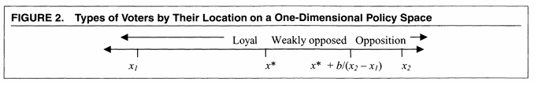
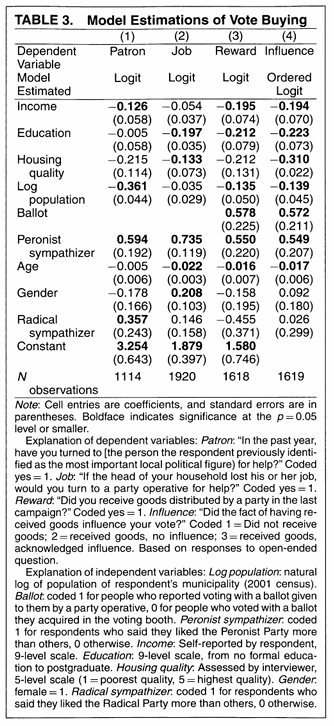
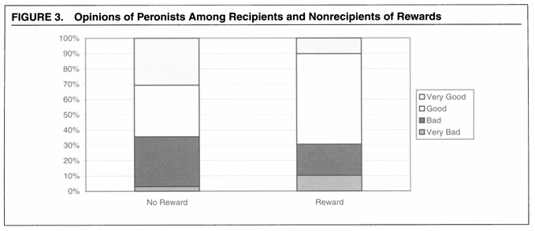

El capítulo anterior mostró cómo la valoración del futuro y la posibilidad de apropiarse de sus beneficios modifican las decisiones presentes. Aquí extendemos ese argumento a una relación estratégica: las recompensas futuras dependen también de lo que otros actores observen y decidan hacer. El problema es explicar cuándo esa dependencia permite sostener compromisos políticos.


## El problema: ¿cómo sostener un compromiso que conviene incumplir?

Un intercambio político puede ser beneficioso para quienes participan y, aun así, fracasar. Consideremos un partido que ofrece alimentos o materiales de construcción a una persona a cambio de su apoyo electoral. El partido debe entregar el beneficio, pero la persona emite su voto en secreto. Una vez recibido el bien, podría votar por otro partido sin devolver nada. Si el partido anticipa esa conducta, tendrá pocas razones para entregar el beneficio. El intercambio enfrenta, entonces, un problema de compromiso: la promesa de votar por quien otorgó la ayuda no se puede ejecutar como un contrato ordinario.

La pregunta guía de este capítulo es: **si el voto es secreto y el partido no observa directamente la decisión del votante, ¿por qué un intercambio clientelar puede sostenerse?** La respuesta exige revisar varios supuestos que suelen introducirse en los modelos elementales de elección racional. En términos generales, se puede pensar que importará saber si los actores (i) volverán a encontrarse, (ii) cuánto saben sobre las acciones y preferencias de otros, (iii) qué represalias están realmente dispuestos a ejecutar y (iv) qué objetivos incorporan a sus funciones de utilidad. Cada uno de estos contextos puede dar forma a un problema estratégico diferente y son susceptibles de ser formulados formalmente. 

El objetivo de esta sección es aprender a **reconstruir las decisiones metodológicas de un modelo** en alguna de las líneas anteriores. Ante cada supuesto preguntaremos: 

> qué problema resuelve
> qué complejidad deja fuera
> qué resultado hace posible
> cómo podría someterse a contrastación empírica. 

La segunda parte del capítulo lo dedicaremos a trabajar en profundidad el artículo de Susan C. Stokes (2005), primero su modelo formal y luego la evidencia  utilizada para evaluar sus implicaciones.

## Repetición, castigos, información y preferencias

### Repetición: el futuro altera los incentivos presentes

Consideremos primero un dilema del prisionero en términos formales. Cada jugador $i$ debe escoger entre **cooperar** ($C$) o **desertar** ($D$). La utilidad que obtiene de cada acción depende también de lo que decida el otro jugador, $j$. Podemos representar esta dependencia mediante $U_i(a_i \mid a_j)$, donde $a_i$ es la acción escogida por el jugador $i$ y $a_j$ la acción del otro jugador.

Los pagos posibles son:

$$
\begin{aligned}
U_i(C\mid C)&=R &&\text{(recompensa por cooperación mutua)}\\
U_i(D\mid C)&=T &&\text{(beneficio de desertar)}\\
U_i(D\mid D)&=P &&\text{(castigo por deserción mutua)}\\
U_i(C\mid D)&=S &&\text{(pago de quien coopera unilateralmente)}
\end{aligned}
$$

Un dilema del prisionero satisface la siguiente condición:

$$
T>R>P>S.
$$

Estas desigualdades hacen que desertar sea individualmente óptimo cualquiera sea la acción del otro. Si el jugador $j$ coopera, el jugador $i$ prefiere desertar porque $U_i(D\mid C)>U_i(C\mid C)$. Si el jugador $j$ deserta, también prefiere desertar porque $U_i(D\mid D)>U_i(C\mid D)$. Por lo tanto, $D$ es una estrategia estrictamente dominante para ambos jugadores y la deserción mutua constituye el único equilibrio de Nash del juego de una sola ronda, aun cuando ambos obtendrían mayor utilidad mediante la cooperación mutua ($R>P$).

Para que esta conclusión cambie, la cooperación debe producir algún valor adicional que no está contenido en los pagos inmediatos del juego. Podemos representarlo provisionalmente mediante un término $\Delta$. Frente a un jugador que coopera, por ejemplo, la comparación deja de ser simplemente entre $U_i(D\mid C)=T$ y $U_i(C\mid C)=R$ y pasa a ser

$$
U_i(C\mid C)+\Delta \gtreqless U_i(D\mid C).
$$

Mientras $\Delta<T-R$, sigue siendo racional desertar. Si $\Delta\geq T-R$, cooperar puede transformarse en una mejor respuesta. La cuestión relevante pasa entonces a ser: **¿qué mecanismo podría generar ese $\Delta$?**

Una respuesta aparece cuando la interacción deja de ser un encuentro aislado (una ronda). Axelrod y Hamilton [@axelrodhamilton1981] muestran que, si dos individuos tienen una probabilidad suficientemente alta de volver a encontrarse, una acción presente afecta los beneficios que pueden obtener en interacciones futuras. El término $\Delta$ puede interpretarse entonces como el valor adicional de las consecuencias futuras de cooperar, en comparación con desertar. La respuesta a una acción actual puede depender de lo ocurrido antes y la cooperación puede sostenerse mediante reciprocidad, incluso sin una autoridad externa que imponga contratos.

Su conocido ejemplo, *Tit for Tat*, comienza cooperando y luego reproduce la conducta anterior del otro jugador. Los autores destacan que puede funcionar porque combina disposición inicial a cooperar, capacidad de responder a la deserción y disposición a reanudar la cooperación. La estrategia, sin embargo, no triunfa por una propiedad moral: su desempeño depende de las condiciones de interacción y de las estrategias que enfrenta. Axelrod y Hamilton estudian tanto su robustez en torneos como las condiciones para su estabilidad evolutiva.

La contribución del argumento es que nos permite ver el trade-off en juego: si incumplir hoy genera un beneficio inmediato, pero pone en riesgo una serie de beneficios futuros, la decisión relevante consiste en comparar ambos valores. La continuidad de una relación puede transformar en racional una conducta que no sería óptima en un encuentro aislado. El resultado requiere, además, algún modo de reconocer a los participantes y condicionar las respuestas a su historia.

### Horizonte temporal y castigos creíbles: ¿por qué cooperar hoy?

La repetición de una interacción puede sostener la cooperación porque las decisiones presentes afectan los beneficios que los participantes esperan obtener en el futuro. Sin embargo, esta posibilidad depende de dos condiciones distintas: **que el futuro tenga suficiente valor** y **que las respuestas anunciadas para ese futuro sean creíbles**. Para comprender por qué ambas importan, conviene comenzar con un juego secuencial sencillo.

#### Una relación de confianza que puede continuar

Imaginemos que dos personas, $i$ y $j$, tienen la oportunidad de desarrollar sucesivamente un proyecto beneficioso para ambas. Primero, $i$ decide si aporta al proyecto ($C$) o si se retira y se queda con un beneficio inmediato ($D$). Si $i$ coopera, le corresponde decidir a $j$, quien también puede cooperar o apropiarse de una ventaja inmediata y terminar la relación. Si ambos cooperan, se genera un beneficio compartido y puede abrirse una nueva oportunidad de colaborar. En la siguiente ocasión, los participantes vuelven a enfrentar decisiones semejantes.

El siguiente diagrama representa la lógica del juego. Las ramas de deserción cierran la relación; la cooperación mutua abre la posibilidad de una nueva ronda.

```{mermaid}
flowchart TD
    A{"Jugador i"}
    B{"Jugador j"}
    X["Fin: i deserta"]
    Y["Fin: j deserta"]
    Q{"¿Hay una nueva ocasión?"}
    Z["Fin de la relación"]
    A2{"Siguiente ronda: i"}
    A -->|"D"| X
    A -->|"C"| B
    B -->|"D"| Y
    B -->|"C: beneficios compartidos"| Q
    Q -->|"Probabilidad q"| A2
    Q -->|"Probabilidad 1-q"| Z
    A2 -.->|"Se repite la secuencia"| A
```

*Figura: juego secuencial ilustrativo de confianza y continuidad. Es distinto del dilema del prisionero simultáneo: aquí las acciones se eligen por turnos y la deserción termina la relación. Lo utilizamos para hacer visible la estructura temporal, antes de volver al dilema del prisionero repetido.*

La pregunta es qué sucedería si ambos supieran con certeza que existen exactamente dos o tres oportunidades de colaborar. Si en la última ocasión desertar resulta individualmente más rentable que cooperar, ninguno puede confiar en una recompensa futura que discipline esa decisión. El jugador que actúa al final preferirá desertar. Anticipando esto, el jugador anterior tampoco encontrará conveniente realizar el aporte que lo deja expuesto a esa deserción. El mismo razonamiento se aplica a la penúltima ocasión y, sucesivamente, a todas las anteriores.

Este procedimiento se denomina **inducción hacia atrás** ( *backward induction* ). En un juego con horizonte finito y conocido, si cada ronda reproduce un dilema del prisionero y la última ronda no incorpora otros incentivos, la deserción es el único equilibrio en la etapa final. Aplicando el argumento hacia atrás, la deserción se impone en todas las rondas. Conclusión: la repetición, por sí sola, no resuelve el problema de cooperación.

#### Cuando el final no se conoce

Ahora supongamos que, después de cada ronda, existe una probabilidad $q>0$ de que la relación continúe. Ninguno de los participantes sabe cuál será la última interacción. Si además los agentes descuentan el futuro a una tasa representada por un factor $\beta$, con $0<\beta\leq 1$, el peso efectivo de los pagos de la ronda siguiente es

$$
\delta=\beta q.
$$

El factor $\delta$ reúne dos razones por las cuales un pago futuro puede valer menos que uno presente: la preferencia temporal y la posibilidad de que la relación termine antes de recibirlo. La condición $q>0$ abre la posibilidad de la cooperación, pero no la garantiza. Para que la reciprocidad discipline la conducta presente, $\delta$ tiene que ser suficientemente alto.

Volvamos entonces al dilema del prisionero definido anteriormente, con pagos $T>R>P>S$. Supongamos que ambos participantes siguen esta estrategia: cooperar mientras el otro haya cooperado y, si alguno deserta, desertar en todas las rondas posteriores. Esta regla se conoce como *grim trigger* (castigo permanente). Como primera aproximación, supongamos que las acciones son observables y que la relación continúa con la misma probabilidad $q$ después de cada ronda, incluso si hubo una deserción.

Si ambos cooperan indefinidamente mientras la relación continúa, el valor esperado de los pagos para cada uno es

$$
V_C=R+\delta R+\delta^2R+\cdots=\frac{R}{1-\delta}.
$$

Si uno deserta cuando el otro coopera, obtiene $T$ inmediatamente, pero provoca que en las siguientes rondas ambos reciban $P$:

$$
V_D=T+\delta P+\delta^2P+\cdots
=T+\frac{\delta P}{1-\delta}.
$$

Para que cooperar sea una respuesta óptima frente a la cooperación del otro, debe cumplirse $V_C\geq V_D$. Reordenando,

$$
\frac{R}{1-\delta}\geq T+\frac{\delta P}{1-\delta}
\quad\Longleftrightarrow\quad
\boxed{\delta\geq\frac{T-R}{T-P}}.
$$

La expresión tiene una interpretación económica directa. El numerador, $T-R$, mide la **ganancia inmediata de desertar**. El denominador, $T-P$, refleja la diferencia entre aprovechar la cooperación ajena hoy y quedar expuesto al resultado de deserción mutua en adelante. Cuanto mayor sea la ganancia inmediata de desertar, más alto debe ser el peso asignado al futuro para sostener la cooperación. Cuanto más costoso sea perder la relación cooperativa, más fácil será disciplinar la conducta presente.

Si no existe descuento temporal adicional ($\beta=1$), la condición se expresa directamente en términos de la probabilidad de continuidad:

$$
q\geq\frac{T-R}{T-P}.
$$

Por ejemplo, si $T=5$, $R=3$, $P=1$ y $S=0$, la cooperación puede sostenerse bajo esta estrategia cuando $\delta\geq 1/2$. Si $\beta=1$, basta una probabilidad de continuidad de al menos $1/2$. Si $\beta<1$, la probabilidad requerida será mayor. Este resultado exhibe de manera precisa de dónde proviene el término adicional $\Delta$ introducido anteriormente: corresponde al valor relativo de mantener la cooperación futura en lugar de activar la trayectoria de castigo.

#### Castigar también debe ser racional

La condición anterior compara el beneficio de cooperar con el de desviarse. Pero un equilibrio requiere verificar también **qué hará cada jugador una vez que efectivamente ocurra una desviación**. De poco sirve anunciar un castigo si, al llegar el momento de aplicarlo, quien debe ejecutarlo prefiere renunciar a él.

En el ejemplo de *grim trigger*, después de una deserción ambos juegan $D$ para siempre. Como $D$ es una mejor respuesta a $D$ en el dilema del prisionero original ($P>S$), ninguno tiene incentivos para cooperar unilateralmente durante la fase de castigo. La amenaza es, por tanto, creíble. Siempre que se satisfaga la condición sobre $\delta$, la estrategia constituye un **equilibrio perfecto en subjuegos**: prescribe acciones óptimas tanto antes como después de cualquier desviación.

Este ejemplo permite distinguir dos preguntas que toda explicación de cooperación repetida debe responder. Primero, ¿es suficientemente valiosa la continuidad de la relación para disuadir la deserción inicial? Segundo, ¿son racionales las conductas que los participantes prometen adoptar si alguien incumple? Ambas preguntas son necesarias para sostener el equilibrio.

#### Abreu: diseñar trayectorias de castigo creíbles

Abreu [@abreu1986] profundiza en la segunda pregunta al analizar juegos oligopólicos repetidos. En lugar de limitarse a un castigo permanente, estudia cómo diseñar **trayectorias de castigo suficientemente severas y, al mismo tiempo, compatibles con los incentivos de quienes deben ejecutarlas**. Su análisis caracteriza, bajo las condiciones de su modelo, castigos óptimos con una estructura de *stick and carrot*: una fase de castigo intenso seguida de una recompensa asociada al retorno a una trayectoria más favorable. <https://doi.org/10.1016/0022-0531(86)90025-6>

La idea es que castigar puede implicar costos para el propio castigador. Una fase excepcionalmente severa puede resultar sostenible si la continuación prometida compensa a los participantes y si, en cada momento, nadie gana desviándose de la trayectoria prevista. Por eso la credibilidad debe comprobarse sobre **todo el plan de continuación**, incluido el comportamiento durante el castigo y el retorno posterior a la cooperación.

Conviene distinguir esta contribución de una regla que castiga una desviación solo con cierta probabilidad. En el modelo básico de *grim trigger* el castigo se activa con certeza tras una deserción observada. Una probabilidad de castigo inferior a uno puede introducirse como una extensión del ejemplo, pero no define por sí sola el mecanismo *stick and carrot* de Abreu. Si el castigo es incierto, además de la continuidad de la relación importa la probabilidad de detectar y sancionar una desviación y el valor esperado de la sanción.

La conclusión general es que la cooperación repetida requiere una estructura temporal y estratégica precisa. Debe existir la posibilidad de futuras interacciones, esas interacciones deben tener suficiente valor y las respuestas anunciadas para después de una desviación deben constituir decisiones racionales cuando llegue el momento de ejecutarlas. **La amenaza funciona porque modifica los incentivos de hoy mediante un futuro que los propios jugadores tienen razones para hacer efectivo.**

### Preferencias sociales: ¿qué entra en una función de utilidad?

Hasta ahora hemos considerado mecanismos que permiten sostener la cooperación entre individuos que persiguen sus propios beneficios. La repetición modifica los incentivos porque una decisión presente afecta las oportunidades futuras. Existe, sin embargo, otra posibilidad: que los individuos incorporen directamente el bienestar de otras personas entre los argumentos de su función de utilidad.

En su forma más simple, podemos representar las preferencias de un individuo $i$ mediante una función de utilidad que depende exclusivamente de sus propios beneficios:

$$
U_i = u_i(x_i),
$$

donde $x_i$ representa los beneficios que recibe. Bajo esta formulación, el bienestar de otros individuos solo importa en la medida en que afecte los beneficios de $i$.

Podemos ampliar la función incorporando directamente el bienestar de otro individuo $j$:

$$
U_i = u_i(x_i) + \alpha_i u_j(x_j).
$$

El parámetro $\alpha_i$ representa el peso que el individuo $i$ asigna a la utilidad del otro. Si $\alpha_i=0$, sus preferencias son estrictamente egoístas en este sentido. Si $\alpha_i>0$, el bienestar del otro contribuye positivamente a su propia utilidad. Si $\alpha_i<0$, el individuo obtiene una utilidad menor cuando aumenta el bienestar del otro, manteniendo constante todo lo demás.

Esta modificación puede alterar las predicciones de un juego sin cambiar sus reglas, su secuencia ni los beneficios materiales que reciben los jugadores. Consideremos nuevamente el dilema del prisionero. Si cada individuo incorpora los pagos materiales del otro en su utilidad, la comparación entre cooperar y desertar, cuando el otro coopera, pasa a ser:

$$
\begin{aligned}
U_i(C\mid C)&=R+\alpha_i R,\\
U_i(D\mid C)&=T+\alpha_i S.
\end{aligned}
$$

Cooperar será al menos tan atractivo como desertar cuando:

$$
R+\alpha_i R\geq T+\alpha_i S,
$$

es decir,

$$
\alpha_i\geq\frac{T-R}{R-S}.
$$

El resultado es importante: una decisión que antes estaba estrictamente dominada puede convertirse en racional si el individuo asigna suficiente valor al bienestar del otro. La cooperación deja de requerir necesariamente una amenaza de castigo futuro. Puede surgir de las propias preferencias de los jugadores.

Naturalmente, para que la cooperación mutua constituya un equilibrio de Nash, esta condición debe cumplirse para ambos individuos.

#### Una aplicación: altruismo y asignación de recursos públicos

Finan y Mazzocco [@finanmazzocco2021] incorporan este mecanismo en un modelo de decisiones de legisladores brasileños que distribuyen fondos públicos entre municipios. Cada legislador dispone de un presupuesto y debe decidir cómo asignarlo, considerando que esas decisiones afectan tanto sus posibilidades de reelección como el bienestar de los ciudadanos.

Los autores permiten que los legisladores asignen distinta importancia a ambos objetivos. Una representación simplificada de su formulación es:

$$
U_i(q)=(1-\beta_i)p_i(q)+\beta_i W(q),
$$

donde $q$ representa la distribución de recursos, $p_i(q)$ la probabilidad de reelección del legislador $i$, $W(q)$ el bienestar agregado de la población y $\beta_i$ el peso relativo que el legislador asigna a este último componente. Esta expresión omite los costos de competir y los shocks de preferencias presentes en el modelo completo.

Cuando $\beta_i$ es pequeño, el legislador tiene incentivos para dirigir recursos hacia municipios que ofrecen mayores retornos electorales. Cuando $\beta_i$ es mayor, adquiere importancia asignar fondos hacia lugares donde producen mayores ganancias de bienestar, incluso si allí existen pocos votantes.

La decisión de modelación es sustantiva. Los autores permiten que distintos legisladores tengan diferentes valores de $\beta_i$ y estiman esa heterogeneidad a partir de sus decisiones. En particular, distinguen tipos relativamente egoístas y altruistas. Esto les permite explicar por qué algunos legisladores concentran recursos en municipios electoralmente atractivos mientras otros favorecen territorios donde el rendimiento social de los recursos es mayor.

El modelo incorpora además decisiones de postulación a la reelección, competencia entre legisladores e incertidumbre acerca de las características de sus rivales. Estos elementos permiten contrastar distintas explicaciones de las asignaciones observadas.

#### El problema metodológico: explicar una conducta mediante las preferencias

La incorporación de preferencias sociales abre una cuestión fundamental para la teoría de la elección racional. En principio, una función de utilidad puede incluir cualquier dimensión que el individuo valore: consumo, poder, prestigio, bienestar ajeno, reconocimiento, identidad o cumplimiento de normas. La racionalidad exige consistencia en la elección respecto de esas preferencias, pero por sí sola no determina cuáles deben ser sus contenidos.

Esta flexibilidad tiene ventajas. Permite representar motivaciones heterogéneas sin abandonar el supuesto de que los actores eligen las alternativas que consideran mejores. Al mismo tiempo, introduce un riesgo: **incorporar en las preferencias precisamente aquello que se intenta explicar**.

Supongamos que observamos que un individuo coopera aun cuando hacerlo reduce sus beneficios materiales. Podemos explicar esa decisión postulando que el individuo obtiene utilidad de cooperar. Sin embargo, si la existencia de esa preferencia se deduce exclusivamente de la misma conducta que buscamos explicar, el modelo ofrece poca información adicional. La cooperación queda racionalizada mediante un supuesto construido a partir del resultado observado.

El problema se vuelve más evidente si permitimos modificar libremente la función de utilidad después de conocer las decisiones. Prácticamente cualquier comportamiento podría interpretarse como óptimo bajo alguna especificación de preferencias. La teoría perdería capacidad para generar predicciones que puedan ser refutadas.

Por eso, una cuestión central es cómo justificamos la introducción de un nuevo argumento o parámetro en la función de utilidad. Hay al menos dos caminos complementarios. Podemos buscar evidencia independiente que permita identificar las preferencias y luego utilizarlas para predecir decisiones en otros contextos. También podemos desarrollar una explicación de cómo esas preferencias se forman, por ejemplo, mediante procesos de socialización, aprendizaje o interacción institucional.

Finan y Mazzocco permiten ilustrar tanto las ventajas como las limitaciones de incorporar preferencias sociales en un modelo. Los autores evitan una racionalización puramente circular al imponer restricciones sobre las decisiones de los legisladores y utilizar diferencias observables entre quienes buscan la reelección y quienes no lo hacen para estimar el peso relativo de los incentivos electorales y altruistas. Sin embargo, esta identificación depende de supuestos sustantivos, especialmente que los legisladores que no buscan reelegirse asignan recursos exclusivamente en función del bienestar social. Si otras motivaciones producen patrones similares de asignación, los parámetros estimados como altruismo podrían estar capturando mecanismos diferentes. El artículo ilustra así una distinción metodológica importante: estimar preferencias a partir de decisiones observadas permite explicar y predecir comportamientos bajo ciertos supuestos, pero no demuestra por sí mismo el origen ni la naturaleza de esas preferencias. La fortaleza de la explicación depende de las restricciones que impone el modelo y de nuestra capacidad para distinguir empíricamente entre mecanismos alternativos.

¿Cuál es la lección metodológica? **Agregar preferencias sociales puede enriquecer un modelo, siempre que su incorporación genere restricciones empíricas y permita distinguir entre explicaciones alternativas**. Si diferentes mecanismos generan exactamente las mismas predicciones observables, introducir un nuevo parámetro de preferencias puede aumentar la flexibilidad del modelo sin aumentar proporcionalmente su capacidad explicativa.

### Información imperfecta: observar acciones y conocer tipos de actores/jugadores son problemas diferentes

Hasta ahora hemos identificado dos maneras de modificar los incentivos individuales. La primera consiste en introducir consecuencias futuras de las decisiones presentes. La segunda amplía los beneficios que los individuos valoran, incorporando el bienestar de otros actores. Existe una tercera dimensión: las decisiones también dependen de lo que cada individuo sabe acerca de las acciones y características de los demás.

Para introducir este problema conviene distinguir dos situaciones.

La primera ocurre cuando los jugadores conocen la estructura del juego y las preferencias de los demás, pero no pueden observar perfectamente sus decisiones. Es un problema de **información imperfecta sobre acciones** ( *moral hazard problems* ).

Supongamos que un individuo $i$ debe decidir si mantiene una relación cooperativa con $j$, pero no puede observar directamente si este último cumplió su compromiso. En cambio, recibe una señal $s$ cuya distribución depende de la acción efectivamente realizada:

$$
\Pr(s\mid a_j).
$$

Si las señales son informativas, su distribución será diferente dependiendo de si $j$ coopera o deserta. La decisión de sancionar una desviación dependerá entonces de lo que $i$ pueda inferir a partir de esas señales.

La segunda situación ocurre cuando un jugador desconoce características relevantes de los otros participantes, como sus preferencias, capacidades o motivaciones. Es un problema de **información incompleta sobre tipos** ( *adverse selection problems* ).

Podemos representar estas características mediante un parámetro $\theta_j$, conocido por el jugador $j$, pero no necesariamente por $i$. Este último debe actuar sobre la base de una creencia acerca de los posibles valores de ese parámetro:

$$
\Pr(\theta_j).
$$

En este contexto, las estrategias de los jugadores dependen tanto de sus propias preferencias como de sus creencias acerca de las preferencias de los demás.

Finan y Mazzocco incorporan precisamente este segundo problema. Los legisladores desconocen el grado de altruismo y el atractivo electoral de sus competidores. Al decidir dónde asignar recursos, deben anticipar las decisiones de otros legisladores sin conocer completamente sus características. Esta incertidumbre genera distorsiones adicionales en la distribución de fondos públicos.

Stokes [@stokes2005], por su parte, permite estudiar un problema diferente y especialmente relevante para las relaciones clientelares. Un partido político puede entregar beneficios a determinados votantes, pero enfrenta una dificultad fundamental: el voto es secreto y, por tanto, no puede verificar directamente si quienes reciben esos beneficios cumplen con el intercambio esperado.

La organización política puede, sin embargo, obtener información sobre las inclinaciones electorales de sus interlocutores mediante intermediarios insertos en redes sociales locales. Aunque el voto individual permanece oculto, esas redes permiten elaborar inferencias sobre el comportamiento de los votantes y condicionar las decisiones futuras de asignación de beneficios.

En suma, cuando desconocemos las preferencias de otro jugador, el problema consiste en anticipar qué hará. Cuando no podemos observar su acción, el problema consiste en determinar si efectivamente hizo aquello que esperábamos. Ambos problemas pueden coexistir, pero afectan de manera diferente la estructura de incentivos de los participantes en la interacción bajo escrutinio.

Con ello regresamos a la pregunta que organiza esta sesión: **si el voto es secreto y el partido no puede observar directamente la decisión del votante, ¿cómo puede sostenerse una relación clientelar?**

La repetición de las interacciones puede generar incentivos para cumplir, pero la eficacia de esos incentivos depende de la información disponible para identificar posibles desviaciones. El modelo de Stokes permite estudiar cómo los partidos intentan resolver esta dificultad y por qué ciertos votantes resultan más atractivos que otros para establecer relaciones clientelares. Este será el problema que analizaremos a continuación, primero mediante la construcción del modelo teórico y luego examinando su implementación empírica.

## El problema de investigación de Stokes (2005)

En *Perverse Accountability: A Formal Model of Machine Politics with Evidence from Argentina*, Susan C. Stokes [@stokes2005] estudia cómo un partido clientelar puede comprar apoyo electoral cuando el voto es secreto. El punto de partida no es explicar por qué los votantes necesitan recursos, sino cómo puede cumplirse un intercambio que cada parte tendría incentivos para incumplir después de recibir lo que desea. La autora observa que parte de la literatura sobre distribución electoral de recursos daba por supuesto, de manera explícita o implícita, que el partido cumpliría con las recompensas prometidas y que estas tendrían efectos sobre el voto. Esas premisas dejan pendiente el problema estratégico central.

La autora denomina **rendición de cuentas perversa** (*perverse accountability*) a una inversión del mecanismo convencional de responsabilidad democrática. En la rendición de cuentas democrática, el votante observa o infiere el desempeño del gobernante y lo premia o castiga. En su versión perversa, la organización política intenta inferir la conducta electoral del votante y condicionar recompensas o sanciones a ella. El objetivo del artículo es mostrar bajo qué condiciones puede funcionar esa relación y qué votantes serán seleccionados para recibir beneficios.

Una observación orienta el modelo: las maquinarias tienen recursos escasos y deben decidir **a quién entregar beneficios**. No necesariamente resulta rentable entregar ayudas a quienes ya votarían por el partido; tampoco a quienes no cambiarían su voto bajo ninguna circunstancia. Esta intuición llevará a una predicción diferenciada acerca de los destinatarios.

## Parte teórica: las decisiones que construyen el modelo

### Decisión 1. Elegir los jugadores y simplificar la competencia

Stokes reduce el problema a la interacción entre una **máquina política** y un **votante**. La competencia electoral aparece como una elección entre dos partidos con posiciones ideológicas distintas. El partido clientelar puede ofrecer un beneficio privado, mientras que la persona puede votar por él o por su oponente.

¿Por qué este recorte? Permite estudiar el compromiso entre quienes negocian un beneficio sin modelar al mismo tiempo todos los partidos, sus coaliciones y las asignaciones presupuestarias agregadas. La simplificación hace posible derivar condiciones precisas para que un individuo acepte y cumpla el intercambio. Su costo es igualmente claro: el modelo no desarrolla la competencia simultánea entre distintas máquinas que ofrecen beneficios a un mismo votante.

### Decisión 2. Especificar las preferencias y la utilidad del voto

La autora sitúa las posiciones ideológicas de los partidos en un espacio unidimensional: el partido clientelar en $x_1$ y su oponente en $x_2$, con $x_1<x_2$. Cada votante tiene una posición ideal $x_i$. El punto medio entre partidos se define como:

$$
x^*=\frac{x_1+x_2}{2}.
$$

Su utilidad por elegir una alternativa $v_i\in\{x_1,x_2\}$ combina la distancia respecto de su posición ideal con un posible beneficio privado:

$$
U_i(v_i,b_i)=-\frac{1}{2}(v_i-x_i)^2+b_i,
$$

con $b_i\in\{0,b\}$ y $b>0$. La expresión cuadrática es una single peaked preference y el beneficio privado suma utilidad si se recibe. La decisión metodológica hace conmensurables dos componentes: la satisfacción derivada de expresar una preferencia política y el valor de un bien particularista.

Sin transferencia, un votante a la izquierda del punto medio prefiere a la máquina y uno a la derecha prefiere a la oposición. Para alguien situado a la derecha del punto medio, la pérdida ideológica de votar por la máquina, expresada respecto de votar por la oposición, es:

$$
\begin{aligned}
d_i
&=\frac{1}{2}\big[(x_1-x_i)^2-(x_2-x_i)^2\big]\\
&=(x_2-x_1)(x_i-x^*).
\end{aligned}
$$

Esta transformación es útil porque permite formular la decisión como una comparación entre una **compensación privada $b$** y un **costo ideológico $d_i$**. Cuanto más lejos está el votante de la máquina, mayor compensación requeriría.

### Decisión 3. Construir primero el juego de una sola ronda

Stokes identifica tres tipos de votantes según su ubicación ideológica y respuesta potencial al beneficio:

- **Leales:** $x_i<x^*$. Prefieren la máquina incluso sin recibir beneficios.
- **Débilmente opositores:** $x^*<x_i<x^*+b/(x_2-x_1)$. Sin beneficio prefieren la oposición, pero la transferencia puede hacer atractivo votar por la máquina.
- **Opositores firmes:** $x_i>x^*+b/(x_2-x_1)$. El valor del beneficio es insuficiente para compensar su distancia ideológica.

La autora presenta una matriz simplificada para el intercambio con un votante débilmente opositor:

| Decisión del votante | Máquina entrega beneficio | Máquina no entrega beneficio |
|:--|:--:|:--:|
| Cumple (vota por la máquina) | $(3,3)$ | $(1,4)$ |
| Incumple (vota por la oposición) | $(4,1)$ | $(2,2)$ |

*En cada casilla aparece primero la utilidad del votante y luego la de la máquina. La matriz reproduce el cuadro 2 del artículo.*

En una interacción aislada, aceptar el beneficio y votar por el otro partido resulta atractivo para el votante. El partido anticipa ese oportunismo y preferiría no pagar por un voto que no recibirá. La matriz permite ver con claridad **por qué hace falta cambiar la estructura temporal del juego**. También muestra por qué el mecanismo se centra en los votantes débilmente opositores: los leales y los opositores firmes plantean problemas estratégicos diferentes.

### Decisión 4. Repetir indefinidamente la relación

Para superar ese resultado estático, Stokes supone que la relación continúa durante un horizonte indefinido. Este supuesto no significa que en la realidad haya infinitas elecciones; significa que ninguno de los actores conoce una fecha terminal segura a partir de la cual desaparezcan las consecuencias futuras. La continuidad resulta plausible si las organizaciones partidarias permanecen insertas en comunidades y mantienen relaciones con sus votantes durante largos períodos.

La autora asume también que la máquina puede seguir distribuyendo beneficios aunque pierda una elección. Es un supuesto sustantivo, no meramente técnico: si el partido dejara de contar con recursos al perder, cambiaría el valor esperado de continuar cooperando y la relación repetida podría interrumpirse.

La preferencia temporal del votante se recoge mediante un **factor de descuento** $\delta\in[0,1)$. Un $\delta$ elevado significa que el votante concede mayor importancia a las recompensas futuras. No debe confundirse este factor de descuento con la probabilidad de observar una desviación, que definiremos a continuación.

### Decisión 5. Introducir incertidumbre unilateral sobre el voto

El secreto del voto impide que el partido observe perfectamente la conducta electoral. Stokes no elimina ese obstáculo: supone que la máquina puede identificar una defección con probabilidad $p\in[0,1]$. El votante, en cambio, observa si recibe o no el beneficio. La incertidumbre es por tanto **unilateral** respecto de la acción realizada en cada intercambio.

Esta decisión hace que las redes locales importen causalmente. La relación personal entre operador político y votante permite adquirir información sobre inclinaciones partidarias, declaraciones públicas, participación y entorno social. Ninguna señal equivale necesariamente a observar la papeleta. Lo relevante es la posibilidad de construir inferencias que afecten la expectativa de sanción del votante.

La diferencia entre $p=0$ y $p>0$ es fundamental: con monitoreo nulo, la desviación electoral no puede activar una sanción dependiente del voto; con monitoreo positivo, el riesgo de perder la relación modifica el incentivo.

### Decisión 6. Escoger una regla contingente de castigo

La autora utiliza una estrategia tipo **grim trigger**: una defección detectada provoca el abandono permanente de la cooperación. El esquema es: mientras hay cooperación, el partido entrega el beneficio y el votante lo apoya; si el partido detecta un voto contrario, corta la entrega futura. La amenaza de retirar bienes permite disciplinar el comportamiento actual.

Esta selección cumple una función analítica. Permite representar con sencillez el costo máximo de perder una relación clientelar estable. Stokes presenta testimonios de operadores para mostrar la plausibilidad de una exclusión persistente. De todos modos, la existencia de esa estrategia no demuestra que todas las redes políticas realmente se comporten así ni que sea la única estrategia de equilibrio. Aquí debemos recordar la lección de Abreu: el castigo tiene que resultar creíble dentro del juego completo.

### Decisión 7. Derivar la restricción de incentivos

Consideremos a un votante débilmente opositor. Su preferencia electoral sin transferencia favorece a la oposición, pero recibe una utilidad privada $b$ si la máquina le entrega un beneficio. Para simplificar la derivación, restemos a todos los resultados el beneficio ideológico de votar por la oposición, que utilizaremos como referencia de utilidad cero. Así, votar por la máquina tiene un costo ideológico $d_i>0$ y recibir el beneficio suma $b$.

Si el votante cumple siempre con el acuerdo, su valor esperado es:

$$
V_C=(b-d_i)+\delta(b-d_i)+\delta^2(b-d_i)+\cdots
=\frac{b-d_i}{1-\delta}.
$$

Si acepta el beneficio hoy y vota por la oposición, obtiene $b$ en el período presente. Con probabilidad $1-p$, la desviación no se detecta y la relación cooperativa puede continuar; con probabilidad $p$, se detecta, se pierden los beneficios posteriores y el votante vuelve a su alternativa ideológica preferida. Bajo esta estrategia contingente, el valor de desviarse una vez es:

$$
V_D=b+\delta(1-p)\frac{b-d_i}{1-\delta}.
$$

Para que cumplir sea racional, necesitamos $V_C\geq V_D$. Sustituyendo y reordenando:

$$
\frac{b-d_i}{1-\delta}
\geq b+\delta(1-p)\frac{b-d_i}{1-\delta},
$$

$$
(1-\delta+\delta p)(b-d_i)\geq(1-\delta)b,
$$

$$
d_i\leq \frac{\delta p}{1-\delta+\delta p}\,b.
$$

Definamos:

$$
\lambda=\frac{\delta p}{1-\delta+\delta p}.
$$

La condición de incentivos es entonces $d_i\leq\lambda b$. Reemplazando $d_i=(x_2-x_1)(x_i-x^*)$, obtenemos la restricción del votante para que el intercambio pueda sostenerse:

$$
\boxed{\quad x^*<x_i\leq x^*+\lambda\frac{b}{x_2-x_1}\quad}
$$

(con las desigualdades estrictas de la presentación original cuando se consideran tipos y preferencias estrictas). Esta es la intuición central de la ecuación (2) de Stokes; la @fig-stokes2005-fig2 ilustra la ubicación de los tipos de votantes en el espacio ideológico. El beneficio que permitiría cambiar el voto en una sola ronda sólo se convierte en un intercambio repetido sostenible para un subconjunto de votantes: quienes están suficientemente cerca del punto medio para que el valor descontado de los beneficios, ponderado por el riesgo de detección, compense su pérdida ideológica.

{#fig-stokes2005-fig2 fig-align="center" width="100%"}

**Verificación de la lógica:** si $p=0$ o $\delta=0$, entonces $\lambda=0$; no hay margen para comprar de manera sostenible el voto de alguien estrictamente predispuesto contra la máquina. Si aumentan $p$ o $\delta$, crece el conjunto de votantes débilmente opositores con los que el acuerdo es sostenible. Esta es una conclusión sobre el mecanismo formal, no una observación directa sobre comportamientos reales.

Esta derivación verifica los incentivos del votante, dadas las transferencias y la regla de castigo. Un equilibrio completo requiere verificar también los incentivos de la máquina para entregar los beneficios y ejecutar el castigo. La desigualdad no sustituye esas condiciones. Las sumas geométricas utilizadas requieren $\delta<1$; la paciencia extrema se interpreta como un límite. Además, esta representación supone que no hay falsos positivos en la detección de desviaciones.

### Decisión 8. Deducir a quién conviene ofrecer beneficios

El resultado delimita tres perfiles estratégicos. Los **leales** respaldarían al partido sin transferencia, de modo que su amenaza de castigar al partido retirándole su voto si no reciben beneficios carece de credibilidad en el modelo. Los **opositores firmes** no aceptan intercambiar su voto bajo las condiciones relevantes, porque el beneficio es insuficiente. Los **débilmente opositores**, en cambio, podrían modificar su voto a cambio del bien y cuentan con una alternativa política creíble si dejan de recibirlo.

Esta es una predicción importante: una máquina con recursos escasos buscará especialmente votantes cuya conducta puede modificarse y verificarse suficientemente bien. **Ser pobre o ser partidario del partido no basta por sí solo para identificar al destinatario óptimo**. Importan simultáneamente el valor relativo del beneficio, la distancia ideológica, la relación futura y la capacidad de monitoreo.

### Decisión 9. Obtener predicciones contrastables

Stokes identifica cuatro implicaciones comparativas del modelo:

1. **Proximidad ideológica entre los partidos.** Si disminuye $x_2-x_1$, baja el costo ideológico relativo de cambiar el voto y se amplía el conjunto potencialmente clientelizable.
2. **Valor del beneficio privado.** Un $b$ más alto, en relación con el costo ideológico, vuelve viable el intercambio para más votantes. Con utilidad marginal decreciente del ingreso, bienes relativamente pequeños pueden ser especialmente valiosos para personas de menores recursos.
3. **Capacidad de monitoreo.** Un $p$ más alto fortalece la amenaza de retirar beneficios futuros y favorece intercambios sostenibles.
4. **Tipo de votante.** Entre los votantes sobre los que la máquina dispone de información, la predicción distintiva apunta a personas indiferentes o débilmente opositoras, antes que a leales incondicionales u opositores firmes.

Conviene identificar aquí un paso metodológico decisivo: estas predicciones se deducen del modelo antes de observar las regresiones. La evaluación empírica debe buscar medidas que representen $b$, $p$ y la posición política $x_i$, sin confundir los conceptos teóricos con sus indicadores imperfectos.

## Parte empírica: cómo Stokes pone a prueba el modelo

### Del mecanismo formal a preguntas de encuesta

El artículo utiliza principalmente una encuesta a **1.920 personas**, realizada entre diciembre de 2001 y enero de 2002 en áreas de las provincias de Buenos Aires, Córdoba y Misiones, además de Mar del Plata. El diseño utiliza muestreo multietápico por conglomerados. El estudio complementa las encuestas con entrevistas a operadores y votantes, observaciones sobre procedimientos electorales y una encuesta distinta de 2003 que explora percepciones de la observabilidad del voto.

La elección de encuestar individuos responde a una dificultad metodológica importante: observar que un municipio recibe más recursos y vota más por un partido no muestra que **los mismos individuos** que recibieron bienes hayan condicionado su comportamiento electoral a ellos. La encuesta acerca el análisis al nivel individual que exige el modelo, aunque introduce problemas de declaración y medición.

Stokes no observa directamente la variable $p$ para cada votante ni identifica sus posiciones $x_i$ en una escala ideológica continua. Recurre a indicadores indirectos de monitoreo y predisposición partidaria. Tampoco se observa el verdadero voto individual secreto. Por eso es preciso distinguir evidencia consistente con el mecanismo y una prueba directa de todas sus relaciones causales.

### Operacionalización: qué se mide y qué representa

La **tabla 3 del artículo**, reproducida en la @fig-stokes2005-table3, presenta cuatro variables dependientes que representan distintas dimensiones de una relación clientelar:

| Variable | Pregunta o codificación | Qué aporta al análisis |
|---|---|---|
| `Patron` | Si el encuestado recurrió durante el último año a una figura política local para solicitar ayuda (sí/no). | Dependencia de intermediación política. |
| `Job` | Si recurriría a un operador político en caso de desempleo del principal sostén del hogar (sí/no). | Expectativa de apoyo futuro. |
| `Reward` | Si recibió bienes distribuidos por algún partido en la última campaña (sí/no). | Exposición declarada a transferencias particularistas. |
| `Influence` | Categoría ordinal: no recibió bienes; recibió bienes sin influencia declarada; recibió bienes y reconoció influencia en el voto. | Autorreporte de respuesta electoral al beneficio. |

La autora estima modelos **logit** para `Patron`, `Job` y `Reward`, y un **logit ordenado** para `Influence`. La última medida impone un orden sobre tres situaciones distintas; su codificación hace que recibir un bien forme parte de la clasificación de la respuesta, por lo que no puede interpretarse simplemente como una medida directa de cambio causal de voto entre receptores.

{#fig-stokes2005-table3 fig-align="center" width="500px"}

Entre las variables explicativas figuran ingreso autodeclarado, educación, calidad de la vivienda, tamaño poblacional municipal, recepción de una papeleta suministrada por un operador partidario, simpatía por el peronismo y controles sociodemográficos. Es una combinación de indicadores de situación socioeconómica, organización política y oportunidades de monitoreo.

### Hipótesis 1. ¿La necesidad económica facilita el intercambio?

El modelo indica que los beneficios privados tendrán mayor poder de incentivo para quienes los valoran más intensamente en términos de utilidad marginal. Stokes emplea **ingreso, educación y calidad de la vivienda** como indicadores complementarios de posición socioeconómica. No son medidas idénticas: la educación puede captar recursos y oportunidades de más largo plazo, y la calidad de la vivienda introduce una evaluación del entrevistador.

Los resultados de la tabla 3 muestran asociaciones negativas entre estos indicadores y distintas manifestaciones declaradas del clientelismo. La autora interpreta el patrón como consistente con una mayor incidencia de relaciones clientelares entre personas de menores recursos. Presenta también probabilidades simuladas de recibir recompensas que difieren marcadamente entre perfiles socioeconómicos extremos, manteniendo constantes otras características.

**Decisión metodológica a discutir:** la teoría habla de utilidad marginal de un beneficio ($b$); la regresión estima asociaciones entre indicadores socioeconómicos y recepción o influencia declarada de bienes. El puente interpretativo es razonable, pero no constituye una medición directa de la utilidad individual de cada transferencia.

### Hipótesis 2. ¿La organización partidaria permite monitorear?

El argumento del modelo requiere que una maquinaria política pueda adquirir información sobre sus votantes y sostener relaciones repetidas. Stokes identifica al peronismo como la organización argentina que mejor corresponde a la estructura territorial descentralizada descrita por su teoría. Las respuestas a la encuesta indican que el peronismo es el partido más mencionado como distribuidor de bienes en los barrios investigados.

La autora utiliza ese resultado, junto con entrevistas y conocimiento del funcionamiento territorial de los partidos, como evidencia del papel organizacional. Nótese que **no se cuenta con una medida directa e individual del costo de monitorear**. La estructura organizacional opera como argumento institucional acerca de por qué ciertas organizaciones deberían observar mejor a los votantes ( *Peronist sympathizer*, *ballot* y *Log population* ).

Este hallazgo también admite interpretaciones alternativas. Un partido territorialmente extenso puede entregar bienes más eficazmente por tener mejores redes de distribución, aun sin monitorear el voto. La autora reconoce esta diferencia e intenta aproximarse más directamente al mecanismo mediante indicadores adicionales.

### Hipótesis 3. ¿La estructura de la comunidad afecta la observabilidad?

Stokes utiliza el **logaritmo de la población municipal** como aproximación a la posibilidad de monitorear. En localidades más pequeñas, las interacciones son más personales y las inclinaciones partidarias podrían ser más conocidas. Una menor población debería asociarse, por consiguiente, con mayor incidencia y eficacia de las transferencias.

En la tabla 3, el tamaño municipal aparece negativamente asociado con varias medidas de clientelismo. El estudio aclara que gran parte de la muestra proviene de ciudades, de modo que el indicador identifica sobre todo diferencias de tamaño entre entornos urbanos, y no un contraste simple entre mundo rural y urbano.

**Decisión metodológica a discutir:** el tamaño de una localidad es una variable observable y replicable, pero puede afectar muchos otros fenómenos además del monitoreo, como proximidad a los operadores, infraestructura partidaria o costos de distribución. La regresión es compatible con la hipótesis de información, aunque el indicador no aísla exclusivamente ese canal.

### Hipótesis 4. ¿La modalidad de entrega de la papeleta aproxima el monitoreo?

En el sistema electoral argentino estudiado por Stokes, los partidos preparaban papeletas que podían llegar al votante por medio de sus operadores o adquirirse dentro del recinto electoral. La autora utiliza `Ballot` para identificar a quienes declaran haber recibido su papeleta directamente de un operador partidario. La variable intenta captar un vínculo operativo más directo entre el votante y la organización.

En la tabla 3, `Ballot` tiene una asociación positiva con `Reward` y con `Influence`. Además, la autora simula que, para un determinado perfil de votante pobre, la probabilidad esperada de reconocer influencia pasa de aproximadamente **7 %** si toma la papeleta en el recinto a **13 %** si la recibe de un operador. La diferencia ilustra una implicación sustantiva: la cercanía operativa puede estar asociada tanto con la selección para recibir bienes como con la respuesta declarada a ellos.

La interpretación causal sigue requiriendo cuidado. Recibir la papeleta de un operador podría ser indicador de **selección partidaria previa**, o de otras relaciones políticas ya establecidas, además de facilitar la supervisión. Stokes discute esa alternativa y recurre a testimonios que describen la entrega de papeletas como parte de una estrategia de influencia. Es evidencia complementaria, aunque no equivale a asignación aleatoria de la modalidad de entrega.

### Hipótesis 5. ¿Qué tipos de votantes reciben los beneficios?

Esta es posiblemente la predicción más distintiva del modelo: los beneficiarios deberían concentrarse en personas indiferentes o débilmente opuestas a la máquina, antes que entre quienes la apoyarían incondicionalmente. Para aproximar las predisposiciones políticas, Stokes pregunta a los encuestados qué opinión tienen del peronismo en cuatro categorías: **muy buena, buena, mala y muy mala**.

La **figura 3 del artículo** (véase @fig-stokes2005-fig3), que compara receptores y no receptores de recompensas según opinión partidaria, ofrece resultados mixtos. Entre los receptores hay proporcionalmente menos personas con una opinión *muy buena* del peronismo, un resultado compatible con la idea de no gastar recursos en leales intensos. También hay más receptores con opinión *mala* que con opinión *muy mala*, lo que resulta compatible con distinguir oposición débil y fuerte.

{#fig-stokes2005-fig3 fig-align="center" width="100%"}

Pero existe una tensión sustantiva: una proporción importante de los receptores evalúa al peronismo como *bueno*, y las regresiones muestran una relación positiva entre simpatía peronista y recepción de recompensas. Si esos votantes ya preferían al partido, el patrón se aparta de la predicción simple de seleccionar a quienes están débilmente en contra. La autora sugiere que la escala de respuestas puede esconder indiferencia real y que la presencia territorial del partido también puede modificar las predisposiciones de los ciudadanos. **La evidencia, por tanto, no confirma sin reservas la predicción sobre los tipos de votantes.**

### Una predicción que el estudio no somete a prueba

La primera predicción comparativa del modelo se refiere a la **distancia ideológica entre los partidos**. Stokes explica que sus encuestas no preguntaron cómo percibían los entrevistados esa distancia. Por ese motivo, esta implicación teórica queda sin contraste empírico en el artículo. Es un buen ejemplo de por qué conviene revisar una por una las transiciones entre teoría, hipótesis, variable y resultado, en lugar de afirmar genéricamente que “el modelo fue validado”.

### Alcances y límites de la estrategia empírica

El artículo combina tres tipos de evidencia: un modelo formal que identifica condiciones de incentivos; entrevistas y material contextual que justifican la plausibilidad de sus supuestos; y asociaciones estadísticas individuales que examinan varias de sus implicaciones. La triangulación resulta valiosa porque el mecanismo central, el cumplimiento del voto privado, no puede observarse directamente.

Quedan, sin embargo, límites que afectan la fuerza de las inferencias:

- **Subdeclaración:** aceptar bienes a cambio de votos puede resultar socialmente incómodo de reconocer. La autora informa que sólo una minoría declaró haber recibido regalos, aunque una proporción mucho mayor sabía de distribuciones realizadas en su barrio.
- **Observabilidad inferida:** no existe una estimación directa de la probabilidad individual $p$ de detectar un voto contrario; se usan indicadores de tamaño comunitario, entrega de papeletas y penetración organizacional.
- **Preferencias aproximadas:** las opiniones sobre el partido no equivalen a posiciones ideales $x_i$ observadas antes de recibir el beneficio. También pueden cambiar como consecuencia de la relación.
- **Simultaneidad y selección:** los partidos no asignan aleatoriamente recursos ni contactos; pueden seleccionar deliberadamente a quienes consideran más receptivos y mejor conocidos.
- **Persistencia no observada directamente:** el modelo descansa en el valor de futuras recompensas y amenazas de exclusión, pero las encuestas transversales no siguen una misma relación partido-votante a lo largo de múltiples elecciones.

La conclusión empírica adecuada es, por ello, matizada. La evidencia argentina respalda varias asociaciones que Stokes espera encontrar cuando el clientelismo depende de recursos valorados, relaciones organizacionales y capacidad de monitoreo. La predicción sobre destinatarios tiene apoyo parcial y tensiones observables; la distancia ideológica entre partidos queda sin comprobar. El estudio establece una explicación estratégica plausible y disciplinada por datos, sin identificar causalmente cada componente de la condición de equilibrio.

## ¿Qué aprendemos sobre la construcción de modelos políticos?

Regresemos a la pregunta inicial. Un partido no necesita observar perfectamente cada voto para intentar sostener un intercambio clientelar. Puede ofrecer beneficios dentro de una relación persistente y utilizar información social para inferir desviaciones. El votante compara la ventaja presente de votar contra la máquina con la pérdida esperada de ayudas futuras. Si esa pérdida es suficientemente grande, cumplir el acuerdo puede ser racional pese a la existencia del voto secreto.

El artículo de Stokes nos ha permitido seguir la **secuencia de decisiones de modelación** que convierte una intuición en una explicación susceptible de evaluación. Primero identifica un problema de compromiso que el juego estático no resuelve. Luego precisa jugadores y preferencias, incorpora tiempo futuro, modela observación probabilística, elige una estrategia de castigo y deriva una restricción de incentivos. A partir de esa condición obtiene predicciones acerca de recursos, monitoreo y tipos de votantes. Finalmente busca indicadores empíricos y examina hasta dónde permiten confrontar la teoría con comportamientos observados.

El itinerario permite recuperar las tres familias de mecanismos estudiadas al comenzar. La repetición modifica las recompensas intertemporales; la información imperfecta altera qué sanciones pueden activarse y con qué probabilidad; las preferencias especifican qué consideran beneficioso los jugadores. **El equilibrio depende conjuntamente de preferencias, información y estructura temporal.** Ninguna de las tres dimensiones puede ignorarse sin justificarlo.

Para evaluar críticamente un modelo político, conviene afrontar cuatro preguntas: 

> ¿Qué decisión de los actores queremos explicar?, 
> ¿Qué supuestos hacen posible el mecanismo?, 
> ¿Qué predicción cambia cuando modificamos esos supuestos?, y 
> ¿Qué evidencia disponible permite distinguir ese mecanismo de explicaciones rivales? 

Stokes ofrece un caso adecuado porque permite responderlas en el tránsito desde el dilema del prisionero hasta los resultados de encuesta, y porque conserva tensiones entre modelo y evidencia que son intelectualmente productivas.

## Referencias

[Consultar referencias aquí](01-interaccion-instituciones-agenda.qmd#refs).
