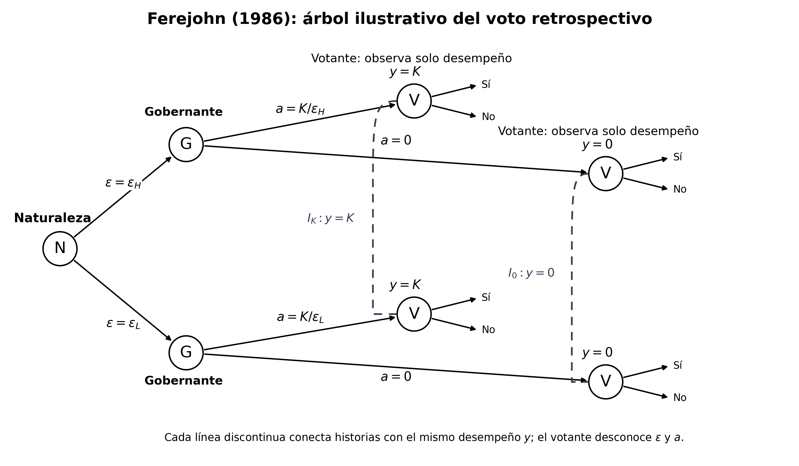

El capítulo anterior estudió cómo la repetición y el monitoreo permiten sostener compromisos políticos. Ahora trasladamos esa lógica a la representación: cuando los ciudadanos delegan decisiones, ¿cómo pueden incentivar a sus representantes a actuar conforme a sus intereses? A partir de este problema examinaremos una segunda cuestión: cómo inferir las preferencias de los propios representantes observando sus decisiones. Para ello, pasaremos del estudio de la rendición de cuentas electoral a la estimación de posiciones ideológicas mediante votaciones legislativas.


## Introducción. ¿Cómo controlar a los representantes y conocer sus preferencias?

Imaginemos un municipio cuyo alcalde administra recursos para construir escuelas, reparar caminos y financiar servicios de salud. Algunas decisiones demandan esfuerzo y coordinación. Otras ofrecen oportunidades para favorecer a proveedores, desviar recursos o conseguir beneficios privados. Los habitantes pueden observar si una escuela se construyó, pero rara vez conocen todas las decisiones que hicieron posible su construcción, el costo que habría tenido bajo una gestión diligente o las alternativas que el alcalde descartó.

El alcalde enfrenta elecciones periódicas. Durante su primer mandato puede presentarse nuevamente; durante el segundo, una regla institucional le impide competir por un tercer período consecutivo. Supongamos que nada más cambia: sus preferencias, su capacidad y el presupuesto disponible permanecen constantes. ¿Esperaríamos las mismas decisiones en ambos mandatos?

La pregunta introduce el **problema principal-agente**. Los ciudadanos delegan autoridad en representantes que adquieren información y capacidad de decisión sobre asuntos que aquellos no pueden supervisar directamente. Además, los representantes pueden tener intereses distintos de los ciudadanos. ¿Cómo conseguir, entonces, que actúen conforme a los intereses de quienes les entregaron esa autoridad? Una posibilidad consiste en establecer incentivos que hagan conveniente para el representante comportarse de la manera deseada. Las elecciones pueden desempeñar esa función porque conservar el cargo tiene valor y perderlo puede ser costoso.

La primera parte del capítulo estudia este mecanismo. Comenzaremos formulando el problema principal-agente y sus restricciones de incentivos. Después examinaremos cómo John Ferejohn (1986) demuestra que una regla de reelección basada en el desempeño puede disciplinar a los gobernantes, aun cuando los ciudadanos no observen directamente sus acciones. Finalmente, estudiaremos cómo Claudio Ferraz y Frederico Finan (2011) utilizan los límites a la reelección de alcaldes brasileños para investigar empíricamente si los incentivos electorales reducen la corrupción. Nos interesará especialmente comprender las decisiones que toman los autores al construir sus modelos y las estrategias que utilizan para contrastar sus predicciones con datos.

Este recorrido supone que las preferencias del representante pueden diferir de las del electorado. En los modelos anteriores, esa divergencia se incorpora mediante supuestos acerca de los beneficios privados y los costos que enfrenta el gobernante. Pero podemos plantear una pregunta adicional: **¿cómo podríamos conocer empíricamente las preferencias de los propios representantes?** En muchas situaciones, esas preferencias tampoco son directamente observables. Lo que observamos son decisiones que pueden revelar información sobre ellas.

Para abordar esta pregunta, dejaremos el ejemplo del alcalde y nos trasladaremos a un cuerpo colegiado. Un parlamento ofrece una oportunidad especialmente interesante para estudiar las preferencias políticas porque muchos representantes deben pronunciarse sobre las mismas propuestas. Ante una votación legislativa, cada diputado enfrenta un conjunto común de alternativas y debe expresar una decisión. Cuando observamos numerosas votaciones, podemos identificar patrones de coincidencia y desacuerdo entre representantes. Esos patrones contienen información que, bajo determinados supuestos, permite inferir sus posiciones ideológicas.

La segunda parte del capítulo introduce los modelos espaciales de votación y los métodos de estimación de posiciones ideales (*ideal points*). Estudiaremos cómo se pasa de una matriz de votos observados a la estimación de posiciones políticas que no conocemos directamente. Luego aplicaremos estas herramientas en R utilizando votaciones de la Cámara de Diputadas y Diputados de Chile. El ejercicio permitirá examinar la distribución de posiciones ideológicas, las diferencias entre partidos y la heterogeneidad de preferencias dentro de ellos. También discutiremos hasta qué punto las decisiones observadas permiten distinguir preferencias individuales de incentivos estratégicos o disciplina partidaria.

Las dos partes del capítulo abordan, así, dimensiones complementarias de la representación política. La primera estudia cómo los incentivos pueden modificar el comportamiento de los representantes cuando sus intereses divergen de los de los ciudadanos. La segunda examina cómo podemos inferir las preferencias de esos representantes a partir de su conducta. En ambos casos, **el desafío consiste en comprender decisiones observables a partir de elementos que no podemos observar directamente**, y en reconocer qué supuestos necesitamos para hacerlo.

El objetivo metodológico de la sesión será reconstruir cómo se formulan esos problemas, qué decisiones de modelamiento permiten abordarlos y de qué manera las herramientas formales se conectan con estrategias de investigación empírica.

## Delegar decisiones: una introducción formal al problema principal-agente

### Por qué aparece el problema

Un principal, o mandante, necesita que otra persona tome decisiones o realice actividades en su nombre. Su bienestar depende, al menos parcialmente, de las decisiones que adopte esa persona, a quien llamaremos agente. Para desempeñar su función, el agente recibe recursos y autoridad, dispone de conocimientos especializados y adquiere información durante el ejercicio de sus responsabilidades. El principal, en cambio, difícilmente puede conocer todas las circunstancias que enfrenta el agente ni observar directamente cada una de sus decisiones.

Esta delegación plantea un problema cuando las preferencias de ambos no coinciden. El principal desea que el agente actúe de determinada manera, pero este puede preferir otra acción que le proporcione mayores beneficios personales o le demande menos esfuerzo. Como sus decisiones no son perfectamente observables, el agente dispone de cierta libertad para perseguir sus propios intereses, incluso cuando estos difieren de los del principal.

En el capítulo anterior estudiamos cómo la asimetría de información puede dar lugar a problemas de **selección adversa** y **riesgo moral** (*moral hazard*). El primero aparece cuando el principal desconoce características relevantes del agente antes de establecer la relación, como su capacidad o sus preferencias. El segundo surge cuando, una vez delegada la responsabilidad, el agente puede adoptar acciones que el principal no observa o no puede verificar adecuadamente. Ambos problemas pueden coexistir. Aquí nos concentraremos inicialmente en el riesgo moral, porque queremos comprender cómo inducir al agente a actuar en beneficio del principal aun cuando sus acciones no sean directamente observables.

Esta pregunta retoma un elemento de la discusión anterior sobre relaciones políticas repetidas: las consecuencias futuras de una decisión pueden modificar los incentivos presentes. Ahora cambiaremos de perspectiva. Nos situaremos en la posición del principal, que debe establecer las condiciones bajo las cuales el agente desempeñará sus funciones. En política, esto nos lleva a considerar el diseño de instituciones como la duración de los mandatos, las posibilidades de reelección y las reglas mediante las cuales los gobernantes pueden ser reemplazados.

¿Por cuánto tiempo conviene entregar autoridad a un representante? ¿Es preferible permitirle reelegirse o limitar el número de mandatos que puede ejercer? Estas decisiones institucionales alteran los beneficios futuros que un gobernante puede obtener de su comportamiento presente.

El problema que queremos resolver es, entonces, el siguiente: **¿cómo puede el principal establecer incentivos para que un agente, cuyas preferencias pueden diferir de las suyas y cuyas acciones no puede observar directamente, encuentre conveniente actuar conforme a sus intereses?**

### Una formulación elemental

Comencemos representando el problema mediante dos actores: un principal $P$ y un agente $A$.

El principal desea obtener un resultado $y$, que depende del esfuerzo realizado por el agente y de circunstancias externas que ninguno de los dos controla completamente. Podemos expresarlo como:

$$
y=f(a,\varepsilon),
$$

donde $a\geq 0$ representa el esfuerzo del agente y $\varepsilon$ reúne los factores externos que también influyen sobre el resultado. Supondremos que, manteniendo constantes esas circunstancias, un mayor esfuerzo permite obtener un mejor resultado.

La utilidad del principal depende del resultado producido:

$$
U_P(y)=u_P(y).
$$

Sustituyendo la función de producción del resultado, podemos escribir:

$$
\boxed{U_P(a,\varepsilon)=u_P\big(f(a,\varepsilon)\big).}
$$

Esta expresión hace explícito que el bienestar del principal depende de una acción que realiza otra persona y de circunstancias que también afectan sus consecuencias. Como esas circunstancias pueden variar, el principal está interesado en maximizar su utilidad esperada:

$$
\max_a\;\mathbb{E}_{\varepsilon}
\left[u_P\big(f(a,\varepsilon)\big)\right].
$$

Esta maximización representa el problema que resolvería el principal si pudiera escoger directamente el esfuerzo del agente. Precisamente ahí reside la dificultad: **el principal desea influir sobre $a$, pero es el agente quien lo elige**.

Consideremos ahora al agente. Supongamos que recibe una compensación $W$ por desempeñar su función y que realizar esfuerzo tiene un costo $c(a)$, creciente con el nivel de esfuerzo:

$$
U_A(a)=W-c(a),
\qquad c'(a)>0,\quad c(0)=0.
$$

El agente recibe el beneficio de ocupar el cargo, pero debe sacrificar tiempo, energía u otros recursos para realizar sus actividades. Supondremos inicialmente que la compensación $W$ es fija y que no depende de los resultados obtenidos.

¿Qué decisión tomará el agente?

Dado que desea maximizar su utilidad, resolverá:

$$
\max_{a\geq 0}\;W-c(a).
$$

Como $W$ no cambia con el esfuerzo y $c(a)$ aumenta cuando éste crece, cualquier esfuerzo positivo reduce la utilidad del agente respecto de la alternativa de no esforzarse. Por lo tanto, su decisión óptima será:

$$
\boxed{a_A^*=0.}
$$

En ese caso, el agente recibe $W$ sin realizar esfuerzo alguno.

El resultado puede ser insatisfactorio para el principal, que habría preferido un esfuerzo positivo para obtener un mayor bienestar. La divergencia surge porque el agente acarrea el costo de esforzarse, mientras que los beneficios adicionales de ese esfuerzo recaen sobre el principal.

Naturalmente, esto no implica que todos los agentes carezcan de motivaciones para trabajar. Podrían valorar el cumplimiento de sus responsabilidades, compartir los objetivos del principal o recibir beneficios personales por un trabajo bien realizado. Hemos omitido esas posibilidades deliberadamente para identificar el problema de incentivos en su forma más sencilla.

**La conclusión es que, mientras la compensación del agente sea independiente de su conducta, el principal no dispone de un mecanismo que haga conveniente realizar el esfuerzo que desea.**

### Diseñar incentivos: participación y compatibilidad

¿Qué puede hacer el principal para modificar esta situación?

Una posibilidad es establecer una relación entre la conducta del agente y los beneficios que éste obtiene. Aquí la idea es que realizar la acción deseada debe producir una utilidad al menos tan alta como la que el agente recibiría escogiendo otra acción.

Sin embargo, al diseñar ese mecanismo, el principal enfrenta dos problemas sucesivos.

El primero consiste en conseguir que el agente acepte desempeñar la función. Cualquier persona dispone de alternativas al acuerdo propuesto y sólo estará dispuesta a participar si la utilidad que espera recibir alcanza, como mínimo, la que obtendría fuera de esa relación.

Esta es la **restricción de participación**, también denominada restricción de racionalidad individual (*individual rationality*, IR):

$$
\boxed{\mathbb{E}[U_A]\geq\overline U_A,}
$$

donde $\overline U_A$ representa la utilidad que el agente puede obtener en su mejor alternativa externa (o costo de oportunidad) .

El segundo problema aparece una vez que el agente acepta participar. El principal necesita que, entre las acciones disponibles, elija aquella que el principal desea inducir. Esa acción debe resultar óptima para el propio agente, dados los beneficios y costos que enfrenta.

Ésta es la **restricción de compatibilidad de incentivos** (*incentive compatibility*, IC):

$$
\boxed{
a^*\in\arg\max_{a}\;\mathbb{E}[U_A(a)].
}
$$

Entonces, la primera restricción exige que al agente le convenga incorporarse a la relación; la segunda, que una vez incorporado le convenga comportarse de la manera esperada.

Retomemos nuestro modelo. Supongamos que el principal desea inducir un esfuerzo alto $H$, mientras que el agente puede optar por un esfuerzo alto $H$ u otro bajo $L$, donde:

$$
H>L,\qquad c(H)>c(L).
$$

Con una compensación fija $W$, el agente compara:

$$
U_A(H)=W-c(H)
$$

con

$$
U_A(L)=W-c(L).
$$

Puesto que $c(H)>c(L)$, necesariamente se cumple:

$$
U_A(H)<U_A(L).
$$

Por tanto, el agente escogerá el esfuerzo bajo. Aumentar $W$ en una cantidad fija podría ayudar a satisfacer la restricción de participación, pero no modificaría esta comparación: ambas alternativas recibirían exactamente el mismo aumento de compensación.

Para inducir el esfuerzo alto necesitamos introducir alguna consecuencia que dependa de la conducta del agente. Idealmente, su compensación debería aumentar cuando escoge $H$. Pero aquí reaparece el problema de información: **el principal no puede observar directamente qué esfuerzo realizó**.

La solución consiste en vincular los beneficios del agente con algún resultado observable que proporcione información sobre su comportamiento. Aunque el resultado no dependa exclusivamente del esfuerzo, puede ser más probable obtener un buen desempeño cuando el agente se esfuerza que cuando no lo hace.

Así, el principal puede diseñar una regla que premie los buenos resultados o sancione los malos. Al hacerlo, modifica los beneficios esperados de las distintas acciones y, con ello, la decisión que el agente encuentra conveniente tomar.

### La reelección como mecanismo de incentivos

En una democracia representativa, los ciudadanos no pueden modificar directamente la remuneración de sus gobernantes cada vez que toman una decisión. Sin embargo, las elecciones permiten establecer incentivos mediante la posibilidad que el representante pueda conservar el cargo o perderlo.

Supongamos que los ciudadanos adoptan una regla de evaluación según la cual un buen desempeño aumenta las posibilidades de reelección. Como el resultado observado depende parcialmente del esfuerzo, la probabilidad de conservar el cargo también puede depender de él.

Llamemos $p(a)$ a esa probabilidad. Para simplificar, supondremos que:

$$
p(H)>p(L).
$$

Es decir, realizar un esfuerzo alto aumenta las probabilidades de reelección respecto de realizar un esfuerzo bajo, por ejemplo, porque con esfuerzo alto el agente deja más evidencias concretas de beneficios para el principal (e.g. se terminó de construir el hospital, hay más plazas, las calles están más limpias, etc...) 

Esto puede funcionar para motivar al agente a esforzarse porque valora las consecuencias futuras para él que tendrá la elección. Denotemos por $V^I$ el valor esperado de continuar en el cargo y por $V^O$ el valor esperado de quedar fuera. Supongamos que:

$$
V^I>V^O.
$$

Finalmente, introducimos un factor de descuento $\delta\in(0,1)$, que representa cuánto valora el agente los beneficios futuros en comparación con los presentes.

Ahora podemos reformular su utilidad. Si realiza un esfuerzo $a$, recibirá la compensación actual $W$, asumirá el costo $c(a)$ y obtendrá un beneficio futuro esperado que depende de sus posibilidades de reelección:

$$
U_A(a)=W-c(a)+
\delta\left[p(a)V^I+(1-p(a))V^O\right].
$$

El agente compara nuevamente las alternativas $H$ y $L$. Escogerá el esfuerzo alto cuando la utilidad asociada a esa decisión sea al menos igual a la que obtendría realizando un esfuerzo bajo:

$$
\begin{aligned}
W-c(H)+\delta[p(H)V^I+(1-p(H))V^O]\\
\geq W-c(L)+\delta[p(L)V^I+(1-p(L))V^O].
\end{aligned}
$$

Podemos simplificar esta expresión. Primero eliminamos $W$, que aparece en ambos lados de la desigualdad. Luego agrupamos los costos del esfuerzo y las diferencias entre los beneficios futuros esperados. Obtenemos:

$$
\boxed{
c(H)-c(L)\leq
\delta\,[p(H)-p(L)]\,[V^I-V^O].
}
$$

Esta es la restricción de compatibilidad de incentivos que buscábamos.

El lado izquierdo representa el **costo adicional de realizar el esfuerzo alto**. El lado derecho representa el **beneficio futuro adicional que ese esfuerzo genera al aumentar la probabilidad de conservar el cargo**.

La interpretación es bastante intuitiva: el agente estará dispuesto a realizar el esfuerzo extra que desea el principal cuando el beneficio adicional esperado de hacerlo sea, como mínimo, igual al costo adicional que deberá asumir. O dicho técnicamente, cuando el beneficio marginal de esforzar esa magnitud extra sea igual o superior al costo marginal de dicho esfuerzo.

La expresión también permite identificar las condiciones bajo las cuales la reelección puede disciplinar al gobernante. La recompensa futura debe ser suficientemente valiosa, el agente debe atribuir importancia a su futuro y, especialmente, su esfuerzo debe afectar de manera significativa la probabilidad de conservar el cargo.

Si el representante ya no puede ser reelegido, esa vía de recompensa desaparece. Del mismo modo, si el desempeño observado proporciona muy poca información sobre sus acciones, el esfuerzo puede tener un efecto demasiado pequeño sobre las probabilidades electorales. En ambas situaciones, el mecanismo pierde capacidad para inducir la conducta deseada.

Hemos llegado así a una solución posible del problema principal-agente. Aunque el principal no observe directamente las acciones del representante, puede utilizar resultados observables para establecer consecuencias que alteren los beneficios esperados de sus decisiones.

Esta formulación es una simplificación didáctica. En el modelo de Ferejohn (1986), que estudiaremos a continuación, el gobernante observa las condiciones externas antes de escoger su esfuerzo y los ciudadanos establecen una regla retrospectiva basada en un umbral de desempeño. Su contribución consiste en analizar cómo debe construirse esa regla y bajo qué condiciones produce un equilibrio en el que al gobernante le conviene responder a los intereses de los electores.

::: {.callout-tip title="Para reflexión personal"}

Consideremos nuevamente las decisiones del principal. ¿Le convendría aumentar el valor de ocupar el cargo? ¿Qué sucede si los resultados observados dependen principalmente de factores que el gobernante no controla? ¿Y si perder una elección no reduce demasiado sus oportunidades políticas futuras?

En cada caso, identifique qué término de la restricción de incentivos cambia y qué consecuencias debería tener para la conducta del agente.

:::

## Ferejohn (1986): la reelección como mecanismo de control

### Por qué abandonar las promesas de campaña

Ferejohn comienza identificando una dificultad en los modelos de competencia electoral que existían a la fecha. En ellos se planteaba que los ciudadanos comparan plataformas políticas y terminaban optando por la que más se acerca a sus preferencias. El problema que ve Ferejohn es que el candidato, una vez elegido, puede tener incentivos para apartarse de lo que prometió (i.e. de la plataforma política declarada). Y si es así, ¿era racional para el ciudadano votar sólo en base a lo que declaraban los candidatos? La intención de Ferejohn es, entonces, construir una teoría en la cual los votantes anticipan esa posibilidad de ser engañados por un agente y mostrar cómo cierta disciplina sí es posible de conseguir en el comportamiento del gobernante. Para ello desarrolla una aproximación de principal-agente. 

Por eso el artículo reemplaza la comparación de promesas por una **regla de voto retrospectivo** en la que ciudadanos e incumbentes se ven involucrados en una interacción estratégica. Los ciudadanos evalúan el resultado de la administración y establecen un estándar que determina la continuidad del incumbente. Nótese que esta decisión metodológica analiza un proceso electoral como una relación entre el incumbente y los ciudadanos... ¿y qué pasa con los otros candidatos? No es que se ignoren, sino que por simplificación y para poder detectar el problema específico de interés, los candidatos desafiantes son parametrizados. Ellos no se incorporan en el análisis como actores estratégicos (por ejemplo, ofreciendo programas/promesas, etc.); ellos quedan incluidos tácitamente como la alternativa que vuelve operativa la amenaza de reemplazo.

También importa el horizonte. Frente al problema de que una última elección elimina incentivos futuros, Ferejohn trabaja con un horizonte infinito. No afirma que cada persona ocupe indefinidamente el cargo. Su horizonte representa una competencia política continuada que permite analizar incentivos dinámicos sin que el juego se deshaga por el último período.

### Jugadores, información y secuencia

El caso básico considera un electorado homogéneo y un gobernante. En cada período:

1. Los votantes aplican una regla retrospectiva de reelección con un umbral $K_t$.
2. El gobernante observa un estado externo $\varepsilon_t$.
3. El gobernante elige esfuerzo $a_t$, que los votantes no observan directamente.
4. El desempeño observado es $y_t=a_t\varepsilon_t$.
5. El incumbente conserva el cargo si $y_t\geq K_t$; en caso contrario es reemplazado.

El supuesto central es **la diferencia entre acción y desempeño**. El gobernante sabe algo que el electorado ignora: las condiciones externas antes de actuar. El ciudadano observa únicamente el producto del esfuerzo y esas condiciones. Un buen resultado puede reflejar esfuerzo, circunstancias favorables o ambos. El desempeño funciona como una señal imperfecta de la conducta.

{#fig-ferejohn-voto-retrospectivo width="100%" fig-alt="Árbol de decisiones: la naturaleza determina las condiciones externas, el gobernante escoge el esfuerzo y el votante decide la reelección observando solo el desempeño. Las líneas discontinuas unen historias que el votante no puede distinguir."}

Las preferencias de un período son

$$
u_A(a_t,\varepsilon_t)=W-\phi(a_t),
\qquad u_P(a_t,\varepsilon_t)=a_t\varepsilon_t,
$$

con $\phi(0)=0$ y $\phi$ creciente y convexa. $W$ incorpora compensaciones y rentas asociadas al cargo. La convexidad de $\phi$ expresa que elevar el esfuerzo se vuelve progresivamente más costoso. Para simplificar, los actores son neutrales al riesgo y el estado externo se modela mediante una distribución conocida $F$.

¿Por qué escoger $a\varepsilon$ en vez de una función más compleja? Porque permite expresar inmediatamente cuánto esfuerzo se necesita para satisfacer el estándar de los electores. Si $\varepsilon$ es favorable, conseguir $K$ requiere menos esfuerzo; si es desfavorable, requiere más. Esta elección funcional hace visible el efecto disciplinario de la información imperfecta.

### La mejor respuesta del gobernante

Supongamos una regla estacionaria $K$. Para un estado $\varepsilon>0$, el esfuerzo mínimo que permite ser reelegido es

$$
a_K(\varepsilon)=\frac K\varepsilon.
$$

Un gobernante interesado en conservar el cargo jamás escogerá esfuerzo superior a ese nivel si hacerlo aumenta el costo sin cambiar el resultado electoral. La decisión relevante es entre realizar el esfuerzo mínimo exigido y aceptar la derrota sin realizar esfuerzo.

Sea $V^I$ el valor futuro de continuar en el cargo y $V^O$ el valor futuro de quedar fuera. El gobernante se esfuerza para cumplir la regla cuando

$$
W-\phi(K/\varepsilon)+\delta V^I
\geq W+\delta V^O.
$$

Los beneficios corrientes $W$ aparecen a ambos lados y se cancelan. Obtenemos la condición:

$$
\boxed{\phi(K/\varepsilon)\leq\delta(V^I-V^O).}
$$

Definamos $M\equiv\delta(V^I-V^O)$, el valor descontado de evitar la pérdida del cargo. El político cumple el estándar cuando el costo de lograrlo no excede $M$. Para estados suficientemente desfavorables renuncia a la reelección; para estados favorables realiza exactamente el esfuerzo que exige $K$. Esta es la intuición de la **Proposición 1** (pp. 14-15 del artículo).

El resultado muestra por qué el valor de permanecer en el cargo importa, pero también por qué ese valor debe distinguirse de $W$ recibido en el período actual. Lo disciplinario es la diferencia entre las oportunidades futuras dentro y fuera del gobierno.

### Los votantes también optimizan

Una regla más exigente puede elevar el desempeño del gobernante cuando este decide cumplirla. Pero también puede aumentar la proporción de circunstancias en que considera demasiado costoso intentarlo. Por lo tanto, escoger $K$ es un problema estratégico del principal.

Sea $\varepsilon^*(K)$ el menor estado en que el incumbente intenta satisfacer el estándar. Puesto que obtiene $K$ cuando el político cumple, el rendimiento esperado de un período para el elector, en la formulación sencilla del artículo, es

$$
g(K)=K[1-F(\varepsilon^*(K))].
$$

Si los períodos son idénticos y se emplea una regla estacionaria, la suma descontada es $g(K)/(1-\delta)$. La elección óptima de $K$ considera la **respuesta endógena del agente**, y no simplemente el desempeño que al principal le gustaría exigir.

#### Un caso ilustrativo  

Ferejohn estudia un caso particularmente transparente. Supongamos:

$$
\varepsilon\sim U[0,1],\qquad \phi(a)=a,\qquad 0\leq a\leq1.
$$

El gobernante se esfuerza cuando puede satisfacer el estándar ($\varepsilon\geq K$) y cuando hacerlo no cuesta más que $M$ ($\varepsilon\geq K/M$). Por tanto:

$$
\varepsilon^*(K)=\max\{K,K/M\}.
$$

Para $M\leq1$, se cumple $\varepsilon^*(K)=K/M$ en el rango relevante. Entonces el principal maximiza:

$$
g(K)=K\left(1-\frac K M\right).
$$

La condición de primer orden es

$$
\frac{dg}{dK}=1-\frac{2K}{M}=0
\quad\Rightarrow\quad K^*=\frac M2.
$$

Para $M\geq1$, la restricción operativa es $\varepsilon^*(K)=K$ y se maximiza $K(1-K)$, de donde $K^*=1/2$. Reuniendo ambos casos:

$$
\boxed{K^*=\min\left\{\frac12,\frac{\delta(V^I-V^O)}2\right\}.}
$$

En ambos regímenes $\varepsilon^*=1/2$. Bajo estos supuestos específicos, el estándar óptimo aumenta con el valor de permanecer en el cargo hasta alcanzar un límite. La derivación resume el corolario de la Proposición 2 (p. 16) y la discusión de los resultados de la p. 17. No debe trasladarse a otras distribuciones o costos sin revisar las condiciones del modelo.

### Por qué el equilibrio debe ser dinámicamente creíble

Para hablar de disciplina electoral, la amenaza de castigo debe ser creíble cuando llega la elección. Ferejohn exige que la conducta prescrita en cada continuación del juego sea óptima, no simplemente que se anuncie al comienzo. El principio es el de **perfección en subjuegos**. Como los contendientes son equivalentes en el modelo, los votantes pueden sostener una regla de castigo retrospectivo sin aceptar una alternativa intrínsecamente peor.

El modelo no requiere que el gobernante sea altruista. Precisamente porque quiere conservar los beneficios futuros del cargo, puede elegir políticas favorables al electorado. El control electoral es una propiedad del equilibrio resultante de preferencias, información y reglas.

### ¿Qué ocurre si la derrota no resulta definitiva?

Ferejohn introduce una probabilidad $x$ de recuperar el cargo después de quedar fuera, asociada a diferentes interpretaciones de la competencia entre candidatos y partidos. Cuanto más fácil es regresar, menor resulta $V^I-V^O$. Perder la elección cuesta menos y el incentivo a esforzarse se debilita. Su **Proposición 4** establece que, dentro del modelo, un aumento de $x$ reduce el bienestar del votante.

Este resultado no demuestra que un sistema de partidos particular sea siempre superior. Descansa en supuestos específicos: candidatos equivalentes, ausencia de reputaciones partidarias diferenciadas y un modo simplificado de representar el retorno al gobierno. Interesa porque identifica un mecanismo verificable: la sanción sólo disciplina en la medida en que el agente pierde algo valioso.

### El paso hacia las preferencias heterogéneas

Hasta aquí los ciudadanos evalúan un resultado común. Pero en una sociedad real, distintos grupos prefieren políticas y asignaciones distintas. Para analizarlo, Ferejohn permite que un gobernante distribuya el producto total entre $N$ votantes. Cada elector evalúa la porción que recibe y el incumbente necesita satisfacer únicamente una mayoría.

La **Proposición 6** muestra que, bajo las condiciones del modelo distributivo, el incumbente puede enfrentar a los grupos entre sí y debilitar completamente el control. Si los electores establecen demandas particulares, el político puede formar una mayoría mínima con las demandas más baratas. Un grupo que queda fuera tiene incentivos para ofrecer un estándar todavía menor con el fin de entrar en la coalición ganadora. La competencia entre electores termina erosionando las exigencias colectivas.

La **Proposición 7** indica que una regla de evaluación del resultado agregado, aplicada de manera coordinada, permite recuperar el nivel de control del caso homogéneo. Ferejohn denomina *sociotrópicas* a estas reglas: los votantes evalúan un desempeño común en lugar de limitarse a su beneficio individual.

La conclusión para nuestra sesión es doble. Los problemas de información importan porque los votantes no observan las acciones; las diferencias de preferencias importan porque dificultan acordar qué desempeño debe premiarse. El segundo problema prepara una extensión hacia la representación ideológica, aunque esa extensión requerirá supuestos y herramientas diferentes de los utilizados por Ferejohn.

::: {.callout-important title="En suma"}
Ferejohn construye una explicación de cuándo la perspectiva de perder el cargo induce esfuerzo. Sus resultados dependen del valor relativo de continuar en el gobierno, de la calidad del desempeño como señal, de la credibilidad del castigo y de la coordinación de los votantes. El modelo explica incentivos; no estima todavía su magnitud en una democracia concreta.
:::

## Ferraz y Finan (2011): de los incentivos a la corrupción municipal

### Una predicción y un diseño de investigación

Ferejohn explica por qué un político puede realizar esfuerzo en beneficio de los ciudadanos para evitar una derrota electoral. Pero es un modelo continuo. Una implicancia importante es que la probabilidad de volver a tener los beneficios de estar en el cargo se mantienen incluso con derrotas de por medio. Pero qué pasa si el incumbente sabe que ya no puede seguir en él. Eso cambia los incentivos. Ferraz y Finan lo analizan buscando trazas en un punto específico: apropiación o no de recursos públicos (corrupción). La investigación se sitúa en municipios brasileños, donde una reforma constitucional introdujo la posibilidad de un segundo mandato consecutivo para alcaldes y, al mismo tiempo, impuso un límite de dos mandatos seguidos. El programa federal de auditorías de la Controladoria-Geral da União (CGU), iniciado en 2003, proporcionó información detallada sobre irregularidades de gestión.

La comparación básica parece directa: los alcaldes de primer mandato tienen una reelección inmediata por la cual competir; los de segundo mandato no. Pero el contraste enfrenta un problema de identificación: los alcaldes que llegaron a un segundo mandato ya superaron una elección anterior y tienen una experiencia distinta. Un buen diseño debe explicar por qué esas diferencias no son suficientes para producir los resultados observados.

El artículo, por lo tanto, sirve para estudiar una secuencia metodológica completa: formular el mecanismo, derivar una hipótesis, construir variables, identificar fuentes de sesgo y utilizar predicciones adicionales para investigar si el mecanismo explica los datos.

### ¿Por qué Ferraz y Finan construyen otro modelo?

El modelo simplificado de la sección 2 de Ferraz y Finan sigue a Besley (2006). A diferencia de Ferejohn, considera **dos períodos** y **dos tipos de políticos**: no corruptos ($nc$) y corruptos ($c$). Sea $\pi$ la proporción de no corruptos en el conjunto de candidatos.

Cada período tiene un estado $s_t\in\{0,1\}$, observado por el político. El gobernante escoge una política $e_t$. Los votantes obtienen $V>0$ si $e_t=s_t$, y cero en caso contrario. Un político no corrupto escoge la política congruente con el estado. Un corrupto puede escoger $e_t\neq s_t$ y recibir un beneficio privado $r_t$, extraído de una distribución $G$ con media $\mu$.

La modelación introduce deliberadamente **selección adversa**: los ciudadanos no conocen el tipo del político. También hay **riesgo moral**: las acciones y el estado no son directamente observables. Después de la política, los votantes conocen el resultado que obtuvieron y deciden si reeligen al incumbente.

¿Por qué usar dos períodos? Porque el límite de mandatos ofrece una comparación clara entre una etapa en que la continuidad está en juego y otra en que desaparece esa posibilidad inmediata. El horizonte finito produce un efecto de último período que en Ferejohn había sido excluido mediante el horizonte infinito. Ambas opciones son coherentes con sus respectivas preguntas de investigación.

### La decisión del político corrupto

En el segundo período ya no existe la recompensa de una nueva reelección. Un político no corrupto implementa la política favorable al elector; un político corrupto obtiene el beneficio privado disponible.

En el primer período el corrupto enfrenta dos alternativas. Si se apropia de $r_1$, obtiene el beneficio privado ahora pero renuncia a la reelección. Si actúa como un político no corrupto, sacrifica esa renta inmediata y conserva la posibilidad de recibir los beneficios privados futuros, además de la utilidad $E$ de ejercer el cargo. La condición para moderar su conducta es

$$
\boxed{r_1\leq\delta(\mu+E).}
$$

Esta desigualdad reproduce la comparación central del modelo: renta inmediata frente al valor descontado del segundo mandato. El político corrupto puede comportarse bien por razones estratégicas. De hecho, ese comportamiento puede hacer difícil distinguirlo de un político no corrupto a partir de la observación de un resultado favorable.

La probabilidad de que un político corrupto se discipline es

$$
\boxed{\lambda=G\left(\delta(\mu+E)\right).}
$$

En particular, esa probabilidad aumenta si el futuro importa más o si los beneficios esperados del cargo son mayores, manteniendo lo demás constante.

### Cómo intervienen las creencias de los votantes

Si el resultado favorable es $V$, todos los políticos no corruptos pueden producirlo, mientras que entre los corruptos sólo lo hacen los que renuncian a su oportunidad privada del primer período. Por Bayes, el votante actualiza su creencia:

$$
\Pr(nc\mid V)=
\frac{\pi}{\pi+(1-\pi)\lambda}.
$$

El resultado favorable aumenta o, en el límite, mantiene la probabilidad atribuida a un político no corrupto. Así, los votantes encuentran racional premiar resultados favorables y los políticos corruptos pueden tratar de parecerse a los no corruptos.

Como los políticos corruptos que se moderan en el primer período pueden sobrevivir al segundo, y los que se comportan mal pueden ser reemplazados, el resultado agregado depende tanto de la disciplina como de la selección. Los autores presentan una condición suficiente, expresada en términos de $\lambda$ y $\pi$, para obtener mayor extracción de rentas en el segundo período. 

### La hipótesis que va a los datos

Bajo las condiciones estudiadas, la predicción principal es

$$
\mathbb{E}[C_i\mid\text{primer mandato}]
<
\mathbb{E}[C_i\mid\text{segundo mandato}],
$$

con $C_i$ como corrupción municipal. La comparación es atractiva porque introduce variación en el incentivo electoral, pero medir esa variación no constituye por sí mismo identificación causal. Debemos mirar cómo se mide $C_i$ y cómo se asignan los alcaldes a cada condición.

## Del concepto de corrupción a una variable medible

### La elección de una fuente de información

La corrupción es difícil de medir porque los responsables tienen incentivos para ocultarla. Una medida de percepción puede incorporar reputaciones, cobertura periodística y sesgos de información. Los autores aprovechan una alternativa: reportes de auditorías federales sobre el uso de recursos transferidos a municipios.

Los auditores inspeccionan documentos, contratos y obras; además obtienen información en terreno. Los investigadores clasifican las irregularidades identificadas. Las categorías de corrupción comprenden **fraude en la contratación pública**, **desvío de recursos** y **sobreprecios**. Esta operacionalización privilegia prácticas verificables que involucren apropiación privada o contratación fraudulenta, evitando equiparar automáticamente toda infracción administrativa con corrupción.

La medida principal es

$$
C_i=\frac{\text{monto asociado con actos de corrupción}_i}
{\text{monto total de recursos auditados}_i}.
$$

La ventaja es que $C_i$ expresa una proporción comparable entre municipios de distinto tamaño. La limitación es que corresponde a corrupción **detectada y codificada**, no a un censo perfecto de todas las prácticas corruptas. Por eso los autores construyen también el número de irregularidades y la proporción de ítems auditados con corrupción; son pruebas de sensibilidad frente a distintas formas de medir el fenómeno.

La selección aleatoria de municipios para auditoría mejora la observación de corrupción en la muestra, pero no asigna aleatoriamente el número de mandato de los alcaldes. Este punto es esencial para separar calidad de medición de identificación causal.

### ¿Cuál es la variable explicativa?

Sea

$$
I_i=\begin{cases}
1 & \text{si el alcalde cursa su primer mandato},\\
0 & \text{si cursa su segundo mandato consecutivo}.
\end{cases}
$$

El indicador aproxima la posibilidad de competir inmediatamente por la reelección. Es una variable institucionalmente interpretable, pero imperfecta: los alcaldes de segundo mandato pueden mantener incentivos por carreras políticas posteriores o por la posibilidad de retornar después de una pausa. Los autores aportan evidencia de que tales trayectorias eran relativamente poco frecuentes en su contexto.

La regresión inicial es

$$
\boxed{C_i=\beta I_i+X_i'\varphi+Z_i'\gamma+\varepsilon_i,}
$$

con controles municipales $X_i$ y del alcalde $Z_i$. Si los incentivos disciplinan, esperamos $\beta<0$.

### Primera lectura de los resultados: Tabla 4

La Tabla 4 del borrador de febrero de 2010 muestra (luego fue publicado en $AER$ el 2011), para 476 municipios, la evolución de la estimación al incorporar controles:

| Especificación | Coeficiente de primer mandato | Error estándar robusto |
|:--|--:|--:|
| Sin controles, columna 1 | $-0.019$ | $0.009$ |
| Controles municipales y personales, más instituciones, efectos de lotería y estado, columna 6 | $-0.027$ | $0.011$ |

La primera estimación representa **1,9 puntos porcentuales menos** de recursos auditados involucrados en corrupción para alcaldes de primer mandato. Frente al promedio de $0.074$ entre alcaldes de segundo mandato, equivale a una diferencia relativa cercana al **27%**. Conviene evitar un error habitual: **$-0.019$ es una diferencia en puntos porcentuales sobre una proporción; 27% es la comparación relativa con la media de referencia**. El coeficiente ajustado de $-0.027$ corresponde a otra especificación y no debe confundirse con la cifra de 27% del resumen.

El efecto estimado persiste al introducir características observadas, lo que reduce algunas explicaciones alternativas. Pero el control estadístico no asegura que las diferencias no observadas entre alcaldes hayan desaparecido.

### ¿Qué sesgos amenazan la interpretación?

La diferencia observada entre mandatos puede mezclar al menos tres procesos. Primero, la **disciplina**: los alcaldes en primer mandato sacrifican rentas para aumentar sus posibilidades de continuidad. Segundo, la **selección**: los reelegidos que llegan al segundo mandato pueden ser sistemáticamente distintos de los reemplazados. Tercero, el **aprendizaje**: mayor permanencia puede generar conocimiento, relaciones con proveedores o capacidad para ocultar irregularidades.

Estos mecanismos pueden producir patrones observacionales parecidos. Por eso la sección de estrategia empírica emplea explícitamente un lenguaje de resultados potenciales para descomponer la comparación simple en el efecto buscado y términos vinculados a experiencia y diferencias no observadas.

### Elecciones estrechas y discontinuidad

Para reducir diferencias municipales no observadas, los autores comparan lugares donde el alcalde que buscaba reelegirse en 2000 ganó por muy poco con lugares donde perdió por muy poco. En el período 2001-2004 los primeros quedan con un alcalde reelegido, en segundo mandato, y los segundos con un nuevo alcalde, en primero.

Definamos $W_i$ como votos del incumbente menos votos del competidor más cercano. Cerca de $W_i=0$, resultados electorales con diferencias pequeñas pueden producir una discontinuidad en el tipo de mandato del alcalde que gobierna después. Con una variable $T_i$ que vale uno para un alcalde de segundo mandato, una formulación consistente es

$$
T_i=\mathbb{1}[W_i\geq0],
\qquad
C_i=\alpha+\tau T_i+f(W_i)+X_i'\gamma+u_i.
$$

La hipótesis de mayor corrupción en segundos mandatos implica $\tau>0$. Para interpretar causalmente el salto es necesario asumir continuidad de los resultados potenciales en torno al umbral y examinar si existen manipulaciones o discontinuidades relevantes en otras características.

En la Tabla 6 los coeficientes del indicador de primer mandato permanecen negativos bajo especificaciones alternativas, aunque varían en magnitud y precisión. El diseño de discontinuidad mejora la comparabilidad de los municipios próximos al umbral, pero la victoria estrecha también determina **qué persona** gobierna. Por ello no elimina sin más las diferencias de capacidad y experiencia entre políticos.

### Descartar explicaciones alternativas con otras predicciones

La mejor parte metodológica del artículo aparece cuando los autores van más allá de una diferencia promedio. Si la disciplina electoral es el mecanismo, deberían observarse otros patrones.

**Experiencia.** La comparación incorpora trayectorias previas como alcaldes o legisladores locales. Si el resultado dependiera exclusivamente de aprendizaje, deberían existir diferencias semejantes entre políticos de experiencia semejante. Los coeficientes siguen siendo negativos en las comparaciones estudiadas (Tabla 7), aunque toda aproximación a experiencia o habilidad es imperfecta.

**Visibilidad de las irregularidades.** La reelección debería disciplinar especialmente conductas que afectan resultados reconocibles para los votantes. Los investigadores elaboran un indicador de irregularidades administrativas menos visibles y no encuentran una diferencia estadísticamente clara entre mandatos en ese indicador (Tabla 8). En el borrador, la estimación principal para mala gestión es $0.054$ con error estándar $0.102$, mientras la estimación de corrupción para esa submuestra sigue siendo negativa. La comparación ayuda a evaluar el mecanismo de información, aunque las categorías de medición no son completamente equivalentes.

**Competencia y condiciones institucionales.** El diferencial de corrupción es mayor en ciertos municipios con escaso acceso a medios y menor vigilancia judicial, y disminuye donde los alcaldes tienen posiciones electorales muy seguras (Tabla 10). Hay una sutileza teórica: más información puede hacer más fácil identificar el *tipo* del político y mejorar la selección de quienes sobreviven al segundo mandato, reduciendo la diferencia observada entre mandatos. Si la información revela *acciones*, en cambio, puede aumentar directamente el incentivo a moderarse. Los autores distinguen ambas posibilidades en su discusión del modelo ampliado.

**Actividad proactiva del gobernante.** La Tabla 9 estudia transferencias obtenidas mediante convenios o aportes complementarios (*matching grants*), un resultado más visible y dependiente del esfuerzo de gestión. Los alcaldes de primer mandato aparecen relativamente más activos conforme se aproxima la elección. Este resultado es coherente con un incentivo para producir resultados electoralmente reconocibles, y difícil de reducir a una explicación uniforme de aprendizaje.

Estas pruebas añaden contenido teórico: cada una pregunta qué más debería observarse si el mecanismo que afirmamos haber identificado fuera verdadero.

### Qué concluimos, y qué no

La evidencia aporta apoyo a la predicción de que la posibilidad de reelección limita la apropiación de recursos en los municipios y el período estudiados. No permite concluir, por sí sola, que todas las democracias deban suprimir los límites de mandatos. Tampoco identifica cómo se comportaría un alcalde ante la opción de un tercero o cuarto mandato consecutivo. Podrían aparecer costos distintos, como posiciones de poder persistentes, menores oportunidades de renovación o políticas concebidas para obtener aprobación inmediata.

El aporte metodológico del artículo es mostrar cómo una teoría de incentivos genera una comparación concreta y cómo la investigación intenta distinguir ese efecto de la selección, la experiencia y los problemas de medición.

## Preferencias políticas: de controlar al representante a comprender sus decisiones

Ferejohn comienza suponiendo que todos los electores evalúan el desempeño del gobernante con un mismo criterio. Bajo ese supuesto, pueden exigir un nivel mínimo de resultados y utilizar la amenaza de no reelegirlo para incentivar su esfuerzo. Pero ¿qué sucede cuando los ciudadanos tienen intereses diferentes y cada uno evalúa al gobernante según los beneficios particulares que recibe? En ese caso, el gobernante puede concentrar los recursos en un grupo suficiente para asegurar su reelección, dejando fuera al resto. Además, como los ciudadanos compiten por obtener esos beneficios, cada uno tiene incentivos para aceptar menos con tal de formar parte de la mayoría favorecida. Esta competencia debilita progresivamente las exigencias al gobernante y, en el equilibrio del modelo, puede eliminar por completo su esfuerzo. Así, **la diversidad de intereses distributivos dificulta que los ciudadanos ejerzan colectivamente el control electoral**.

El análisis de Ferejohn deja abierta una cuestión que hasta ahora hemos mantenido en segundo plano. Para estudiar cómo las diferencias de intereses afectan el comportamiento político, hemos incorporado las preferencias de los actores como supuestos del modelo. En la práctica, sin embargo, esas preferencias no son directamente observables. Conocemos las decisiones que toman los representantes, pero ¿podemos utilizar esas decisiones para inferir qué políticas prefieren?

Para explorar esta posibilidad, pasaremos del gobernante individual a un cuerpo colegiado. Un parlamento ofrece una ventaja particular: numerosos diputados deben pronunciarse sobre las mismas propuestas. Al observar sus votaciones, podemos identificar patrones de coincidencia y desacuerdo que, bajo determinados supuestos, permiten estimar sus posiciones en un espacio político. Esta es la lógica de los modelos espaciales de votación y de los métodos de estimación de posiciones ideales que estudiaremos en la segunda parte de la sesión. Se trata de herramientas complementarias al análisis de Ferejohn, que no forman parte de su modelo original.

Estas estimaciones nos permitirán comparar las posiciones de los diputados, identificar diferencias entre partidos y examinar cuánto se aparta cada legislador de las posiciones predominantes en su bancada. Sin embargo, debemos distinguir las preferencias de los partidos de las de los ciudadanos. Que un diputado vote de manera diferente a su bancada no significa necesariamente que esté actuando contra los intereses de sus electores. Para evaluar esa relación necesitaríamos, además, información independiente sobre las preferencias del electorado. Por ahora, nuestro objetivo será aprender **cómo inferir posiciones políticas a partir de decisiones legislativas observadas** y reconocer los supuestos necesarios para interpretar esas estimaciones.

### Un modelo espacial de votación

Supongamos que las alternativas pueden representarse en una dimensión política continua. El diputado $i$ tiene un punto ideal $\theta_i$ y evalúa una alternativa $x$ según

$$
u_i(x)=-(x-\theta_i)^2.
$$

Cuanto menor sea la distancia entre la política y el punto ideal, mayor será la utilidad. En la votación $j$, el diputado elige entre aprobar una propuesta $z_j$ y mantener un statu quo $q_j$. Bajo votación sincera, apoya la propuesta si

$$
-(z_j-\theta_i)^2>-(q_j-\theta_i)^2.
$$

Equivalentemente, la diferencia de utilidad es

$$
\Delta u^{\mathrm{pol}}_{ij}=
(q_j-\theta_i)^2-(z_j-\theta_i)^2.
$$

El modelo muestra que, conocidas las alternativas, una votación informa acerca de la posición ideal de quien decide. Si $z_j>q_j$, por ejemplo, un legislador situado a la derecha del punto medio $(z_j+q_j)/2$ prefiere la propuesta. Esa implicación se invierte cuando la propuesta se ubica a la izquierda del statu quo.

Con muchas votaciones, los patrones de decisiones permiten localizar a diputados y alternativas en un espacio común. Esta es la intuición de la tradición de modelos espaciales de votación nominal de Poole y Rosenthal (1985).

### Incorporar incentivos de representación

Si el legislador está preocupado por conservar el cargo, la decisión de voto puede depender también de su efecto sobre la continuidad electoral. Para ilustrarlo, incluyamos la diferencia de probabilidad de reelección entre votar favorablemente y votar en contra, $\Delta p_{ij}$, y un costo o beneficio asociado a la coordinación partidaria, $s_{ij}$. Una comparación conceptual sería:

$$
\boxed{
\Delta U_{ij}=
\underbrace{(q_j-\theta_i)^2-(z_j-\theta_i)^2}_{\text{preferencia por la política}}
+
\underbrace{\delta R_i\Delta p_{ij}}_{\text{incentivo electoral}}
+
\underbrace{s_{ij}}_{\text{incentivo partidario}}
.}
$$

El diputado vota favorablemente si $\Delta U_{ij}\geq0$. Esta ecuación no pertenece a Ferejohn, Ferraz y Finan ni a una estimación NOMINATE (**Nomina**l *T*hree-Step *E*stimation). 

La formulación anterior nos permite reconocer tres factores que pueden influir en una votación legislativa. Primero, **las preferencias del diputado**, que lo llevan a favorecer las alternativas políticas más cercanas a su posición ideal. Segundo, **los incentivos electorales**, que pueden hacerlo apoyar una alternativa distinta si considera que esa decisión mejora sus posibilidades de reelección. Tercero, **la coordinación partidaria**, que puede inducirlo a votar conforme a los acuerdos de su bancada, incluso cuando personalmente preferiría otra opción. Nuestra ecuación incorpora los dos primeros factores; representar formalmente el tercero requeriría introducir los incentivos o restricciones asociados a la pertenencia partidaria.

Esta distinción es importante para comprender qué estamos estimando cuando utilizamos métodos como NOMINATE. A partir de las votaciones observadas podemos identificar patrones de coincidencia y desacuerdo entre diputados y estimar sus posiciones en un espacio político. Sin embargo, como esas decisiones pueden responder tanto a preferencias individuales como a incentivos electorales o partidarios, **las posiciones estimadas no necesariamente representan las preferencias que tendría cada diputado en ausencia de esas presiones**. Su interpretación depende de los supuestos que adoptemos sobre cómo se generan los votos.

Esto también tiene consecuencias para la investigación empírica. Si queremos explicar la disciplina partidaria utilizando posiciones ideológicas estimadas a partir de las mismas votaciones que empleamos para medir esa disciplina, podemos introducir una relación circular entre lo que intentamos explicar y aquello con lo que pretendemos explicarlo. Clinton, Jackman y Rivers (2004) advierten sobre la importancia de los supuestos de comportamiento que sostienen los modelos de posiciones ideales. Por ello, una alternativa metodológica consiste en estimar las posiciones utilizando un conjunto de votaciones y evaluar posteriormente el comportamiento partidario con otro. Esta separación reduce la circularidad de la medición, aunque por sí sola no permite distinguir causalmente las preferencias individuales de los incentivos estratégicos.

### Cómo estimar una posición que no observamos

Para fines pedagógicos, introduzcamos un modelo de respuesta a ítems (*item response model*) en una dimensión:

$$
\Pr(Y_{ij}=1\mid\theta_i,\alpha_j,\beta_j)=
\operatorname{logit}^{-1}(\alpha_j+\beta_j\theta_i),
$$

con $Y_{ij}=1$ cuando el diputado $i$ vota a favor del ítem $j$. La posición $\theta_i$ no se observa directamente; se infiere a partir de todas las votaciones. $\alpha_j$ recoge una característica del ítem que afecta la probabilidad de voto favorable y $\beta_j$ identifica cuánto distingue la votación entre posiciones de la dimensión latente. En este modelo, algunos ítems discriminan en un sentido y otros en el opuesto.

La especificación logística representa una formulación IRT ilustrativa. W-NOMINATE utiliza una función probabilística espacial específica y sus estimaciones **no son numéricamente idénticas** a las de cualquier IRT logístico sencillo. Ambas familias comparten, sin embargo, la idea de reconstruir posiciones latentes a partir de elecciones repetidas.

Los puntos ideales requieren restricciones de identificación. Invertir simultáneamente el sentido de la escala y las discriminaciones puede dejar sin alterar las probabilidades previstas. La localización y la escala también deben fijarse mediante una normalización. Por eso los paquetes de estimación utilizan convenciones y, en W-NOMINATE, una referencia de polaridad. El extremo positivo solo puede interpretarse mediante esa convención y una validación substantiva del patrón de votación.

También debemos examinar si una sola dimensión representa adecuadamente las decisiones. Un espacio de dos dimensiones puede capturar conflictos no alineados con el eje dominante. Elegir una dimensión ayuda a enseñar el mecanismo, pero es un supuesto empírico que debemos justificar, no una propiedad garantizada de todas las legislaturas.

### Qué podremos afirmar sobre representación

Podemos distinguir tres conceptos distintos:

| Concepto | Información mínima | Interpretación legítima |
|:--|:--|:--|
| Posición legislativa estimada | Votos nominales | Ubicación latente que resume el patrón de decisiones, bajo el modelo |
| Discrepancia respecto de la bancada | Votos individuales y de otros miembros del partido | Frecuencia de desacuerdo con un referente partidario |
| Distancia entre elector y representante | Medida **independiente** de preferencias ciudadanas y de representantes | Posible discrepancia de representación, condicionada a comparabilidad de escalas |

En esta sesión nos enfocamos en las dos primeras. La tercera requiere incorporar mediciones externas de opinión ciudadana, posiciones programáticas o instrumentos de preferencias previamente validados. 

La utilidad de este puente es abrir nuevas preguntas: ¿quién vota más consistentemente con su partido?, ¿cómo varía la dispersión interna de las bancadas?, ¿en qué materias las posiciones estimadas explican mejor las decisiones?, ¿qué evidencia adicional necesitaríamos para estimar responsabilidad frente a los electores?

## Laboratorio en R. Posiciones ideológicas y decisiones legislativas en Chile

### Los datos

El laboratorio utiliza el conjunto de datos de **Fábrega (2025), *Ideological positions in the Chilean Chamber of Deputies (2002–2026): A legislative roll-call dataset***, y sus archivos de replicación. Contiene votaciones nominales sobre proyectos de ley y estimaciones de posiciones mediante tres procedimientos, entre ellos W-NOMINATE y un modelo bayesiano; el enfoque dinámico busca conectar posiciones entre períodos.

Los materiales están disponibles en [Harvard Dataverse](https://doi.org/10.7910/DVN/FOXOIT) y en el [repositorio de GitHub](https://github.com/jfabregalacoa/monitor_congreso). Utilizaremos el sexto período, correspondiente a 2022-2026, para no mezclar estimaciones de legislaturas distintas durante el ejercicio introductorio.

::: {.callout-note title="Archivos del laboratorio"}
El material de la sesión incluye el [script completo del laboratorio en R](../scripts/ECONPOL_Sesion_4_Laboratorio_R.R){download="ECONPOL_Sesion_4_Laboratorio_R.R"}. Este archivo organiza la actividad en tres partes: analizar estimaciones publicadas, reconstruir puntos ideales a partir de votos y estudiar discrepancias partidarias utilizando votaciones reservadas. Para ejecutarlo se requieren R, conexión a internet y los paquetes `data.table`, `ggplot2`, `pscl` y `wnominate`; la primera línea comentada del script permite instalarlos. Los bloques siguientes se ejecutan al renderizar el capítulo y muestran sus resultados en el HTML. La generación requiere descargar los datos y estimar los modelos; el script permite realizar también el laboratorio de forma independiente.
:::

### Primera actividad: describir posiciones ya estimadas

Comenzamos sin estimar ningún modelo. Recuperamos las posiciones publicadas y examinamos su distribución, lo que permite concentrarse en su interpretación antes de estudiar el algoritmo.

```{r}
#| eval: true
library(data.table)
library(ggplot2)

base <- paste0(
  "https://raw.githubusercontent.com/jfabregalacoa/",
  "monitor_congreso/master/Harvard%20Dataverse/"
)
url <- paste0(base, "Ideology%20estimates/",
              "ideologia_congreso_chile_2002_2026_long_format.csv")

pos <- fread(url, na.strings = c("", "NA"))
p6 <- pos[Period == "Periodo_6" & !is.na(wnom_ideology)]

# Distribución de las posiciones W-NOMINATE
hist(p6$wnom_ideology,
     xlab = "Posición estimada", main = "Diputados, 2022-2026")
```

El paso siguiente es estudiar las posiciones por partido. Esta comparación requiere comprobar la variable de afiliación y recordar que los cambios de partido dentro de un período pueden complicar su interpretación.

```{r}
#| eval: true
p6[, .(n = .N,
       mediana = median(wnom_ideology),
       dispersion = IQR(wnom_ideology)),
   by = party_1][order(-n)]
```

La **dispersión intrapartidaria** es un resultado sustantivo: partidos con una mediana semejante pueden tener distribuciones internas diferentes. No constituye por sí misma una medición de disciplina, pues un diputado puede tener una posición distinta de su bancada y, aun así, seguir consistentemente sus acuerdos de voto.

### Segunda actividad: recuperar posiciones de una matriz de votos

Ahora empezamos desde las decisiones nominales. El archivo de votaciones contiene identificadores de diputados en las primeras columnas y, desde la sexta, una columna por votación. Recodificamos `Afirmativo` como 1 y `En Contra` como 0. Abstenciones, ausencias u otros registros no equivalen a votos negativos y se mantienen como ausentes para esta especificación.

```{r}
#| eval: true
library(pscl)
library(wnominate)

url_votos <- paste0(base, "Roll%20calls/",
                    "matriz__periodo_2022_26.csv")
d <- fread(url_votos)

recodificar <- function(x) {
  x <- trimws(as.character(x))
  ifelse(x == "Afirmativo", 1L,
         ifelse(x == "En Contra", 0L, NA_integer_))
}

m <- as.matrix(d[, 6:ncol(d), with = FALSE][, lapply(.SD, recodificar)])
storage.mode(m) <- "numeric"
rownames(m) <- as.character(d$DiputadoId)

rc <- pscl::rollcall(m, yea = 1, nay = 0,
                     legis.names = rownames(m),
                     vote.names = colnames(m))

ancla <- intersect(c("908", "865", "857", "942", "917", "1135"),
                   rownames(m))[1]
stopifnot(!is.na(ancla))
resultado <- wnominate::wnominate(rcObject = rc, dims = 1,
                                  polarity = ancla)

head(resultado$legislators[, "coord1D", drop = FALSE])
```

Este código sigue la estructura general del script de replicación del conjunto de datos. Para una actividad más rápida o más exigente, podemos filtrar votaciones casi unánimes y diputados con poca participación. Es importante notar que tales exclusiones también son decisiones metodológicas que pueden cambiar qué división política conseguimos identificar.

**Nota para que le den una vuelta después**: El término `polarity` ¿qué significa? Miren la dimensión elegida ¿qué está midiendo? Exploren la proporción de votos ausentes y los indicadores de ajuste del modelo. También recomiendo que contrasten las coordenadas con las estimaciones publicadas para ver consistencia o no y discutir las diferencias debidas a filtros, anclas y procedimientos.

### Tercera actividad: ¿se apartan de sus bancadas los diputados ideológicamente distantes?

Para volver al problema de los incentivos proponemos una pregunta exploratoria: **¿la distancia de un diputado al centro de su bancada está asociada con una mayor frecuencia de votos discrepantes?**

Definamos $\widehat\theta_i$ como posición estimada del diputado y $\widetilde\theta_{p(i)}$ como mediana del partido. Una distancia sencilla es

$$
d_i=|\widehat\theta_i-\widetilde\theta_{p(i)}|.
$$

Para la votación $j$, definimos $D_{ij}=1$ si el diputado vota de manera distinta de la mayoría de **los otros miembros** de su partido presentes en esa votación. Excluir su propio voto al calcular la mayoría evita que su decisión contribuya mecánicamente al referente con el que será comparado. Las observaciones sin una mayoría clara o con muy pocos integrantes del partido se excluyen según una regla explícita.

Hay un problema adicional: si estimamos $\widehat\theta_i$ con las mismas votaciones utilizadas para construir $D_{ij}$, los resultados pueden tener circularidad. Para reducirla, separaremos aleatoriamente las votaciones en dos grupos: uno de **estimación** (70%) y otro de **evaluación** (30%). Recuperamos las posiciones con el primer conjunto y analizamos las discrepancias exclusivamente en el segundo. Este procedimiento no resuelve todos los problemas de endogeneidad, pero evita una superposición mecánica particularmente evidente.

**Estimar con una muestra y evaluar con otra.** Retomamos la matriz de votos `m` de la segunda actividad. Conservamos votaciones con al menos 30 votos válidos, cinco a favor y cinco en contra. La semilla fija permite reproducir la división 70/30. Volvemos a estimar las posiciones usando únicamente los votos de entrenamiento; las coordenadas de la segunda actividad no se utilizan para explicar las discrepancias.

```{r}
#| label: actividad3-entrenamiento
#| eval: true

votos_01 <- m

no_faltantes <- colSums(!is.na(votos_01))
a_favor <- colSums(votos_01 == 1, na.rm = TRUE)
en_contra <- colSums(votos_01 == 0, na.rm = TRUE)
conservar <- no_faltantes >= 30 & a_favor >= 5 & en_contra >= 5
votos_01 <- votos_01[, conservar, drop = FALSE]

cat("Dimensiones de la matriz para estimacion:\n")
print(dim(votos_01))
stopifnot(ncol(votos_01) >= 20)

# Separar votaciones para ESTIMACION y EVALUACION.
# Evita estimar ideologia con exactamente las decisiones que queremos explicar.
set.seed(1042026)
indices_train <- sample.int(ncol(votos_01),
                             size = floor(0.70 * ncol(votos_01)))
train <- votos_01[, indices_train, drop = FALSE]
test <- votos_01[, -indices_train, drop = FALSE]

roll <- pscl::rollcall(
  data = train,
  yea = 1,
  nay = 0,
  missing = NA,
  legis.names = rownames(train),
  vote.names = colnames(train),
  desc = "Chile 2022-2026: votaciones de entrenamiento"
)

# El ancla fija el sentido de la coordenada; no implica aprobacion politica.
# Lista de identificadores que utiliza el script original del repositorio.
anclas <- c("908", "865", "857", "942", "917", "1135")
ancla <- intersect(anclas, rownames(train))[1]
stopifnot(length(ancla) == 1, !is.na(ancla))

modelo <- wnominate::wnominate(
  rcObject = roll,
  dims = 1,
  polarity = ancla,
  minvotes = 20,
  lop = 0.025,
  trials = 3
)

ideales_entrenamiento <- data.table(
  DiputadoId = as.character(rownames(modelo$legislators)),
  theta_train = as.numeric(modelo$legislators$coord1D)
)
ideales_entrenamiento <- ideales_entrenamiento[!is.na(theta_train)]
print(summary(ideales_entrenamiento$theta_train))
```

**Medir la distancia al partido.** Vinculamos los identificadores de las estimaciones con la afiliación consignada en la primera actividad y calculamos la distancia a la mediana partidaria.

```{r}
#| label: actividad3-distancias
#| eval: false

info_partido <- unique(
  p6[, .(DiputadoId = as.character(Id), partido = as.character(party_1))],
  by = "DiputadoId"
)
info_partido <- info_partido[!is.na(partido) & nzchar(trimws(partido))]

ideales_partido <- merge(ideales_entrenamiento, info_partido,
                        by = "DiputadoId", all = FALSE)
ideales_partido[, mediana_partido := median(theta_train, na.rm = TRUE),
                by = partido]
ideales_partido[, distancia_partido := abs(theta_train - mediana_partido)]
```

**Construir las discrepancias con los votos reservados.** Para cada votación exigimos al menos tres compañeros de partido con voto válido y excluimos empates. Calculamos una tasa por diputado y conservamos a quienes tienen al menos diez votaciones evaluadas.

```{r}
#| label: actividad3-discrepancias
#| eval: false

# Convertir solo la submuestra de TEST a formato largo.
test_dt <- as.data.table(test)
test_dt[, DiputadoId := as.character(rownames(test))]
long <- melt(test_dt,
             id.vars = "DiputadoId",
             variable.name = "votacion",
             value.name = "voto",
             variable.factor = FALSE)

long <- merge(long, info_partido, by = "DiputadoId")
long <- long[!is.na(voto)]

# Mayoría del partido excluyendo el propio voto (leave-one-out).
# Evita que la decision del diputado determine mecanicamente el referente.
long[, `:=`(votos_favor = sum(voto == 1),
            votos_validos = .N), by = .(votacion, partido)]
long[, `:=`(otros_favor = votos_favor - voto,
            otros_validos = votos_validos - 1)]

# Exigir al menos otros tres parlamentarios del mismo partido,
# y excluir empates en el resto de la bancada.
long <- long[
  otros_validos >= 3 & (2 * otros_favor != otros_validos)
]
long[, mayoria_otros := as.integer(2 * otros_favor > otros_validos)]
long[, discrepancia := as.integer(voto != mayoria_otros)]

# Una tasa por diputado evita presentar los votos como observaciones independientes.
resumen_diputados <- long[
  , .(tasa_discrepancia = mean(discrepancia),
      n_votos_evaluados = .N),
  by = .(DiputadoId, partido)
]
resumen_diputados <- merge(
  resumen_diputados,
  ideales_partido[, .(DiputadoId, theta_train, distancia_partido)],
  by = "DiputadoId"
)
resumen_diputados <- resumen_diputados[n_votos_evaluados >= 10]

print(summary(resumen_diputados$tasa_discrepancia))
```

El modelo descriptivo a nivel de diputados puede ser

$$
\overline D_i=\alpha+\beta d_i+u_i,
$$

con $\overline D_i$ como tasa de discrepancias en las votaciones reservadas. Un coeficiente positivo mostraría una asociación entre distancia al partido y discrepancia observada. La estimación **no identificaría** un efecto causal de las preferencias ideológicas ni una diferencia de rendición de cuentas ante los ciudadanos. Las votaciones, los partidos y los diputados comparten dependencias que exigen otro diseño para inferencia causal.


**Visualizar y estimar la asociación.** El tamaño de los puntos indica cuántas votaciones sustentan cada tasa. Tanto la recta del gráfico como la regresión ponderan por ese número de votos. La banda de confianza y los errores estándar corresponden a este ajuste descriptivo; no corrigen las dependencias entre diputados y votaciones.

```{r}
#| label: fig-actividad3-distancia-discrepancia
#| eval: true

g3 <- ggplot(resumen_diputados,
             aes(x = distancia_partido, y = tasa_discrepancia)) +
  geom_point(aes(size = n_votos_evaluados), alpha = 0.65) +
  geom_smooth(aes(weight = n_votos_evaluados), method = "lm", se = TRUE, color = "grey30") +
  labs(x = "Distancia al centro estimado del partido (TRAIN)",
       y = "Proporcion de discrepancias en votos reservados (TEST)",
       title = "Posiciones y votaciones: asociacion descriptiva") +
  theme_minimal()
print(g3)
```

La salida siguiente muestra el coeficiente de la distancia, su error estándar y los indicadores de ajuste. Su interpretación debe mantener las limitaciones señaladas arriba.

```{r}
#| label: actividad3-regresion
#| eval: true

ajuste_descriptivo <- lm(
  tasa_discrepancia ~ distancia_partido,
  weights = n_votos_evaluados,
  data = resumen_diputados
)
print(summary(ajuste_descriptivo))
```

**Interpretación de los resultados.** La regresión muestra una asociación positiva y estadísticamente significativa entre la distancia ideológica de un diputado respecto de su partido y su tasa de discrepancia con la bancada. El coeficiente estimado (0,508) indica que un aumento de 0,1 unidades en la distancia partidaria se asocia con un incremento de aproximadamente **5,1 puntos porcentuales en la tasa de discrepancia**. El modelo presenta un poder explicativo muy alto ($R^2=0,905$): la distancia partidaria da cuenta de alrededor del 90,5 % de la variación ponderada en las tasas de discrepancia observadas. La estimación pondera a cada diputado según el número de votaciones evaluadas, dando mayor peso a quienes cuentan con más observaciones.

**Precaución metodológica.** Esta relación no demuestra que la distancia ideológica cause la indisciplina partidaria. Si las posiciones ideológicas se estimaron utilizando las mismas votaciones empleadas para calcular la discrepancia, ambas variables comparten información de origen. Esto puede explicar parte de la elevada asociación encontrada. Para evaluar la capacidad predictiva de las posiciones ideológicas, sería conveniente estimarlas con un conjunto de votaciones y medir la discrepancia partidaria utilizando otro conjunto independiente.

## Integración: lo que aprendemos al pasar de un modelo a los datos

## 4.7. Cierre. Incentivos y preferencias en la representación política

Volvamos al alcalde de la introducción. Su decisión de esforzarse por mejorar los servicios públicos o aprovechar el cargo para obtener beneficios privados depende de sus preferencias, pero también de las consecuencias que anticipa. Si conservar el cargo tiene valor, la posibilidad de reelección puede inducirlo a actuar en beneficio de los ciudadanos, incluso cuando sus intereses sean diferentes. El problema del principal consiste en diseñar reglas que produzcan esos incentivos, reconociendo que no puede observar directamente todas las acciones del gobernante.

Ferejohn (1986) nos permitió formalizar este problema y comprender por qué la capacidad de control electoral depende del valor de permanecer en el cargo, de la información disponible y de las reglas de evaluación que utilizan los votantes. También mostró que la diversidad de intereses entre ciudadanos puede debilitar ese control cuando el gobernante tiene oportunidades para favorecer selectivamente a distintos grupos. Ferraz y Finan (2011), por su parte, nos permitieron examinar empíricamente uno de estos mecanismos: cómo cambia la corrupción cuando los gobernantes enfrentan o dejan de enfrentar incentivos de reelección. Su investigación mostró además por qué observar una diferencia de comportamiento no basta para identificar su causa. Es necesario evaluar otras explicaciones, como la experiencia acumulada o la selección de quienes consiguen mantenerse en el cargo.

La segunda parte del capítulo abordó una pregunta diferente. Hasta ese momento habíamos supuesto que los agentes podían tener preferencias distintas de las del principal, pero ¿cómo conocer esas preferencias? Para responder, nos trasladamos desde el gobierno de un alcalde hacia las decisiones de un cuerpo colegiado. Las votaciones parlamentarias ofrecen una oportunidad particular: muchos representantes deben pronunciarse sobre las mismas alternativas, y sus patrones de coincidencia y desacuerdo permiten inferir posiciones políticas que no observamos directamente. Los modelos espaciales proporcionan las herramientas formales para realizar esa estimación.

Sin embargo, las posiciones estimadas requieren una interpretación cuidadosa. Un diputado puede votar de acuerdo con sus preferencias individuales, responder a incentivos electorales o seguir los acuerdos de su partido. Las tres motivaciones pueden producir decisiones semejantes. Por eso, reconstruir posiciones ideológicas a partir de votaciones nominales exige explicitar los supuestos sobre cómo se generan esos votos. También debemos distinguir las preferencias de los diputados, las posiciones de sus partidos y las preferencias de los ciudadanos que representan.

Las dos partes del capítulo nos dejan, así, dos problemas fundamentales para la investigación en economía política. **El primero es explicar cómo los incentivos modifican las decisiones de actores con intereses potencialmente divergentes. El segundo es inferir las preferencias de esos actores a partir de su comportamiento observable.** Para abordar cualquiera de ellos necesitamos identificar quién decide, qué información posee, qué alternativas enfrenta y qué consecuencias anticipa. Después debemos establecer qué datos permiten estudiar el mecanismo propuesto y qué otras explicaciones podrían producir los mismos resultados.

En definitiva, las instituciones importan porque modifican los incentivos bajo los cuales se toman decisiones políticas. Pero para comprender esas decisiones también necesitamos conocer las preferencias de quienes las toman. Los modelos formales nos ayudan a establecer cómo podrían operar ambos elementos; las herramientas de estimación y el diseño empírico nos permiten investigar hasta dónde podemos reconocerlos en el comportamiento observado.

::: {.callout-tip title="Preguntas de cierre"}
1. ¿Por qué la posibilidad de perder el cargo importa más que el valor absoluto de un salario ya recibido?
2. ¿Cómo cambia el incentivo electoral cuando los votantes observan resultados, acciones o tipos del político?
3. ¿Por qué una diferencia entre primeros y segundos mandatos no prueba por sí sola un efecto de reelección?
4. ¿Qué mide una posición ideal estimada con votos legislativos y qué necesitaríamos para compararla con las preferencias de los ciudadanos?
:::

## Referencias

Aghion, Philippe, y Jean Tirole. 1997. “Formal and Real Authority in Organizations”. *Journal of Political Economy* 105 (1): 1-29. https://doi.org/10.1086/262063.

Clinton, Joshua, Simon Jackman, y Douglas Rivers. 2004. “The Statistical Analysis of Roll Call Data”. *American Political Science Review* 98 (2): 355-370. https://doi.org/10.1017/S0003055404001194.

Fábrega, Jorge. 2025. “Ideological Positions in the Chilean Chamber of Deputies (2002-2026): A Legislative Roll-Call Dataset”. *Data in Brief* 63: 112163. https://doi.org/10.1016/j.dib.2025.112163. Datos: https://doi.org/10.7910/DVN/FOXOIT.

Ferejohn, John. 1986. “Incumbent Performance and Electoral Control”. *Public Choice* 50: 5-25. https://doi.org/10.1007/BF00124924.

Ferraz, Claudio, y Frederico Finan. 2011. “Electoral Accountability and Corruption: Evidence from the Audits of Local Governments”. *American Economic Review* 101 (4): 1274-1311. https://doi.org/10.1257/aer.101.4.1274. **Nota sobre la fuente:** la fuente descrita en el material base corresponde al borrador de febrero de 2010; las referencias a ecuaciones y tablas detalladas siguen esa versión.

Poole, Keith T., y Howard Rosenthal. 1985. “A Spatial Model for Legislative Roll Call Analysis”. *American Journal of Political Science* 29 (2): 357-384. https://doi.org/10.2307/2111172.

Poole, Keith T., Jeffrey B. Lewis, James Lo, y Royce Carroll. 2011. “Scaling Roll Call Votes with wnominate in R”. *Journal of Statistical Software* 42 (14): 1-21. https://doi.org/10.18637/jss.v042.i14.

## Guía de recorrido para una sesión de 120 minutos

| Etapa | Tiempo sugerido | Trabajo principal |
|:--|--:|:--|
| Apertura y principal-agente | 15 min | Incentivos, información y restricciones IC/IR |
| Ferejohn | 30 min | Mejor respuesta, umbral óptimo, valor de continuar en el cargo |
| Ferraz y Finan | 25 min | Modelo de dos períodos, operacionalización, sesgos e identificación |
| Puente espacial | 15 min | Preferencias heterogéneas y estimación de puntos ideales |
| R: laboratorio guiado | 35 min | Exploración publicada y primera estimación; extensión autónoma de discrepancias |
| **Total** | **120 min** | |

En una sesión de dos horas, conviene dedicar la actividad de aula a explorar las posiciones publicadas y a reconstruir al menos una estimación. El análisis con división entrenamiento/evaluación y discrepancias partidarias puede completarse individualmente con el script entregado.
