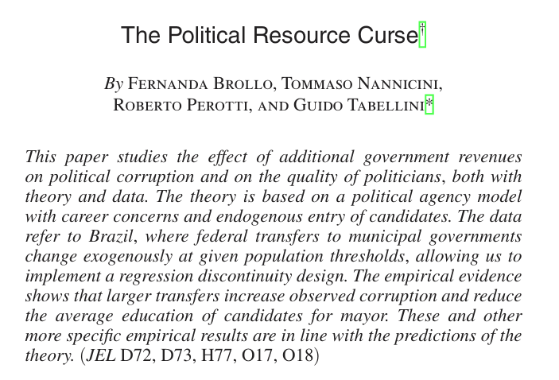
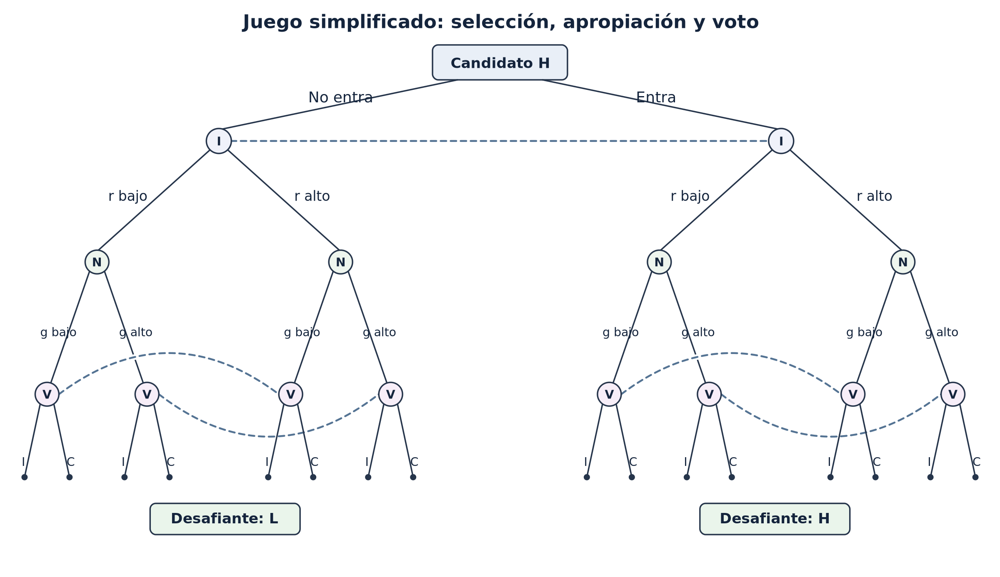
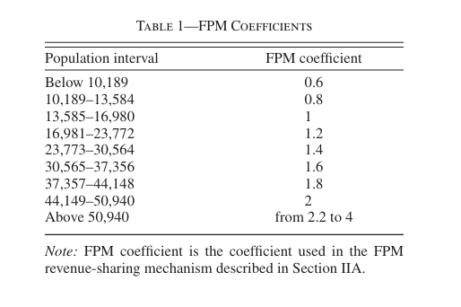
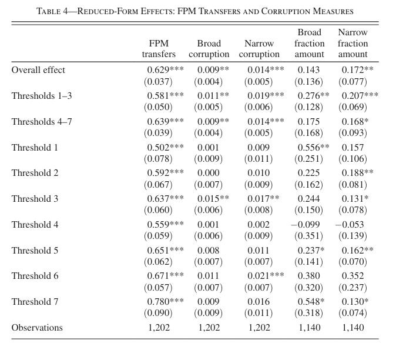
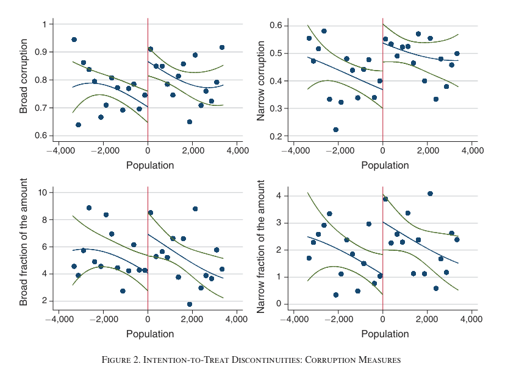

## El problema: ¿por qué mayores recursos pueden deteriorar la calidad del gobierno?

En el [capítulo anterior](04-principal-agente-elecciones-corrupcion.qmd) analizamos la relación entre ciudadanos y gobernantes como un problema de agencia. Los ciudadanos delegan decisiones en un representante cuyos intereses pueden diferir de los suyos. El representante obtiene beneficios de ocupar el cargo, pero depende de la decisión de los electores para continuar en él. Esa posibilidad de continuidad vincula su comportamiento presente con sus ingresos y beneficios futuros.

En el modelo de rendición de cuentas electoral estudiado a partir de Ferejohn (1986), el gobernante enfrenta una decisión intertemporal. Puede obtener mayores beneficios privados durante el período actual o contener esa apropiación para preservar su posición electoral. Ferraz y Finan (2011) examinan empíricamente una implicación de esta lógica: cuando los alcaldes brasileños tienen la posibilidad de ser reelegidos, sus incentivos para evitar la corrupción son mayores.

Una forma de expresar el problema de decisión que venimos estudiando es:

$$
V_1(a)=b(a)+\delta p(a)V_2.
$$

La variable $a$ representa la decisión del agente, $b(a)$ el beneficio privado presente, $p(a)$ la probabilidad de continuar en el cargo y $V_2$ el valor de ocuparlo en el futuro. El factor $\delta$ recoge cuánto valora los beneficios futuros frente a los presentes. Si obtener un beneficio privado adicional hoy reduce $p(a)$, aparece un costo intertemporal de la apropiación.

La condición marginal correspondiente, cuando existe una solución interior, es:

$$
b'(a)+\delta p'(a)V_2=0.
$$

El primer término mide la ganancia privada inmediata. El segundo mide la variación del valor esperado del futuro político. El equilibrio depende de la magnitud relativa de ambas fuerzas, incluida la capacidad de los ciudadanos para detectar y sancionar comportamientos oportunistas.

**Ejemplo.** Un alcalde puede desviar recursos y obtener una ganancia privada inmediata. Si el desvío reduce sus posibilidades de ganar una segunda elección, también pone en riesgo los beneficios de ejercer el cargo durante cuatro años adicionales. Cuando su mandato no admite reelección, desaparece ese incentivo electoral específico, aunque pueden permanecer sanciones legales, reputacionales y partidarias. El contraste permite explicar por qué las reglas de reelección pueden afectar la conducta del gobernante.

Consideremos ahora qué sucede si el municipio comienza a recibir mayores recursos. En principio, un presupuesto más elevado debería permitir financiar mejores servicios públicos, ampliar la infraestructura municipal o atender necesidades que antes no podían satisfacerse. Sin embargo, también aumenta la cantidad de recursos que el gobernante administra y, potencialmente, las oportunidades de apropiación privada. **¿Podría un aumento de los recursos públicos terminar incrementando la corrupción y deteriorando la calidad del gobierno?**

Para responder, extendamos el problema de agencia anterior incorporando explícitamente el presupuesto que el principal entrega al gobernante. Una parte de esos recursos puede destinarse a la provisión de bienes públicos y otra puede ser apropiada por el agente. La decisión del gobernante consiste en determinar cuánto destinar a cada uso, considerando que la apropiación genera beneficios privados inmediatos y puede afectar sus posibilidades de reelección.

**Ejemplo.** Supongamos que un municipio administra 100 unidades presupuestarias y que su alcalde destina 90 a servicios públicos y se apropia de 10. Si el presupuesto aumenta a 130, podría destinar 100 a servicios públicos y apropiarse de 30. Los ciudadanos observarían una mejora en la provisión de servicios, mientras que el monto apropiado se habría triplicado. El ejemplo muestra cómo un aumento del presupuesto puede modificar la relación entre los resultados que observan los ciudadanos y la conducta del gobernante.

Esta posibilidad amplía el problema de riesgo moral (*moral hazard*) que estudiamos anteriormente. Ahora podemos analizar cómo el tamaño del presupuesto afecta el beneficio de apropiarse de recursos y la intensidad de los incentivos electorales que disciplinan al gobernante.

Pero el incremento de los recursos también puede tener consecuencias anteriores a la elección. Si administrar un municipio permite obtener mayores rentas, el cargo se vuelve más atractivo para potenciales candidatos. Ese atractivo puede variar entre individuos según sus capacidades, oportunidades laborales fuera de la política y costos de apropiarse indebidamente de recursos. En consecuencia, un aumento del presupuesto puede modificar quiénes consideran conveniente ingresar a la competencia electoral.

Brollo et al. (2013) integran estos dos mecanismos en un modelo de agencia política con entrada endógena de candidatos. Primero, estudian cómo un aumento de los recursos disponibles afecta la apropiación de rentas por parte del gobernante. Luego incorporan individuos heterogéneos que deciden si entrar en política, permitiendo que la composición del conjunto de candidatos se determine dentro del propio modelo.

La relación entre ambos mecanismos tiene una consecuencia adicional. Si el aumento de las rentas atrae relativamente más a candidatos de menor competencia, el gobernante que busca reelegirse enfrentará adversarios de menor calidad esperada. Esto puede debilitar la amenaza electoral y aumentar todavía más sus incentivos para apropiarse de recursos.

El análisis de esta sesión se organiza, por tanto, alrededor de dos preguntas relacionadas:

1. **Riesgo moral:** ¿por qué un aumento del presupuesto puede incrementar la apropiación de recursos por parte del gobernante, aun cuando existen mecanismos de rendición de cuentas electoral?
2. **Selección política:** ¿cómo modifica ese aumento de recursos la composición del conjunto de candidatos y qué consecuencias tiene para los incentivos del gobernante?

La primera pregunta extiende el modelo de agencia que ya conocemos. La segunda incorpora una decisión adicional: la entrada de individuos heterogéneos a la competencia política. Al resolver ambas conjuntamente, podremos analizar cómo un cambio en los recursos disponibles afecta tanto la conducta de quienes gobiernan como la calidad de quienes aspiran a reemplazarlos. El abstract de Brollo, Nannicini, Perotti y Tabellini (2013) es el siguiente:

{fig-alt="Título, autores y abstract de The Political Resource Curse, de Brollo, Nannicini, Perotti y Tabellini (2013)." width=703}

## Recursos delegados, provisión pública y rentas políticas

### Una restricción presupuestaria con usos alternativos

Brollo, Nannicini, Perotti y Tabellini (2013) estudian un gobierno municipal que dispone, en cada período, de un presupuesto $\tau$. El alcalde puede asignar una parte a rentas que lo benefician privadamente, $r_t$, y el resto a bienes públicos. La capacidad de transformar los recursos restantes en servicios depende de su competencia administrativa, $\theta$:

$$
g_t=\theta(\tau-r_t).
$$

La apropiación está sujeta a un límite:

$$
0\leq r_t\leq\psi\tau,\qquad 0<\psi<1.
$$

Esta restricción formaliza que sólo una fracción del presupuesto puede destinarse a rentas privadas. Los electores valoran la provisión $g_t$, mientras que el gobernante valora las rentas y los beneficios de ejercer el cargo. En consecuencia, la misma unidad de recursos tiene usos que benefician a actores distintos.

**Ejemplo.** Consideremos un municipio con un presupuesto de 100 unidades y un límite de apropiación del 20%. Si el alcalde se apropia de 10 unidades, quedan 90 para financiar servicios. Con competencia $\theta=1{,}2$, la provisión obtenida es $g=108$. Otro alcalde con $\theta=1$ y la misma apropiación produce $g=90$. Un observador que sólo conoce la provisión final enfrenta un problema: un resultado bajo puede reflejar más apropiación, menor competencia o ambas.

Las decisiones sobre $\tau$, $r_t$ y $\theta$ desempeñan funciones analíticas diferentes. El presupuesto representa los recursos disponibles; $r_t$ es una decisión del gobernante; $\theta$ es una característica del individuo que afecta su capacidad de producir resultados. Separar estos componentes permite estudiar tanto los incentivos como la heterogeneidad entre políticos (Brollo et al., 2013, sección I.A, pp. 1762-1764).

### El juego político: jugadores, decisiones y secuencia de acontecimientos

Para estudiar cómo el tamaño del presupuesto afecta la conducta del gobernante, Brollo et al. (2013) construyen un juego de dos períodos. Durante el primero, un alcalde administra los recursos municipales y posteriormente enfrenta una elección. El ganador gobierna durante el segundo período, al término del cual finaliza el juego.

#### Los jugadores y sus características

El modelo considera tres actores políticos:

1. **El alcalde en ejercicio (*incumbent*).** Administra el presupuesto municipal y decide cuánto destinar a rentas privadas. Busca maximizar los beneficios presentes y futuros de ocupar el cargo, considerando que sus decisiones afectan la probabilidad de reelección.

2. **El candidato desafiante (*challenger*).** Compite contra el alcalde en la elección que separa ambos períodos. Su competencia administrativa esperada influye en la decisión de los electores. Inicialmente, el modelo considera que la identidad y el tipo del desafiante son determinados exógenamente. Más adelante se incorporará la decisión de entrar en política.

3. **Los electores.** Constituyen el principal en la relación de agencia. Valoran la provisión de bienes públicos y deciden si reeligen al alcalde o entregan el cargo al desafiante. Como no observan directamente la apropiación de recursos, deben evaluar al gobernante a partir de los resultados de su administración y de la información disponible sobre ambos candidatos.

Los políticos pueden pertenecer a dos tipos, $J\in\{H,L\}$, que representan distintos niveles de competencia administrativa esperada. Para cada individuo, la competencia efectiva $\theta$ se obtiene de una distribución uniforme cuya media depende de su tipo:

$$
E(\theta\mid J)=1+\sigma_J,
$$

donde $\sigma_H=\sigma$ y $\sigma_L=-\sigma$, con $0<\sigma<1$.

Por construcción, los políticos de tipo $H$ son más competentes en promedio. Sin embargo, las distribuciones pueden superponerse: un individuo de tipo $L$ puede resultar más competente que uno de tipo $H$.

El tipo de un candidato es observable, mientras que su competencia efectiva $\theta$ es inicialmente desconocida. Esta diferencia permite que los electores utilicen tanto las características conocidas de los candidatos como los resultados de gobierno para formar expectativas sobre su desempeño futuro.

#### Las preferencias y funciones de utilidad

Los electores valoran exclusivamente los bienes públicos que reciben. Su utilidad durante cada período es:

$$
W_t=g_t.
$$

Por su parte, los alcaldes obtienen beneficios de las rentas apropiadas, aunque enfrentan el riesgo de ser descubiertos y sancionados.

La probabilidad de detectar apropiación indebida de recursos es:

$$
d(r_t)=qr_t,
$$

donde $q>0$ representa un parámetro de la tecnología de fiscalización. Cuando el alcalde es descubierto, enfrenta una pérdida de utilidad $\lambda_J$, que depende de su tipo.

Los autores suponen que $\lambda_H>\lambda_L$: los políticos de mayor calidad enfrentan mayores costos reputacionales por ser descubiertos. Por tanto, el valor esperado de cada unidad apropiada es:

$$
\alpha_J=1-\lambda_Jq.
$$

Además, los políticos reciben beneficios asociados al ejercicio del cargo, representados por $R$.

La utilidad esperada de un alcalde de tipo $J$ en el segundo período es:

$$
V_2^J=\alpha_Jr_2+R.
$$

En el primer período, la posibilidad de reelección agrega un beneficio futuro:

$$
V_1^J=\alpha_Jr_1+R+p_JV_2^J,
$$

donde $p_J$ es la probabilidad de reelección que el alcalde anticipa cuando decide cuánto apropiarse.

Estas funciones mantienen la estructura intertemporal del problema de agencia estudiado anteriormente. La apropiación proporciona beneficios presentes, pero puede reducir la probabilidad de acceder a los beneficios futuros de ocupar el cargo.

#### Las reglas y la secuencia del juego

El orden de los acontecimientos determina qué información tiene cada jugador cuando toma sus decisiones.

**Etapa 1. Decisión del alcalde.**

Al comenzar el primer período, el alcalde conoce su propio tipo $J$, pero desconoce la realización exacta de su competencia $\theta$. Tampoco conoce todavía la identidad de su futuro competidor.

Sabe que el desafiante será de tipo $L$ con probabilidad $\pi$ y de tipo $H$ con probabilidad $1-\pi$.

Con esa información, decide cuántos recursos apropiarse:

$$
r_1\in[0,\psi\tau].
$$

Su decisión determina, junto con su competencia administrativa, los bienes públicos producidos:

$$
g_1=\theta(\tau-r_1).
$$

**Etapa 2. Identificación del desafiante.**

Se determina quién competirá contra el alcalde. Su tipo, $H$ o $L$, se hace público, aunque su competencia efectiva $\theta$ permanece desconocida.

Los electores conocen entonces el tipo de ambos candidatos.

**Etapa 3. Elección.**

Los ciudadanos observan la provisión de bienes públicos $g_1$, pero no observan directamente las rentas apropiadas $r_1$.

Al evaluar al alcalde, deben considerar que el resultado observado depende de dos factores: la cantidad de recursos destinados a bienes públicos y la competencia administrativa de quien los utiliza.

Los electores comparan las expectativas de desempeño futuro de los candidatos y deciden si reeligen al incumbente o eligen al desafiante.

**Etapa 4. Fiscalización y sanción.**

Después de la elección se realiza la auditoría del primer período. Si se descubre apropiación indebida de recursos, el alcalde recibe la sanción correspondiente.

El orden es importante: como la fiscalización ocurre después de la elección, los electores no conocen su resultado cuando votan. Su decisión electoral depende de lo que pueden inferir a partir de los bienes públicos observados y las características conocidas de los candidatos.

**Etapa 5. Segundo período.**

El candidato que ganó la elección administra el presupuesto del segundo período y decide cuánto apropiarse, $r_2$.

Al finalizar se realiza una nueva auditoría y se aplican las sanciones correspondientes. Como el juego termina después de este período, el gobernante ya no enfrenta un incentivo de reelección dentro del modelo.

Una versión simplificada del juego es la que se presenta a continuación. 

{fig-alt="Árbol del juego simplificado de selección, apropiación y voto: entrada del candidato H, decisiones de rentas del incumbente, provisión de bienes públicos y elección de los votantes, con sus conjuntos de información." width=100%}

#### ¿Qué resultados determina el juego?

Dadas las características de los candidatos, el tamaño del presupuesto y las reglas de fiscalización, el modelo permite determinar conjuntamente varios resultados:

- **La apropiación de rentas:** cuánto decide apropiarse el alcalde, $r_1$ y $r_2$.
- **La provisión de bienes públicos:** cuánto reciben los electores como resultado de las decisiones presupuestarias y la competencia del gobernante, $g_1$ y $g_2$.
- **La probabilidad de reelección:** cómo el desempeño observado y las características de los candidatos afectan $p_J$.
- **Las sanciones esperadas:** cómo la probabilidad de detectar irregularidades y sus consecuencias afectan el valor de apropiarse de recursos.

**Ejemplo.** Supongamos que dos alcaldes disponen del mismo presupuesto y producen idéntica cantidad de bienes públicos. Uno es considerado de alta competencia administrativa y el otro de baja competencia. Aunque los ciudadanos observan el mismo resultado, pueden hacer inferencias diferentes: un alcalde del que se esperaba una elevada capacidad de gestión podría haber destinado más recursos a fines privados, mientras que el otro podría haber producido el mismo resultado con menor apropiación y menor competencia efectiva.

De este modo, la información sobre el tipo del político influye en la interpretación de su desempeño y en sus posibilidades de reelección.

En esta primera formulación, la probabilidad $\pi$ de enfrentar a un desafiante de baja calidad se considera dada. Esto permite resolver el problema de apropiación de rentas manteniendo constante la composición esperada de los competidores.

Posteriormente, el modelo incorporará una decisión adicional: los individuos deberán decidir si ingresar a la competencia política. La composición de los candidatos, y por tanto $\pi$, pasará a determinarse endógenamente. Así podremos estudiar cómo un aumento del presupuesto afecta primero los incentivos del gobernante y luego, a través de la selección de candidatos, las condiciones de competencia electoral que enfrenta.

### La inferencia electoral a partir de los resultados observados

La secuencia del juego deja a los electores con un problema de inferencia. Cuando votan, conocen el presupuesto y el tipo del incumbente, y observan $g_1$. Como desconocen $r_1$, deben interpretar ese resultado a partir de lo que esperan que haga un político de ese tipo. Si en equilibrio anticipan que un alcalde de tipo $J$ elige $r_1^{J*}$, la restricción presupuestaria permite recuperar la competencia que atribuyen al incumbente:

$$
\widehat\theta(g_1,J)=\frac{g_1}{\tau-r_1^{J*}}.
$$

La expresión muestra cómo se conectan las decisiones no observadas con los resultados electorales. Una mayor apropiación efectiva, manteniendo constante la competencia del alcalde, reduce $g_1$. Los electores, que utilizan la apropiación esperada $r_1^{J*}$ para interpretar el resultado, atribuyen esa menor provisión a una competencia más baja. Por esta vía, la apropiación presente puede perjudicar la reelección aun cuando los votantes no observen directamente los recursos desviados.

**Ejemplo.** Supongamos que el presupuesto es de 100 unidades y los electores esperan que un alcalde de cierto tipo se apropie de 10. Si observan una provisión $g_1=99$, infieren $\widehat\theta=99/90=1{,}1$. Si el resultado fuese $g_1=81$, la competencia inferida sería $\widehat\theta=81/90=0{,}9$. Una caída de la provisión modifica, por tanto, la evaluación electoral del alcalde. El cálculo utiliza las rentas que los votantes esperan en equilibrio, no una observación directa de las rentas efectivamente apropiadas.

La exigencia electoral también depende del desafiante. Si los votantes esperan que un candidato de tipo $H$ administre mejor que uno de tipo $L$, un mismo desempeño del incumbente puede ser suficiente para derrotar al segundo y resultar insuficiente frente al primero. Por ejemplo, con $\sigma=0{,}2$, un incumbente cuya competencia inferida es $1{,}1$ supera la media de un desafiante de tipo $L$ ($0{,}8$), pero no la de uno de tipo $H$ ($1{,}2$). La comparación supone iguales recursos y reglas de apropiación para cualquiera que gobierne en el período final.

Como el incumbente decide $r_1$ antes de conocer el tipo de su oponente, anticipa ambos escenarios. Su probabilidad de reelección $p_J(r_1;\tau,\pi)$ reúne la respuesta de los votantes ante la provisión observada y las probabilidades de enfrentar a cada tipo de desafiante. La composición esperada de los competidores, resumida inicialmente por $\pi$, influye así en el costo electoral de apropiarse de recursos.

### La decisión óptima del alcalde: inducción hacia atrás

El juego se resuelve comenzando por el segundo período. Quien ocupa el cargo en esa etapa ya no enfrenta otra elección. Como $\alpha_J>0$, cada unidad adicional apropiada aumenta su utilidad esperada. En consecuencia, el alcalde elige el máximo permitido por la restricción presupuestaria:

$$
r_2^{J*}=\psi\tau.
$$

Al sustituir esta decisión en el valor del segundo período, obtenemos:

$$
V_2^{J*}(\tau)=\alpha_J\psi\tau+R.
$$

Este resultado permite determinar cuánto vale conservar el cargo antes de decidir la apropiación del primer período. El incumbente resuelve:

$$
\max_{0\leq r_1\leq\psi\tau}
\left\{\alpha_Jr_1+R+p_J(r_1;\tau,\pi)\bigl(\alpha_J\psi\tau+R\bigr)\right\}.
$$

La elección de $r_1$ enfrenta el beneficio marginal de apropiarse de recursos con la pérdida del valor esperado de la reelección. Si la solución es interior, la condición de primer orden es:

$$
\alpha_J+
\frac{\partial p_J(r_1;\tau,\pi)}{\partial r_1}
\bigl(\alpha_J\psi\tau+R\bigr)=0.
$$

Como $\partial p_J/\partial r_1<0$, el segundo término representa el costo electoral esperado de apropiarse de una unidad adicional. La condición muestra cómo un aumento de las rentas debe compensarse con la pérdida marginal de oportunidades futuras.

**Ejemplo.** Sea $\alpha_J=0{,}8$, $\psi=0{,}2$ y $R=8$. Si el presupuesto es de 100 unidades, el valor de ocupar el cargo en el segundo período es $V_2^{J*}=0{,}8(20)+8=24$. Si el presupuesto aumenta a 200, ese valor llega a $0{,}8(40)+8=40$. Así, un presupuesto mayor también aumenta lo que el alcalde arriesga al perder la elección. Para determinar cuánto decidirá apropiarse en cada caso, debemos conocer además cómo varía la probabilidad de reelección con $r_1$.

El presupuesto actúa por dos vías que ahora pueden analizarse conjuntamente. Al aumentar $\tau$, crece el valor futuro de ocupar el cargo, lo que refuerza el incentivo a conservarlo. También cambia la sensibilidad de la evaluación electoral ante cada unidad apropiada, pues los votantes infieren la competencia a partir de resultados producidos con un presupuesto distinto. La siguiente sección estudia el efecto de ambas fuerzas sobre las rentas de equilibrio (Brollo et al., 2013, sección I.A-B, pp. 1763-1765).

## ¿Qué ocurre cuando aumenta el presupuesto?

Mantengamos inicialmente constante el conjunto de posibles competidores. Un aumento de $\tau$ entrega al alcalde más recursos administrables. Al mismo tiempo, altera la capacidad de los electores para inferir apropiación a partir de los bienes públicos producidos.

**Ejemplo.** Dos municipios tienen alcaldes de competencia similar. En uno, el presupuesto es 100 y se desvían 5 unidades; en el otro, el presupuesto es 200 y se desvían 5 unidades. La reducción absoluta de recursos disponibles es igual, pero representa una proporción mucho menor del presupuesto del segundo municipio. En el modelo, ese contraste afecta la sensibilidad de la probabilidad de reelección ante variaciones en las rentas, dada la estructura de información sobre la competencia del gobernante.

Brollo et al. derivan que, al aumentar el presupuesto, la sanción electoral marginal asociada a apropiarse de rentas disminuye en valor absoluto. Por ello, las rentas de equilibrio aumentan:

$$
\frac{\partial r_1^{J*}}{\partial\tau}>0.
$$

También importa quién gobierna. Los autores suponen $\lambda_H>\lambda_L$, por lo que descubrir apropiación genera un costo reputacional mayor para un político de tipo $H$. De ello se deriva que, manteniendo lo demás constante, los incumbentes de tipo $H$ se apropian de menos rentas que los de tipo $L$:

$$
r_1^{H*}<r_1^{L*}.
$$

La calidad esperada de los competidores constituye otro límite a la apropiación. Un incumbente que anticipa enfrentar un oponente más competente tiene mayores incentivos para preservar su desempeño electoral. El modelo predice asimismo que la influencia del presupuesto sobre las rentas es menor cuando la competencia esperada del oponente es mayor (Brollo et al., 2013, sección I.B, predicciones 1-3).

Hasta aquí hemos permitido que el presupuesto modifique las decisiones del gobernante. El siguiente paso consiste en examinar cómo el presupuesto afecta las decisiones de personas que todavía no ocupan el cargo.

## La entrada en política como decisión económica

### Individuos heterogéneos y oportunidades exteriores

Consideremos dos personas con capacidad de administrar un municipio. Una cuenta con oportunidades laborales atractivas fuera de la política; la otra dispone de alternativas menos remuneradas. Ambas pueden valorar el ejercicio de un cargo público, pero renunciar a sus actividades actuales tiene costos distintos. Además, pueden diferir en el costo reputacional de ser descubiertas apropiándose de rentas.

Brollo et al. consideran una población con dos grupos de individuos, $H$ y $L$, que difieren en competencia esperada y costo de oportunidad. Dentro de cada grupo hay personas con costos de oportunidad distintos. Para la persona $i$ del grupo $J$, el costo de entrar a la actividad política se expresa como:

$$
c_{iJ}=iy_J,\qquad y_H>y_L>0.
$$

La correlación positiva entre competencia política esperada y oportunidades exteriores permite estudiar selección: participar resulta relativamente más costoso para algunas personas que, en promedio, también serían administradores más competentes. La relación no es perfecta porque el factor $i$ introduce heterogeneidad adicional dentro de cada tipo.

### El valor esperado de convertirse en candidato

Ingresar a la política significa entrar en un conjunto de $n=n_H+n_L$ aspirantes. De él se selecciona un solo oponente para enfrentar al incumbente. Todos los aspirantes tienen, por supuesto, la misma probabilidad $1/n$ de ser seleccionados en el modelo; esta simplificación deja fuera los mecanismos de nominación de partidos.

Si un individuo de tipo $J$ es seleccionado, gana con probabilidad $p_J^*$ y obtiene $V_2^J$. La condición para entrar es:

$$
\boxed{iy_J\leq \frac{p_J^*}{n}V_2^J.}
$$

En el lado izquierdo está el costo de oportunidad. En el derecho, el valor esperado de entrar. Quien pierde o no es seleccionado recibe cero dentro de esta representación. El tamaño del conjunto $n$ también importa: si entran más aspirantes, cada uno tiene una probabilidad menor de llegar a competir contra el alcalde.

**Ejemplo.** Si una persona tiene una probabilidad de 1 en 10 de convertirse en candidata, una probabilidad de 1 en 2 de ganar y un beneficio de 200 unidades al ejercer el cargo, el valor esperado de entrar es 10. A quien le cuesta 6 unidades renunciar a sus alternativas le conviene ingresar; a quien le cuesta 15, no. Si se duplicara el beneficio del cargo, el valor esperado de entrada aumentaría a 20 para ambas personas. La respuesta de cada una dependería de su costo de oportunidad. Los números ilustran la condición de entrada y no corresponden a estimaciones del estudio.

### Del incentivo individual a la composición del conjunto

La utilidad de ejercer el cargo depende de los recursos apropiables y del costo esperado de la apropiación. Como los autores suponen $\lambda_H>\lambda_L$, el valor neto de las rentas es mayor para los individuos de tipo $L$:

$$
\alpha_L>\alpha_H.
$$

Cuando el presupuesto aumenta, el valor esperado del cargo crece relativamente más para ese grupo. En equilibrio, una mayor fracción de aspirantes pertenece al tipo $L$. Si definimos:

$$
\pi=\frac{n_L}{n_H+n_L},
$$

la predicción de selección es:

$$
\frac{d\pi}{d\tau}>0.
$$

El resultado depende de la mayor valoración relativa de las rentas por parte de los individuos de tipo $L$. Si los costos reputacionales relativos fueran diferentes, cambiaría la predicción. También depende de simplificar la selección partidaria mediante la probabilidad común de nominación $1/n$ (Brollo et al., 2013, sección I.C, ecuación 4 y predicción 4).

**Ejemplo.** Imaginemos una alcaldía cuyo presupuesto crece sin que aumenten en la misma proporción los mecanismos de supervisión. La ampliación hace el puesto atractivo para profesionales interesados en administrar más proyectos, pero también aumenta el valor de los recursos de los que podría apropiarse un gobernante. Si esa última ventaja pesa relativamente más entre personas con menores costos reputacionales, la composición de aspirantes se desplaza hacia ese grupo. La magnitud y aun la dirección del efecto dependen de los supuestos sobre quiénes valoran más cada beneficio y cuánto cuesta ingresar a la política.

## Equilibrio con entrada endógena

La entrada cambia la competencia que enfrenta el incumbente. Los votantes comparan la continuidad del alcalde con la calidad esperada del desafiante. Si el conjunto de aspirantes contiene una proporción mayor de individuos de tipo $L$, la alternativa electoral se vuelve menos exigente en términos de competencia esperada.

El modelo predice que, incluso apropiándose de más recursos, el incumbente puede aumentar su probabilidad de reelección. Los votantes comparan alternativas disponibles y la composición de esas alternativas cambia con el presupuesto (Brollo et al., 2013, sección I.C, predicción 5).

Podemos expresar la lógica del efecto total de un cambio presupuestario sobre las rentas mediante la regla de la cadena. Sea $\bar\theta_o$ la competencia esperada del conjunto de posibles competidores:

$$
\frac{dr_1^{J*}}{d\tau}
=
\underbrace{\frac{\partial r_1^{J*}}{\partial\tau}}_{\text{Efecto directo}}
+
\underbrace{
\frac{\partial r_1^{J*}}{\partial\bar\theta_o}
\frac{d\bar\theta_o}{d\tau}
}_{\text{Efecto vía selección}}.
$$

El primer componente corresponde a la respuesta del incumbente cuando cambia el presupuesto y se mantiene constante la composición esperada de sus oponentes. El segundo incorpora la variación de esa composición. En el equilibrio descrito por los autores, ambos componentes aumentan las rentas de apropiación (Brollo et al., 2013, sección I.C, predicción 6).

Esta descomposición permite distinguir dos efectos institucionales. Uno opera sobre las decisiones de actores que ya ocupan sus posiciones. El otro opera sobre las características de quienes consideran ingresar en ellas. Una misma variación presupuestaria activa ambos mecanismos y produce un efecto total que depende de su interacción.

## De las predicciones del modelo a variables observables

El modelo ofrece seis predicciones interrelacionadas. Su contraste requiere traducir conceptos teóricos a indicadores, identificar cambios presupuestarios que no respondan a las características de los municipios y distinguir, cuando sea posible, los mecanismos que producen cada resultado.

| Concepto o predicción | Magnitud observada en los datos | Decisión de medición |
|---|---|---|
| Presupuesto municipal $\tau$ | Transferencias del Fondo de Participación de los Municipios (FPM) | Utilizar transferencias efectivas; construir además transferencias teóricas a partir de la regla legal |
| Apropiación de rentas $r_t$ | Irregularidades detectadas en auditorías federales | Definir medidas amplias y restringidas de corrupción |
| Tipo del político $J$ | Educación de los candidatos opositores | Usar proporción con educación superior y años promedio de escolaridad |
| Composición del conjunto de competidores $\pi$ | Educación de los oponentes del incumbente | Restringir la muestra de selección a elecciones donde el alcalde busca reelegirse |
| Valor de continuidad $p_J$ | Reelección del incumbente | Indicador binario de victoria electoral |
| Castigo por apropiación | Efecto electoral de divulgar irregularidades antes de la elección | Combinar el momento de divulgación con las discontinuidades de transferencias |

Las auditorías registran irregularidades administrativas y posibles actos de corrupción, mientras que el modelo describe una apropiación privada de rentas. Por esa razón, los autores construyen una medida amplia de irregularidades y otra restringida a episodios graves. La medida empírica se aproxima al mecanismo teórico, pero no observa directamente cada unidad de $r_t$.

La educación cumple una función distinta. En el modelo, la competencia administrativa efectiva es $\theta$ y el tipo observable $J$ permite anticipar su distribución. En los datos, el nivel educacional aproxima el tipo, sin medir directamente la capacidad de gestión ni los costos reputacionales. El ejercicio empírico contrasta cambios en la composición educacional de candidatos, un resultado observable vinculado al mecanismo de selección propuesto (Brollo et al., 2013, sección II, pp. 1769-1777).

## Cómo identificar el efecto causal de los recursos

### La dificultad de comparar municipios ricos y pobres

Una regresión de corrupción sobre transferencias podría reflejar diferencias que preceden a los recursos fiscales. Municipios con mayores necesidades pueden recibir transferencias más grandes y, simultáneamente, enfrentar dificultades administrativas. Las autoridades también podrían influir sobre las transferencias que reciben. En ambos casos, la asociación entre presupuesto y corrupción mezcla el efecto de los recursos con características previas.

Los autores aprovechan una regla brasileña de distribución del FPM: el coeficiente que determina una parte de las transferencias federales aumenta por tramos cuando la población estimada por el Instituto Brasileño de Geografía y Estadística supera umbrales preestablecidos.

Por ejemplo, el coeficiente FPM es 0,8 para municipios de 10.189 a 13.584 habitantes y 1,0 para municipios de 13.585 a 16.980 habitantes. A cada lado del umbral de 13.585 habitantes, poblaciones casi iguales pueden implicar transferencias teóricas diferentes. Las primeras siete discontinuidades permiten analizar municipios de menos de 50.940 habitantes (Brollo et al., 2013, tabla 1, p. 1770):

{fig-alt="Tabla 1 de Brollo et al. (2013): intervalos de población y coeficientes del Fondo de Participación de los Municipios (FPM)." width=514}

**Ejemplo.** Supongamos dos municipios similares con 13.584 y 13.585 habitantes, respectivamente. Su población difiere en una persona, pero la regla asigna distintos coeficientes de transferencia. Si sus otras características cambian continuamente alrededor del umbral, la diferencia de transferencias ofrece una fuente de variación útil para estudiar qué sucede con las decisiones de los gobernantes y la composición de candidatos.

### Por qué la discontinuidad es *fuzzy*

La transferencia efectivamente recibida no coincide siempre con la cantidad que corresponde a la regla. Hubo asignaciones administrativas inconsistentes con las estimaciones de población y disposiciones transitorias que afectaron algunos municipios. Por ello, cruzar el umbral modifica de manera discontinua las transferencias **esperadas**, pero el tratamiento efectivo no se ajusta mecánicamente a la regla.

Denotemos por $\widehat\tau_i$ las transferencias teóricas y por $\tau_i$ las transferencias efectivas. Los autores usan $\widehat\tau_i$ como instrumento de $\tau_i$. Esta estrategia corresponde a una regresión discontinua *fuzzy*: la regla cambia la intensidad de exposición a los recursos, aunque exista cumplimiento imperfecto (Brollo et al., 2013, sección III.A).

Para un único umbral $c$, definimos la distancia $x_i=P_i-c$, donde $P_i$ es la población del municipio. El estimando local puede expresarse como:

$$
\beta_{\mathrm{FRD}}
=
\frac{
\lim_{x\downarrow 0}E[Y_i\mid x_i=x]
-
\lim_{x\uparrow 0}E[Y_i\mid x_i=x]
}{
\lim_{x\downarrow 0}E[\tau_i\mid x_i=x]
-
\lim_{x\uparrow 0}E[\tau_i\mid x_i=x]
}.
$$

El numerador es el salto del resultado en el umbral. El denominador es el salto de las transferencias efectivas. Su cociente expresa el cambio en el resultado por unidad adicional de transferencias inducida por la regla, bajo los supuestos de identificación.

### Las ecuaciones que estiman los autores

El estudio utiliza los siete umbrales y estima una relación entre transferencias efectivas y teóricas (primera etapa):

$$
\tau_i=g(P_i)+\alpha_{\tau}\widehat\tau_i+\delta_t+\gamma_s+u_i.
$$

Después estima la forma reducida para un resultado $Y_i$, que puede ser corrupción, educación de los oponentes o reelección:

$$
Y_i=g(P_i)+\alpha_Y\widehat\tau_i+\delta_t+\gamma_s+\eta_i.
$$

Finalmente, utiliza las transferencias teóricas como instrumento de las efectivas:

$$
Y_i=g(P_i)+\beta_Y\tau_i+\delta_t+\gamma_s+\varepsilon_i,
\qquad \tau_i\text{ instrumentada por }\widehat\tau_i.
$$

Aquí $g(P_i)$ controla de manera flexible la relación entre población y resultado; $\delta_t$ controla diferencias entre períodos de gobierno; $\gamma_s$ representa los controles geográficos incluidos en la especificación. Los autores emplean un polinomio cúbico de población normalizada y errores estándar agrupados por municipio. Las ecuaciones 5–7 describen efectos de estado, mientras que las notas de las tablas 4, 5, 8 y 9 indican controles de macroregión. Esta diferencia entre la exposición general y las notas de las tablas exige verificar cada script original antes de ejecutar la reproducción (Brollo et al., 2013, ecuaciones 5-7 y tablas 4-9).

Para interpretar causalmente estas estimaciones se requiere continuidad de los resultados potenciales en torno a los umbrales, ausencia de otras políticas relevantes que cambien exactamente allí y ausencia de manipulación precisa de las cifras de población utilizadas para construir el instrumento. La interpretación instrumental añade los supuestos de exclusión y monotonicidad. Los autores evalúan discontinuidades en la densidad poblacional, balance de covariables predeterminadas y especificaciones alternativas. El resultado identifica efectos locales alrededor de los umbrales para municipios cuyas transferencias responden a la regla.

### Las muestras usadas para la estimación

Los resultados de corrupción provienen de 1.202 observaciones municipio-período con auditorías aleatorias. Para observar la composición de los competidores, los autores utilizan una muestra mayor, de 2.877 observaciones en elecciones en las que el incumbente se presenta a la reelección. Esta última restricción sigue el modelo, porque identifica un grupo de oponentes frente a un gobernante que busca continuar.

La selección de municipios según la decisión del incumbente de competir puede tener consecuencias para la interpretación. Los autores examinan también especificaciones con un conjunto más amplio de elecciones. Es necesario distinguir el efecto causal de las transferencias dentro de la muestra analizada de la posibilidad de extrapolar ese efecto a todas las elecciones municipales.

## Estimaciones: qué evidencia corresponde a cada mecanismo

### Recursos e irregularidades administrativas

Las tablas 4 y 5 estudian la corrupción. En la tabla 4, la primera etapa de la muestra auditada estima $\widehat\alpha_{\tau}=0{,}629$, mientras que la forma reducida estima coeficientes de 0,009 para corrupción amplia y 0,014 para corrupción grave. En la tabla 5, los coeficientes instrumentales respectivos son 0,014 y 0,022, con errores estándar agrupados de 0,007 y 0,008. Las transferencias están expresadas en unidades de 100.000 reales a precios del año 2000.

{fig-alt="Tabla 4 de Brollo et al. (2013): efectos de forma reducida de las transferencias FPM sobre las medidas de corrupción, para el conjunto de umbrales y por umbral." width=674}

{fig-alt="Figura 2 de Brollo et al. (2013): discontinuidades en cuatro medidas de corrupción alrededor de los umbrales de población del FPM." width=851}

Los resultados son consistentes con la predicción de que mayores recursos fiscales incrementan la apropiación de rentas, aunque la medición observada corresponde a la presencia de irregularidades detectadas. El análisis de mecanismos examina, además, si el castigo electoral por corrupción disminuye en municipios con más transferencias (tabla 6) y si el efecto de las transferencias sobre la corrupción es menor cuando los oponentes tienen más educación (tabla 7).

### Recursos y selección política

Las tablas 8 y 9 se concentran en la composición de los candidatos y la reelección del incumbente. Para la muestra completa de selección, la tabla 8 informa una primera etapa de 0,732. Las formas reducidas son -0,006 para la proporción de oponentes con educación superior, -0,056 para sus años promedio de escolaridad y 0,009 para la reelección del alcalde.

La tabla 9 presenta los efectos estimados mediante variables instrumentales:

| Resultado | Coeficiente IV | Error estándar | Observaciones |
|---|---:|---:|---:|
| Fracción de oponentes con educación superior | -0,008 | 0,004 | 2.877 |
| Años promedio de escolaridad de oponentes | -0,077 | 0,026 | 2.877 |
| Reelección del incumbente | 0,012 | 0,005 | 2.877 |

*Fuente:* Brollo et al. (2013), tablas 8 y 9, pp. 1791-1792. Cada coeficiente IV corresponde a un incremento de 100.000 reales en transferencias efectivas, medidos a precios de 2000. Las variables de educación se refieren a los oponentes en elecciones donde el incumbente compite por reelegirse.

Un incremento de 100.000 reales en transferencias efectivas reduce la proporción de oponentes con estudios superiores en aproximadamente 0,8 puntos porcentuales e incrementa la probabilidad de reelección del incumbente en aproximadamente 1,2 puntos porcentuales, según las estimaciones instrumentales. Estos coeficientes describen efectos marginales del modelo estimado; para interpretar cambios porcentuales se debe considerar el nivel inicial de transferencias y la media de cada resultado.

Los autores también documentan que el aumento de corrupción es mayor cuando los oponentes tienen menor educación. La evidencia vincula el incentivo presupuestario con un cambio de composición electoral y con la conducta del incumbente, aunque no permite observar directamente las decisiones de entrada de todas las personas que consideraron postular.

## Discusión de los supuestos y sus implicaciones

La teoría combina información imperfecta, heterogeneidad individual y entrada endógena. Cada componente habilita una predicción distinta:

1. Si los votantes observan la provisión pública y desconocen las rentas, deben inferir la competencia del alcalde. El aumento presupuestario modifica esa inferencia y los incentivos de apropiación.
2. Si algunos individuos tienen mayores oportunidades fuera de la política, la decisión de competir varía entre tipos y dentro de cada tipo.
3. Si las rentas apropiadas generan costos reputacionales diferentes, un aumento del presupuesto modifica de manera desigual el atractivo del cargo.
4. Si el incumbente compite contra candidatos cuya composición ha cambiado, su propia decisión óptima también se modifica.

La estrategia empírica combina una regla administrativa de asignación de transferencias, datos de auditoría y registros de candidatos. Su fuerza principal radica en la discontinuidad de recursos fiscales, que permite evaluar efectos causales locales. El vínculo entre la educación observada, la competencia administrativa y la entrada individual exige supuestos adicionales. Asimismo, las estimaciones de corrupción combinan la reacción conductual directa y los posibles efectos de la composición de candidatos; separar cuantitativamente ambos componentes es más difícil.

El modelo también permite precisar su alcance. La variación estudiada corresponde a presupuestos administrados por autoridades; el salario legal de los políticos constituye una fuente de ingresos distinta de las rentas apropiables. Por ello, la dirección de la selección prevista en el artículo depende del valor que las rentas apropiables tengan para los distintos tipos y de los mecanismos institucionales de sanción y nominación.

Las elecciones generan incentivos para que los gobernantes consideren los efectos futuros de sus decisiones presentes. Cuando introducimos un presupuesto administrable, esos incentivos también dependen del volumen de recursos y de la información disponible para los electores. A su vez, el valor de controlar recursos modifica las decisiones de entrada de personas heterogéneas.

La decisión del gobernante y la decisión del potencial candidato quedan así vinculadas. El alcalde elige cuánto apropiarse según la amenaza electoral que enfrenta. La amenaza electoral depende de las características de los competidores. Esas características dependen, en parte, de las rentas que ofrece el cargo. El equilibrio integra, por tanto, comportamiento y selección.

La misma lógica puede extenderse a otras instituciones. En una legislatura, las facultades de ciertas comisiones o cargos directivos pueden influir en quiénes buscan ocuparlos. En la competencia redistributiva, la capacidad de distribuir beneficios modifica tanto los incentivos de los partidos como el valor político de controlar los recursos (Dixit y Londregan, 1996; Krehbiel, 2004). El análisis institucional debe examinar las decisiones de quienes participan actualmente y las decisiones de quienes podrían ingresar.

### Preguntas para que le den una vuelta...

1. ¿Qué supuesto específico permite que un aumento del presupuesto reduzca el castigo electoral marginal de la apropiación? ¿Qué ocurriría si los ciudadanos observaran directamente $r_t$?
2. ¿Cómo cambiaría la selección de candidatos si los políticos más competentes también obtuvieran un beneficio mayor de administrar proyectos públicos, con independencia de las rentas apropiables?
3. ¿Qué implica sustituir la probabilidad común de nominación $1/n$ por una regla en la que los partidos eligen candidatos según competencia y posibilidad de ganar?
4. ¿Qué resultado de la tabla 9 puede interpretarse directamente como evidencia de un cambio observable en la composición de la competencia? ¿Qué información adicional se necesitaría para observar la entrada individual?
5. ¿Por qué el coeficiente IV se interpreta localmente alrededor de los umbrales? ¿Qué evidencia podría cuestionar esa interpretación?

## Referencias

Brollo, F., Nannicini, T., Perotti, R., & Tabellini, G. (2013). The Political Resource Curse. *American Economic Review, 103*(5), 1759-1796. https://doi.org/10.1257/aer.103.5.1759

Brollo, F., Nannicini, T., Perotti, R., & Tabellini, G. (2019). *Replication data for: The Political Resource Curse* (versión V1) [Datos y código]. openICPSR. https://doi.org/10.3886/E112657V1

Dixit, A., & Londregan, J. (1996). The Determinants of Success of Special Interests in Redistributive Politics. *The Journal of Politics, 58*(4), 1132-1155. https://www.jstor.org/stable/2960152

Ferejohn, J. A. (1986). Incumbent Performance and Electoral Control. *Public Choice, 50*(1-3), 5-25.

Ferraz, C., & Finan, F. (2011). Electoral Accountability and Corruption: Evidence from the Audits of Local Governments. *American Economic Review, 101*(4), 1274-1311. https://doi.org/10.1257/aer.101.4.1274

Krehbiel, K. (2004). Legislative Organization. *Journal of Economic Perspectives, 18*(1), 113-128. https://doi.org/10.1257/089533004773563467
