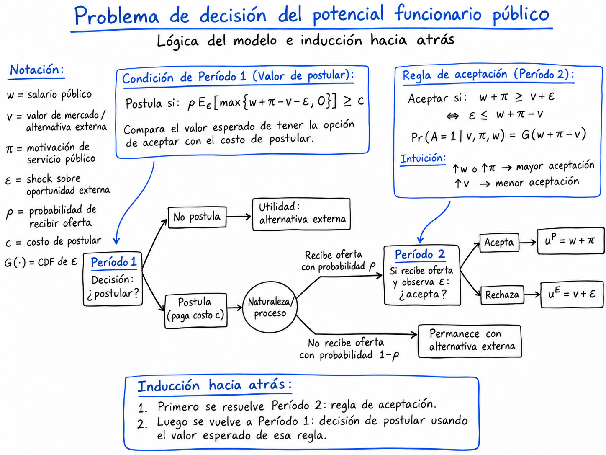
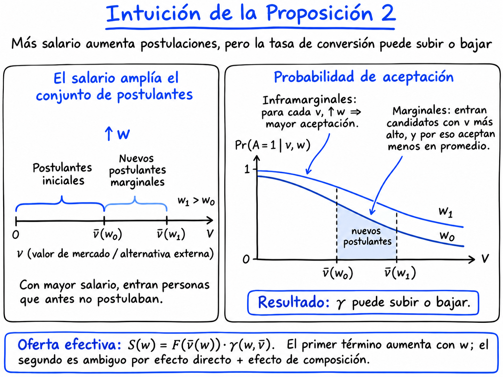
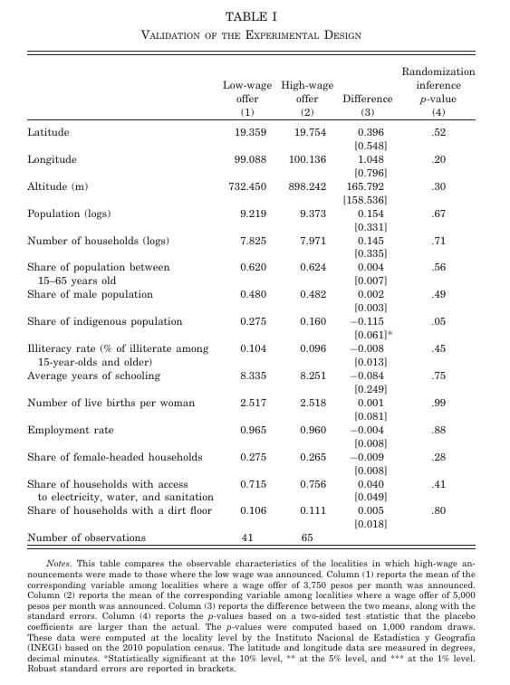
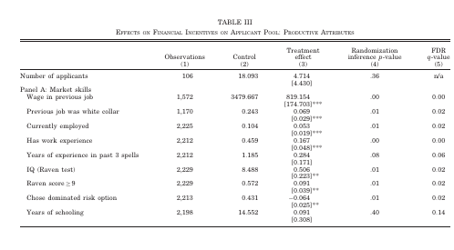
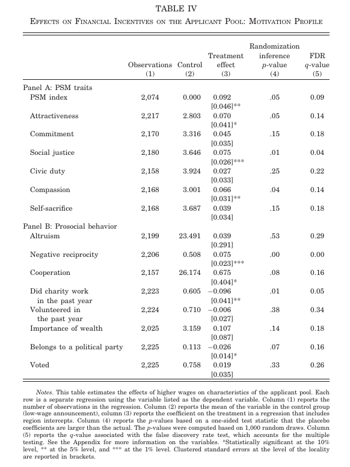

[]{#sec-burocracia-capacidad-estatal}

## De la selección de gobernantes a la selección de funcionarios

En la sesión anterior estudiamos cómo las instituciones modifican la conducta y la composición de quienes aspiran a ocupar cargos políticos. Un gobierno que recibe recursos adicionales puede mejorar la provisión de bienes públicos, pero el acceso a esos recursos también cambia los beneficios privados asociados con el poder. En el modelo de @brollo2013, la relación $g_t=\theta(\tau-r_t)$ permite representar con claridad esta tensión: la provisión depende de los recursos disponibles, de las rentas que retiene el alcalde y de su competencia administrativa. Allí, $\theta$ describe la competencia del gobernante. No equivale a una medida de la capacidad de toda la burocracia, aunque ayuda a formular la pregunta que guiará esta última sesión: incluso si las autoridades desean implementar una política, ¿con qué personas cuenta el Estado para hacerlo?

Las instituciones públicas requieren presupuesto, facultades legales y organización. También necesitan trabajadores que conviertan decisiones en acciones. La selección del personal introduce un problema distinto del que enfrentan los votantes cuando eligen gobernantes: los trabajadores comparan empleos públicos con oportunidades alternativas, enfrentan costos de postulación y valoran características del puesto que pueden no ser monetarias. Por consiguiente, el diseño de la compensación puede modificar no solo cuánto personal está disponible, sino también qué capacidades y motivaciones se encuentran entre quienes solicitan ingresar al Estado.

Imaginemos que un programa público necesita contratar profesionales para trabajar en localidades alejadas, con servicios deficientes y problemas de seguridad. Una estrategia consistiría en ofrecer salarios modestos, confiando en el compromiso de los interesados con los objetivos del programa. Otra consistiría en ofrecer remuneraciones competitivas para atraer personas que también podrían conseguir buenos empleos privados. ¿La segunda estrategia permite contratar trabajadores más capaces? ¿Debilita su vocación de servicio? ¿Consigue, además, que acepten puestos en destinos difíciles? Estas preguntas tienen respuestas que dependen de la heterogeneidad de los trabajadores y de la secuencia de decisiones que enfrentan.

@dalbo2013 estudian precisamente estas cuestiones mediante un modelo de postulación y aceptación de ofertas laborales y un experimento de reclutamiento público en México. El artículo nos servirá para mirar un encadenamiento lógico desde identificar un problema institucional, construir un modelo de decisiones individuales, derivar predicciones y diseñar una estrategia empírica para evaluarlas. La pregunta central es cómo los incentivos monetarios afectan la **oferta de trabajo al Estado y la composición de quienes están dispuestos a trabajar para él**.

## El problema de elección ocupacional

### Un empleo, varias dimensiones de valor

En el modelo, el Estado actúa como empleador y anuncia un salario $w$. Los trabajadores potenciales son heterogéneos en dos dimensiones. La primera, $v$, representa su valor en el mercado laboral y, por consiguiente, el atractivo esperado de sus oportunidades externas. La segunda, $\pi$, representa una motivación específica por el servicio público (*public service motivation*, PSM): el beneficio que obtienen de desempeñar un trabajo cuyo propósito es público. En el artículo, ambos componentes se representan en las mismas unidades de utilidad y, para simplificar, el salario se incorpora linealmente.

La utilidad de ocupar la posición pública es

$$
U_i^{P}=w+\pi_i.
$$

La oportunidad alternativa tiene un valor que combina el tipo del trabajador con un componente incierto:

$$
U_i^{E}=v_i+\varepsilon_i.
$$

El shock $\varepsilon_i$ recoge acontecimientos individuales que modifican el valor de trabajar fuera del Estado. Puede representar, por ejemplo, una nueva oportunidad laboral o un cambio inesperado en la alternativa existente. Se distribuye de acuerdo con una función acumulada $G(\varepsilon)$ y una densidad $g(\varepsilon)$, con media cero. El modelo supone que $v_i$ es conocido desde el comienzo, mientras que $\varepsilon_i$ se observa más adelante. En la población, $v$ sigue una distribución acumulada $F(v)$ con densidad $f(v)$.

Estas variables cumplen funciones diferentes. La calidad de mercado $v$ aumenta el costo de oportunidad de trabajar para el Estado. La motivación $\pi$ aumenta el atractivo del trabajo público para un mismo salario. Por eso es posible que dos personas igualmente calificadas tomen decisiones distintas, y también que dos personas con idéntico interés en lo público difieran en su disposición a aceptar el empleo.

### Reglas del proceso de contratación

El tiempo importa porque postular y aceptar una oferta son decisiones separadas. El modelo distingue dos períodos y, para concentrarse en el mecanismo, no introduce descuento temporal.

**Período 1: postulación.** El empleador anuncia el salario $w$. Cada trabajador conoce sus características $v$ y $\pi$ y decide si paga un costo $c>0$ para asistir a la entrevista. Quien no postula conserva sus oportunidades externas. Quien postula accede a la posibilidad de recibir una oferta pública en el período siguiente.

**Período 2: aceptación.** Se realiza y observa el shock $\varepsilon$. Un postulante recibe una oferta con probabilidad $\rho\in(0,1]$ y decide aceptarla o rechazarla comparando los beneficios del trabajo público con el valor de su alternativa externa. Al final se realizan los pagos. En el análisis básico, los autores suponen que $\rho$ es la misma para todos los tipos y normalizan $\rho=1$. La uniformidad de la probabilidad es sustantiva: si los trabajadores creen que sus posibilidades de selección dependen de su calidad, pueden aparecer patrones de postulación más complejos.

La secuencia puede representarse así:

$$
\underbrace{\text{Anuncio de }w\;\longrightarrow\;\text{Postular o no}}_{\text{Período 1}}
\quad\longrightarrow\quad
\underbrace{\text{Se observa }\varepsilon\;\longrightarrow\;\text{Oferta y aceptación}}_{\text{Período 2}}.
$$

Esta estructura temporal responde a una decisión metodológica: el reclutamiento ocurre mediante etapas, no como una oferta laboral que se transforma instantáneamente en un puesto ocupado. Las etapas permiten que el salario afecte la disposición inicial a postular y, posteriormente, la probabilidad de que una oferta se convierta en contratación.

### Primera decisión: aceptar o rechazar

Resolvemos el problema por inducción hacia atrás. Si un trabajador de tipo $(v,\pi)$ recibe una oferta en el segundo período, acepta cuando la utilidad del empleo público es al menos igual al valor de la alternativa:

$$
w+\pi\geq v+\varepsilon.
$$

Reordenando,

$$
\varepsilon\leq w+\pi-v.
$$

Denotemos por $G(\cdot)$ la función de distribución acumulada del shock y por $g(\cdot)=G'(\cdot)$ su función de densidad. Entonces, la probabilidad de aceptación, para un trabajador con características dadas, es

$$
\Pr(A=1\mid v,\pi,w)=G(w+\pi-v).
$$

La expresión permite derivar tres relaciones. Si aumenta $w$, se amplía el conjunto de realizaciones del shock ante las cuales el trabajador acepta. Si aumenta $\pi$, sucede lo mismo. En cambio, cuanto mayor es $v$, menor es la probabilidad de aceptación, porque mejores oportunidades externas elevan el umbral que debe superar el empleo público. Cuando la densidad $g$ es estrictamente positiva en $w+\pi-v$, los efectos marginales sobre la probabilidad de aceptación son.

$$
\frac{\partial\Pr(A=1\mid v,\pi,w)}{\partial w}=g(w+\pi-v)>0,
$$

$$
\frac{\partial\Pr(A=1\mid v,\pi,w)}{\partial \pi}=g(w+\pi-v)>0,
$$

$$
\frac{\partial\Pr(A=1\mid v,\pi,w)}{\partial v}=-g(w+\pi-v)<0.
$$

Esta conclusión se refiere a un **trabajador dado**, manteniendo constantes sus características. Más adelante veremos por qué no puede trasladarse automáticamente a la tasa de aceptación promedio de todos los postulantes.

### Segunda decisión: ¿vale la pena postular?

En el primer período todavía no se conoce la realización de $\varepsilon$. Un individuo debe decidir si paga el costo $c$ para disponer de una opción de empleo público. Si recibe una oferta, la aceptará únicamente cuando le resulte más conveniente que su alternativa externa. El valor esperado de poder elegir entre ambas opciones, en relación con no haber postulado, es

$$
\rho\,\mathbb E_{\varepsilon}\bigl[\max\{w+\pi-v-\varepsilon,0\}\bigr].
$$

La restricción de participación puede escribirse, por tanto, como

$$
\boxed{\;
\rho\,\mathbb E_{\varepsilon}\bigl[\max\{w+\pi-v-\varepsilon,0\}\bigr]\geq c.
\;}
$$

Esta expresión explicita la decisión económica que sustenta el modelo. El individuo paga un costo presente para acceder a una opción futura. Una remuneración pública mayor eleva el beneficio esperado de esa opción; una alternativa externa más atractiva lo reduce. La motivación de servicio público puede compensar un salario relativamente bajo, mientras que un salario más elevado puede atraer personas con mejores oportunidades privadas.

Los autores simplifican posteriormente la probabilidad de oferta a $\rho=1$. Mantener una probabilidad común diferente de uno no altera el mecanismo cualitativo, pero la interpretación dejaría de ser tan simple si la probabilidad dependiera de la calidad o motivación del candidato. Esta es una de las fronteras explícitas del modelo básico [@dalbo2013, pp. 1175-1177].

{fig-alt="Problema de decisión del potencial funcionario público: postulación en el período 1, aceptación de la oferta en el período 2 y resolución por inducción hacia atrás." width=100%}

## Incentivos monetarios y composición de los postulantes

### El trabajador marginal y la selección por calidad

Consideremos inicialmente personas con una misma motivación $\pi$, pero diferentes valores de mercado $v$. Quien dispone de mejores oportunidades externas necesita una oferta pública suficientemente atractiva para justificar la postulación. Así, un salario bajo puede atraer sobre todo a trabajadores cuyas opciones externas son relativamente limitadas; al elevar el salario, el empleador incorpora al conjunto de postulantes individuos que antes no encontraban conveniente pagar el costo de postular.

El resultado implica dos efectos posibles sobre el conjunto de candidatos. El primero es de cantidad: aumenta el número de personas para quienes postular resulta atractivo. El segundo es de composición: entran personas con un valor de mercado más alto. En el modelo de @dalbo2013, bajo sus supuestos, el salario mayor incrementa tanto el tamaño como la calidad media del conjunto de postulantes. El resultado requiere recordar que $v$ representa el valor de mercado utilizado por los autores como dimensión teórica de calidad; no debe confundirse mecánicamente con cualquiera de los indicadores empíricos que utilizarán después.

La composición cambia por decisiones individuales de autoselección. Ningún trabajador necesita modificar sus propias capacidades para que aumente la calidad promedio del grupo: basta con que el salario altere quiénes encuentran rentable presentarse al proceso.

### ¿Qué ocurre con la motivación de servicio público?

La motivación introduce un segundo margen de heterogeneidad. A igualdad de oportunidades externas, una persona con mayor $\pi$ encuentra más atractivo el empleo público y puede estar dispuesta a postular con salarios menores. ¿Qué sucede con la motivación promedio cuando aumentan las remuneraciones? La respuesta depende de la relación entre motivación y calidad en la población.

En el **caso de independencia**, $v$ y $\pi$ se distribuyen independientemente. El salario bajo ya resulta relativamente atractivo para quienes obtienen una utilidad no monetaria elevada del servicio público. Cuando el salario aumenta, entran trabajadores que requieren una compensación monetaria mayor para justificar su participación. Bajo las condiciones analizadas por los autores, el valor medio de $\pi$ en el conjunto de postulantes disminuye: el salario mejora la composición por calidad de mercado, pero reduce la motivación promedio.

En el **caso de correlación positiva**, los autores consideran una relación extrema, determinista, $v=m(\pi)$, con $m'(\pi)>1$. Esta condición indica que, a medida que aumenta la motivación, el valor de mercado crece más que proporcionalmente en las unidades del modelo. Los trabajadores muy motivados pueden ser también quienes enfrentan costos de oportunidad elevados. Si el salario inicial resulta insuficiente para atraerlos, un aumento permite incorporar personas que tienen simultáneamente una mayor capacidad de mercado y una motivación pública más alta. En este caso, el salario aumenta ambas dimensiones promedio.

La **Proposición 1** del artículo reúne estos resultados:

1. Bajo los supuestos del modelo, un aumento del salario incrementa el tamaño y la calidad promedio del conjunto de postulantes.
2. Si calidad y motivación de servicio público son independientes en la población, el aumento salarial reduce la motivación promedio entre quienes postulan.
3. Si ambas características mantienen la relación positiva específica $v=m(\pi)$ con $m'(\pi)>1$, el aumento salarial incrementa la motivación promedio.

Los autores remiten las demostraciones formales al apéndice en línea [@dalbo2013, pp. 1176-1177]. El contenido sustantivo de la proposición es que el efecto de un incentivo sobre la **composición de quienes participan** depende de cómo se distribuyen conjuntamente sus características. La política salarial no necesita producir un cambio psicológico en la vocación individual para modificar la motivación promedio de los postulantes.

Esta distinción también impone una cautela empírica. Observar que los postulantes de localidades con salarios altos tienen mayor calidad y motivación no basta para estimar directamente la correlación de ambas características en toda la población, ni permite aislar todos los mecanismos que la generan. El experimento identificará el efecto de los salarios sobre el conjunto observado de postulantes.

## De las postulaciones a los puestos ocupados

### Una segunda simplificación para estudiar el reclutamiento

Atraer candidatos es condición necesaria para contratar personal, pero no suficiente. Después de superar el proceso de selección, el candidato puede rechazar la oferta. Para analizar esta etapa, @dalbo2013 consideran una versión simplificada sin motivación no monetaria, $\pi=0$.

En esa versión existe un tipo marginal $\bar v$ que es indiferente entre pagar el costo de postulación y mantenerse fuera del proceso. Los trabajadores con $v\leq\bar v$ postulan y quienes tienen $v>\bar v$ no lo hacen. Como el atractivo del puesto aumenta con el salario, $\bar v$ es creciente en $w$.

La fracción de la población que postula queda expresada por $F(\bar v)$. Una vez en ese grupo, la probabilidad de aceptar una oferta depende de la realización del shock externo. La oferta efectiva de trabajo a este empleador, expresada como una medida de candidatos que pueden ser contratados, es

$$
S=\int_0^{\bar v}G(w-v)f(v)\,dv.
$$

La expresión combina la probabilidad de estar en el conjunto de postulantes con la de aceptar la oferta. Podemos multiplicar y dividir por $F(\bar v)$ para obtener

$$
S=\underbrace{F(\bar v)}_{\substack{\text{Tamaño del conjunto}\\\text{de postulantes}}}
\times
\underbrace{\left[\int_0^{\bar v}G(w-v)\frac{f(v)}{F(\bar v)}\,dv\right]}_{\substack{\gamma(w,\bar v):\\\text{tasa de conversión}}}.
$$

Por lo tanto,

$$
\boxed{S=F(\bar v)\,\gamma(w,\bar v).}
$$

La primera componente corresponde a quienes entran al proceso. La segunda representa la proporción esperada de ofertas que se convierten en contrataciones, una vez considerada la composición del grupo.

### La elasticidad de oferta laboral como suma de dos márgenes

La elasticidad de la oferta efectiva de trabajo respecto del salario indica cuánto cambia la cantidad de trabajadores disponibles para este empleador ante una variación porcentual de la remuneración.

Recordemos que la oferta efectiva de trabajo se expresa como el producto de dos componentes:

$$
S(w)=F(\bar v(w))\,\gamma(w,\bar v(w)),
$$

donde $F(\bar v(w))$ representa el tamaño del conjunto de postulantes y $\gamma(w,\bar v(w))$ es la tasa de conversión de ofertas en contrataciones.

Para simplificar la notación durante la derivación, escribiremos $F=F(\bar v(w))$ y $\gamma=\gamma(w,\bar v(w))$, recordando que ambas expresiones dependen del salario.

**Primer paso: derivar la oferta de trabajo respecto del salario.**

Aplicando la regla de derivación de un producto:

$$
\frac{dS}{dw}
=
\frac{dF}{dw}\gamma
+
F\frac{d\gamma}{dw}.
$$

El primer término representa el efecto de un cambio salarial sobre el tamaño del conjunto de postulantes. El segundo representa su efecto sobre la tasa de conversión.

**Segundo paso: expresar la derivada en términos de elasticidades.**

Por definición, la elasticidad de la oferta efectiva respecto del salario es:

$$
\eta
=
\frac{dS}{dw}\frac{w}{S}.
$$

Sustituyendo la derivada obtenida en el primer paso:

$$
\eta
=
\left(
\frac{dF}{dw}\gamma
+
F\frac{d\gamma}{dw}
\right)\frac{w}{S}.
$$

Como $S=F\gamma$, podemos reemplazar el denominador:

$$
\eta
=
\left(
\frac{dF}{dw}\gamma
+
F\frac{d\gamma}{dw}
\right)\frac{w}{F\gamma}.
$$

Distribuyendo y simplificando los factores comunes:

$$
\eta
=
\frac{dF}{dw}\frac{\gamma w}{F\gamma}
+
\frac{d\gamma}{dw}\frac{Fw}{F\gamma}.
$$

Obtenemos finalmente:

$$
\boxed{
\eta
=
\underbrace{\frac{dF}{dw}\frac{w}{F}}_{\xi_{F(\bar v)}}
+
\underbrace{\frac{d\gamma}{dw}\frac{w}{\gamma}}_{\xi_{\gamma(w,\bar v)}}
}
$$

Esta es la descomposición presentada en la **Proposición 2** de Dal Bó, Finan y Rossi (2013). La elasticidad de la oferta efectiva de trabajo es igual a la suma de la elasticidad del conjunto de postulantes y la elasticidad de la tasa de conversión.

El resultado permite distinguir dos mecanismos. Un aumento salarial puede incrementar las contrataciones porque atrae más postulantes, porque mejora la conversión de ofertas en contrataciones, o por una combinación de ambos efectos.

La teoría predice que el primer componente es positivo. El segundo tiene un signo ambiguo: un salario mayor hace más atractiva la oferta para quienes ya postulaban, pero también incorpora nuevos candidatos con mejores alternativas externas, que pueden ser menos propensos a aceptar. Por ello, el efecto agregado sobre la tasa de conversión depende de cuál de estas fuerzas predomine.

$$
\eta\equiv\frac{dS}{dw}\frac{w}{S}
=\underbrace{\frac{dF}{dw}\frac{w}{F}}_{\xi_{F(\bar v)}}
+\underbrace{\frac{d\gamma}{dw}\frac{w}{\gamma}}_{\xi_{\gamma(w,\bar v)}}.
$$

De aquí surge la **Proposición 2**:

$$
\boxed{\eta=\xi_{F(\bar v)}+\xi_{\gamma(w,\bar v)}.}
$$

La elasticidad del número de postulantes es positiva bajo los supuestos del modelo. El signo de la elasticidad de conversión, en cambio, es ambiguo. Para entenderlo conviene distinguir a los postulantes que ya participaban con el salario original de aquellos que ingresan solo cuando este aumenta.

Los primeros son **inframarginales**: ante el salario más alto, cada uno tiene una mayor probabilidad de aceptar si recibe una oferta. Los segundos son **marginales**: entran porque el salario ahora compensa oportunidades externas más atractivas. En promedio, pueden tener menor disposición a aceptar que los postulantes originales. El salario aumenta la aceptación individual entre los primeros, mientras que el cambio de composición puede reducir la tasa agregada de conversión.

Así se explica por qué la teoría deja abierta una predicción: aun cuando un aumento salarial atraiga más postulantes y eleve la probabilidad de aceptación para cada tipo fijo, la tasa media de conversión puede aumentar o disminuir. Se trata de una consecuencia de la selección, no de una contradicción del modelo [@dalbo2013, pp. 1178-1179].

Conviene precisar el alcance del término *equilibrio*. Los autores describen las decisiones óptimas de los trabajadores frente a un salario anunciado y la oferta residual que enfrenta un empleador. No resuelven un equilibrio general en el que todos los empleadores cambien simultáneamente sus salarios, ni determinan un salario público óptimo a partir de una función objetivo completa del gobierno. Esa precisión será importante al interpretar la elasticidad estimada.

{fig-alt="Intuición de la Proposición 2: un mayor salario amplía el conjunto de postulantes, pero su efecto sobre la tasa de conversión es ambiguo por los efectos directo y de composición." width=100%}

## Un experimento de reclutamiento público en México

### El programa y el problema de identificación

El programa federal mexicano de Desarrollo Regional buscaba aumentar la presencia del Estado en 167 municipios con altos niveles de marginación. Para ello necesitaba agentes de desarrollo comunitario capaces de identificar carencias en la provisión de bienes públicos y vincular a las comunidades con los programas y autoridades pertinentes. El programa contempló aproximadamente 350 puestos de agentes y 50 coordinadores distribuidos en diez regiones. Durante junio-agosto de 2011 se desarrolló un proceso de reclutamiento que incluyó difusión de vacantes, registro, evaluación y ofertas laborales [@dalbo2013, pp. 1170-1174].

En un reclutamiento ordinario, comparar los candidatos de empleos públicos con sueldos altos y bajos no permite atribuir las diferencias observadas al salario. Los puestos mejor remunerados pueden encontrarse en lugares más atractivos, exigir tareas diferentes o estar asociados con empleadores que buscan perfiles distintos. Incluso si observamos que los trabajadores más capaces reciben mayores remuneraciones, no sabremos si el salario los atrajo o si fue fijado precisamente porque el puesto requería sus capacidades.

La solución del estudio consiste en introducir variación exógena en el salario anunciado. Las 106 localidades de reclutamiento fueron asignadas a dos condiciones: 65 anunciaron un salario mensual de **5.000 pesos mexicanos** y 41 uno de **3.750 pesos**. El salario alto supera al bajo en 1.250 pesos, equivalente a un aumento del 33,3% respecto de la condición de salario bajo.

Los anuncios iniciales contenían una descripción general del puesto y vías de contacto; tras el registro, el operador comunicaba el salario correspondiente a la localidad donde el interesado había conocido la vacante. Este procedimiento era parte del esfuerzo por limitar la selección entre lugares con salarios diferentes: las localidades con más de un establecimiento mantuvieron un mismo salario y se solicitaba realizar la evaluación en el sitio asociado al anuncio. Por tanto, el tratamiento relevante es **la oferta salarial asignada a la localidad de reclutamiento**, no la posibilidad de que cada individuo elija libremente entre dos salarios conocidos [@dalbo2013, pp. 1179-1181].

| Etapa | Información disponible para el postulante |
|---|---|
| **1. Anuncio inicial** | Conocía una descripción general del empleo público y cómo comunicarse con el programa. El anuncio inicial no informaba el salario. |
| **2. Registro** | El operador registraba al interesado y le comunicaba el salario asignado a la localidad donde había visto el anuncio: **3.750 o 5.000 pesos mensuales**. |
| **3. Postulación formal** | Conociendo el salario, decidía si asistir a la evaluación, incurriendo en el costo de participar. |
| **4. Selección** | Entre quienes cumplían los requisitos, se asignaban aleatoriamente ofertas asociadas a municipios específicos, dentro de los estratos correspondientes. |
| **5. Oferta laboral** | Al ser contactado, el seleccionado conocía el municipio donde debería trabajar y decidía si aceptaba. |

: **Secuencia del proceso de reclutamiento e información disponible para los candidatos.** Fuente: elaboración a partir de @dalbo2013, sección IV.A-IV.B, pp. 1179-1184. {#tbl-reclutamiento-informacion}

### Dos asignaciones aleatorias, dos preguntas causales

La investigación aprovecha dos momentos distintos.

En el **primero**, la aleatorización del salario por localidad permite comparar el tamaño y el perfil del conjunto de postulantes en las condiciones de salario alto y bajo. La unidad de asignación es la localidad. Por ello, las observaciones de personas dentro de una misma localidad no pueden tratarse como experimentos independientes.

En el **segundo**, después de administrar la evaluación, los autores consideran elegibles a quienes alcanzan los requisitos mínimos. Los 2.254 asistentes a la evaluación fueron examinados mediante pruebas de aptitud, personalidad y motivación; 379, con un puntaje Raven inferior a 7, quedaron fuera del conjunto elegible (sobre 9 se considera capacidad de abstracción alta). Los restantes se organizaron en cuatro estratos definidos por salario originalmente anunciado y categoría de capacidad cognitiva, alta o normal. Las 350 vacantes, vinculadas a municipios específicos, se asignaron a esos estratos y se ofrecieron aleatoriamente a candidatos de la región y categoría correspondiente, considerando además requisitos de lengua indígena cuando correspondía.

Los análisis de aceptación se concentran en la **primera ronda de ofertas**. Cuando una oferta no era aceptada o el candidato no podía ser contactado se buscaba un reemplazo, pero las rondas posteriores ya no conservaban el mismo carácter aleatorio. Esta restricción impide confundir el efecto del salario con el orden de búsqueda de candidatos y las decisiones previas de rechazo [@dalbo2013, pp. 1182-1184].

Estas dos etapas no deben interpretarse como un mismo experimento repetido. La primera identifica cómo cambia el conjunto de interesados. La segunda examina qué sucede cuando se intenta convertir una selección en una contratación y permite explotar la variación exógena en los municipios ofrecidos.

### La validez de la primera aleatorización

La tabla I del artículo compara características de las localidades asignadas a salarios altos y bajos: composición demográfica, educación, empleo, servicios y otras condiciones observables. Solo una de quince variables presenta una diferencia al nivel de significancia del 10%, y la prueba conjunta no rechaza el balance ($p=0{,}30$). Este resultado es consistente con una asignación aleatoria adecuada, aunque el balance observable no constituye por sí solo una garantía lógica contra cualquier problema de implementación [@dalbo2013, tabla I, pp. 1181-1182].

{fig-alt="Tabla I. Validación del diseño experimental: comparación de características de las localidades con ofertas salariales bajas y altas, diferencias y valores p de inferencia por aleatorización." width=100%}

La comparación entre candidatos observados no representa dos muestras aleatorias de toda la población: postular es precisamente la decisión que los autores quieren explicar. La asignación aleatoria es del **salario ofrecido por localidad**. Lo que puede identificarse causalmente es el efecto del salario sobre la composición del conjunto que decide presentarse, no un efecto del salario sobre las capacidades innatas de cada trabajador.

## De las proposiciones a las regresiones

### Primera especificación: composición del conjunto de postulantes

La ecuación (1) de @dalbo2013 puede expresarse como

$$
Y_{icr}=\beta_1T_c+\zeta_r+\varepsilon_{icr},
$$

donde $Y_{icr}$ representa una característica del postulante $i$ de la localidad $c$ y la región $r$; $T_c$ toma el valor uno si la localidad recibió el tratamiento de salario alto; y $\zeta_r$ incorpora efectos fijos de región. Para resultados agregados, como el número de postulantes, la variable dependiente se mide a nivel de localidad.

El coeficiente $\beta_1$ estima la diferencia entre condiciones salariales, ajustada por región, para el resultado considerado. Como el tratamiento fue asignado aleatoriamente, esa diferencia tiene una interpretación causal dentro del diseño. Los errores estándar se agrupan por localidad, la unidad de aleatorización. La estrategia empírica utiliza regresiones sencillas porque la identificación procede del experimento, no de suponer que los controles observados eliminan toda selección previa.

La proposición 1 se transforma en resultados contrastables: un efecto positivo sobre el número de postulantes y sobre indicadores de su calidad; respecto de motivación, una predicción que depende de la relación poblacional entre $v$ y $\pi$.

### Segunda especificación: conversión de las ofertas

Para la contratación efectiva se estima una especificación del tipo

$$
A_{ics}=\gamma_1T_c+X_i'\beta+\zeta_s+\varepsilon_{ics},
$$

donde $A_{ics}=1$ si el seleccionado acepta efectivamente la oferta, $X_i$ reúne características individuales y $\zeta_s$ identifica combinaciones de región y requisito de lengua indígena. En la variable dependiente, tanto el rechazo explícito como la imposibilidad de volver a contactar al seleccionado cuentan como no contratación.

La definición de $A_{ics}$ responde al problema del empleador: para cubrir una vacante importa que la persona pueda ser localizada y termine aceptando. El coeficiente $\gamma_1$ compara tasas de conversión entre las condiciones salariales, con la composición que efectivamente generó cada salario. No debe interpretarse sin más como el efecto puro de elevar el salario **sobre una misma población fija** de trabajadores, porque el tratamiento ya modificó quiénes postularon.

### Tercera especificación: atributos del destino y compensaciones salariales

Al comunicar la oferta, se informaba también el municipio donde la persona trabajaría. Como los destinos fueron asignados aleatoriamente dentro de las condiciones del diseño, los autores pueden estudiar el efecto de sus características sobre la aceptación mediante

$$
A_{icms}=\gamma_1T_c+\gamma_2(T_c\times W_m)
+\gamma_3W_m+X_i'\beta+\zeta_s+\varepsilon_{icms},
$$

donde $W_m$ es una característica del municipio asignado: distancia al lugar de residencia, desarrollo humano o violencia asociada al narcotráfico. El coeficiente $\gamma_3$ representa la relación entre el atributo y la aceptación en la condición salarial baja; $\gamma_2$ indica cuánto cambia esa relación cuando el salario es alto.

La comparación se realiza, en las especificaciones principales, entre quienes fueron efectivamente contactados. Esto permite observar decisiones de aceptación frente a destinos conocidos, pero introduce una precaución: el conjunto de personas contactables puede ser selectivo. La aleatorización del destino no convierte automáticamente el condicionamiento en haber sido contactado en una muestra aleatoria de todos los seleccionados [@dalbo2013, pp. 1183-1184, 1209-1210].

## Cómo medir capacidad y motivación

Un modelo formal puede incorporar una característica $v$ sin especificar exactamente cómo se observará. La investigación empírica exige tomar decisiones adicionales: qué indicadores utilizar, qué dimensiones aproximan y qué inferencias permiten.

Los autores distinguen **aptitud o capacidad de desempeño** de **perfil motivacional**. Como aproximación al valor externo de mercado utilizan el ingreso reportado del empleo anterior y la trayectoria ocupacional. Para aptitudes cognitivas administran una versión de doce matrices del test de Raven. Para rasgos no cognitivos emplean el cuestionario *Big Five Inventory* de 44 preguntas, que mide apertura, responsabilidad, extraversión, amabilidad y neuroticismo. También incluyen indicadores de integridad [@dalbo2013, sección V.A, pp. 1184-1186].

La motivación de servicio público se aproxima mediante la escala de Perry (1996), organizada en seis dimensiones: atracción por la formulación de políticas, compromiso con ella, justicia social, deber cívico, compasión y autosacrificio. El índice compuesto combina puntuaciones estandarizadas tomando como referencia las respuestas de los postulantes en localidades de salario bajo. El estudio también incorpora medidas complementarias de comportamiento prosocial, como voluntariado, actividades caritativas, participación política y respuestas a juegos de preferencias sociales [@dalbo2013, pp. 1186-1187].

| Concepto en el modelo | Medición empleada | Qué permite afirmar y qué exige cautela |
|---|---|---|
| Valor externo de mercado $v$ | Remuneración anterior, experiencia, trayectoria ocupacional | Aproxima alternativas de mercado, pero también puede reflejar condiciones laborales previas. |
| Aptitud y características asociadas al desempeño | Raven, Big Five, antecedentes ocupacionales | Mide atributos potencialmente relevantes para el trabajo; no observa directamente productividad posterior. |
| Motivación de servicio público $\pi$ | Índice PSM y seis subdimensiones | Registra actitudes vinculadas con lo público; no equivale a observar directamente esfuerzo o integridad en el cargo. |
| Comportamiento prosocial | Voluntariado, caridad, juegos y participación | Aporta indicadores adicionales que no necesariamente se comportan igual que la escala PSM. |
| Contratación efectiva | Oferta aceptada y persona contactable | Mide conversión de ofertas en empleo, no permanencia ni calidad del desempeño. |

La separación entre teoría y medición evita un salto argumental frecuente. En el modelo, $v$ es una característica individual que determina el costo de oportunidad. En los datos, los investigadores disponen de **indicadores** vinculados con ese constructo. Encontrar un efecto sobre Raven o los ingresos anteriores no implica haber estimado directamente el parámetro teórico individual $v$.

## Evidencia empírica: cantidad, calidad y motivación

### ¿Aumenta el número de postulantes?

La tabla III muestra que las localidades con salario bajo tuvieron en promedio 18,093 postulantes; la diferencia estimada para localidades de salario alto es 4,714 postulantes adicionales. Esto equivale aproximadamente a un incremento del 26,1%. Sin embargo, el error estándar de 4,430 y el valor $p=0{,}36$ de la prueba de aleatorización indican que el efecto sobre el número de postulantes está estimado con poca precisión.

{fig-alt="Tabla III. Efectos de los incentivos financieros sobre los atributos de los postulantes: número de postulantes, ingresos anteriores, características ocupacionales y escolaridad." width=100%}

El resultado es compatible, en dirección, con la primera predicción de la teoría. La evidencia, sin embargo, no permite presentar el incremento del número de candidatos con la misma confianza que algunos efectos encontrados sobre sus características. Precisamente por eso resulta útil examinar conjuntamente magnitud e incertidumbre: una estimación puntual no se transforma en evidencia concluyente por coincidir con la predicción teórica.

### ¿Se modifica la calidad de quienes postulan?

Los resultados de la tabla III son más precisos para varias características de los candidatos. En comparación con la condición de salario bajo, los postulantes de localidades de salario alto registran una remuneración previa aproximadamente 819 pesos mayor y obtienen 0,506 puntos adicionales en Raven, equivalentes a cerca de 0,19 desviaciones estándar respecto de la condición de control. Asimismo, son más frecuentes la experiencia laboral y antecedentes en empleos de oficina. Entre los rasgos de personalidad se observan mayores niveles de responsabilidad y menores niveles de neuroticismo. En cambio, no aparecen diferencias claras en escolaridad ni en las mediciones de integridad utilizadas.

| Resultado de la tabla III | Media con salario bajo | Efecto del salario alto | Lectura |
|---|---:|---:|---|
| Número de postulantes por localidad | 18,093 | +4,714 | Estimación positiva, imprecisa ($p=0{,}36$). |
| Salario mensual del empleo anterior | 3.479,667 pesos | +819,154 pesos | Mayor valor externo de mercado reportado. |
| Puntaje Raven | 8,488 | +0,506 | Mayor aptitud cognitiva observada. |
| Experiencia laboral (proporción) | 0,459 | +0,167 | Mayor presencia de postulantes con experiencia. |
| Responsabilidad (*conscientiousness*) | 4,235 | +0,063 | Diferencia favorable en ese rasgo. |
| Neuroticismo | 2,254 | -0,099 | Menor neuroticismo en el grupo de salario alto. |

*Fuente: elaboración a partir de @dalbo2013, tabla III, pp. 1193-1194. Los coeficientes corresponden a regresiones separadas con efectos fijos de región; las diferencias no deben interpretarse como efectos sobre una misma persona.*

Para entender el mecanismo no basta con enumerar coeficientes. El salario alto cambia la decisión de participación y, con ello, la distribución de características observadas entre los candidatos. La composición de una organización puede mejorar incluso antes de contratar a alguien. A la vez, el diseño solo permite hablar aquí de características de los postulantes: el paso desde su perfil al desempeño futuro debe ser argumentado y, en lo posible, evaluado con datos adicionales.

### ¿Los incentivos monetarios desplazan la vocación de servicio?

Esta pregunta devuelve el análisis a la parte más interesante de la proposición 1. Si el salario atrajera trabajadores con buenos indicadores de mercado pero escasa motivación pública, el Estado podría enfrentar una disyuntiva. Sin embargo, la tabla IV informa un incremento de 0,092 en el índice estandarizado de PSM para las localidades de salario alto. El resultado tiene un valor $p$ de aleatorización de 0,05 y un valor $q$ de 0,09 tras controlar la tasa de falsos descubrimientos por comparaciones múltiples. La evidencia del índice apunta, por tanto, hacia un aumento moderado de la motivación, con una precisión que debe describirse cuidadosamente.

{fig-alt="Tabla IV. Efectos de los incentivos financieros sobre el perfil motivacional de los postulantes: rasgos de motivación de servicio público y comportamiento prosocial, con efectos del tratamiento y valores p y q." width=100%}

Al examinar las dimensiones, hay incrementos positivos para justicia social y compasión, entre otras; pero no todos los componentes están estimados con igual precisión. Las medidas de comportamiento prosocial muestran un patrón todavía más heterogéneo: algunas no cambian, el trabajo caritativo disminuye y otras presentan incrementos. La conclusión sustentada por los datos es más restringida que afirmar que todos los indicadores de altruismo mejoraron. Los salarios altos atraen candidatos con mejores atributos de mercado **sin evidencia de una caída generalizada del índice de motivación de servicio público** [@dalbo2013, tabla IV, pp. 1199-1200].

¿Confirma esto que $v$ y $\pi$ están positivamente correlacionados en toda la población? El resultado es consistente con esa posibilidad, pero la evidencia experimental no identifica directamente la correlación poblacional ni separa el efecto sobre la motivación que opera a través del cambio en calidad de otros mecanismos. Los propios autores reconocen que serían necesarias fuentes de variación adicionales para separar los canales. Esta distinción es parte de la relación entre el modelo formal y su implementación empírica: el modelo ofrece un conjunto de interpretaciones posibles; los datos permiten descartar algunas con más fuerza que otras.

## Evidencia empírica: de la oferta a la contratación

### La tasa de conversión

La tabla V estudia si los candidatos seleccionados llegaron a aceptar la oferta. Con el salario bajo, el 42,9% de los seleccionados terminó contratado. El salario alto incrementó la probabilidad de conversión en 15,1 puntos porcentuales, aproximadamente un 35,2% respecto del valor inicial. El efecto es estadísticamente significativo en la especificación principal; al incorporar características individuales, la estimación se mantiene cercana, en 16,0 puntos porcentuales [@dalbo2013, tabla V, pp. 1202-1204].

El resultado permite resolver la ambigüedad que había dejado la segunda proposición. El salario mayor atrae individuos con mejores alternativas externas, lo cual podría reducir la aceptación media de las ofertas. En la experiencia estudiada, predomina el efecto que hace más atractiva la oferta para los postulantes, de modo que la conversión agregada aumenta.

La descomposición de la tabla V revela además un mecanismo operativo importante. La reducción estimada de rechazos explícitos es pequeña y estadísticamente imprecisa (-1,7 puntos porcentuales). La caída en la probabilidad de no poder contactar al candidato es mucho mayor: -13,5 puntos porcentuales. Por tanto, buena parte de la mejora de la contratación se produce porque los postulantes del grupo de salario alto resultan más fáciles de contactar cuando llega el momento de ofrecer el puesto. Una tasa agregada de aceptación puede ocultar procesos distintos: rechazar una oferta conocida y no llegar a recibirla no son la misma conducta.

Es importante no confundir este resultado con un experimento hipotético en el que se ofrecieran salarios diferentes a personas seleccionadas aleatoriamente de **una población común que todavía no decidió postular**. En el estudio, los salarios modificaron previamente la composición de la población que llegó a la etapa de ofertas. Los autores reconocen esta distinción e incorporan ejercicios de acotación para valorar la sensibilidad a la selección.

### La elasticidad de oferta laboral

La expresión $S=F\gamma$ permite integrar ambos márgenes. Los autores presentan un incremento puntual estimado del 26,31% en el conjunto de postulantes y del 35,2% en la tasa de conversión frente a un aumento salarial del 33,3%. A partir de estas magnitudes calculan una elasticidad arco de la oferta laboral que enfrenta el programa de aproximadamente **2,15** [@dalbo2013, pp. 1205-1206].

En la interpretación económica del artículo, esta respuesta indica que la oferta que enfrenta el empleador es relativamente elástica, pero no infinitamente elástica. Los autores la relacionan con cierto poder de monopsonio del empleador: elevar el salario puede aumentar sustancialmente la cantidad de trabajadores que efectivamente consigue contratar.

El ejercicio merece dos precisiones. Primero, la elasticidad estimada resume una variación discreta en salarios; no es idéntica, por definición, a la derivada puntual de la proposición 2. Para cambios finitos se debe respetar también el efecto de multiplicar los dos márgenes, aunque los autores informen sus elasticidades arco como descomposición aproximada. Segundo, la elasticidad de 2,15 es una **estimación de corto plazo y equilibrio parcial**, obtenida para un programa específico y empleos temporales. No constituye una elasticidad universal del empleo público ni incorpora todos los posibles ajustes de otros empleadores.

Tampoco conviene olvidar la incertidumbre sobre la primera componente: el aumento del número de postulantes utilizado en el cálculo es una estimación puntual imprecisa. La cifra agregada es informativa como magnitud estimada bajo el diseño, pero no debe sugerir que ambas piezas de la descomposición cuentan con la misma fuerza estadística.

## Trabajar donde el Estado más necesita personal

La capacidad administrativa depende también de la distribución territorial de sus recursos humanos. Un gobierno puede contar con suficientes candidatos en conjunto y tener dificultades para ocupar posiciones situadas en municipios alejados o con condiciones de vida desfavorables. La localización del empleo es otro componente de su atractivo, aun cuando el salario anunciado sea idéntico.

La tercera especificación del estudio aprovecha la asignación aleatoria de municipios a candidatos elegibles. La tabla VI examina distancia, violencia relacionada con drogas y nivel de desarrollo humano. Entre las personas que fueron contactadas, los destinos más alejados y con peores condiciones presentan, en general, menores tasas de aceptación. El salario alto compensa parte de esas desventajas.

La distancia ofrece una ilustración particularmente clara. En la columna (1) de la tabla VI, diez kilómetros adicionales se asocian con una reducción de 2,7 puntos porcentuales en la probabilidad de aceptación bajo el salario bajo. La interacción entre salario alto y distancia es positiva, de 2,6 puntos porcentuales por diez kilómetros, lo cual deja una pendiente neta cercana a cero en el grupo de salario alto. Este resultado es un ejemplo de cómo se interpreta una interacción: el coeficiente principal de distancia corresponde a la condición de referencia, mientras que el coeficiente de interacción muestra cuánto cambia esa pendiente con el tratamiento.

La interpretación debe reservar espacio para las limitaciones del análisis. Las regresiones principales están condicionadas a quienes fueron contactados y, por ello, no eliminan completamente los problemas de selección asociados con la posibilidad de recibir efectivamente información sobre el destino. Además, las tres características municipales están relacionadas entre sí, de modo que algunas interacciones pierden precisión al incluirse conjuntamente [@dalbo2013, tabla VI, pp. 1209-1211].

Los resultados permiten distinguir tres funciones de la remuneración pública: atraer postulantes con determinadas características, convertir ofertas en contrataciones y compensar las desventajas de trabajos localizados en entornos menos atractivos. Cada función corresponde a una decisión distinta dentro del proceso de reclutamiento.

## ¿Cuánto sabemos realmente sobre capacidad estatal?

El estudio de @dalbo2013 proporciona evidencia causal sobre características de candidatos y resultados de contratación. Para avanzar desde esos hallazgos hacia una afirmación sobre capacidad estatal es necesario explicitar el mecanismo intermedio. El Estado necesita personas con capacidad para ejecutar tareas; los salarios pueden modificar quiénes solicitan empleo; y el reclutamiento puede determinar qué capacidades están disponibles en una organización. Sin embargo, el experimento no sigue la productividad de todos los trabajadores contratados, ni estima directamente cómo cambian los servicios públicos entregados a los ciudadanos.

Esta separación entre selección y desempeño puede verse formalmente en @aghiontirole1997. Los autores distinguen la **autoridad formal**, entendida como el derecho a decidir, de la **autoridad real**, entendida como el control efectivo sobre las decisiones. Un superior puede conservar el derecho formal a escoger un proyecto y, al mismo tiempo, depender de la información que adquiere un subordinado. Cuando la supervisión se vuelve más intensa, puede disminuir el incentivo del agente a investigar o tomar iniciativas; delegar eleva esa iniciativa a costa de ceder control. La calidad de los trabajadores solo se aprovecha si los arreglos organizacionales permiten que sus conocimientos influyan en las decisiones.

@hartmoore1999 estudian los fundamentos de los contratos incompletos y muestran, bajo determinados supuestos, cómo las restricciones de compromiso y la posibilidad de renegociación pueden limitar lo que las partes consiguen especificar contractualmente. La lección relevante aquí es que remunerar y contratar personal no resuelve por sí solo todos los problemas de coordinación, autoridad e incentivos dentro de una organización. No es necesario desarrollar sus modelos completos para reconocer que las condiciones de ingreso y las reglas de funcionamiento interno constituyen decisiones institucionales complementarias.

En suma, **quiénes ingresan al Estado depende de los incentivos de selección; qué hacen posteriormente depende también de los incentivos y de la autoridad que organiza su trabajo**. La sesión anterior explicaba cómo los recursos públicos pueden modificar la selección política; esta sesión muestra un mecanismo paralelo de selección administrativa. Ambas dimensiones importan para comprender por qué recursos adicionales no se transforman automáticamente en políticas mejores.

## Addendum. Del modelo reducido a la estimación estructural {#sec-addendum-estimacion-estructural}

### Cuando la pregunta se refiere a una institución que aún no existe

Los resultados del experimento mexicano proceden de una intervención realizada: algunas localidades ofrecieron un salario más alto y otras uno más bajo. La comparación permite estimar qué ocurrió cuando cambió ese incentivo dentro del diseño. Pero muchas preguntas de economía política se refieren a reglas que no han sido modificadas. ¿Qué sucedería con la asignación de recursos si una reforma impidiera la reelección? ¿Cómo se comportarían los políticos bajo un nuevo sistema de votación? ¿Qué ocurriría si un distrito eligiera menos representantes?

Responder estas preguntas exige representar cómo tomarían decisiones los actores bajo reglas diferentes. Una estrategia es especificar sus preferencias, restricciones e interacciones; utilizar las decisiones observadas para estimar parámetros del modelo; y resolver nuevamente sus decisiones cuando cambia la institución. Esta es la lógica básica de la **estimación estructural**.

Una estimación de forma reducida busca identificar directamente la relación causal entre una intervención y un resultado observado, normalmente mediante una variación exógena u otra estrategia de identificación. Un modelo estructural agrega una descripción explícita de las preferencias y decisiones que generan los resultados; esa descripción permite considerar cambios institucionales que no aparecen en los datos originales. Su capacidad contrafactual depende de que los parámetros, las reglas de decisión y los supuestos mantenidos sigan siendo apropiados después de la reforma.

## Comentarios finales: incentivos, selección e instituciones

A lo largo del curso estudiamos problemas de decisión colectiva, horizontes temporales, compromisos difíciles de sostener, información imperfecta, supervisión, rentas políticas y composición de los participantes. La pregunta que los une es cómo las reglas institucionales reorganizan decisiones individuales y, a través de ellas, producen resultados colectivos.

En la sesión anterior vimos que los recursos disponibles alteran los incentivos de quienes gobiernan y de quienes aspiran a gobernar. En esta sesión, el foco se desplazó hacia quienes ejecutan las decisiones públicas. Los salarios y las condiciones de trabajo cambian el atractivo de ingresar al servicio público; ese cambio afecta la postulación, la aceptación y la composición del personal disponible. Después de la contratación aparecen nuevas cuestiones de información, autoridad e incentivos que condicionan el uso de esas capacidades.

La relación entre modelos y evidencia también adquiere un sentido acumulativo. Un modelo formal obliga a especificar quién decide, qué información posee, qué alternativas enfrenta, cuáles son sus objetivos y cómo se determina el resultado. Una estrategia empírica obliga a precisar qué predicción puede contrastarse, qué variable representa el concepto teórico, qué fuente de variación identifica el efecto y hasta dónde llega la inferencia. La estimación estructural permite avanzar hacia preguntas contrafactuales, siempre sujetas a la validez de las preferencias, decisiones y equilibrios especificados.

La última pregunta del curso es, por tanto, una pregunta de diseño institucional: **si queremos mejorar una organización pública, ¿es suficiente con cambiar los incentivos de sus integrantes o debemos modificar también las condiciones que determinan quiénes deciden participar?** La experiencia estudiada sugiere que ambos márgenes merecen atención, y que ignorar cualquiera de ellos puede llevar a diagnósticos incompletos sobre la capacidad del Estado.

## Referencias

::: {#refs}
:::
