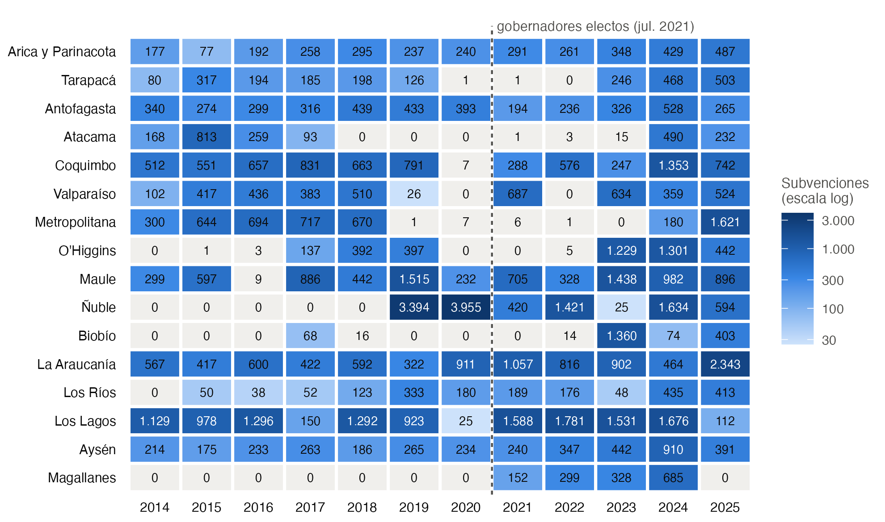

# Abraham: gobernadores regionales y reparto territorial

Primer borrador, 30 de octubre de 2026.

## 1. Idea básica

**Pregunta.** ¿Hacia qué comunas dirigen los gobernadores regionales su gasto discrecional: hacia las que los apoyaron (el núcleo) o hacia las que estuvieron en disputa? ¿Depende la respuesta del tipo de gasto?

**Por qué gobernadores.**

- El gasto de los diputados queda dentro de un gasto operacional difícil de seguir. El de los gobernadores es más transparente.
- El cargo es nuevo: se elige por voto popular desde 2021, y no hay estudios sobre cómo reparten los gobernadores electos.

**La hipótesis de partida.** Viene de Díaz-Cayeros, Estévez y Magaloni (México): los partidos dan bienes privados a su base y bienes públicos y visibles a las zonas en disputa. Abraham propone el paralelo con los gobernadores, con tres tipos de gasto: subvenciones a organizaciones, infraestructura y fiestas costumbristas.

**El trade-off que discutimos.** Hay bastantes transferencias de los gobiernos regionales desde 2014 (más de 128.000). Lo escaso son los gobernadores: 16 por período. Por eso conviene comparar comunas dentro de cada región, no gobernadores entre sí.

## 2. Datos de transferencias

**Fuente.** Registro de transferencias de la Ley 19.862 (<https://registros19862.gob.cl/reporte/transferencias>). Cada fila es una transferencia, con fecha del decreto, objetivo, receptor, comuna y monto. Se descarga en CSV, filtrando por emisor "Gobierno regional".

**Archivos.**

| Archivo | Qué es |
|---|---|
| `scripts/01_descargar_transferencias.R` | Descarga el registro año por año (2014 en adelante), clasifica cada transferencia en un instrumento y le asigna el código de comuna (CUT) usando SINIM. |
| `scripts/02_figura1_cobertura.R` | Hace la Figura 1 a partir de `datos/gore_transferencias.csv.gz`. |
| `datos/gore_transferencias.csv.gz` | Una fila por transferencia (128.605 filas, enero de 2014 a octubre de 2026). |
| `datos/gore_panel_comuna_anio.csv` | Monto y número de transferencias por comuna, año e instrumento. |

Para volver a descargar todo, desde esta carpeta:

```
Rscript scripts/01_descargar_transferencias.R cache/ datos/ ../../playground/datos-apoyo/sinim/sinim_panel_largo.csv
Rscript scripts/02_figura1_cobertura.R datos/gore_transferencias.csv.gz figs/
```

**Instrumentos (decretos de 2022 a 2024).**

| Instrumento | Definición | N.º | Monto (miles de millones) |
|---|---|---:|---:|
| Subvenciones a organizaciones | receptor privado, no de capital, hasta 50 millones | 27.351 | 159,5 |
| Transferencias a municipios | receptor municipalidad (FRIL y otras obras chicas) | 8.348 | 328,8 |
| Convenios grandes | receptor privado, más de 50 millones (bomberos, corporaciones, universidades) | 931 | 334,6 |

Los convenios grandes no son parte del fondo del 8 % y quedan fuera del proyecto.

**Advertencias.**

- Hay regiones y años sin reporte (Figura 1). Hay que revisarlos uno por uno antes de estimar.
- La comuna es el domicilio del receptor, no necesariamente el lugar de la actividad.
- Usar la fecha del decreto (la asignación), no la de ingreso (el pago).
- Los montos son nominales y hay que deflactarlos.

**Pendiente: datos electorales.** Se necesitan los resultados por comuna de gobernador (2021 y 2024) y de alcalde (2021 y 2024). Servel los publica en Power BI. Falta confirmar qué elecciones cubren los datos por mesa que ya tiene Abraham.

## 3. Figura 1



**Figura 1.** Subvenciones a organizaciones (hasta 50 millones) registradas por cada gobierno regional, según el año del decreto. Celdas grises: menos de 20 registros. Ñuble es región desde septiembre de 2018. Los vacíos dentro de una serie son casi con seguridad falta de reporte, no falta de gasto: Metropolitana 2019–2023, Atacama 2018–2022, Valparaíso 2022, Tarapacá 2020–2022 y Biobío en casi todos los años.

## 4. Precisiones institucionales (resumen)

1. **El fondo es el FNDR** (Fondo Nacional de Desarrollo Regional). Glosa de la Ley de Presupuestos: hasta 8 % del presupuesto de inversión del gobierno regional puede ir a subvencionar actividades deportivas, de seguridad, sociales, culturales, de adultos mayores, medioambientales y otras.
2. **El 8 % va sobre todo a organizaciones, no a municipios.** Pueden recibir tanto municipios como instituciones privadas sin fines de lucro, pero en los datos la mayor parte va a organizaciones.
3. **La regla es el concurso.** Hasta 10 % de ese fondo se puede asignar en forma directa, con acuerdo del Consejo Regional (CORE).
4. **Las obras chicas llegan por otro fondo.** Las obras que llegan a los municipios vienen sobre todo del FRIL (Fondo Regional de Iniciativa Local): veredas, luminarias, sedes, plazas.
5. **La visibilidad está en las reglas.** Toda iniciativa financiada debe decir "Iniciativa financiada por el Gobierno Regional…".
6. **Calendario.** Primera elección en mayo de 2021, con voto voluntario y segunda vuelta de baja participación (19,6 %). Segunda elección en octubre de 2024, con voto obligatorio; 9 gobernadores fueron reelectos y no pueden volver a postular en 2028.

## 5. El modelo (lo básico)

Usaremos un modelo parecido al de **Finan y Mazzocco (2021)**, que vimos en el capítulo 3. Allí los legisladores brasileños reparten fondos entre municipios y les importan dos cosas: ganar votos y el bienestar de la población. Aquí el que reparte es el gobernador, y las unidades son las comunas de su región.

**Jugadores.**

- Un gobernador $G$.
- Las comunas de su región, $c = 1, \dots, C$, cada una con electorado $N_c$.

**Instrumentos.** La ley separa dos presupuestos, y $G$ decide cómo repartir cada uno entre las comunas:

- $B_s$: subvenciones a organizaciones (el 8 %). La comuna $c$ recibe $s_c$.
- $B_g$: obras a través de los municipios (FRIL). La comuna $c$ recibe $g_c$.

Conviene trabajar por habitante: $\varsigma_c = s_c / N_c$ y $\gamma_c = g_c / N_c$. Así, las restricciones presupuestarias son

$$
\sum_c N_c \varsigma_c = B_s, \qquad \sum_c N_c \gamma_c = B_g .
$$

**Qué quiere el gobernador.** Igual que los legisladores de Finan y Mazzocco, $G$ pondera votos ($V$) y bienestar ($W$):

$$
U_G = (1-\alpha)\,V + \alpha\,W, \qquad W = \sum_c N_c\, w_c\,(\ln \varsigma_c + \ln \gamma_c),
$$

donde $w_c$ mide la necesidad de la comuna y $\alpha \in [0, 1]$ es el peso del bienestar.

## 6. Qué debería predecir el modelo

Falta desarrollar el modelo: cómo se convierten los recursos en votos ($V$) y, de ahí, el reparto óptimo. Lo que sigue es lo que el modelo debería poder decir al final, para tenerlo como meta.

1. **Núcleo o comunas en disputa, según el instrumento.** ¿Cómo cambia el monto por habitante de cada instrumento con la votación previa del gobernador en la comuna? La hipótesis de Díaz-Cayeros et al. es que un instrumento sigue al núcleo y el otro tiene su máximo en las comunas reñidas.
2. **El alcalde.** ¿Recibe más una comuna cuyo alcalde es aliado del gobernador? ¿En qué instrumento importa más?
3. **Rodear al alcalde opositor.** Con un alcalde opositor, ¿cambia la mezcla de instrumentos, por ejemplo hacia subvenciones que no pasan por el municipio? (Bueno 2018.)
4. **Sin reelección.** Los 9 gobernadores reelectos en 2024 no pueden volver a postular. Si el motivo es electoral, su reparto debería parecerse más a la necesidad $w_c$ (Finan y Mazzocco 2021).
5. **Ciclo electoral.** ¿Se concentra el gasto en los meses previos a la elección? ¿En qué instrumento?
6. **De designado a electo.** Antes de 2021 el intendente lo designaba el Presidente. La votación del gobernador debería predecir el reparto después de 2021, no antes.

## 7. Diseño del modelo de regresión

Por discutir. Debería tener:

- **Unidad de observación:** comuna y año (o comuna y período de gobierno).
- **Variable dependiente:** monto por habitante de cada instrumento (subvenciones y obras), probablemente en logaritmo.
- **Variables explicativas principales:** la votación previa del gobernador en la comuna (con una forma que permita ver si el máximo está en el núcleo o en las comunas reñidas) y si el alcalde es aliado del gobernador.
- **Controles:** necesidad de la comuna (pobreza, ruralidad, población, ingresos propios), número de organizaciones y lo recibido antes de 2021.
- **Efectos fijos:** al menos región por año, para comparar comunas dentro de la misma región y del mismo gobernador.
- **Muestra:** excluir las regiones y años con huecos de reporte (Figura 1).
- **Errores estándar:** agrupados a nivel de comuna; con pocos gobernadores, revisar la inferencia a nivel de región.
- **Pruebas de falsificación:** el mismo modelo con datos anteriores a 2021, cuando no había gobernadores electos.

## 8. Decisiones abiertas

1. **Cómo clasificar los instrumentos.** ¿Las subvenciones a organizaciones son bienes públicos y visibles, o bienes de club que llegan a un grupo a través de su dirigente? La predicción del modelo depende de esa decisión.
2. **Medida del apoyo previo.** ¿Primera vuelta, segunda vuelta o votación del pacto? La segunda vuelta de 2021 tuvo muy baja participación.
3. **Regla de alineamiento.** ¿Mismo pacto o mismo partido? ¿Qué hacer con los independientes?
4. **Elecciones disponibles.** Confirmar qué elecciones cubren sus datos por mesa.
5. **Lecturas:**
   - Finan y Mazzocco (2021), "Electoral Incentives and the Allocation of Public Funds", *Journal of the European Economic Association* 19(5). Base del modelo (anexo del programa; capítulo 3).
   - Bueno (2018), "Bypassing the Enemy: Distributive Politics, Credit Claiming, and Nonstate Organizations in Brazil", *Comparative Political Studies* 51(3). El PDF está en esta carpeta.
   - Díaz-Cayeros, Estévez y Magaloni (2016), *The Political Logic of Poverty Relief*. Cambridge University Press.
   - Dixit y Londregan (1996), "The Determinants of Success of Special Interests in Redistributive Politics", *Journal of Politics* 58(4). Lectura sugerida de la clase 5.
   - Cox (2009), "Swing Voters, Core Voters, and Distributive Politics".
   - Curto-Grau, Solé-Ollé y Sorribas-Navarro (2018), "Does Electoral Competition Curb Party Favoritism?", *AEJ: Applied Economics* 10(4).
   - Gaete Pavez (2023), sobre el reparto del FNDR entre comunas con intendentes designados (2011–2018).
