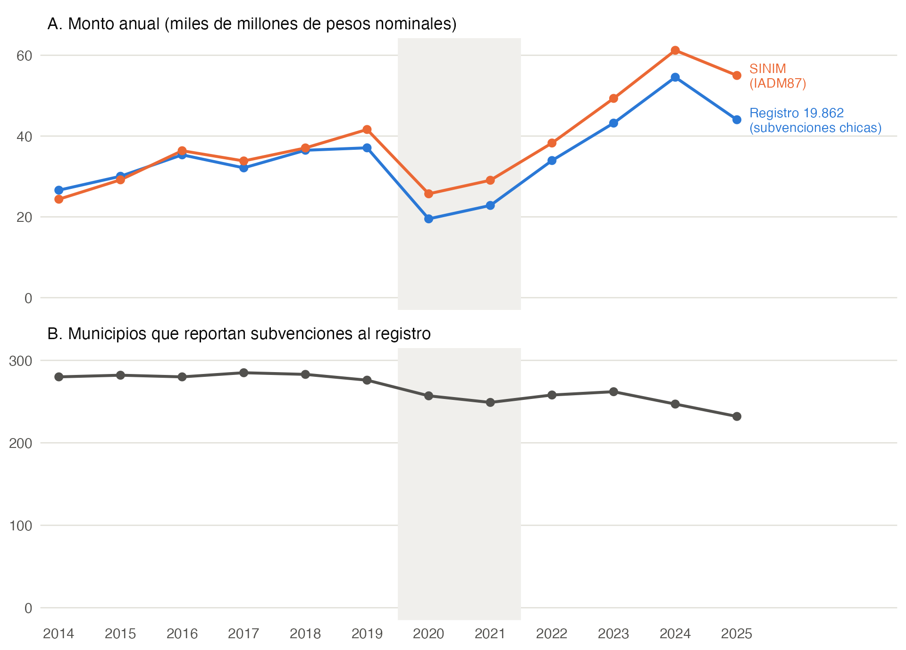
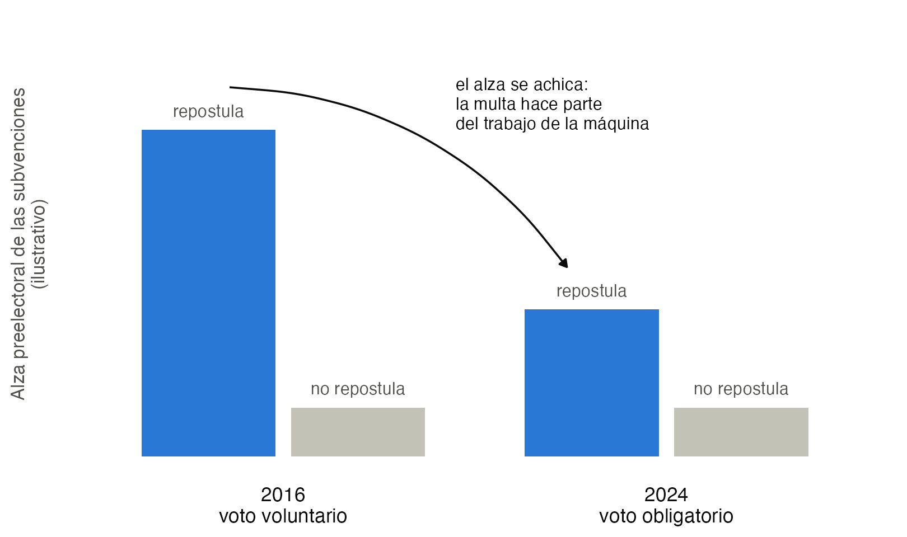

# Camila: voto obligatorio y clientelismo municipal

Primer borrador, 30 de octubre de 2026.

## 1. Idea básica

**Pregunta original.** ¿Cambió el uso clientelar del gasto, y en particular el de educación, cuando el voto volvió a ser obligatorio?

**La intuición.** Con voto voluntario, una máquina política puede pagarles a sus simpatizantes para que vayan a votar (compra de participación). Con voto obligatorio, la multa hace parte de ese trabajo, y la máquina debería gastar menos en movilizar.

**El cambio que proponemos: la máquina es el alcalde.** El gasto que medimos (subvenciones, educación) lo decide el alcalde. Con el alcalde como máquina coinciden tres cosas:

- *Quién decide:* el alcalde reparte el presupuesto municipal.
- *Qué elección le importa:* la municipal. Una con voto voluntario (2016) y una con voto obligatorio (2024).
- *Cuándo reacciona:* en los meses previos a cada elección.

Además, los alcaldes que no van a la reelección no tienen motivo electoral y sirven de comparación.

**Pregunta reformulada.** Cuando el voto pasó a ser obligatorio, ¿se achicó el alza de subvenciones a organizaciones que los alcaldes que van a la reelección hacen antes de la elección? *Secundaria:* ¿ocurrió lo mismo con el gasto municipal en educación?

## 2. Datos de transferencias

**Fuente.** Registro de transferencias de la Ley 19.862 (<https://registros19862.gob.cl/reporte/transferencias>). Cada fila es una transferencia de un municipio, con fecha del decreto, objetivo, receptor, comuna y monto. Se descarga en CSV, filtrando por emisor "Municipalidad".

**Archivos.**

| Archivo | Qué es |
|---|---|
| `scripts/01_descargar_transferencias_municipales.R` | Descarga el registro año por año (2014 en adelante), clasifica cada transferencia y le asigna el código de comuna (CUT) del municipio, usando SINIM. |
| `scripts/02_figura1_registro_vs_sinim.R` | Hace la Figura 1: compara el registro con SINIM. |
| `scripts/03_figura2_predicciones.R` | Hace la Figura 2: lo que debería predecir el modelo (ilustrativo). |
| `datos/muni_transferencias.csv.gz` | Una fila por transferencia (366.080 filas de 324 municipios, enero de 2014 a octubre de 2026). |
| `datos/muni_panel_comuna_mes.csv` | Número y monto de subvenciones chicas por comuna, año y mes del decreto. |

Para volver a descargar todo, desde esta carpeta:

```
Rscript scripts/01_descargar_transferencias_municipales.R cache/ datos/ ../../playground/datos-apoyo/sinim/sinim_panel_largo.csv
Rscript scripts/02_figura1_registro_vs_sinim.R datos/muni_panel_comuna_mes.csv ../../playground/datos-apoyo/sinim/sinim_panel_largo.csv figs/
Rscript scripts/03_figura2_predicciones.R figs/
```

**Tipos de transferencia (2014 a 2026).**

| Tipo | Definición | N.º |
|---|---|---:|
| Subvenciones chicas | receptor privado, hasta 20 millones (juntas de vecinos, clubes, agrupaciones) | 335.861 |
| Corporaciones y bomberos | corporaciones municipales de educación y salud, bomberos | 17.162 |
| Privados grandes | receptor privado, más de 20 millones | 11.299 |
| Otros | otros organismos públicos | 1.758 |

Las subvenciones chicas son la medida de gasto clientelar.

**Advertencias.**

- Un mes sin registros puede ser falta de gasto o falta de reporte. Conviene trabajar con los municipios que reportan en 2016 y en 2024 (197 tienen al menos 10 subvenciones en ambos años).
- 2020 y 2021 tienen menos reporte (pandemia).
- Usar la fecha del decreto (la asignación), no la de ingreso.
- Los montos son nominales y hay que deflactarlos.

**Otros datos.**

- *Gasto clientelar anual y educación:* SINIM, ya descargado en `playground/datos-apoyo/sinim/`. El gasto en educación tiene menos comunas desde 2019 por el traspaso a los SLEP.
- *Pendiente: datos electorales.* Participación y resultados de alcalde por comuna (2016, 2021 y 2024), y quién repostula. Servel los publica en Power BI.

## 3. Figura 1



**Figura 1.** El registro calza con SINIM. A: suma anual de las subvenciones chicas del registro y de la cuenta de SINIM "Transferencias corrientes a organizaciones comunitarias" (IADM87); cada año, el registro está entre 0,8 y 1,1 veces SINIM. B: municipios que reportan al menos una subvención al registro, de 345. En gris, 2020 y 2021: pandemia y elección municipal postergada a mayo de 2021.

## 4. Precisiones institucionales (resumen)

1. **Voto voluntario desde 2012.** La Ley 20.568 estableció la inscripción automática y el voto voluntario; la primera elección así fue la municipal de octubre de 2012.
2. **Vuelta al voto obligatorio.** El plebiscito de septiembre de 2022 fue obligatorio. La Ley 21.524 (enero de 2023) repuso el voto obligatorio en todas las elecciones, salvo las primarias.
3. **Las elecciones municipales que importan.** Octubre de 2016 (voluntaria), mayo de 2021 (voluntaria, postergada por la pandemia) y octubre de 2024 (obligatoria, con cerca de 85 % de participación).
4. **Límite de reelección.** Desde la Ley 21.238 (2020), un alcalde puede reelegirse a lo más dos veces seguidas. Unos 69 alcaldes no pudieron repostular en 2024 (estimación de prensa, no es un conteo oficial).
5. **Traspaso a los SLEP.** Los colegios municipales pasan a los Servicios Locales de Educación Pública. En SINIM, 61 comunas ya no tenían educación municipal en 2024 y 92 en 2025.

## 5. El modelo (lo básico)

Usaremos el modelo de **Stokes (2005)**, que vimos en el capítulo 3, con compra de participación (**Nichter 2008**): la máquina no compra el voto, sino que la persona vaya a votar.

**Jugadores.**

- Un alcalde $I$ que va a la reelección.
- Sus simpatizantes $i$. Cada uno obtiene un beneficio $\beta_i$ por votar y paga un costo $c_i$ por ir a votar.

**La brecha.** Sea $X_i = c_i - \beta_i$. Si $X_i > 0$, el simpatizante no va a votar por su cuenta. Escribimos $X_i^+ = \max\{X_i, 0\}$ para la parte positiva de la brecha: lo que le falta al simpatizante para ir a votar, que es cero si ya iría por su cuenta. $F$ es la distribución de las brechas entre los simpatizantes del alcalde.

**Voto voluntario.** Para que vaya, el alcalde tiene que hacerle llegar $X_i$, por ejemplo a través de una organización. El gasto en movilización es

$$
S_V = \int X^+ \, dF .
$$

**Voto obligatorio.** Abstenerse cuesta una multa esperada $f$, así que la brecha baja a $X_i - f$ y el gasto es

$$
S_O = \int (X - f)^+ \, dF .
$$

La idea es calcular el ahorro $S_V - S_O$. Preguntas: ¿Puede ser negativo? ¿En qué comunas debería ser más grande?

## 6. Qué debería predecir el modelo

Falta desarrollar el modelo: cuándo se paga la movilización y qué hace el alcalde con lo que ahorra. Lo que sigue es lo que el modelo debería poder decir al final, para tenerlo como meta.

1. **El alza preelectoral se achica.** Entre los alcaldes que van a la reelección, el alza de subvenciones antes de la elección es menor en 2024 que en 2016.
2. **Más donde había más que movilizar.** El alza se achica más donde la participación subió más con el voto obligatorio.
3. **Sin motivo electoral, sin alza.** Los alcaldes que no repostulan no muestran alza en ningún régimen (Finan y Mazzocco 2021).
4. **El electorado nuevo se ve en el nivel, no en el alza.** Si los votantes nuevos piden más educación, el gasto en educación sube de forma permanente, no solo antes de la elección.

Ojo: el signo del cambio en educación, por sí solo, no distingue las hipótesis. Lo que el alcalde ahorra en movilizar lo puede gastar en educación, y eso también hace subir el gasto educativo.



**Figura 2.** Lo que debería predecir el modelo (ilustrativo, no son datos).

## 7. Diseño del modelo de regresión

Por discutir. Debería tener:

- **Unidad de observación:** comuna y mes, alrededor de las elecciones de 2016 y 2024.
- **Variable dependiente:** subvenciones de la comuna en el mes (monto o número).
- **Variables explicativas principales:** meses previos a la elección, si el alcalde va a la reelección y si el voto es obligatorio, con sus interacciones.
- **Heterogeneidad:** cuánto subió la participación en la comuna con el voto obligatorio.
- **Efectos fijos:** al menos comuna por ciclo electoral y mes calendario.
- **Muestra:** municipios que reportan al registro en los dos ciclos.
- **Errores estándar:** agrupados a nivel de comuna.
- **Pruebas de falsificación:** alcaldes que no repostulan; meses lejanos a la elección.
- **Educación:** la misma lógica con datos anuales de SINIM.

## 8. Decisiones abiertas

1. **¿La educación sigue como pregunta secundaria** o pasa a ser una extensión?
2. **¿Qué meses cuentan como "previos" a la elección?** Puede haber reglas que limiten las subvenciones durante la campaña (no verificado).
3. **¿Quiénes forman el grupo de comparación:** solo los alcaldes impedidos por ley, o también los que se retiran?
4. **¿Qué partidas de educación cuentan como clientelares** (personal a contrata y a honorarios) y cuáles como programáticas (inversión)?
5. **Lecturas:**
   - Nichter (2008), "Vote Buying or Turnout Buying? Machine Politics and the Secret Ballot", *American Political Science Review* 102(1).
   - Stokes (2005), "Perverse Accountability", *American Political Science Review* 99(3). Base del modelo (capítulo 3).
   - Finan y Mazzocco (2021), "Electoral Incentives and the Allocation of Public Funds", *Journal of the European Economic Association* 19(5). Quien no busca la reelección revela qué haría sin el motivo electoral.
   - Chuaqui, Le Foulon y Olguín (2023), "Quién vota en Chile: primeros análisis después del voto obligatorio", *Puntos de Referencia* 668, CEP.
   - Hoffman, León y Lombardi (2017), "Compulsory Voting, Turnout, and Government Spending: Evidence from Austria", *Journal of Public Economics* 145.
   - Fujiwara (2015), "Voting Technology, Political Responsiveness, and Infant Health: Evidence from Brazil", *Econometrica* 83(2).
