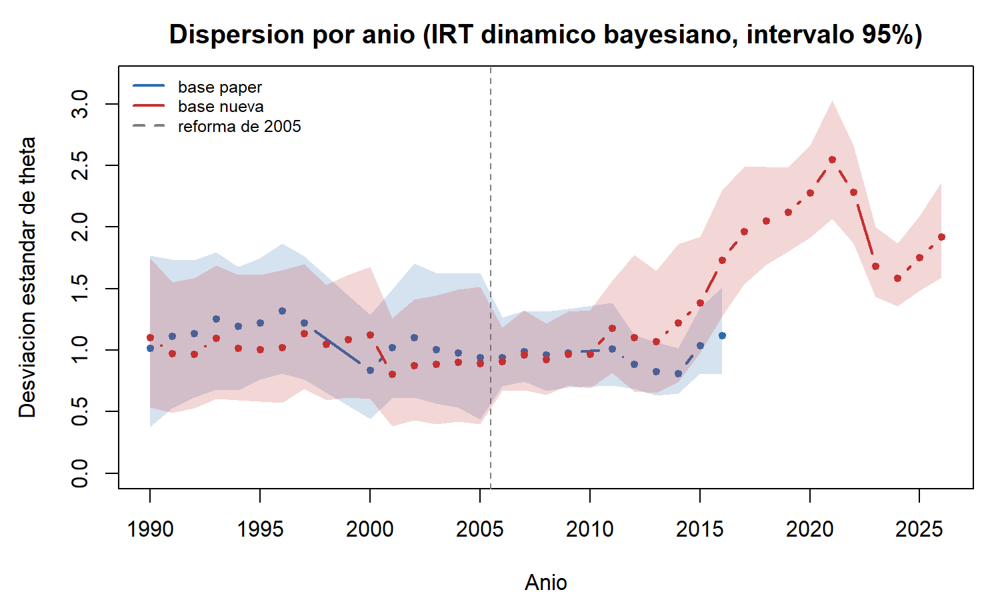
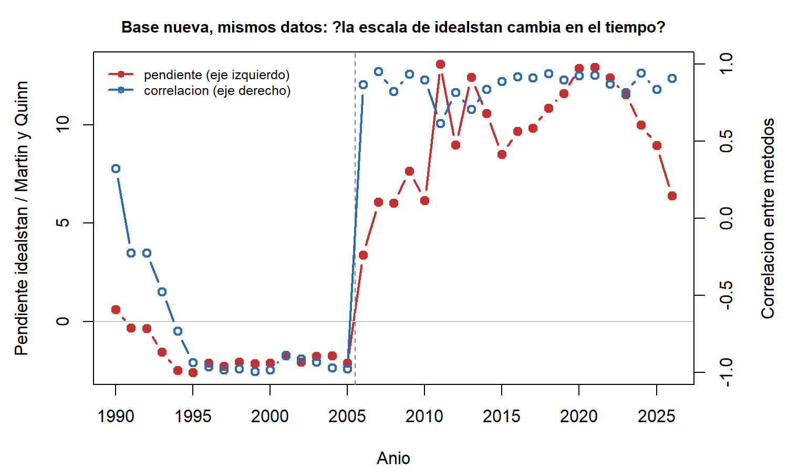
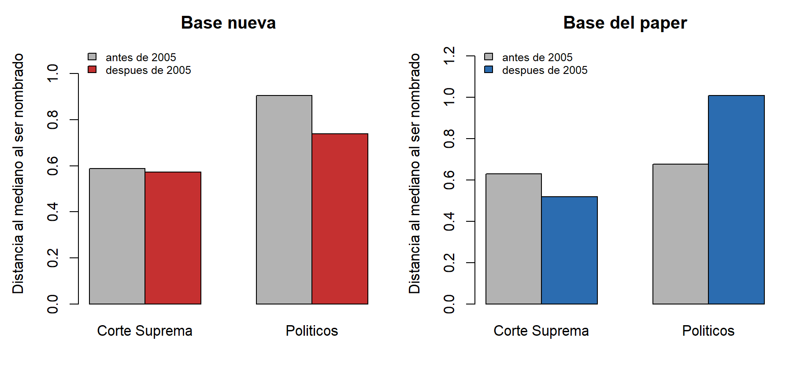
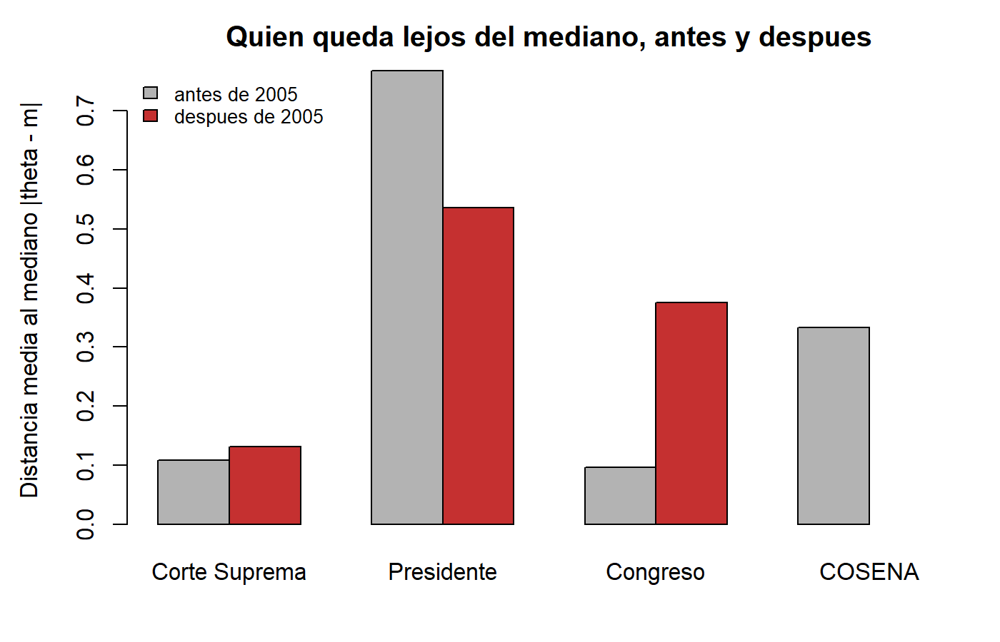
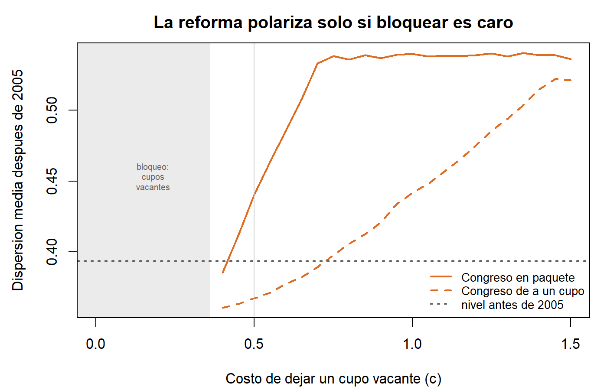
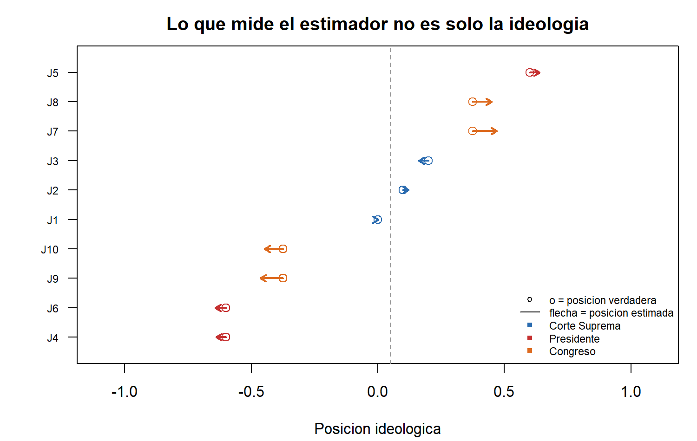
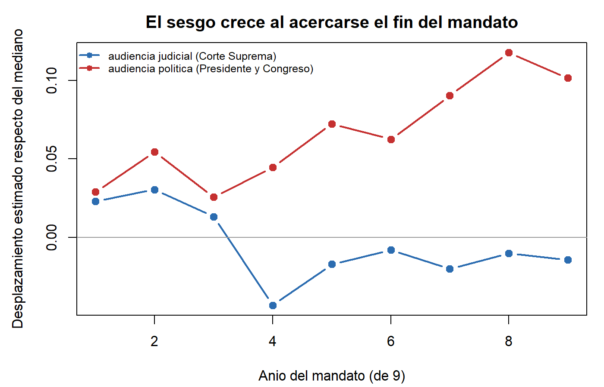

# Un modelo formal para *We did not see it coming*

**Nombramientos, reputación y polarización en el Tribunal Constitucional de Chile**

Borrador de trabajo, noviembre de 2026.

Este documento hace tres cosas:

1. Propone un **modelo formal** para el paper de Fábrega, Sajuria y Drobny, construido con los modelos del curso Economía Política Formal 2026 (secciones 1 a 5).
2. **Replica** el resultado principal del paper con su método (idealstan) y sus datos (sección 7).
3. **Pone a prueba** las predicciones con datos reales, con **tres estimadores** de la ideología y **dos bases** de votos. Compara el período anterior y el posterior a la reforma de 2005, y contrasta la explicación del paper con la de Pardow y Verdugo (2015) (secciones 7 y 8).

Cada parte del modelo se presenta en tres pasos:

- **La idea**, en palabras.
- **Formalmente**, con las ecuaciones y su derivación.
- **Qué significa**, para el paper y para los datos.

> **Resultado principal.**
>
> - **La réplica funciona: no hay error en nuestros datos ni en nuestro código.** Con los datos y el método del paper (idealstan, un IRT dinámico bayesiano) se reproducen sus resultados: la validación (0,57 contra 0,56), el aumento de la dispersión después de 2005 y sus Tablas 2 y 3, con los mismos signos y la misma significancia (sección 7.4).
> - **Un resultado del paper se sostiene con cualquier método:** los nombrados por el Ejecutivo quedan más lejos del mediano que el resto (su Tabla 3), aunque con significancia débil (p ≈ 0,08 con Martin y Quinn). Lo que el paper no prueba es que eso ocurra **solo después de la reforma**: su tabla no incluye esa interacción, y al estimarla no es significativa con ningún método.
> - **El salto de la dispersión en 2005 depende del estimador.** Con **los mismos datos**, los dos estimadores de Martin y Quinn (emIRT y MCMCpack) no encuentran aumento: la dispersión después de 2005 es igual o menor que antes. Año por año, los tres métodos ordenan a los ministros casi igual (correlación de 0,9 a 0,99). Lo que cambia es cómo conectan la "regla" de medir entre épocas. Antes de 2006, idealstan **da vuelta** la orientación y usa una **unidad de menos de la mitad del tamaño** que después: una unidad de Martin y Quinn equivale a unas 2,5 de idealstan antes de la reforma y a unas 6 después. Ese cambio de regla, justo en 2005, basta para duplicar la dispersión.
> - **Ninguna de las demás predicciones encuentra apoyo robusto.** La prueba de diferencias en diferencias del paper (P1) no es significativa con ningún método ni base, una vez que se considera que las posiciones están estimadas con error. El efecto de horizonte (el mecanismo reputacional) desaparece al agrupar las series repetidas. Los académicos no son más activistas, como sostienen Pardow y Verdugo.
> - **Antes de 2006 los datos no alcanzan para ubicar a los ministros en el eje izquierda-derecha.** Hay pocos fallos con disidencia, y en ningún método la escala de esos años se relaciona con el lado político de quien nombró al ministro. Por eso la comparación antes y después de la reforma depende tanto del método.

---

## 1. Punto de partida

### Qué dice el paper

El paper sostiene que la reforma constitucional de 2005 polarizó al Tribunal Constitucional (TC). Su explicación es **reputacional** (Garoupa y Ginsburg):

- Los ministros nombrados por actores políticos cuidan su reputación ante su sector político.
- Los nombrados por la Corte Suprema la cuidan ante el poder judicial.
- La reforma dio más cupos a los actores políticos, así que "importó" la polarización al Tribunal.

| | Antes de 2005 (7 ministros) | Después de 2005 (10 ministros) |
|---|---|---|
| Corte Suprema | 3 | 3 |
| Presidente | 1 | 3 |
| Congreso | 1 (Senado, mayoría simple) | 4 (Senado y Cámara, dos tercios) |
| COSENA | 2 | 0 |

**Lo que encontró:**

1. La dispersión ideológica sube después de 2005.
2. La subida se concentra en los nombrados por poderes políticos (diferencias en diferencias contra la Corte Suprema).
3. Después de 2005, los más lejanos del mediano son los nombrados por el Ejecutivo y el Legislativo.
4. El efecto lo genera el **Ejecutivo**; el del Legislativo no es significativo.

### La explicación alternativa: Pardow y Verdugo (2015)

En *"El Tribunal Constitucional chileno y la reforma de 2005. Un enroque entre jueces de carrera y académicos"*, Pardow y Verdugo sostienen que después de 2005 el Tribunal se volvió más activo frente al Ejecutivo. Para ellos la causa **no es quién nombra, sino quién llega**: académicos que reemplazaron a jueces de carrera.

### Qué le falta al paper

- **No hay modelo formal.** El argumento no tiene jugadores, utilidades ni equilibrio.
- **La prueba no distingue mecanismos.** La distancia de un ministro al mediano puede venir de *a quién se nombró* (selección) o de *cómo vota una vez adentro* (incentivos).
- **No descarta a Pardow y Verdugo.** La reforma y el cambio de carrera ocurrieron al mismo tiempo.

---

## 2. Las piezas del curso

| Capítulo | Modelo | Uso aquí |
|---|---|---|
| 1 | Modelo espacial, votante mediano, control de agenda, veto | **Etapa 1:** quién nombra a quién, según la regla |
| 4 | Voto espacial con incentivos, $\Delta U$ = preferencia + incentivo electoral + incentivo partidario, y estimación de puntos ideales | **Etapa 2:** cómo vota el ministro; también la estimación de la ideología |
| 2 | Dal Bó y Rossi: horizonte del mandato | El incentivo reputacional crece al acercarse el fin del mandato |

---

## 3. Etapa 1: el juego de nominación

### La idea

Cada órgano que nombra quiere un ministro que piense como él. Lo que cambia es **la regla**:

- El Presidente nombra solo.
- La Corte Suprema vota internamente.
- El Congreso necesita dos tercios, así que cada bloque puede vetar.

Con las mismas preferencias, reglas distintas producen ministros distintos: $x^* = f(\text{preferencias}, \text{reglas}, \text{situación inicial})$, como en el capítulo 1.

### Formalmente

Hay una dimensión ideológica. Cada nominador $k$ tiene un ideal $x_k$ y obtiene $u_k(\theta) = -(\theta - x_k)^2$ si nombra a alguien en $\theta$, o $-c$ si el cupo queda vacante.

**Presidente (agenda sin veto):**

$$\boxed{\theta_P^* = x_P}$$

**Corte Suprema (votante mediano de la Corte):**

$$\boxed{\theta_{CS}^* = m_{CS}}$$

**Congreso, un cupo con dos tercios.** Los bloques están en $x_A = \bar x + h$ y $x_B = \bar x - h$. Le toca proponer a $A$, y $B$ acepta si $|\theta - x_B| \le \sqrt c$. Entonces

$$\boxed{\theta_1^* = \min\{x_A,\; x_B + \sqrt c\}}$$

Es la fórmula del capítulo 1, $p^*=\min\{x_S, 2x_m-q\}$: la vacancia hace de status quo. Hay acuerdo solo si $c \ge h^2$; si no, el cupo queda vacante, como ocurrió con los cupos de la Cámara entre 2022 y 2024.

**Congreso con dos cupos en paquete (la "regla del empate").** $B$ acepta el par $(\theta_A,\theta_B)$ si $(\theta_A - x_B)^2 + (\theta_B - x_B)^2 \le 2c$. Con bloques simétricos, cada nombrado queda a una distancia $s$ del centro y la pérdida de $B$ es $2s^2 + 2h^2$. Entonces

$$\boxed{\theta_{paq}^* = \bar x \pm \min\{h,\; \sqrt{c-h^2}\}}$$

Como $\sqrt{c-h^2} \ge \sqrt c - h$ siempre que haya acuerdo, **el paquete produce nombrados más extremos que el cupo suelto**. Cada bloque "paga" el extremo del otro con el propio.

### Qué significa

- **Proposición 1:** la reforma aumenta la dispersión si los presidentes que nombran se alternan entre bloques y si bloquear en el Congreso es caro ($c$ alto).
- **Proposición 2:** después de 2005, la distancia al mediano sigue el orden $\delta_{Presidente} \ge \delta_{Congreso} \ge \delta_{CS}$.
- **Proposición 3:** para que la diferencias en diferencias del paper sea positiva, los presidentes de 1990–2005 deben haber nombrado ministros relativamente moderados (Anexo A).

---

## 4. Etapa 2: cómo vota un ministro

### La idea

Un ministro del TC no puede ser removido ni reelegido. Lo que arriesga con su voto es su **reputación**, que vale para su carrera posterior. Según el paper, la cuida ante audiencias distintas:

- **Nombrado por políticos:** ante su sector político.
- **Nombrado por la Corte Suprema:** ante el poder judicial, que premia el consenso.

### Formalmente

Se modifica la ecuación del capítulo 4, cambiando la reelección por la reputación. En el caso $j$, el ministro $i$ (nombrado por $k$) vota por acoger si $\Delta U_{ij} \ge 0$:

$$
\boxed{\Delta U_{ij} = \underbrace{2(a_j - r_j)(\theta_i - m_j)}_{\text{preferencia}} + \underbrace{\beta^{\,T_i-t} R\, \Delta\rho^k_{ij}}_{\text{reputación}} + \varepsilon_{ij}}
$$

- **Preferencia.** $(r-\theta)^2 - (a-\theta)^2 = 2(a-r)(\theta - m_j)$, donde $m_j$ es el punto de corte del caso.
- **Reputación.** $\Delta\rho = +1$ si acoger agrada a su audiencia.
- **Horizonte.** $\beta^{T_i-t}$ crece al acercarse el fin del mandato $T_i$, como en Dal Bó y Rossi.

### Qué significa

- **Proposición 4:** los nombrados por políticos votan como si estuvieran más cerca de su bloque.
- **Proposición 5:** el empuje es mayor en los nombrados por el Congreso, que llegan moderados por el veto.
- **Proposición 6:** el empuje **crece hacia el final del mandato**.

---

## 5. Qué mide la ideología estimada

Un modelo de puntos ideales supone que solo la ideología explica el voto. Si también pesa la reputación, el modelo la mete dentro de la posición estimada:

$$
\hat\theta_{it} \approx \underbrace{\theta_i}_{\text{selección (etapa 1)}} + \underbrace{\pi_i(t)}_{\text{reputación (etapa 2)}} .
$$

La selección se fija el día del nombramiento; la reputación cambia con el horizonte del mandato. Por eso **la posición tiene que poder cambiar de un año a otro**, y por eso se usa un **IRT dinámico** (sección 7.3).

---

## 6. Predicciones y resultados

| Prueba | Pregunta | Predicción | Resultado |
|---|---|---|---|
| Hecho 1 | ¿La dispersión salta después de 2005? | Sí (Proposición 1) | **Depende del estimador.** Sí con idealstan (el método del paper); no con Martin y Quinn, con los mismos datos |
| **P1** | ¿Los nombrados por políticos quedan más lejos del mediano después de 2005? | Sí (selección) | **No significativo** con ningún método ni base; el signo cambia según el método |
| **P2** | ¿Los nombrados por políticos disienten más después de 2005? | Sí | **Cambia de signo según la base**; no significativo |
| **P3** | ¿Pesa más quién nombró o la carrera del ministro? | Quién nombró (paper) o la carrera (Pardow y Verdugo) | **Depende de la base.** Los académicos no son más activos, como afirman Pardow y Verdugo |
| **P4** | ¿Los nombrados por políticos se alejan del mediano al final del mandato? | Sí (reputación) | **No**, una vez agrupadas las series, con emIRT y con MCMCpack |
| — | ¿Los paquetes del Congreso producen nombrados más extremos? | Sí | No se puede probar: casi todos fueron en paquete |

---

## 7. Pruebas con datos reales

Los coeficientes quedan en `modelo/resultados/` y las figuras en `modelo/figuras/`. La sección 9 lista los scripts y el orden en que se corren.

### 7.1 Los datos: se mejoró la lectura de disidencias antiguas

El script 2 (`codigo/2_descargar_sitio_antiguo.R`) no reconocía varias fórmulas de disidencia de los PDF de 1981–2007:

- "con **los votos** en contra", en plural;
- "Acordad**o**";
- "contra el voto de", "contra la opinión de";
- "y la disidencia, los Ministros...";
- "El Ministro X disiente / discrepa";
- "El Ministro X, estuvo por...".

Además exigía los dos apellidos, y en los años noventa las sentencias nombran a los disidentes **solo por el primer apellido**. Se corrigió todo eso. Se agregó un control (los disidentes siempre son minoría) y se dejan fuera las prevenciones.

| 1990–2005 | Versión anterior | Versión nueva |
|---|---|---|
| Fallos con disidencia en la base nueva | 20 | **58** (la del paper tiene 54) |
| Disidencias de la base del paper que también capta la nueva | 15 de 85 (18 %) | **43 de 85 (51 %)** |

La versión nueva también encuentra 42 disidencias que la base del paper no tiene. En una muestra revisada a mano, casi todas están efectivamente en el texto de la sentencia. Las diferencias que quedan vienen sobre todo de **disidencias parciales**, que cada base codifica distinto; se cuentan como disidencia (`DISIDENCIAS_PARCIALES <- TRUE`). El acuerdo general con la base del paper queda en 79,6 % (kappa 0,513).

### 7.2 Las inaplicabilidades en serie se agrupan

Entre 2015 y 2020 el TC falló miles de requerimientos casi idénticos: misma norma impugnada, mismo año, misma votación. Cada uno no dice nada nuevo sobre quién piensa qué, pero pesaría como un caso distinto. El paper no los agrupa, pero llega solo hasta 2016 y casi no los tiene.

**Criterio** (`AGRUPAR_SERIES <- TRUE` en `modelo/comun.R`): son un solo caso los fallos con el mismo año, la misma norma impugnada y **exactamente la misma votación**. Si no hay norma registrada, cuentan la misma fecha y la misma votación. La base final no se modifica; se agrupa solo para el análisis.

| Fallos con disidencia, base nueva | 1990–2005 | 2006–2014 | 2015–2022 | 2023–2026 |
|---|---|---|---|---|
| Sin agrupar | 58 | 322 | **4.789** | 634 |
| Agrupados | 58 | 255 | **2.362** | 514 |

La serie más grande tenía 118 fallos idénticos.

### 7.3 La ideología: tres estimadores del IRT dinámico

**Por qué dinámico.** Si se estima un modelo para cada período (por mes, por año, o antes y después de 2005), cada estimación queda centrada en *su* tribunal. Si todo el tribunal se corre en bloque, un ministro que se corre con él aparece en el mismo lugar en ambos períodos. El modelo dinámico estima todos los años juntos, conectados por los ministros que siguen en el cargo, y deja que cada posición cambie gradualmente:

$$
\theta_{i,t} = \theta_{i,t-1} + \eta_{it}, \qquad \Pr(\text{acoger}_{ij}) = \Phi(\alpha_j + \beta_j\theta_{i,t(j)})
$$

Es la ecuación de voto de la sección 4 (con $\beta_j\theta_i + \alpha_j$ en lugar de $2(a_j - r_j)(\theta_i - m_j)$) más un paseo aleatorio que conecta los años. Las tres versiones estiman **el mismo modelo**; difieren en cómo se calcula y en cómo se fija la escala.

| | emIRT | MCMCpack | idealstan |
|---|---|---|---|
| Qué es | Martin y Quinn, aproximación variacional (Imai, Lo y Olmsted 2016) | Martin y Quinn por MCMC (muestreo de Gibbs) | IRT dinámico por MCMC con Stan (Kubinec); **el método del paper** |
| Entrega | Una posición por ministro-año | Miles de posiciones posibles por ministro-año (la incertidumbre) | Igual que MCMCpack |
| Varianza del paseo aleatorio | Fija: $\omega^2 = 0{,}1$, la de Martin y Quinn | Fija: 0,1, igual que emIRT | **Se estima libremente para cada ministro** |
| Cómo se fija la escala | Previa de las posiciones ($N(0,1)$) y dos anclas que dan el sentido | Igual | Dos anclas **fijadas en ±2** y nada más |
| Covariable "quién lo nombró" | No permite | No permite | Permite (el paper la usa) |
| Tiempo, base nueva | ~1 min | ~12 h por cadena | ~3,5 h |

Las anclas son las mismas en todos: Aróstica (derecha) y García Pino (izquierda), presentes en ambas bases. Se estima por **años**: un mes tiene muy pocos fallos con disidencia.

**Mismos datos para comparar.** Para que una diferencia entre métodos sea del método y no de los datos, los tres se estimaron con los mismos datos: solo fallos con disidencia (en los unánimes no se distingue a nadie), con al menos 3 votantes, ministros con al menos 10 votos y series agrupadas. Aparte, se hizo una **réplica fiel del paper** con idealstan y los datos tal como los usó el paper (sección 7.4).

**Convergencia.** Un MCMC entrega resultados válidos solo si las cadenas llegaron a la distribución que buscan.

| Estimación | Diagnóstico | Resultado |
|---|---|---|
| MCMCpack, base del paper (2 cadenas de 20.000 iteraciones) | Geweke: % de parámetros con \|z\| > 1,96 (se espera ~5 %); R-hat | Geweke 4 % y 9 %; R-hat máximo 1,03, ninguno sobre 1,1: **convergió** |
| MCMCpack, base nueva, intento de 3.000 iteraciones | Geweke | 49 %: **no convergió**; se descartó |
| MCMCpack, base nueva (2 cadenas, 15.000 iteraciones, ~12 h) | R-hat de Gelman-Rubin; Geweke | R-hat > 1,1 en 24 % (máximo 5,9); Geweke 32 %: **no convergió** |
| MCMCpack, base nueva, anclas fijas (prueba: 2 cadenas de 3.000 iteraciones, ~2,5 h) | R-hat; Geweke | R-hat > 1,1 en 25 % (máximo 2,5), pero solo 10–11 % entre 2006 y 2022; Geweke 28 %: **mejora, aún no converge** |
| idealstan, 5 estimaciones (2 cadenas cada una) | Divergencias; R-hat máximo (se espera < 1,1) | 0 divergencias (2 en una); R-hat máximo entre 1,02 y 1,06: **convergió** |

**Por qué no converge MCMCpack en la base nueva.** Las dos cadenas ordenan a los ministros casi igual (correlación entre sus medias de 0,86 antes de 2006 y de 0,92 a 0,99 después) y ninguna muestra un salto de dispersión en 2005 (cadena 1: 1,03 → 1,12; cadena 2: 0,97 → 0,94). Lo que no se estabiliza es **el tamaño de la escala**: García Pino, por ejemplo, queda en −7 en una cadena y en −5 en la otra.

`modelo/diagnosticar_mcmcpack.R` muestra por qué. **Las cadenas seguían moviéndose al final:** en ambas, la dispersión de 2015–2022 bajaba sin parar (correlación de −0,84 y −0,78 con el número de iteración). Las anclas solo fijan el signo (Aróstica positivo, García Pino negativo), no la distancia. Si todos los ministros se alejan y los fallos "discriminan" menos, los votos se explican casi igual, y el muestreador recorre esa dirección a pasos muy chicos. Con miles de fallos por año, cada paso es diminuto: harían falta muchas más iteraciones.

**Diagnóstico de MCMCpack, base nueva.** Cada color es una cadena. Las cadenas no se juntan y siguen con tendencia al terminar.

**Prueba con anclas fijas.** Si el problema es que la escala no tiene un tamaño fijo, la solución es fijar las anclas en valores exactos (Aróstica = +1, García Pino = −1): `estimar_ideologia_bayes.R nueva 1000 2000 2 <cadena> fijas`. Una prueba corta (3.000 iteraciones por cadena, cinco veces menos que la corrida anterior) confirma el diagnóstico:

| % de parámetros con R-hat > 1,1 | 1990–2005 | 2006–2014 | 2015–2022 | 2023–2026 | R-hat máximo |
|---|---|---|---|---|---|
| Anclas con signo (15.000 iteraciones) | 24 | 29 | 24 | 14 | 5,9 (García Pino) |
| Anclas fijas (3.000 iteraciones) | 49 | **10** | **11** | 29 | 2,5 (García Rodríguez) |

- **La escala dejó de estirarse.** La dispersión de 2015–2022 queda en 0,90, con un intervalo angosto (0,84 a 0,96), y las cadenas ya casi no cambian entre la primera y la segunda mitad.
- **Lo que falta converger está en los años sin anclas.** Aróstica y García Pino solo están en el tribunal entre 2007 y 2022. Antes de 2006 y después de 2022, la escala se conecta solo a través de los ministros que cruzan de una época a otra, y en la base nueva hay pocos fallos con disidencia antes de 2006 (58). Por eso esos años son los que menos convergen, y por eso la base del paper sigue siendo la principal antes de 2006.
- **La conclusión sustantiva no cambia.** Con las anclas fijas tampoco hay salto en 2005: la dispersión pasa de 1,00 a 0,91 (diferencia −0,08; probabilidad de que suba, 0,30).

Mientras no esté la corrida larga con anclas fijas (15.000 iteraciones, ~12 h), los resultados de MCMCpack en la base nueva se reportan como **indicativos**.

En idealstan, el tamaño efectivo de muestra mínimo es bajo en algunos parámetros (32 a 305), suficiente para medianas y desviaciones estándar por año, pero más iteraciones darían intervalos más precisos.

**W-NOMINATE** (el método del laboratorio del capítulo 4) se intentó como comparación, y con estos datos da resultados internamente inconsistentes: clasifica más votos de los que cada ministro emitió. Con el ejemplo del propio paquete funciona bien. La razón probable es que W-NOMINATE supone un parlamento donde todos votan en el mismo período, y en el TC los ministros se reemplazan a lo largo de décadas. No se usa.

### 7.4 La réplica del paper: qué se reproduce y qué depende del método

Esta sección responde una pregunta previa a cualquier crítica: **si nuestros resultados difieren de los del paper, ¿el error es nuestro?** Para responderla se separan tres posibles causas de una diferencia: los **datos** (la base nueva), la **implementación** (nuestro código) y el **método** (el estimador de la ideología).

#### Paso 1. Los datos y el método del paper: la réplica funciona

`modelo/replicar_paper_idealstan.R` repite el procedimiento del paper con **su base** y **su método** (idealstan): todos los votos de 1990–2016, sin agrupar series, ministros con al menos 10 votos y la covariable "nombrado por políticos" dentro del modelo. `modelo/probar_idealstan.R` calcula después sus Tablas 2 y 3 **tal como se publicaron**.

| | Paper | Réplica, con covariable (como el paper) | Réplica, sin covariable |
|---|---|---|---|
| Votos / fallos / ministros | 11.013 / 1.265 / 40 | 11.047 / 1.270 / 39 | igual |
| Validación (correlación con el lado político) | 0,56 | **0,57** | 0,39 |
| Dispersión, 1990–2005 → 2006–2016 (su Figura 3) | sube | 2,16 → 4,75 (×2,2) | 2,10 → 4,38 (×2,1) |
| **Tabla 2**, Ejecutivo + Legislativo (tratado × reforma) | +0,478*** | **+2,60*** ** | +2,14*** |
| **Tabla 2**, solo Ejecutivo | +0,530** | **+3,37*** ** | +1,57** |
| **Tabla 3**, M1: nombrado por político | +0,308* | +1,64* | +1,15 (p = 0,12) |
| **Tabla 3**, M4: Ejecutivo (controlando reforma) | +0,369** | **+1,82** ** | +0,76 (p = 0,31) |
| **Tabla 3**, M5: Ejecutivo (controlando Legislativo y reforma) | +0,384** | +1,68* | +0,78 (p = 0,34) |
| **Tabla 3**, Legislativo | +0,048 | +0,26 | +0,77 |

\* p < 0,1; \*\* p < 0,05; \*\*\* p < 0,01, con errores estándar clásicos, como el paper.

**Con la covariable, como hizo el paper, la réplica reproduce sus resultados**: los mismos signos, la misma significancia y el mismo patrón (Ejecutivo sí, Legislativo no). Los coeficientes son unas 5 veces más grandes porque nuestra escala es más ancha (la dispersión de control antes de 2005 es 0,95 en la réplica y 0,17 en el paper), pero **en proporción son casi iguales**: en la Tabla 2, el efecto equivale a 2,8 veces la dispersión de control en el paper y a 2,7 veces en la réplica.

**Conclusión del paso 1:** ni nuestra base ni nuestro código explican las diferencias. Con lo mismo que usó el paper, obtenemos lo mismo que el paper.

#### Paso 2. Los mismos datos, otro método: qué se sostiene

Para ver si los resultados dependen del estimador, las mismas Tablas 2 y 3 se calcularon con **los mismos datos** (la base del paper, fallos con disidencia, sin covariable) estimados con idealstan y con Martin y Quinn (MCMCpack, que convergió en esta base; se juntan sus dos cadenas).

| | Paper | idealstan | Martin y Quinn (MCMCpack) |
|---|---|---|---|
| Dispersión, 1990–2005 → 2006–2016 | sube | 3,46 → 5,31: **sube** | 1,09 → 0,95: **no sube** |
| **Tabla 2**, Ejecutivo + Legislativo | +0,478*** | +1,30** | **−0,30*** (p = 0,08) |
| **Tabla 2**, solo Ejecutivo | +0,530** | +0,24 (p = 0,75) | **−1,00*** ** |
| **Tabla 3**, M4: Ejecutivo | +0,369** | +2,08** | **+0,44*** (p = 0,09) |
| **Tabla 3**, M5: Ejecutivo | +0,384** | +2,16** | **+0,54*** (p = 0,07) |
| **Tabla 3**, Legislativo | +0,048 | +0,39 | −0,01 |

**Qué se sostiene con cualquier método:**

- **Los nombrados por el Ejecutivo quedan más lejos del mediano que el resto** (Tabla 3). El signo se repite en todos los métodos. Con Martin y Quinn el tamaño es incluso parecido al del paper (0,44 contra 0,37), aunque la significancia es más débil (p ≈ 0,08).
- **Los nombrados por el Legislativo no se distinguen** del resto, como dice el paper.

**Qué depende del método:**

- **El aumento de la dispersión después de 2005** (Figura 3 del paper): idealstan lo encuentra y Martin y Quinn no (sección 7.6 explica por qué).
- **Que ese aumento se concentre en los nombrados por políticos** (Tabla 2): con Martin y Quinn el signo se invierte. No es un problema de convergencia: en la base del paper MCMCpack convergió (dos cadenas, R-hat máximo 1,03).

**Por qué la Tabla 2 cambia de signo.** En todos los métodos, los nombrados por políticos están más dispersos que el resto, antes y después de la reforma (por eso la Tabla 3 se sostiene). Si un método agranda toda la escala después de 2005 por un factor $k > 1$, la brecha entre los grupos crece sola: la interacción de la Tabla 2 vale $(k-1)(\text{sd}_{\text{políticos}} - \text{sd}_{\text{resto}}) > 0$, aunque el tribunal no haya cambiado. idealstan agranda su escala en 2005 (×1,5 con estos datos; sección 7.6) y Martin y Quinn no. **La Tabla 2 positiva es exactamente lo que produciría un cambio de escala**, así que no permite distinguir polarización real de un efecto del estimador.

#### Paso 3. Lo que el paper no prueba

- **"Solo después de la reforma."** El texto del paper concluye que los nombrados por el Ejecutivo están más lejos del mediano "but only after the reform". Pero la Tabla 3 publicada **no incluye la interacción** Ejecutivo × reforma que permitiría afirmarlo: sus modelos 4 y 5 suman el efecto del Ejecutivo y el de la reforma por separado. La ecuación 4 del texto sí incluye esa interacción ($d\,R{\cdot}D$). Cuando se estima, **no es significativa con ningún método ni base** (sección 7.7; en la réplica fiel, +2,66 con p = 0,087 y, con la incertidumbre de las posiciones, p = 0,34).
- **Errores estándar demasiado chicos en la Tabla 2.** Sus 54 observaciones son 27 años × 2 grupos, pero los mismos ministros aparecen en muchos años seguidos, así que las observaciones no son independientes. Además, las posiciones son estimaciones, no datos exactos. Al sumar esa incertidumbre (reglas de Rubin), el efecto de la Tabla 2 pasa de p < 0,001 a p = 0,04 en la réplica, y en la versión con los mismos datos que Martin y Quinn deja de ser significativo (p = 0,40).
- **La covariable dentro del modelo.** El paper incluye "nombrado por políticos" dentro del modelo que estima la ideología y luego prueba si los nombrados por políticos están más lejos del mediano. Parte del resultado puede ser mecánico. En la réplica fiel, el efecto del Ejecutivo en la Tabla 3 es significativo con la covariable (p = 0,04) y no sin ella (p = 0,31).

#### ¿Podemos estar equivocados nosotros?

Sí, en tres puntos concretos, y conviene decirlos:

1. **Detalles que el paper no especifica.** El texto no dice qué unidad de tiempo usa (años, semestres, períodos de mandato), qué proceso sigue la ideología en el tiempo (paseo aleatorio u otro), cómo fija la escala (qué anclas o restricciones) ni cómo entra exactamente la covariable. Nuestras elecciones (años, paseo aleatorio, anclas Aróstica y García Pino) reproducen sus resultados, pero **la escala del paper es unas 5 veces más angosta que la nuestra**, señal de que su identificación fue distinta. Justamente la identificación de la escala es lo que separa a idealstan de Martin y Quinn (sección 7.6).
2. **Martin y Quinn también supone cosas.** Su paseo aleatorio con varianza fija (0,1) podría estar suavizando un cambio real después de 2005. No hay forma de saber, con estos datos, cuál de los dos estimadores conecta mejor las épocas.
3. **Nuestra base nueva** difiere de la del paper (kappa 0,51), pero **no explica las diferencias**: todo lo de esta sección usa la base del paper.

**Cómo resolverlo:** pedir a los autores el código original de la estimación con idealstan. Con él se sabría si su identificación de la escala es distinta de la nuestra y si, con ella, el salto de 2005 se mantiene con Martin y Quinn.

### 7.5 Hecho 1: ¿la dispersión salta en 2005? Tres métodos, dos bases

La dispersión de un año es la desviación estándar de las posiciones (medianas posteriores) de los ministros que votaron ese año; se promedia por período. **Las unidades de cada método son distintas** (idealstan fija las anclas en ±2 y estira; Martin y Quinn usa una escala cercana a la normal estándar), así que lo comparable es **cuánto cambia** cada método de un período a otro, no el nivel.

| Dispersión media (mismos datos) | 1990–2005 | 2006–2014 | 2015–2022 | 2023–2026 | Después / antes de 2005 |
|---|---|---|---|---|---|
| **Base del paper** | | | | | |
| emIRT | 0,94 | 0,90 | 1,27 (2015–16) | — | **×0,96** |
| MCMCpack (2 cadenas) | 1,02 | 0,88 | 1,04 (2015–16) | — | **×0,86** |
| idealstan | 2,8 | 5,1 | 5,3 (2015–16) | — | **×1,8** |
| **Base nueva** | | | | | |
| emIRT | 1,05 | 0,78 | 1,15 | 1,06 | **×0,74** |
| MCMCpack (no convergió; ver 7.3) | 1,00 | 1,03 | 2,04 | 1,73 | **×1,03** |
| idealstan | 2,2 | 6,9 | 13,3 | 10,7 | **×3,1** |

En la fila de MCMCpack de la base nueva, la dispersión se calcula en cada muestra de la posterior y luego se promedia (`probar_bayes.R`), porque las dos cadenas no coinciden en los extremos y promediar primero las posiciones las achicaría artificialmente.

Con MCMCpack, la diferencia 2006–2014 menos 1990–2005 es:

- base del paper: −0,14, intervalo de 95 % [−0,52; 0,21], probabilidad de que la dispersión haya subido 0,24;
- base nueva: +0,03, intervalo [−0,36; 0,43], probabilidad 0,56.

**Figura 7.** Dispersión por año con emIRT, en las dos bases.

**Figura 10.** Dispersión por año con MCMCpack, con su intervalo de 95 %. En la base nueva el modelo no convergió: el aumento desde 2015 viene de ministros extremos cuya posición no se estabiliza.

**Qué significa.** Con los mismos datos, idealstan dice que la dispersión se duplicó o triplicó y Martin y Quinn dice que no cambió. La sección siguiente muestra de dónde viene la diferencia.

### 7.6 Por qué los métodos discrepan: la escala entre épocas

`modelo/comparar_metodos.R` compara, año por año, las posiciones de idealstan con las de Martin y Quinn estimadas con los mismos datos. Para cada año calcula dos cosas:

- La **correlación** entre los dos métodos: si ordenan igual a los ministros.
- La **pendiente**: cuántas unidades de idealstan equivalen a una de Martin y Quinn. Si es constante, los dos métodos usan la misma regla con distinta unidad. Si cambia con los años, uno de los dos estira o encoge su regla en el tiempo.

| Promedios por período | 1990–2005 | 2006–2014 | 2015–2022 | 2023–2026 |
|---|---|---|---|---|
| **Base del paper** (contra MCMCpack) | | | | |
| Correlación | **−0,96** | 0,95 | 0,96 (2015–16) | — |
| Pendiente | **−2,7** | 5,5 | 4,9 | — |
| **Base nueva** (contra MCMCpack, indicativo) | | | | |
| Correlación | **−0,64** | 0,93 | 0,99 | 0,98 |
| Pendiente | **−2,5** | 6,6 | 6,6 | 6,2 |
| **Base nueva** (contra emIRT) | | | | |
| Correlación | **−0,84** | 0,78 | 0,91 | 0,87 |
| Pendiente | **−1,9** | 7,5 | 10,7 | 9,4 |

**Tres hallazgos:**

1. **Dentro de cada año los métodos coinciden.** Ordenan a los ministros casi igual (correlación de 0,8 a 0,99 en valor absoluto).
2. **Antes de 2006, idealstan da vuelta la escala.** La correlación es negativa en todos los años hasta 2005 y pasa a positiva justo en 2006: lo que un método llama izquierda, el otro lo llama derecha. Las anclas (Aróstica y García Pino) votaron casi solo desde 2010–2011, así que el sentido de la escala antes de 2006 depende de unos pocos ministros que cruzan la reforma.
3. **La regla de idealstan cambia de tamaño justo en 2005.** En valor absoluto, la pendiente es de unos 2,5 antes de 2006 y de unos 6 después, en las dos bases. Es decir, la misma distancia entre dos ministros (según Martin y Quinn) mide menos de la mitad en idealstan antes de la reforma que después. Ese cambio de unidad basta para que la dispersión de idealstan "se duplique" sin que el tribunal haya cambiado según Martin y Quinn.
4. **Después de 2006 los métodos no coinciden en la base nueva, pero la comparación no es confiable.** Contra MCMCpack, la pendiente de idealstan se mantiene constante desde 2006 (6,6; 6,6; 6,2), y ambos muestran más dispersión en 2015–2022. Contra emIRT, la pendiente sube de 3,4 en 2006 a 13 en 2021. MCMCpack y emIRT estiman el mismo modelo con la misma varianza fija; que difieran en 2015–2022 se debe a que MCMCpack no convergió justamente ahí (su escala seguía encogiéndose al terminar).

**¿Cuál orientación es la correcta antes de 2006?** Se correlacionó la posición media de cada ministro en cada época con el lado político de quien lo nombró (sin contar las anclas).

| Correlación con "nombrado por la derecha" | Antes de 2006 | Desde 2006 |
|---|---|---|
| Base del paper: MCMCpack / idealstan | +0,29 / −0,31 (N = 5) | 0,48 / 0,52 (N = 13) |
| Base del paper: emIRT / idealstan | +0,09 / −0,31 (N = 5) | 0,61 / 0,52 (N = 13) |
| Base nueva: MCMCpack (indicativo) / idealstan | +0,45 / −0,16 (N = 5) | 0,45 / 0,51 (N = 15) |
| Base nueva: emIRT / idealstan | −0,08 / −0,16 (N = 5) | 0,68 / 0,51 (N = 15) |

Desde 2006 todos los métodos producen una escala izquierda-derecha razonable. **Antes de 2006 ninguno lo hace de forma confiable**: con 5 ministros de lado conocido, las correlaciones van de −0,31 a +0,45 y cambian de signo según el método. Martin y Quinn tiende a dar el signo esperado (3 de 4 versiones); idealstan da siempre el contrario, pero con N = 5 eso no prueba nada. Los fallos con disidencia de esos años (58 en la base nueva, 54 en la del paper), en su mayoría de control preventivo de leyes, no ordenan a los ministros en el eje izquierda-derecha.

**Por qué ocurre (identificación).** Un modelo de puntos ideales solo identifica posiciones **relativas**: se puede estirar, correr o dar vuelta toda la escala y los votos se explican igual. Para comparar épocas, el modelo tiene que fijar la regla, y cada método lo hace distinto:

- **Martin y Quinn** fija la escala con una previa de las posiciones parecida a una normal estándar y con un paseo aleatorio de varianza chica. Eso tiende a mantener **constante** la dispersión entre años. Si el tribunal de verdad se polarizó, este método podría estar **escondiendo** ese cambio.
- **idealstan** fija solo las dos anclas en ±2 y estima libremente la varianza del paseo de cada ministro. Lejos de las anclas (antes de 2006), la regla queda poco amarrada y puede estirarse o darse vuelta. Este método podría estar **inventando** un cambio que no existe.

**Los datos no permiten decidir cuál de los dos tiene razón**, porque antes de 2006 hay muy poca información para conectar las épocas. Lo que sí se puede afirmar: **el resultado principal del paper depende de una decisión de estimación**, no de un patrón que aparezca con cualquier método.

### 7.7 P1. La reforma y la distancia al mediano (la prueba del paper)

Distancia de cada ministro al mediano del año de su nombramiento. El coeficiente $d$ es la diferencias en diferencias: cuánto más se alejan los nombrados por políticos después de 2005, comparados con los de la Corte Suprema. Los valores de $d$ no se comparan entre métodos (unidades distintas); importan el signo y la significancia.

| Método | Base del paper | Base nueva |
|---|---|---|
| emIRT (sin incertidumbre) | +0,44 (p = 0,47) | −0,16 (p = 0,78) |
| MCMCpack (Rubin) | −0,12 (p = 0,86) | −0,14 (p = 0,84), indicativo |
| idealstan, mismos datos, sin covariable (Rubin) | +0,92 (p = 0,74) | +1,08 (p = 0,74) |
| idealstan, con covariable (Rubin) | réplica fiel: +1,95 (p = 0,34) | +0,87 (p = 0,80) |

Detalle de emIRT por grupo (distancia media):

| | Políticos antes | Políticos después | Corte Suprema antes | Corte Suprema después |
|---|---|---|---|---|
| Base nueva | 0,89 | 0,74 | 0,58 | 0,59 |
| Base del paper | 0,68 | 1,01 | 0,63 | 0,52 |

**Qué significa.** Con idealstan el signo va en la dirección del paper en las dos bases, pero nunca es significativo. Con Martin y Quinn el signo cambia según la base. Con 4 a 19 ministros por grupo, esta prueba **no puede distinguir** si la reforma tuvo efecto.

### 7.8 P2. La reforma y la disidencia

Esta prueba no usa la ideología estimada, así que no depende del método.

| Disidencia media por ministro-año | Políticos antes | Políticos después | Corte Suprema antes | Corte Suprema después | Diferencias en diferencias |
|---|---|---|---|---|---|
| Base nueva | 5,4 % | 20,8 % | 3,3 % | 20,8 % | −3,1 puntos (p = 0,35) |
| Base del paper | 4,3 % | 10,3 % | 3,6 % | 7,3 % | +2,0 puntos (p = 0,24) |

Todos disienten más después de 2005. Que los nombrados por políticos aumenten *más* depende de la base.

### 7.9 P3. ¿Quién nombra o la carrera? Pardow y Verdugo

**El enroque existe.** Los jueces de carrera pasan de cerca del 43 % antes de 2005 a casi ninguno después. Coincide con la reforma, así que se separa ministro por ministro:

$$\text{resultado} = b_1\,\text{académico} + b_2\,\text{político} + \text{año} + e$$

| Resultado | Base | Académico ($b_1$) | Nombrado por políticos ($b_2$) |
|---|---|---|---|
| Disidencia | paper | −0,008 (p = 0,58) | **+0,023 (p = 0,02)** |
| | nueva | **+0,046 (p = 0,04)** | −0,010 (p = 0,65) |
| "Activismo" (votar por acoger más que el resto) | paper | −0,061 (p = 0,51) | **+0,181 (p = 0,03)** |
| | nueva | **−0,187 (p = 0,03)** | +0,101 (p = 0,26) |
| Distancia al mediano (emIRT) | paper | +0,14 (p = 0,78) | +0,23 (p = 0,57) |
| | nueva | +0,42 (p = 0,32) | +0,01 (p = 0,98) |

**Qué significa:**

- En la base del paper, lo que predice disidencia y activismo es quién nombró al ministro.
- En la nueva, los académicos disienten más, pero **son menos activistas, no más**.
- La afirmación específica de Pardow y Verdugo (los académicos hicieron al Tribunal más activo) **no se sostiene en ninguna de las dos bases**.
- Que pese más quién nombra o la carrera depende de la base.

### 7.10 P4. El horizonte del mandato (la reputación)

Se usa la ideología **año a año**, con efectos fijos de ministro y de año. El coeficiente es "años que faltan × político": negativo significa que los nombrados por políticos se alejan del mediano al acercarse el fin del mandato, comparados con los de la Corte Suprema.

| | Disidencia | Distancia al mediano |
|---|---|---|
| Base nueva, después de 2005 (emIRT) | −0,006 (p = 0,70) | −0,043 (p = 0,42) |
| Base nueva, antes de 2005 / cambio después (emIRT) | +0,009 / −0,015 (p = 0,40) | +0,067 / −0,110 (p = 0,28) |
| Base nueva, después de 2005 (MCMCpack, Rubin, indicativo) | — | −0,059 (p = 0,42) |
| Base del paper, después de 2005 (emIRT) | −0,008 (p = 0,48) | −0,037 (p = 0,58) |
| Base del paper, antes / cambio después (emIRT) | +0,006 / −0,014 (p = 0,24) | −0,040 / +0,002 (p = 0,98) |
| Base del paper, después de 2005 (MCMCpack, Rubin) | — | −0,076 (p = 0,31) |

**Robustez (base nueva, distancia, desde 2006, emIRT):**

| $\omega^2$ | Todo 2006+ | Sin 2015–2020 | Ponderado por votos |
|---|---|---|---|
| 0,05 | −0,012 (p = 0,83) | −0,068 (p = 0,45) | −0,075 (p = 0,32) |
| 0,10 | −0,011 (p = 0,85) | −0,071 (p = 0,45) | −0,068 (p = 0,33) |
| 0,20 | −0,009 (p = 0,86) | −0,073 (p = 0,45) | −0,060 (p = 0,35) |

**Prueba placebo.** Al asignar al azar quién es "nombrado por político", el 39 % de las veces sale un efecto igual o mayor.

**Qué significa.** **No hay evidencia de efecto de horizonte.** El signo es negativo, pero el efecto es chico y no significativo en ninguna versión. Sin agrupar las series, el efecto era −0,13 (p = 0,013): venía de las series repetidas, que multiplicaban unos pocos votos de los mismos ministros en los mismos años.

---

## 8. Balance

1. **La réplica del paper funciona, así que las diferencias no vienen de nuestros datos ni de nuestro código.** Con su base, su método (idealstan con la covariable) y sus criterios se reproducen la validación (0,57 contra 0,56), el salto de la dispersión después de 2005 y sus Tablas 2 y 3, con los mismos signos y la misma significancia.
2. **Las diferencias vienen del estimador.** Con los mismos datos, los dos estimadores de Martin y Quinn no encuentran aumento de la dispersión en 2005, en ninguna de las dos bases, y la Tabla 2 cambia de signo. Los métodos coinciden dentro de cada año; difieren en cómo conectan las épocas. Antes de 2006 idealstan da vuelta la escala y usa una unidad de menos de la mitad del tamaño, y los datos de esos años son demasiado escasos para decidir qué conexión es la correcta.
3. **Lo que se sostiene con cualquier método:** los nombrados por el Ejecutivo quedan más lejos del mediano que el resto (Tabla 3 del paper), con significancia débil. Los nombrados por el Legislativo no se distinguen.
4. **Que el efecto del Ejecutivo aparezca solo después de la reforma (la interacción de la ecuación 4) no es significativo** con ningún método ni base al considerar que las posiciones son estimadas (reglas de Rubin). Con idealstan el signo coincide con el paper; con Martin y Quinn cambia según la base.
5. **No hay apoyo para el mecanismo reputacional.** El efecto de horizonte es chico y no significativo con emIRT y con MCMCpack, una vez agrupadas las series.
6. **Pardow y Verdugo:** el enroque existe, pero los académicos no resultan más activistas.
7. **Lo que sí se puede decir:** después de 2006 la ideología estimada es una escala izquierda-derecha razonable con cualquier método. **La comparación con el tribunal anterior a la reforma**, que es la pregunta del paper, **no tiene una respuesta que no dependa del método.**
8. **Por qué cambió respecto de versiones anteriores de este documento:**
   - con un modelo estático, la base del paper mostraba un salto en 2005;
   - con la lectura antigua de disidencias faltaba información anterior a 2006;
   - sin agrupar las series, aparecía un efecto de horizonte.

   Las tres cosas resultaron ser producto del método, no de los datos.

### Siguientes pasos posibles

- **Pedir a los autores el código original** de la estimación con idealstan (unidad de tiempo, anclas, previas, cómo entra la covariable). Es la forma más directa de confirmar que la diferencia es de identificación y no de implementación.
- **Una medida que no dependa del estimador:** por ejemplo, la tasa de desacuerdo entre pares de ministros en cada fallo, o la proporción de fallos con disidencia, controlando por tipo de causa. No mide ideología, pero no necesita conectar escalas entre épocas.
- **Sensibilidad de idealstan:** anclas de la época anterior a 2006 (o una en cada época) y varianza del paseo fija, para ver si el salto sobrevive.
- **Más información antes de 2006:** incluir las prevenciones o las votaciones de fallos sin disidencia que tengan votos separados.

---

## 9. Supuestos y límites

- **Pocos ministros:** 29 a 46 con datos suficientes por base, y de 4 a 19 por grupo en las comparaciones antes y después. Poco poder estadístico.
- **Muchas pruebas:** se hicieron muchas, así que algún resultado significativo puede ser casualidad. Por eso se agregó la prueba placebo.
- **Antes de 2005 hay pocos fallos con disidencia por año** (2 a 10), tanto en la base nueva como en la del paper. Ese problema ya lo tenía el paper, y es la razón de que los métodos discrepen.
- **Escala entre épocas:** ningún método puede comprobar que la unidad de medida sea la misma antes y después de 2005 (sección 7.6).
- **MCMCpack no convergió en la base nueva** (sección 7.3): sus resultados en esa base son indicativos. Más iteraciones (cada 15.000 tardan ~12 h) o anclas fijas en valores exactos (en prueba) podrían resolverlo.
- **Disidencias parciales:** cada base las codifica distinto, y eso explica buena parte de los desacuerdos entre bases.
- **Criterio para agrupar series:** exige una votación idéntica. Series con un ministro distinto no se agrupan.
- **Períodos de los ministros nombrados desde 2018:** salen de Wikipedia; hay que verificarlos con el Diario Oficial.
- **Codificación de carrera:** Romero Guzmán aparece como juez de carrera, lo que hay que revisar. La carrera de los nombrados desde 2018 no está registrada.
- **Una dimensión ideológica.** Bloques unitarios y $c$ fijo en la etapa 1.

---

## 10. Archivos y cómo reproducir

Desde RStudio con `TC.Rproj`, después de correr `codigo/1`, `2` y `3`. Todos los scripts se corren desde la carpeta raíz del proyecto, por ejemplo `Rscript modelo/estimar_ideologia.R`.

| Orden | Script | Qué hace | Tiempo |
|---|---|---|---|
| 1 | `modelo/estimar_ideologia.R` | IRT dinámico con emIRT, estático y W-NOMINATE, en las dos bases | ~2,5 min |
| 2 | `modelo/probar_predicciones.R` | Pruebas P1 a P4 y figuras 7 a 9 (emIRT) | ~10 s |
| 3 | `modelo/robustez_horizonte.R` | Robustez y placebo de P4 | ~1,5 min |
| 4 | `modelo/estimar_ideologia_bayes.R paper 5000 20000 10` | MCMCpack, base del paper | ~2 min |
| 4b | `modelo/estimar_ideologia_bayes.R nueva 5000 10000 10 1` (y `... 2`) | MCMCpack, base nueva, dos cadenas en paralelo | ~12 h |
| 4c | `modelo/estimar_ideologia_bayes.R nueva 1000 2000 2 1 fijas` (y `... 2 fijas`) | MCMCpack con anclas fijas en ±1 (prueba) | ~2,5 h |
| 5 | `modelo/probar_bayes.R` | Dispersión, P1 y P4 con MCMCpack; R-hat; figura 10 | ~5 min |
| 5b | `modelo/diagnosticar_mcmcpack.R <nueva\|nueva_fijas>` | Dónde y por qué no converge MCMCpack | ~1 min |
| 6 | `modelo/replicar_paper_idealstan.R mcmc` (y `mcmc 500 sin_covariable`) | Réplica fiel del paper con idealstan | 20 a 40 min |
| 7 | `modelo/estimar_idealstan.R <paper\|nueva> [con_covariable\|sin_covariable]` | idealstan con los mismos datos que Martin y Quinn | paper ~6 min; nueva ~3,5 h |
| 8 | `modelo/probar_idealstan.R <mcmc\|mcmc_sincov\|mcmcpack> <paper\|paperprep\|nuevaprep>` | Validación, dispersión, ecuación 4 y Tablas 2 y 3 del paper tal como se publicaron; con `mcmcpack` usa las muestras de Martin y Quinn; figura 11 | ~2 min |
| 9 | `modelo/comparar_metodos.R <paper\|nueva> [mcmcpack\|emirt]` | Comparación año a año entre métodos; figura 12 | ~1 min |
| — | `modelo/simular_modelo.R` | Simulación del Anexo A (opcional) | ~2 min |

**Paquetes:**

- `install.packages(c("emIRT", "pscl", "wnominate", "MCMCpack", "coda"))`.
- idealstan necesita además **Rtools 4.5** (Windows) y `cmdstanr`: `install.packages("cmdstanr", repos = c("https://stan-dev.r-universe.dev", getOption("repos")))`, luego `cmdstanr::install_cmdstan()` e `install.packages("idealstan")`.

`modelo/comun.R` tiene funciones compartidas y no se corre solo. Para repetir el análisis sin agrupar series, se cambia `AGRUPAR_SERIES <- FALSE`.

**Qué se sube a GitHub:** los scripts, este documento y `modelo/figuras/` (las figuras que muestra el documento). La carpeta `modelo/resultados/` no se sube: la crean los scripts, y las estimaciones de idealstan pesan hasta 150 MB cada una, más de lo que acepta GitHub. Al correr un script con otros argumentos aparecen figuras adicionales (por ejemplo, `fig11` para cada versión); el documento muestra solo las principales.

---

## Anexo A. Simulación (ilustrativa)

La simulación (`modelo/simular_modelo.R`) **no aporta evidencia**: sus números salen de supuestos. Sirvió para tres cosas:

1. **Revisar las derivaciones:** detectó un error en una primera versión de la fórmula del paquete.
2. **Ver qué resultados dependen de supuestos:** la diferencias en diferencias del paper solo sale positiva si los presidentes de 1990–2005 nombraban moderados.
3. **Mostrar el problema de la sección 5:** el estimador atribuye a la ideología lo que es reputación.

**Figura 1.** Tribunales simulados antes y después de 2005, y dispersión en 10.000 tribunales.

**Figura 2.** Distancia simulada al mediano según quién nombró.

**Figura 3.** Dispersión simulada después de 2005 según el costo de la vacancia $c$.

**Figura 4.** Posición verdadera y estimada en un tribunal simulado con reputación.

**Figura 5.** En la simulación, el sesgo de la posición estimada crece al acercarse el fin del mandato (la predicción P4).

## Anexo B. Dónde están las fechas de los nombramientos

Las fechas no están en los fallos. Fuentes:

1. **[Wikipedia](https://es.wikipedia.org/wiki/Tribunal_Constitucional_de_Chile):** períodos y órgano que nombró.
2. **[Diario Oficial](https://www.diariooficial.interior.gob.cl):** decretos de nombramiento.
3. **[Tramitación del Senado](https://tramitacion.senado.cl):** acuerdos de nombramiento del Congreso.
4. **Prensa**, para los paquetes:
   - [Pauta 2022](https://www.pauta.cl/actualidad/2022/04/06/tribunal-constitucional-nombramientos-congreso-partidos-politicos.html)
   - [BioBío 2024](https://www.biobiochile.cl/noticias/nacional/chile/2024/01/10/senado-aprueba-a-4-nuevos-integrantes-del-tribunal-constitucional-son-de-la-dc-rn-ps-y-udi.shtml)
   - [CIPER 2014](https://www.ciperchile.cl/2014/12/18/sandias-caladas-para-el-tribunal-constitucional/)

---

## Referencias

- Black, D. (1948). On the rationale of group decision-making. *Journal of Political Economy*.
- Clinton, J., Jackman, S. y Rivers, D. (2004). The statistical analysis of roll call data. *American Political Science Review*.
- Dal Bó, E. y Rossi, M. (2011). Term length and the effort of politicians. *Review of Economic Studies*.
- Fábrega, J., Sajuria, J. y Drobny, S. *We did not see it coming: The unintended polarisation induced by an institutional reform. The case of the Chilean Constitutional Tribunal*. Borrador.
- Ferejohn, J. (1986). Incumbent performance and electoral control. *Public Choice*.
- Garoupa, N. y Ginsburg, T. (2015). *Judicial Reputation: A Comparative Theory*. University of Chicago Press.
- Gelman, A. y Rubin, D. (1992). Inference from iterative simulation using multiple sequences. *Statistical Science*.
- Imai, K., Lo, J. y Olmsted, J. (2016). Fast estimation of ideal points with massive data. *American Political Science Review*.
- Kubinec, R. (2019). Generalized ideal point models for time-varying and missing-data inference. Documento de trabajo; paquete `idealstan`.
- Martin, A. y Quinn, K. (2002). Dynamic ideal point estimation via Markov chain Monte Carlo for the U.S. Supreme Court, 1953–1999. *Political Analysis*.
- Pardow, D. y Verdugo, S. (2015). El Tribunal Constitucional chileno y la reforma de 2005. Un enroque entre jueces de carrera y académicos. *Revista de Derecho (Valdivia)*, 28(1).
- Poole, K. y Rosenthal, H. (1985). A spatial model for legislative roll call analysis. *American Journal of Political Science*.
- Romer, T. y Rosenthal, H. (1978). Political resource allocation, controlled agendas, and the status quo. *Public Choice*.
- Rubin, D. (1987). *Multiple Imputation for Nonresponse in Surveys*. Wiley.
- Capítulos 1, 2 y 4 del curso Economía Política Formal 2026 (J. Fábrega), <https://jfabregalacoa.github.io/econpol_2026/>.
