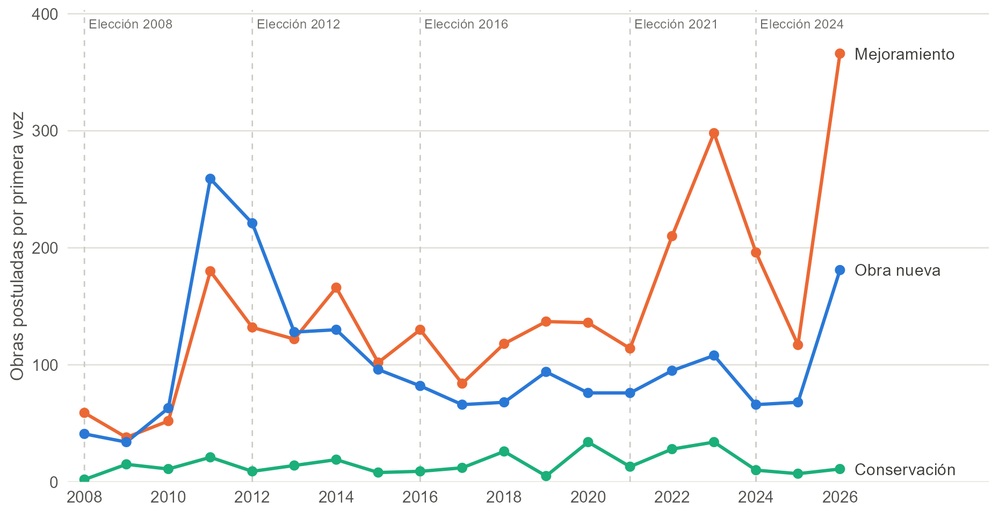

```{r}
#| label: setup
library(dplyr)
library(readr)
servel <- read_csv("../datos/servel_alcaldes_comuna.csv", show_col_types = FALSE)
```

# Pregunta y motivación

¿Por qué el gasto municipal se inclina por inaugurar obras nuevas, como plazas, sedes o luminarias, y descuida su mantención? ¿Se acentúa ese sesgo cuando el horizonte del alcalde es corto?

La intuición es simple. Una plaza nueva se inaugura, se ve y se le atribuye al alcalde antes de la elección. Mantener lo que ya existe rinde después y casi no se ve: una plaza bien cuidada no tiene ceremonia. Si el alcalde no está seguro de seguir en el cargo, le conviene lo que rinde ahora.

La pregunta aplica el problema del capítulo 2 del curso, el horizonte de apropiación [@dalborossi2011], a una decisión concreta. Chile ofrece dos fuentes de variación en ese horizonte: el ciclo electoral municipal y el límite a la reelección de alcaldes que introdujo la Ley 21.238 en 2020 [@ley21238]. Esta última permite comparar alcaldes que pueden repostular con alcaldes que no, como en @ferrazfinan2011.

# Contexto institucional

## Quién construye y quién mantiene una plaza

Un mapeo de las vías institucionales para construir, recuperar o mantener plazas públicas, a partir de normas y documentos oficiales, identifica 28 vías [ver `mapeo-institucional/` en esta carpeta]. Tres hallazgos importan para el modelo:

1. **Obra y mantención se pagan con presupuestos distintos.** La obra nueva suele financiarla el gobierno regional (FNDR, FRIL), SUBDERE (PMU) o el MINVU. La mantención habitual (riego, aseo, poda y reparaciones menores) es gasto corriente municipal. Varios programas lo explicitan: exigen al municipio comprometer la mantención futura con recursos propios.
2. **El alcalde pide, otro asigna.** El alcalde y la SECPLA formulan y postulan la obra, pero la asignan el gobernador regional y el consejo regional, SUBDERE o el MINVU. Las postulaciones miden la demanda del alcalde; las asignaciones, la decisión de otro nivel de gobierno.
3. **No toda plaza nueva es decisión municipal.** Los loteos deben ceder áreas verdes, los proyectos inmobiliarios pagan aportes al espacio público y el MINVU ejecuta programas propios. El stock de plazas mezcla todas esas vías.

## Cuatro formas de intervenir una plaza

El informe distingue cuatro intervenciones, que difieren en quién decide, cómo se pagan y cuánto se ven:

| Intervención | Qué es | Cómo se paga | Se inaugura | Dónde se mide |
|-----------|--------------------|-------------|----|-----------------|
| Obra nueva | Construir una plaza o área verde que no existía | Inversión externa (BIP) | Sí | BIP: CONSTRUCCION, INSTALACION |
| Mejoramiento | Transformar una plaza existente y elevar su estándar | Inversión externa (BIP) | Sí | BIP: MEJORAMIENTO, REPOSICION, RECUPERACION y otros |
| Conservación | Reparación mayor que devuelve la plaza a su estado original, sin ampliarla | Inversión externa (BIP) | A veces | BIP: CONSERVACION, REPARACION |
| Mantención habitual | Riego, aseo, poda, jardinería y reparaciones menores | Gasto corriente municipal | No | SINIM: gasto en mantención de jardines |

En este informe, *mantener* se refiere a la mantención habitual. Obra nueva y mejoramiento son las dos formas de *inaugurar* y se analizan por separado, porque difieren en un punto clave: la obra nueva agrega superficie que habrá que mantener para siempre, mientras que el mejoramiento interviene una plaza que ya se mantenía. La conservación aparece cuando una plaza se deterioró, muchas veces por falta de mantención.

## El límite a la reelección

Hasta 2020 los alcaldes podían reelegirse indefinidamente. La Ley 21.238, publicada el 8 de julio de 2020, limitó la reelección consecutiva a dos períodos: un alcalde puede ejercer a lo más tres mandatos seguidos. Durante la tramitación se decidió contar los períodos ya ejercidos, y el Tribunal Calificador de Elecciones resolvió en 2021 casos sobre cómo hacerlo (por ejemplo, períodos asumidos por vacancia).

En los datos del Servel, `r sum(servel$anio == 2021 & servel$impedido_proxima, na.rm = TRUE)` alcaldes fueron electos en 2012, 2016 y 2021, y por eso no pudieron repostular en 2024. La cifra coincide con la que informó la prensa. Las elecciones municipales relevantes fueron en octubre de 2012, octubre de 2016, mayo de 2021 (postergada por la pandemia) y octubre de 2024.

**Pendiente.** Falta confirmar el texto de la disposición transitoria: si en 2021 ya quedaron impedidos quienes tenían tres períodos (2008, 2012 y 2016) o si la ley autorizó por única vez a todos a postular. Los resultados de 2008 permitirían verificarlo, pero los sitios históricos del Servel no están disponibles; se solicitarán por Ley de Transparencia.

# Modelo

## Modelo base: horizonte de apropiación

El capítulo 2 distingue dos razones para invertir poco en retornos futuros: valorar poco el futuro ($\delta$ bajo) o tener poca probabilidad de apropiarse de él ($p$ bajo). Una autoridad compara
$$
V = b_0 + \delta p\, b_1 ,
$$ {#eq-base}
donde $b_0$ es el retorno presente y $b_1$ el futuro. Aun con $\delta \approx 1$, un $p$ bajo hace poco atractivas las inversiones de retorno tardío. Si una actividad rinde rápido y otra lento, una caída de $p$ reduce el atractivo relativo de la lenta.

## Supuestos

Un alcalde gobierna durante un período y toma dos decisiones al comienzo:

- $k \in \{0,1\}$: postular y construir una plaza nueva. La financia un nivel de gobierno superior, así que no cuesta presupuesto municipal hoy. Se inaugura antes de la elección y le da al alcalde un reconocimiento $v_N B$, donde $B$ es su beneficio social y $v_N$ la fracción que se convierte en crédito político. Deja una mantención futura de costo $\gamma$, que paga quien gobierne el período siguiente.
- $m \in \{0,1\}$: mantener las plazas existentes. Cuesta $c$ del presupuesto municipal hoy. Su beneficio social $H$ se materializa el período siguiente, y el alcalde que siga en el cargo recibe un crédito $v_M H$.

Al final del período hay elección. Sea $e \in \{0,1\}$ un indicador de si el alcalde puede repostular.

- Si $e = 1$, es reelecto con probabilidad $P(k) = \pi + \theta k$. Aquí $\pi$ es su seguridad electoral y $\theta > 0$ el efecto de inaugurar sobre la reelección. La mantención no afecta la probabilidad de reelección porque no se ve.
- Si $e = 0$, no puede seguir: $P = 0$.

Quien sigue en el cargo recibe el valor de continuar $V$, el crédito de la mantención y paga la mantención de la obra nueva. El alcalde también puede valorar el bienestar de la comuna con un peso $\alpha \ge 0$ (motivación de servicio público), donde el bienestar neto es
$$
W(k, m) = k\,(B - \beta\gamma) + m\,(\beta H - c),
$$
con $\beta$ el descuento social.

La utilidad esperada del alcalde es
$$
U^e(k, m) = k\, v_N B - c\, m + e\,\delta\,(\pi + \theta k)\,\big[V + m\, v_M H - k\,\gamma\big] + \alpha\, W(k, m).
$$ {#eq-utilidad}

Las tres fuerzas del capítulo 2 aparecen en esta expresión. El **retorno presente** de inaugurar es $v_N B$. El **horizonte de apropiación** es el factor $\delta(\pi + \theta k)$, que multiplica todo lo que el alcalde recibe o paga después. La **rendición de cuentas** es el término $\theta$: inaugurar aumenta la probabilidad de seguir en el cargo, como en @ferejohn1986 y en el mecanismo de *accountability* de @dalborossi2011.

## Resultados

La ganancia de mantener, dado $k$, es
$$
\Delta_m^e(k) = U^e(k,1) - U^e(k,0) = -c + \alpha(\beta H - c) + e\,\delta\,(\pi + \theta k)\, v_M H .
$$
La ganancia de construir, dado $m$, es
$$
\Delta_k^e(m) = v_N B + \alpha(B - \beta\gamma) + e\,\delta\Big[\theta\,(V + m\, v_M H) - (\pi + \theta)\,\gamma\Big].
$$

::: {#prp-mantencion}
## Mantención y reelección
El alcalde que puede repostular tiene mayor ganancia de mantener que el que no puede:
$$
\Delta_m^1(k) - \Delta_m^0 = \delta\,(\pi + \theta k)\, v_M H > 0 .
$$
Por lo tanto, mantiene al menos tanto como el impedido. Entre los que pueden repostular, la ganancia de mantener aumenta con la seguridad electoral $\pi$.
:::

::: {.proof}
Se resta $\Delta_m^0 = -c + \alpha(\beta H - c)$ de $\Delta_m^1(k)$. Como $\delta, v_M, H > 0$ y $\pi + \theta k > 0$, la diferencia es positiva. La derivada respecto de $\pi$ es $\delta v_M H > 0$.
:::

::: {#prp-construccion}
## Construcción y reelección: dos fuerzas opuestas
El alcalde que puede repostular tiene mayor ganancia de construir que el impedido si y solo si
$$
\theta\,(V + m\, v_M H) > (\pi + \theta)\,\gamma .
$$
:::

::: {.proof}
$\Delta_k^1(m) - \Delta_k^0 = \delta\big[\theta(V + m v_M H) - (\pi + \theta)\gamma\big]$, y $\delta > 0$.
:::

La @prp-construccion reproduce la ambigüedad de @dalborossi2011. El lado izquierdo es el **motivo electoral**: inaugurar ayuda a ganar, y ganar vale $V$. El lado derecho es la **cuenta al sucesor**: el alcalde que sigue paga la mantención de lo que construyó; el impedido no la paga nunca. Si el cargo vale mucho y la obra es muy visible, el alcalde que puede repostular construye más; si la mantención que deja la obra es cara, construye menos. El signo es una pregunta empírica.

::: {#prp-sucesor}
## La cuenta al sucesor
El costo futuro $\gamma$ de una obra nueva pesa $\delta(\pi + \theta) + \alpha\beta$ en la decisión del alcalde que puede repostular y solo $\alpha\beta$ en la del impedido. Si $\alpha = 0$, el impedido construye cualquier obra con $v_N B > 0$, aunque su beneficio neto $B - \beta\gamma$ sea negativo.
:::

::: {.proof}
Se lee el coeficiente de $\gamma$ en $\Delta_k^e(m)$. Con $e = 0$ y $\alpha = 0$, $\Delta_k^0 = v_N B > 0$.
:::

Además, para el alcalde que puede repostular, construir y mantener son complementarios: $\partial^2 U^1 / \partial k\, \partial m = \delta\theta v_M H > 0$. Inaugurar aumenta la probabilidad de seguir en el cargo y, con ella, el valor de haber mantenido. Para el impedido, las dos decisiones son independientes.

## Obra nueva frente a mejoramiento

Supongamos ahora que el alcalde que decide inaugurar puede elegir entre una obra nueva ($j = N$) y un mejoramiento ($j = R$). Ambas se inauguran y se ven igual ($\theta$ común), pero la obra nueva deja una mantención futura mayor: $\gamma_N > \gamma_R \ge 0$. Sus beneficios sociales son $B_N$ y $B_R$. Condicional a inaugurar algo, la ventaja de elegir la obra nueva es
$$
D^e = v_N (B_N - B_R) + \alpha\,(B_N - B_R - \beta(\gamma_N - \gamma_R)) - e\,\delta\,(\pi + \theta)\,(\gamma_N - \gamma_R).
$$

::: {#prp-composicion}
## Composición de lo que se inaugura
Si la obra nueva y el mejoramiento son igual de visibles, el impedido prefiere la obra nueva en mayor medida que el alcalde que puede repostular:
$$
D^0 - D^1 = \delta\,(\pi + \theta)\,(\gamma_N - \gamma_R) > 0 .
$$
:::

::: {.proof}
Se resta $D^1$ de $D^0$; todos los términos que no dependen de $e$ se cancelan. Como $\gamma_N > \gamma_R$ y $\delta(\pi + \theta) > 0$, la diferencia es positiva.
:::

La @prp-composicion es más limpia que la @prp-construccion porque el motivo electoral, que empuja a inaugurar cualquier cosa, se cancela al comparar dos obras igual de visibles. Lo que queda es la cuenta al sucesor. Si la obra nueva fuera más visible que el mejoramiento, reaparecería una fuerza opuesta y el resultado volvería a ser empírico.

## Extensiones

**Cercanía de la elección.** Si el efecto de inaugurar sobre la reelección es mayor para las obras que se inauguran cerca de la elección ($\theta$ crece al acercarse la votación), el alcalde que puede repostular concentra las inauguraciones antes de la elección. El impedido no tiene ese ciclo, porque $\theta$ no entra en su decisión.

**Continuidad de la coalición.** Si al impedido le importa que su coalición conserve la alcaldía, con peso $\lambda \in [0, 1]$ y probabilidad $\pi_c + \theta_c k$, en @eq-utilidad se reemplaza $e\,\delta(\pi + \theta k)$ por $\lambda\,\delta(\pi_c + \theta_c k)$. Las diferencias entre alcaldes que pueden y no pueden repostular se achican a medida que $\lambda$ se acerca a 1.

**Financiamiento externo.** La obra se construye solo si el nivel superior aprueba la postulación, con probabilidad $q$. Esto multiplica los términos de $k$ por $q$ y no cambia el signo de las proposiciones. La afinidad política entre el alcalde y el gobernador regional puede afectar $q$ y debe controlarse.

**Mantención atrasada y conservación.** Si una plaza no se mantiene ($m = 0$), se deteriora y, con alguna probabilidad, el período siguiente necesita una conservación financiada como inversión. La conservación es entonces la huella observable de la mantención que no se hizo: las comunas cuyo alcalde mantuvo poco deberían postular más conservaciones en el período siguiente.

**Conservación como sustituto financiero.** Un municipio con poco presupuesto propio puede postular como conservación lo que en el fondo es mantención, para que la financie el gobierno regional. Este canal es financiero, no político: predice más conservación cuando caen los ingresos propios, sin relación con el horizonte del alcalde.

## Alcances del modelo

El modelo trata a los votantes como no estratégicos: $\theta$ resume cómo responden a las inauguraciones, sin derivarlo de una regla de voto retrospectivo como en @ferejohn1986. Las decisiones son binarias y de un solo período. Una extensión natural endogeniza la regla de voto y la selección de tipos de alcalde [@besley2006].

# Hipótesis

| | Hipótesis | Fuente en el modelo |
|--|------------------------------------------|----------------|
| H1 | Los alcaldes impedidos de repostular gastan menos en mantención por metro cuadrado. Entre los que pueden repostular, los más seguros electoralmente mantienen más. | @prp-mantencion |
| H2 | La diferencia en obras inaugurables (nuevas y mejoramientos) entre alcaldes que pueden y no pueden repostular tiene signo ambiguo. Los que pueden repostular concentran las postulaciones antes de la elección; los impedidos no. | @prp-construccion y cercanía de la elección |
| H3 | Dentro de lo que se inaugura, los impedidos postulan una mayor proporción de obras nuevas frente a mejoramientos. | @prp-composicion |
| H4 | Las obras nuevas que dejan los alcaldes impedidos aumentan la mantención del período siguiente, sobre todo cuando cambia el alcalde. Las comunas que mantuvieron poco postulan más conservaciones después. | @prp-sucesor y mantención atrasada |
| H5 | Las diferencias de H1 a H4 son menores cuando la coalición del alcalde impedido tiene buenas probabilidades de conservar la alcaldía. | Continuidad de la coalición |
| H6 | Las obras que originan el gobierno regional o el MINVU, y los estudios y diseños que no se inauguran, no siguen el ciclo ni la elegibilidad del alcalde. | Prueba de falsificación |

La **explicación rival** es puramente financiera: si la obra la paga otro y la mantención el municipio, se construye más y se mantiene menos aunque no haya política, y la conservación sustituye a la mantención cuando faltan recursos propios. Esa explicación no predice diferencias por elegibilidad ni por cercanía de la elección, que es lo que contrastan H1 a H3 y H6.

# Datos

La base es un panel comuna-año (345 comunas) que une cuatro fuentes por código de comuna:

| Concepto | Medida | Fuente | Cobertura |
|---|---|---|---|
| Mantención | Gasto en mantención de jardines de la comunidad por m² de área verde mantenida | SINIM | 2008–2025 |
| Obras | Postulaciones municipales de plazas, parques y áreas verdes por año de primera aparición, separadas en obra nueva, mejoramiento y conservación | BIP histórico (MDSF) | 1997–2027 |
| Horizonte | Repostulación, margen, períodos seguidos, impedimento para repostular | Servel | 2012–2024 |
| Financiamiento externo | Transferencias de capital a municipios; porcentaje de inversión con recursos externos | Ley 19.862; SINIM | 2014– |

```{r}
#| label: tbl-servel
#| tbl-cap: "Elecciones de alcalde por comuna, según los datos del Servel."
servel |>
  group_by(Elección = anio) |>
  summarise(
    Comunas = n(),
    `Alcalde repostula` = sum(incumbente_repostula, na.rm = TRUE),
    `Alcalde reelecto` = sum(incumbente_gana, na.rm = TRUE),
    `Margen mediano` = round(median(margen), 3),
    `Impedido en la siguiente` = sum(impedido_proxima, na.rm = TRUE)
  ) |>
  knitr::kable()
```

En la @tbl-servel, 2012 no tiene alcalde en ejercicio identificado porque faltan los datos de 2008. La columna "Impedido en la siguiente" cuenta electos con tres períodos seguidos dentro de los datos, así que solo es completa para 2021.

```{r}
#| label: tbl-bip
#| tbl-cap: "Obras municipales de espacio público en el BIP por período alcaldicio y tipo (año de primera postulación)."
obras <- read_csv("../datos/bip_ep_obras.csv.gz", show_col_types = FALSE)
obras |>
  filter(anio_primera >= 2009, anio_primera <= 2024) |>
  mutate(Período = cut(anio_primera, c(2008, 2012, 2016, 2021, 2024),
                       labels = c("2009–2012", "2013–2016", "2017–2021", "2022–2024"))) |>
  count(Período, tipo) |>
  tidyr::pivot_wider(names_from = tipo, values_from = n) |>
  transmute(Período, `Obra nueva` = nueva, Mejoramiento = mejoramiento,
            Conservación = conservacion, `Otra (estudios y otros)` = otro,
            `% nueva entre inaugurables` = round(100 * nueva / (nueva + mejoramiento))) |>
  knitr::kable()
```

La @tbl-bip muestra que la proporción de obras nuevas entre lo que se inaugura cae de un período a otro. H3 se contrasta como diferencia respecto de esa tendencia común, comparando alcaldes que pueden y no pueden repostular dentro de un mismo período. La comuna de cada obra se asigna por el nombre del municipio que la postula, porque los códigos de comuna del BIP cambian con las reformas territoriales.

{#fig-bip width="100%"}

La @fig-bip muestra la misma información año a año. Las postulaciones suben antes de algunas elecciones: obras nuevas en 2011–2012 y mejoramientos en 2022–2023. El año es el presupuestario al que se postula, y la postulación suele hacerse el año calendario anterior. Desde 2013 los mejoramientos superan a las obras nuevas, y la conservación se mantiene baja todo el período. El alza de 2026 debe revisarse contra la completitud del registro antes de interpretarla.

**Advertencias.** El BIP registra lo que el alcalde postula, no lo que recibe, y no incluye todas las obras con fondos propios ni gran parte del PMU. En el BIP, la marca `NUEVO` no identifica la primera postulación, por eso se usa el año de primera aparición del código. SINIM es autoinformado y debe deflactarse. El stock de plazas de SINIM no mide la decisión del alcalde, porque incluye cesiones de loteos y obras del MINVU.

# Diseño empírico

**Mantención (H1).** El contraste principal compara las comunas cuyo alcalde quedó en su último mandato en 2021–2024 ($G_c = 1$) con el resto, antes y después:
$$
y_{ct} = \beta\, (G_c \times \text{Post}_t) + \mathbf{x}_{ct}'\boldsymbol{\phi} + \mu_c + \tau_t + \varepsilon_{ct},
$$
donde $y_{ct}$ es la mantención por m², $\text{Post}_t$ indica los años 2022–2024 y $\mu_c$, $\tau_t$ son efectos fijos de comuna y año. Los mismos alcaldes estaban en 2017–2020 en un período en que podían repostular, lo que permite comparar a la misma persona con y sin horizonte electoral. Se estimará además la versión por año (estudio de eventos) para revisar tendencias previas.

**Obras inaugurables (H2).** Postulaciones por comuna y año en función de los años que faltan para la elección, interactuados con $G_c$, mediante una regresión de Poisson con efectos fijos. Se estima por separado para obra nueva, mejoramiento y conservación.

**Obra nueva frente a mejoramiento (H3).** Con una fila por comuna, año y tipo de obra inaugurable,
$$
n_{cjt} = \exp\big(\beta_3\, (G_c \times \text{Post}_t \times \text{Nueva}_j) + \mu_{cj} + \tau_{jt} + \dots\big)\,\eta_{cjt},
$$
donde $\beta_3$ mide si los impedidos desplazan su cartera hacia obras nuevas. Los efectos fijos por tipo y año absorben la tendencia común de la @tbl-bip.

**Cuenta al sucesor y mantención atrasada (H4).** Gasto en mantención del período siguiente en función de las obras nuevas del período anterior, interactuadas con el cambio de alcalde y con $G_c$; y conservaciones postuladas en función de la mantención del período anterior.

**Controles y errores.** Población, ruralidad, ingresos propios, Fondo Común Municipal, financiamiento externo y afinidad política con el gobernador regional. Errores estándar agrupados por comuna.

**Amenazas.** Los alcaldes con tres períodos seguidos son, por construcción, alcaldes que ganan [@ferrazfinan2011]. El grupo de comparación más cercano son los alcaldes con dos períodos seguidos (electos en 2016 y 2021), que tienen experiencia parecida pero podían repostular. La pandemia coincide con la entrada en vigencia del límite y afecta a todas las comunas; los efectos fijos de año la absorben solo si su efecto es común.

# Resultados

Pendiente: se completará con las estimaciones una vez unida la base.

# Decisiones abiertas

1. **Votantes estratégicos.** ¿Basta con $\theta$ como forma reducida, o conviene derivar la regla de voto como en el capítulo 4?
2. **Visibilidad de la obra nueva y del mejoramiento.** La @prp-composicion supone que se ven igual. Si la obra nueva se ve más, hay que medirlo (por ejemplo, con cobertura de prensa de inauguraciones).
3. **Validar la clasificación del BIP.** Revisar a mano la muestra de 200 obras (`datos/bip_ep_muestra_revision.csv`).
4. **Disposición transitoria de la Ley 21.238.** Confirmar el cómputo de períodos y si hubo alcaldes impedidos en 2021.
5. **Datos de 2008.** Solicitud por Ley de Transparencia al Servel.
6. **Literatura chilena.** Revisar @corvalan2018 sobre ciclos políticos en el gasto municipal chileno, y la evidencia de @drazeneslava2010 y @rogoff1990 sobre gasto visible antes de las elecciones.

# Referencias {.unnumbered}

::: {#refs}
:::
