# Plazas públicas en Chile: construcción, recuperación y mantención

**Corte documental: 6 de noviembre de 2026.**

Este informe reconstruye las vías institucionales estandarizadas que pueden producir, recuperar o mantener plazas públicas en Chile. Distingue quién propone, formula, evalúa, financia, contrata y mantiene. Los diagramas son una síntesis analítica de normas y documentos oficiales; no son flujogramas emitidos por los organismos.

Corte documental: 6 de noviembre de 2026. Se mapean familias nacionales y variantes regionales verificadas, no todas las combinaciones contractuales posibles ni las convocatorias de las 16 regiones. La existencia de una vía legal no implica que haya recursos o una postulación abierta en la fecha de lectura.

Construcción, recuperación y mantención no son una sola cadena presupuestaria. La obra puede financiarla un ministerio o un GORE y terminar bajo administración municipal; el riego, aseo, jardinería y reparaciones posteriores requieren otra decisión de organización y gasto.

## Actores

| Actor | Función | Base |
|---|---|---|
| Alcalde / alcaldesa | Propone prioridades y presupuesto; representa al municipio, presenta proyectos y dicta actos de ejecución y contratación dentro de sus atribuciones. | S01 |
| Concejo municipal | Aprueba presupuesto y actos que la ley le reserva. Contratos ≥500 UTM: mayoría absoluta; si exceden período alcaldicio: dos tercios. También interviene en concesiones. | S01 art. 65 |
| SECPLA / profesional formulador | Traduce demanda en cartera, perfil, diseño, presupuesto y postulación. Puede haber arquitectos municipales o consultores. No existe un cargo único de arquitecto SECPLA obligatorio para toda plaza. | S01 art. 21 |
| Director de Obras Municipales | Revisa permisos y recepciones urbanísticas cuando proceden; dirige construcciones de responsabilidad municipal en el marco de su competencia. | S01 art. 24; S03 |
| Jefatura de áreas verdes / aseo y ornato | Programa o controla construcción, conservación y administración de áreas verdes. Nombre y organización de la unidad varían entre municipios. | S01 art. 25 |
| Gobernador regional | Órgano ejecutivo del GORE: impulsa cartera, propone distribución y ejecuta acuerdos y presupuesto regional. No es superior jerárquico del alcalde ni de las SEREMI. | S02 |
| Consejo Regional · CORE | Aprueba marcos y presupuesto; asignación individual sobre 7.000 UTM de ejecución y estudios/diseños que los originan; aprueba convenios de programación. | S02 art. 36 |
| Equipos técnicos del GORE | Planifican, revisan pertinencia, analizan y gestionan inversiones según estructura e instructivos regionales. DIPLADER y DIPIR no cumplen la misma función. | S02; S12 |
| SEREMI MINVU / director SERVIU | SEREMI coordina política y programación sectorial regional; SERVIU formula o contrata proyectos y ejecuta obras. Sus roles cambian según el programa. | S18; S19 |
| Analista MDSF / SEREMI de Desarrollo Social | Evalúa inversión cuando corresponde. Un resultado favorable habilita técnicamente; no asigna el presupuesto político de la plaza. | S05; S34 |
| SUBDERE / jefe URS / equipo central | Revisa y tramita programas de inversión local. URS conecta al municipio con el nivel central; hay diferencias entre programas y líneas. | S09; S24; S26; S27 |
| Comunidad organizada / CVD / EP | Vecinos plantean y priorizan necesidades; el CVD tiene un papel formal en Quiero Mi Barrio. La Entidad Patrocinante desarrolla y tramita proyectos DS 27. | S16; S17 |
| Proyectista / constructor / inspector | El proyectista diseña; el contratista construye; ITO o inspector fiscal controla obra. Inspector de servicios controla mantenimiento contratado: no son funciones intercambiables. | S01; S18; S31; S33 |

## Catálogo

| Ficha | Vía | Intervención |
|---|---|---|
| R01 | Inversión con presupuesto municipal | Nueva / recuperación |
| R02 | Proyecto municipal con financiamiento GORE | Nueva / recuperación |
| R03 | Cartera originada en el Gobierno Regional | Nueva / recuperación |
| R04 | Fondo Regional de Iniciativa Local · FRIL | Nueva / recuperación |
| R05 | SUBDERE · PMU Tradicional | Nueva / recuperación |
| R06 | SUBDERE · otras líneas PMU | Nueva / recuperación condicionada |
| R07 | MINVU · Programa de Espacios Públicos | Recuperación |
| R08 | MINVU · Quiero Mi Barrio | Nueva / recuperación dentro del barrio |
| R09 | MINVU · DS 27, capítulo I | Nueva / mejoramiento de pequeña escala |
| R10 | MINVU · inversión urbana programada | Nueva / recuperación |
| R11 | MINVU · Pequeñas Localidades | Nueva / recuperación |
| R12 | Seguridad Pública · recuperación de espacios | Recuperación / habilitación |
| R13 | SUBDERE · PRBIPE | Recuperación patrimonial / barrial |
| R14 | SUBDERE · PREAVS | Recuperación en territorios focalizados |
| R15 | SUBDERE · Fondo de Recuperación de Ciudades | Recuperación / reposición |
| R16 | SUBDERE · infraestructura con aporte reembolsable | Nueva / recuperación |
| R17 | MOP · espacio público en borde costero | Nueva / recuperación de componente |
| R18 | Plaza por obligación de urbanizar y ceder | Nueva |
| R19 | Urbanización voluntaria | Nueva / intervención en espacio existente |
| R20 | Aportes al espacio público en dinero | Nueva / recuperación elegible en plan |
| R21 | Aportes materializados como obras | Nueva / recuperación elegible |
| R22 | Cofinanciamiento y convenios de programación | Modalidad transversal |
| R23 | Acción Local · intervenciones comunitarias menores | Complementaria; alcance documental limitado |
| R24 | Mantención municipal con ejecución directa | Mantención habitual |
| R25 | Mantención municipal contratada | Mantención habitual / prestaciones del contrato |
| R26 | Conservación con financiamiento regional o mixto | Conservación como inversión |
| R27 | Conservación con financiamiento sectorial | Conservación como inversión |
| R28 | MINVU · conservación de parques urbanos | Mantención de parques elegibles |

## T00 · Elegir el tipo de intervención

Clasificar el problema antes de elegir un fondo. La expresión recuperar una plaza puede referirse a procesos presupuestarios y técnicos diferentes.

**Estandarización:** Síntesis analítica basada en competencias, SNI y programas; no sustituye el expediente de una plaza concreta.

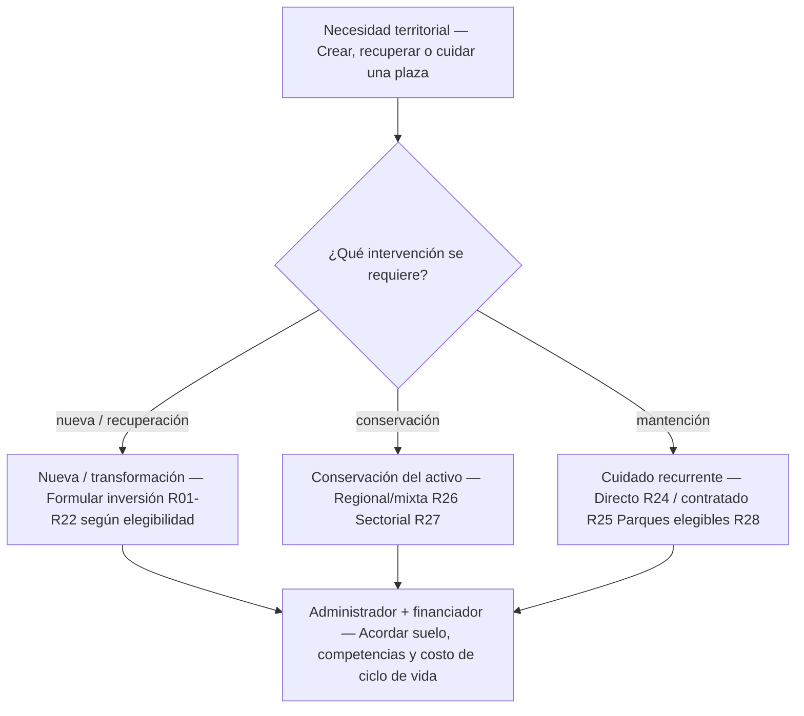

**Nueva plaza.** Crear espacio de uso público, urbanizar suelo o incorporar una nueva obra. Puede seguir inversión municipal, regional, sectorial o urbanización.

**Recuperación.** Mejorar, reponer o rehabilitar un espacio deteriorado. Se debe escoger la clasificación oficial adecuada según alcance, no solo el nombre de la iniciativa.

**Conservación.** Mantener o restituir capacidad del activo con un proyecto de inversión; tiene reglas específicas y distingue financiamiento regional de sectorial.

**Mantención habitual.** Servicios recurrentes: riego, limpieza y jardinería. Normalmente se organizan desde la municipalidad, con ejecución directa o contratada.

**Fuentes:** [S01](https://www.bcn.cl/leychile/navegar?idNorma=251693), [S03](https://www.bcn.cl/leychile/navegar?idNorma=13560), [S07](https://sni.gob.cl/wp-content/uploads/RIS-Proyectos_Espacios_Publicos_2024.pdf), [S34](https://sni.gob.cl/wp-content/uploads/Instructivo-para-Proyectos-de-Conservacion-2026.pdf).


## T01 · La habilitación técnica no asigna recursos

Ruta transversal para las inversiones que están dentro del ámbito del SNI. Las conservaciones R26/R27 tienen reglas específicas.

**Estandarización:** NIP 2026, proporcionalidad y requisitos sectoriales. Prevalece la norma específica del fondo y la glosa anual.

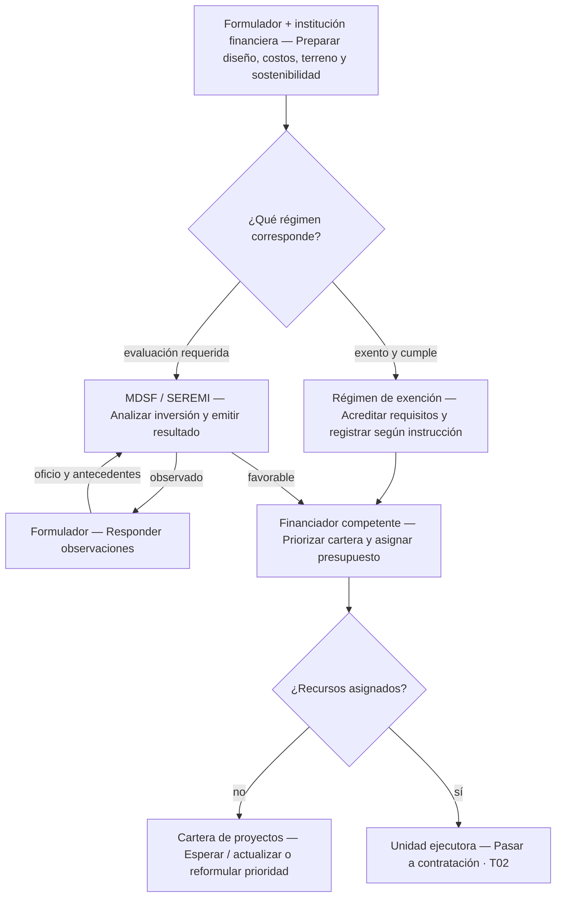

**Actores distintos.** Formulador prepara el proyecto; institución financiera lo postula; analista MDSF/SEREMI evalúa cuando corresponde. El evaluador no decide qué alcalde o barrio recibe presupuesto.

**Exenciones.** El régimen general contempla proyectos menores a 5.000 UTM sujetos a requisitos y exclusiones. PMU tiene en su glosa 2026 una referencia específica a menos de 2.500 UTM; FRC exige recomendación favorable. No usar una única regla para todos los fondos.

**Qué no desaparece.** Una exención no elimina terreno disponible, diseño, permisos, consistencia de costos, registro requerido ni prohibición de fraccionamiento. Se debe comprobar el instructivo exacto y su umbral.

**Resultado.** RS, elegibilidad o resultado técnico habilitante no son una promesa de financiamiento. La priorización política y asignación presupuestaria constituyen otra decisión.

**Fuentes:** [S05](https://www.gobiernosantiago.cl/wp-content/uploads/2026/04/Normas-Instrucciones-y-Procedimeintos-NIP-para-el-proceso-de-inversion-publica-2026.pdf), [S06](https://sni.gob.cl/wp-content/uploads/Instructivo_proporcionalidad_SNI_2025.pdf), [S07](https://sni.gob.cl/wp-content/uploads/RIS-Proyectos_Espacios_Publicos_2024.pdf), [S08](https://www.dipres.gob.cl/597/articles-396977_doc_pdf.pdf), [S34](https://sni.gob.cl/wp-content/uploads/Instructivo-para-Proyectos-de-Conservacion-2026.pdf).


## T02 · De la asignación a una plaza en funcionamiento

Secuencia funcional común para obras contratadas. Se concreta con las bases, régimen de contratación y convenio de cada institución.

**Estandarización:** Síntesis de obligaciones contractuales, urbanísticas y de administración. No todos los permisos ni controles se aplican a toda plaza.

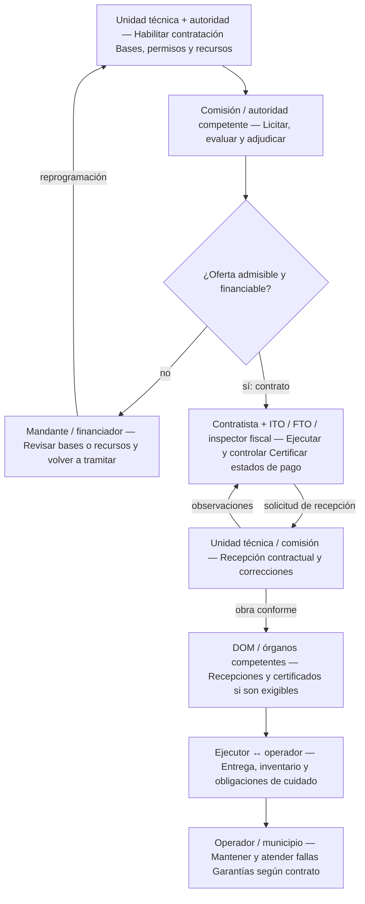

**Antes de licitar.** Proyecto ejecutable, recursos, terreno, permisos y operador acordado. El régimen depende del ejecutor: obras SERVIU, DS 236/2002; obras MOP, DS 75/2004; compras y servicios, Ley 19.886 y DS 661/2024, según su ámbito.

**Dos recepciones distintas.** La recepción del contrato de obra verifica cumplimiento contractual; la recepción DOM, cuando procede, acredita cumplimiento urbanístico. No son el mismo acto.

**Problemas y retornos.** Ofertas fuera de presupuesto pueden exigir revisión de recursos y bases; observaciones de obra exigen correcciones; cambios relevantes pueden requerir reevaluación. No toda licitación termina en contrato.

**Controles condicionales.** CMN si hay protección patrimonial; SEIA según tipologías legales; autorizaciones de servicios, suelo o borde si proceden. Contraloría no aprueba de forma previa todas las plazas; sus controles dependen del acto.

**Fuentes:** [S01](https://www.bcn.cl/leychile/navegar?idNorma=251693), [S03](https://www.bcn.cl/leychile/navegar?idNorma=13560), [S04](https://www.bcn.cl/leychile/navegar?idNorma=8201), [S18](https://www.bcn.cl/leychile/navegar?idNorma=12617), [S31](https://www.bcn.cl/leychile/navegar?idNorma=1209290), [S37](https://www.monumentos.gob.cl/tramites/autorizacion-intervencion-zonas-tipicas-pintorescas), [S38](https://www.sea.gob.cl/pertinencia-de-ingreso-al-seia), [S41](https://www.bcn.cl/leychile/navegar?idNorma=211854), [S42](https://www.bcn.cl/leychile/navegar?idNorma=233103).


## R01 · Inversión con presupuesto municipal

La municipalidad financia y ejecuta una plaza dentro de sus atribuciones y de los recursos efectivamente disponibles.

**Estandarización:** Ciclo legal municipal; la organización del equipo y el expediente se especifican localmente.

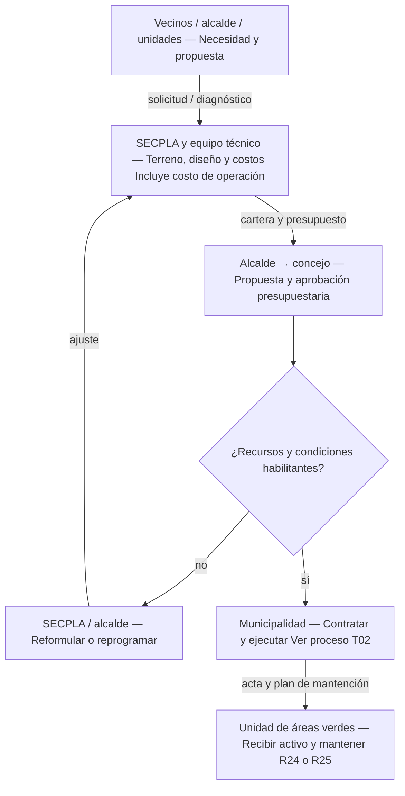

**Decisión política.** El alcalde propone prioridades y presupuesto; el concejo aprueba el presupuesto y las decisiones que la ley somete a su acuerdo. No existe una votación separada obligatoria del concejo sobre cada diseño.

**Documento de enlace.** Perfil y diseño de SECPLA, presupuesto municipal, acuerdos del concejo cuando proceden, decreto de adjudicación y contrato.

**Después de la obra.** La unidad municipal de áreas verdes incorpora la plaza a su programa de mantención. El presupuesto de obra no asegura por sí solo ese gasto futuro.

**Condición importante.** La evaluación SNI no es universal para toda inversión financiada con fondos propios municipales. Comprobar fuente de recursos y regla aplicable: T01.

**Fuentes:** [S01](https://www.bcn.cl/leychile/navegar?idNorma=251693), [S03](https://www.bcn.cl/leychile/navegar?idNorma=13560), [S05](https://www.gobiernosantiago.cl/wp-content/uploads/2026/04/Normas-Instrucciones-y-Procedimeintos-NIP-para-el-proceso-de-inversion-publica-2026.pdf), [S31](https://www.bcn.cl/leychile/navegar?idNorma=1209290).


## R02 · Proyecto municipal con financiamiento GORE

La iniciativa se formula en el municipio y solicita inversión regional, habitualmente identificada como FNDR u otra asignación regional habilitada.

**Estandarización:** Ley regional + SNI + instrucciones anuales del respectivo GORE.

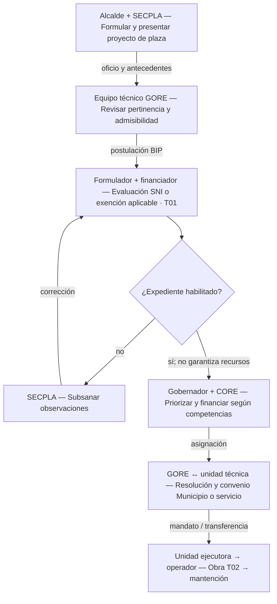

**Decisión política.** Alcalde: presenta y prioriza su cartera. Gobernador: propone distribución y asignación. CORE: aprueba marcos; además aprueba individualmente los proyectos de ejecución sobre 7.000 UTM y sus estudios o diseños.

**Documento de enlace.** Oficio municipal, ficha IDI/código BIP, expediente técnico, resultado de evaluación o respaldo de exención, acuerdo y resolución de financiamiento, convenio.

**Unidad ejecutora.** El convenio define quién licita e inspecciona. Puede ser el municipio o un servicio competente. El GORE financiador no tiene que construir directamente.

**Después de la obra.** Definir previamente el organismo que administrará y pagará la operación. En una plaza municipal ordinaria, se incorpora a la mantención municipal.

**Fuentes:** [S01](https://www.bcn.cl/leychile/navegar?idNorma=251693), [S02](https://www.bcn.cl/leychile/navegar?idNorma=243771), [S05](https://www.gobiernosantiago.cl/wp-content/uploads/2026/04/Normas-Instrucciones-y-Procedimeintos-NIP-para-el-proceso-de-inversion-publica-2026.pdf), [S06](https://sni.gob.cl/wp-content/uploads/Instructivo_proporcionalidad_SNI_2025.pdf), [S07](https://sni.gob.cl/wp-content/uploads/RIS-Proyectos_Espacios_Publicos_2024.pdf), [S12](https://www.gobiernosantiago.cl/wp-content/uploads/2026/10/152-Circular-5-Proceso-de-Inversion-2026-accesible.pdf).


## R03 · Cartera originada en el Gobierno Regional

El problema se incorpora a una cartera regional o intercomunal; el GORE coordina formulación y ejecución con municipios y servicios.

**Estandarización:** Competencias regionales y ciclo de inversión; no es un concurso nacional único para plazas.

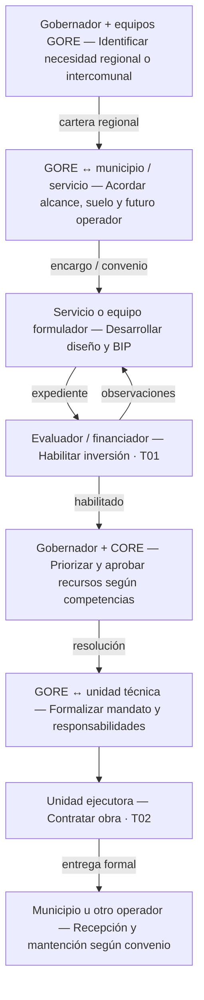

**Quién impulsa.** Gobernador y equipos de planificación/inversión regional. DIPLADER y DIPIR cumplen roles distintos; la distribución concreta de funciones depende del GORE.

**Comunicación formal.** Acuerdos de coordinación, solicitud de formulación, ficha BIP, convenio de programación si existe y convenio con la unidad técnica ejecutora.

**Condición territorial.** La prioridad regional no reemplaza la disponibilidad del terreno ni las competencias municipales o sectoriales. Se debe acordar quién recibe y opera cada obra.

**Decisión de financiamiento.** Rigen los mismos controles presupuestarios y umbrales CORE de R02. Un proyecto regional también puede quedar sin financiamiento.

**Fuentes:** [S02](https://www.bcn.cl/leychile/navegar?idNorma=243771), [S05](https://www.gobiernosantiago.cl/wp-content/uploads/2026/04/Normas-Instrucciones-y-Procedimeintos-NIP-para-el-proceso-de-inversion-publica-2026.pdf), [S07](https://sni.gob.cl/wp-content/uploads/RIS-Proyectos_Espacios_Publicos_2024.pdf), [S12](https://www.gobiernosantiago.cl/wp-content/uploads/2026/10/152-Circular-5-Proceso-de-Inversion-2026-accesible.pdf), [S18](https://www.bcn.cl/leychile/navegar?idNorma=12617).


## R04 · Fondo Regional de Iniciativa Local · FRIL

Obras locales elegibles conforme a la guía nacional y, decisivamente, a las bases regionales y glosa anual aplicable.

**Estandarización:** Marco nacional con selección y condiciones regionales. No toda convocatoria FRIL admite plazas.

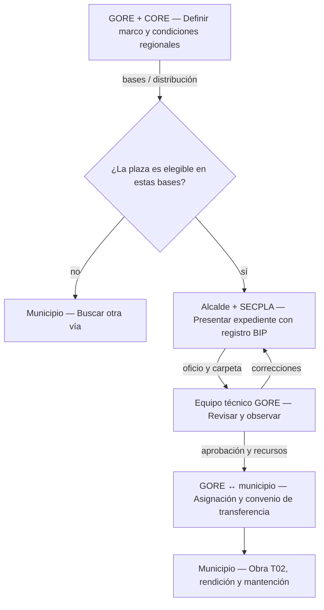

**Decisión política.** Gobernador propone la distribución; CORE interviene en marcos y asignaciones conforme al régimen regional. El alcalde presenta proyectos de su comuna.

**Evaluación.** El equipo GORE revisa admisibilidad y calidad técnica. La exención de informe MDSF para proyectos bajo el umbral vigente no elimina expediente, registro BIP ni control regional.

**Después de la obra.** Municipio licita, inspecciona, paga y rinde conforme al convenio; recibe e incorpora la plaza a mantención.

**Variación comprobada.** El instructivo FRIL de Santiago, resolución 694 de 2026, se orienta a vialidad y movilidad rural. No permite asumir que cualquier plaza urbana puede postular allí.

**Fuentes:** [S02](https://www.bcn.cl/leychile/navegar?idNorma=243771), [S10](https://www.subdere.gov.cl/sites/default/files/documentos/Guia%20Operativa%20FRIL%202024.pdf), [S11](https://www.gobiernosantiago.cl/wp-content/uploads/2026/10/154-INSTRUCTIVO_FRIL_RES_N_694_F_11_05_2026-accesible.pdf).


## R05 · SUBDERE · PMU Tradicional

Programa de Mejoramiento Urbano y Equipamiento Comunal, línea Tradicional, antes IRAL; puede financiar obras de espacio público elegibles.

**Estandarización:** Guía PMU y presupuesto anual; tiene una intervención específica del gobernador.

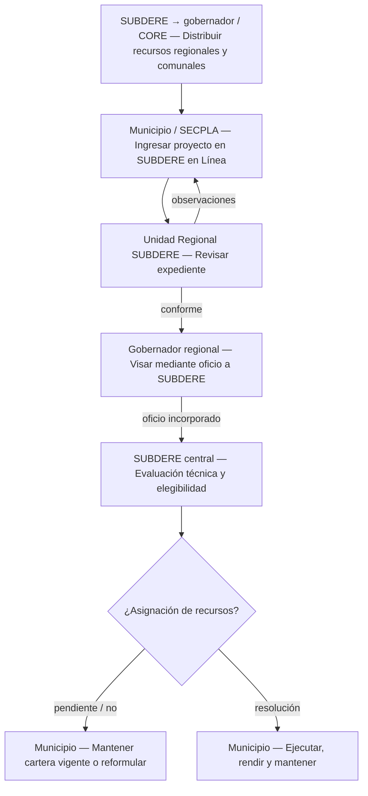

**Distribución.** SUBDERE informa recursos regionales; gobernador propone distribución comunal y CORE resuelve según la glosa aplicable. Luego se tramitan los proyectos.

**Enlace distintivo.** Tras revisar la URS, el gobernador visa el proyecto mediante oficio a SUBDERE. Esa etapa no debe copiarse automáticamente a las otras líneas PMU.

**Control técnico.** SUBDERE central declara elegible; elegibilidad no asegura financiamiento. La glosa PMU 2026 contempla exención MDSF para costos inferiores a 2.500 UTM: no usar un umbral genérico sin revisar la línea.

**Ejecución y continuidad.** Resolución de recursos y modalidad autorizada; municipio ejecuta y rinde. Debe prever mantención posterior con recursos propios u otra vía habilitada.

**Fuentes:** [S08](https://www.dipres.gob.cl/597/articles-396977_doc_pdf.pdf), [S09](https://www.subdere.gov.cl/sites/default/files/documentos/Guia%20operativa%20PMU.pdf), [S01](https://www.bcn.cl/leychile/navegar?idNorma=251693).


## R06 · SUBDERE · otras líneas PMU

Variantes de la guía PMU: Emergencia, Cuenca del Carbón y línea vinculada a Prevención del Delito, cuando exista disponibilidad y elegibilidad.

**Estandarización:** La guía distingue circuitos de revisión; no constituyen una convocatoria siempre abierta.

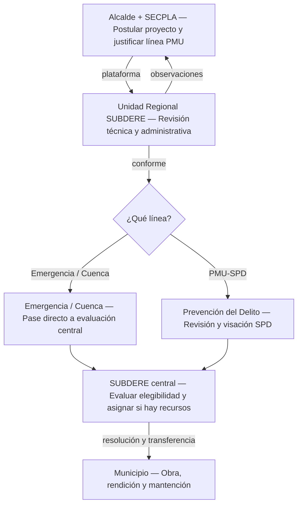

**Diferencia institucional.** Emergencia y Cuenca pasan de URS a evaluación central. La línea SPD incorpora revisión de la Subsecretaría de Prevención del Delito.

**No confundir.** PMU-SPD sigue siendo un circuito de financiamiento PMU. El Sistema Nacional de Seguridad Municipal tiene su propio circuito: R12.

**Documento decisivo.** Oficio alcaldicio y expediente ingresado a SUBDERE en Línea; visación adicional SPD cuando corresponde; resolución de asignación.

**Límite.** Que una plaza esté deteriorada no basta para invocar cualquier línea de emergencia. Debe satisfacer su objeto y las condiciones presupuestarias vigentes.

**Fuentes:** [S08](https://www.dipres.gob.cl/597/articles-396977_doc_pdf.pdf), [S09](https://www.subdere.gov.cl/sites/default/files/documentos/Guia%20operativa%20PMU.pdf).


## R07 · MINVU · Programa de Espacios Públicos

DS 312/2006 vigente: recuperación de espacios públicos en áreas centrales deterioradas; mejora de obras existentes.

**Estandarización:** Reglamento nacional, resolución operativa y llamado regional. Cambio de objeto publicado el 08-04-2026.

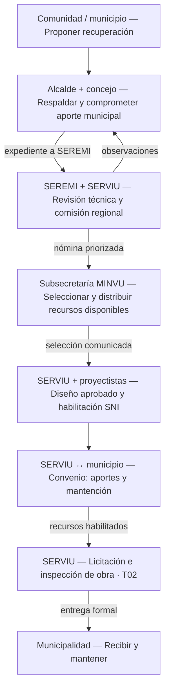

**Iniciativa y postulación.** Puede originarse en la municipalidad o comunidad organizada. La municipalidad postula a SEREMI y compromete el aporte aprobado por el concejo.

**Selección.** SEREMI y SERVIU informan técnicamente; comisión regional prioriza; Subsecretaría MINVU determina selección y distribución de recursos. SEREMI comunica el resultado.

**Diseño y ejecución.** El circuito regular contempla diseño gestionado por SERVIU y posterior habilitación de ejecución. Un llamado puede admitir proyectos con diseño aprobado; verificar sus condiciones.

**Mantención.** El DS 312 excluye la mantención del costo de obras. El convenio y compromiso municipal deben resolver la continuidad; no presentar este programa como un fondo permanente de aseo y riego.

**Fuentes:** [S13](https://www.bcn.cl/leychile/navegar?idNorma=257919), [S14](https://www.diariooficial.interior.gob.cl/publicaciones/2026/04/08/44419/01/2792214.pdf), [S15](https://www.bcn.cl/leychile/navegar?idNorma=1049524), [S05](https://www.gobiernosantiago.cl/wp-content/uploads/2026/04/Normas-Instrucciones-y-Procedimeintos-NIP-para-el-proceso-de-inversion-publica-2026.pdf).


## R08 · MINVU · Quiero Mi Barrio

Una plaza se incorpora al Plan de Gestión de Obras de un barrio seleccionado en el Programa de Recuperación de Barrios.

**Estandarización:** DS 14/2007 y reglas del proceso de selección y ejecución correspondiente.

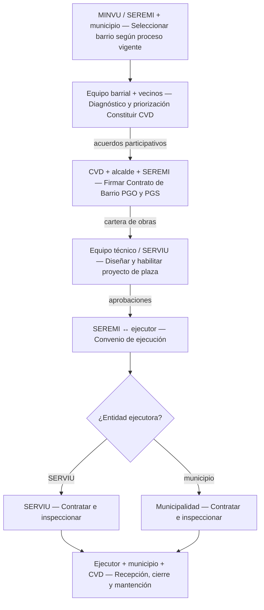

**Actor vecinal formal.** El Consejo Vecinal de Desarrollo representa a la comunidad en el Contrato de Barrio; este contrato también lo suscriben alcalde y SEREMI.

**Acuerdo central.** El Contrato de Barrio reúne obras y gestión social. La plaza no se tramita como una solicitud aislada y automática de cualquier junta de vecinos.

**Quién construye.** La entidad ejecutora puede ser SERVIU o municipio, según convenio y normativa. El equipo barrial facilita diagnóstico y participación; no reemplaza al ejecutor técnico.

**Continuidad.** Cierre del programa y agenda futura deben enlazarse con el responsable efectivo de operación. La participación vecinal no sustituye el presupuesto de mantención.

**Fuentes:** [S16](https://www.minvu.gob.cl/wp-content/uploads/2019/05/DS_14_07_Recuperacio%CC%81n-Barrios_ACT_24-05-2017.pdf), [S05](https://www.gobiernosantiago.cl/wp-content/uploads/2026/04/Normas-Instrucciones-y-Procedimeintos-NIP-para-el-proceso-de-inversion-publica-2026.pdf), [S07](https://sni.gob.cl/wp-content/uploads/RIS-Proyectos_Espacios_Publicos_2024.pdf).


## R09 · MINVU · DS 27, capítulo I

Equipamiento comunitario y espacios públicos mediante organizaciones y Entidad Patrocinante; aquí se consideran solo proyectos que dan lugar a espacios de uso público.

**Estandarización:** Procedimiento del llamado 2026, resolución 1.002; condiciones no extrapolables a otros años.

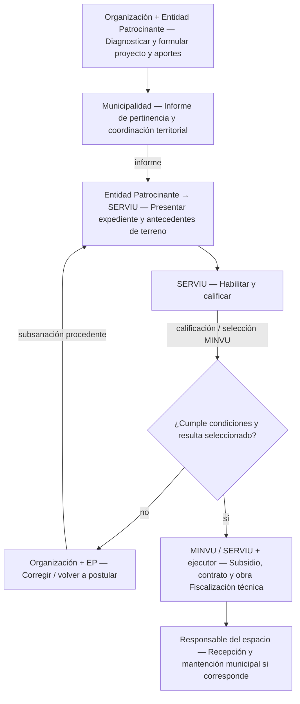

**Escala y acceso.** El llamado 2026 admite áreas verdes de hasta 1.800 m² en las condiciones del numeral 34. No todo equipamiento comunitario financiado es una plaza pública.

**Actores individuales.** Directiva de la organización; profesional de la Entidad Patrocinante; funcionario municipal competente para informar pertinencia; evaluador SERVIU y fiscalizador técnico de obras.

**Decisiones.** Municipio informa pertinencia y no duplicación; SERVIU habilita y califica; MINVU selecciona según recursos y reglas. La selección no la decide por sí sola la organización.

**Operación.** Acreditar terreno, acceso público y responsable de mantención. El subsidio y los aportes cubren el proyecto aprobado; no equivalen a financiamiento indefinido de mantenimiento.

**Fuentes:** [S17](https://www.leychile.cl/navegar?idNorma=1226221), [S01](https://www.bcn.cl/leychile/navegar?idNorma=251693).


## R10 · MINVU · inversión urbana programada

Plazas como parte de planes y proyectos urbanos: regeneración, planes maestros, proyectos urbanos integrales u otras líneas sectoriales habilitadas.

**Estandarización:** Síntesis del ciclo de inversión sectorial; no existe un concurso único que reúna todas estas líneas.

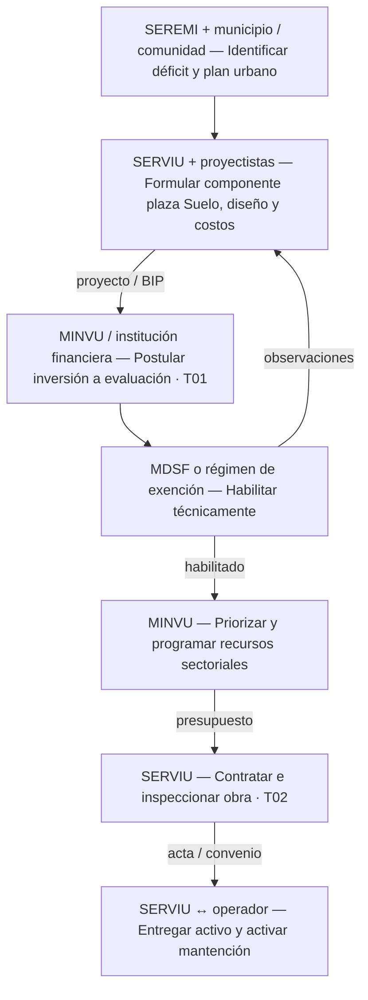

**Origen sectorial.** SEREMI coordina planificación y programación regional del sector; SERVIU desarrolla o contrata proyectos y ejecuta. Municipio y comunidad pueden participar en la definición territorial.

**Decisión presupuestaria.** MINVU incorpora inversiones a su programación y presupuesto; SNI resuelve la habilitación técnico-económica que corresponda. Un plan urbano no garantiza por sí solo el gasto.

**Variantes.** Puede haber aportes GORE o municipales y un convenio de programación. Eso agrega R22 sin eliminar las responsabilidades sectoriales.

**Después de la obra.** El convenio de entrega debe precisar quién administra suelo y equipamiento. No presumir que SERVIU mantendrá indefinidamente toda plaza que construye.

**Fuentes:** [S18](https://www.bcn.cl/leychile/navegar?idNorma=12617), [S19](https://www.bcn.cl/leychile/navegar?idNorma=13007), [S20](https://www.minvu.gob.cl/sobre-minvu/obras-urbanas/), [S05](https://www.gobiernosantiago.cl/wp-content/uploads/2026/04/Normas-Instrucciones-y-Procedimeintos-NIP-para-el-proceso-de-inversion-publica-2026.pdf), [S07](https://sni.gob.cl/wp-content/uploads/RIS-Proyectos_Espacios_Publicos_2024.pdf).


## R11 · MINVU · Pequeñas Localidades

Plaza incorporada al componente urbano de un Plan de Desarrollo de la Localidad; también comprende pequeñas ciudades elegibles.

**Estandarización:** DS 39/2015; elegibilidad y detalles se completan con el llamado aplicable.

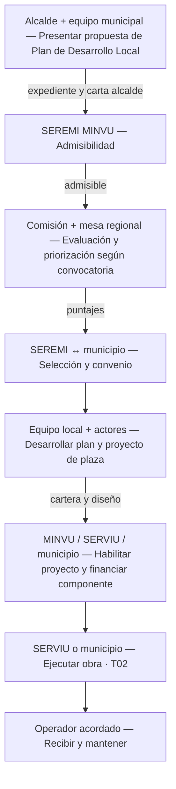

**Escala territorial.** Localidad o sistema de localidades de hasta 20.000 habitantes y demás condiciones del reglamento/listado y convocatoria. No es un fondo disponible para todas las ciudades.

**Selección.** SEREMI revisa admisibilidad; comisión evaluadora y mesa regional califican; SEREMI sanciona la selección y firma convenio con el municipio.

**Precisión institucional.** El texto base conserva una referencia a Intendente en la mesa regional. No se reemplaza aquí automáticamente por gobernador: se debe verificar la integración efectiva en el llamado y actos vigentes.

**Operación.** SERVIU o municipio puede ser entidad ejecutora de obras. El plan y convenio deben identificar al operador; otras instituciones pueden aportar al componente multisectorial.

**Fuentes:** [S21](https://www.bcn.cl/leychile/navegar?idNorma=1088984), [S05](https://www.gobiernosantiago.cl/wp-content/uploads/2026/04/Normas-Instrucciones-y-Procedimeintos-NIP-para-el-proceso-de-inversion-publica-2026.pdf).


## R12 · Seguridad Pública · recuperación de espacios

Proyecto de prevención situacional de la SPD, por ejemplo bajo el Sistema Nacional de Seguridad Municipal; la plaza responde a problemas de seguridad diagnosticados.

**Estandarización:** Asignación y convenio del programa + Orientaciones Técnicas 2026, tipología REP.

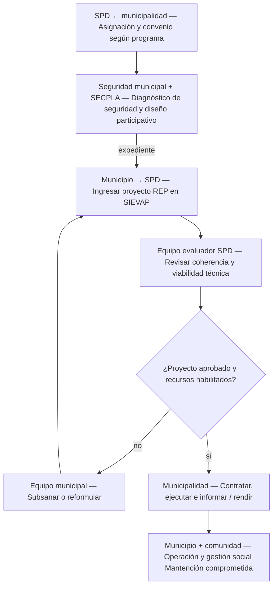

**Ministerio competente.** SPD pertenece al Ministerio de Seguridad Pública. El equipo municipal de seguridad trabaja con SECPLA y el equipo territorial.

**Entrada al circuito.** En SNSM se asignan recursos según el sistema correspondiente y se conviene con la municipalidad. No representarlo como un concurso libre universal de plazas.

**Comunicación.** Proyecto en SIEVAP: diagnóstico, focalización, diseño, presupuesto y sustentabilidad; SPD evalúa coherencia y viabilidad. Acta de validación comunitaria recomendada en REP 2026.

**Mantención.** La documentación REP exige compromiso alcaldicio o acuerdo del concejo cuando las obras requieren mantención y gastos operacionales. Esta obligación debe presupuestarse.

**Fuentes:** [S22](https://spd-seguridadmunicipal.cl/), [S23](https://spd-seguridadmunicipal.cl/wp-content/uploads/2026/06/Orientaciones-Tecncas-OOTT-2026.pdf), [S01](https://www.bcn.cl/leychile/navegar?idNorma=251693).


## R13 · SUBDERE · PRBIPE

Plaza incorporada en el Plan de Revitalización de un barrio atendido por el Programa de Revitalización de Barrios e Infraestructura Patrimonial Emblemática.

**Estandarización:** Guía operativa; cobertura focalizada, no una ventanilla genérica para cualquier plaza.

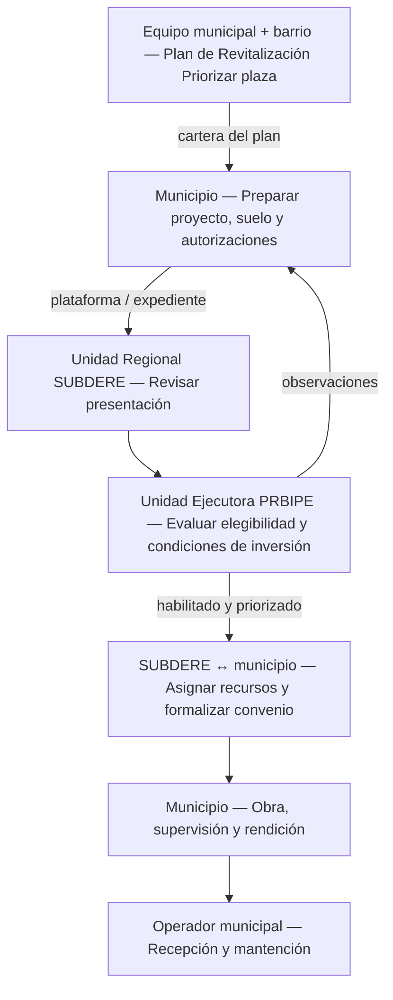

**Origen.** Equipo municipal y actores del barrio elaboran el plan; una plaza debe ser una iniciativa elegible de esa cartera.

**Revisión.** Municipio presenta; URS revisa y coordina; Unidad Ejecutora del Programa en SUBDERE evalúa. Se agregan evaluación SNI y autorización patrimonial cuando corresponde.

**Financiamiento.** La documentación histórica incluye BID. La descripción oficial informa que desde el término del préstamo en febrero de 2022 continúa con financiamiento nacional; no atribuir al BID toda obra actual.

**Continuidad.** La municipalidad contrata y gestiona la ejecución conforme a convenios; operación y mantención deben quedar asignadas al responsable del espacio.

**Fuentes:** [S24](https://www.subdere.gov.cl/sites/default/files/documentos/Guia%20Operativa%20PRBIPE.pdf), [S25](https://www.subdere.gov.cl/taxonomy/term/2387), [S05](https://www.gobiernosantiago.cl/wp-content/uploads/2026/04/Normas-Instrucciones-y-Procedimeintos-NIP-para-el-proceso-de-inversion-publica-2026.pdf), [S37](https://www.monumentos.gob.cl/tramites/autorizacion-intervencion-zonas-tipicas-pintorescas).


## R14 · SUBDERE · PREAVS

Programa de Recuperación de Espacios de Alto Valor Social: plaza dentro de un polígono e intervención habilitados por el programa.

**Estandarización:** Guía 2023 y glosa 10 de 2026; depende de focalización territorial y recursos.

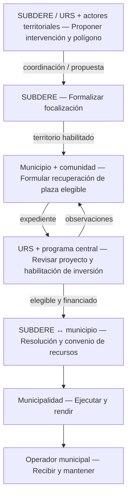

**Focalización.** Coordinación de SUBDERE/URS con delegación presidencial, municipio y actores territoriales; la delimitación se formaliza por SUBDERE.

**Vía de entrada.** Primero se habilita el territorio y la intervención. Luego el municipio formula proyectos; no basta una solicitud aislada de recuperar una plaza.

**Control.** Revisión URS y programa, evaluación SNI cuando procede, resolución y convenio de transferencia. Mantener separados elegibilidad y financiamiento.

**Después de la obra.** Municipio ejecuta, supervisa y rinde. El plan de recuperación debe enlazar las obras con su operación y mantención posterior.

**Fuentes:** [S26](https://www.subdere.gov.cl/sites/default/files/documentos/GUIA%20OPERACIONES%20PREAVS%2030.06.23%20RESOL%20N%C2%B06719%20(2).pdf), [S08](https://www.dipres.gob.cl/597/articles-396977_doc_pdf.pdf), [S05](https://www.gobiernosantiago.cl/wp-content/uploads/2026/04/Normas-Instrucciones-y-Procedimeintos-NIP-para-el-proceso-de-inversion-publica-2026.pdf).


## R15 · SUBDERE · Fondo de Recuperación de Ciudades

Intervenciones por emergencia o catástrofe, o por obsolescencia y deterioro funcional que impiden el uso adecuado del espacio.

**Estandarización:** Guía FRC + glosa 07 del presupuesto 2026.

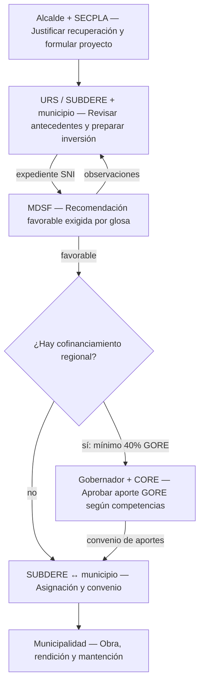

**Requisito técnico.** La glosa 2026 exige recomendación favorable del MDSF para los proyectos postulados por municipios o asociaciones. No suprimir esa puerta usando una exención genérica.

**Cambio anual relevante.** En 2026 los nuevos proyectos pueden cofinanciarse con el GORE; si se usa esa opción, su aporte debe ser de al menos 40%. No presentar el cofinanciamiento regional como obligatorio en todos los casos.

**Actos formales.** Oficio municipal, expediente y recomendación favorable; acuerdos regionales si hay aporte GORE; resolución SUBDERE y convenio de transferencia.

**Operación.** El financiamiento recupera el activo. Su recepción debe vincularse a un presupuesto y responsable de mantención.

**Fuentes:** [S27](https://www.subdere.gov.cl/sites/default/files/documentos/GUIA%20OPERATIVA%20FRC%20RESOL%20EX%20N%C2%B08988%20DE%2029.08.23.pdf), [S08](https://www.dipres.gob.cl/597/articles-396977_doc_pdf.pdf), [S05](https://www.gobiernosantiago.cl/wp-content/uploads/2026/04/Normas-Instrucciones-y-Procedimeintos-NIP-para-el-proceso-de-inversion-publica-2026.pdf), [S02](https://www.bcn.cl/leychile/navegar?idNorma=243771).


## R16 · SUBDERE · infraestructura con aporte reembolsable

Financiamiento reembolsable del programa conocido como Ciudades, para municipios y proyectos que cumplen los requisitos del DS 196 modificado.

**Estandarización:** Procedimiento financiero específico; no es una subvención disponible para cualquier comuna.

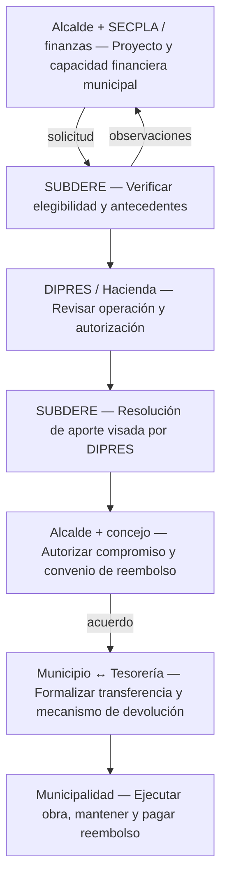

**Naturaleza del recurso.** El municipio recibe un aporte y lo devuelve mediante el mecanismo convenido con Tesorería. Debe considerar capacidad de pago y costos futuros de operar la plaza.

**Actores decisores.** SUBDERE revisa; DIPRES interviene en elegibilidad/autorización presupuestaria; alcalde requiere acuerdo de dos tercios del concejo para el convenio con TGR. El reembolso se descuenta del impuesto territorial de beneficio propio.

**Documento clave.** Expediente técnico-financiero, resolución de aporte visada por DIPRES, acuerdo del concejo y convenio con Tesorería.

**No confundir.** Este programa no es el aporte urbanístico reembolsable de la LGUC ni el Fondo de Recuperación de Ciudades de R15.

**Fuentes:** [S28](https://www.bcn.cl/leychile/navegar?idNorma=1031505), [S40](https://www.subdere.gov.cl/content/glosa-13), [S01](https://www.bcn.cl/leychile/navegar?idNorma=251693).


## R17 · MOP · espacio público en borde costero

Plaza, paseo o área de encuentro integrada a una intervención de mejoramiento del borde costero, fluvial o lacustre de la Dirección de Obras Portuarias.

**Estandarización:** Competencia sectorial DOP y ciclo de inversión pública; no es un programa MOP genérico para plazas interiores.

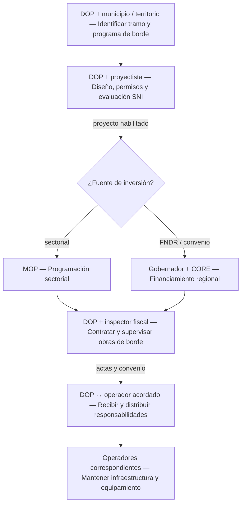

**Origen y coordinación.** DOP puede levantar una cartera con municipios, comunidad y región. El expediente debe resolver administración del suelo y autorizaciones del borde, según localización.

**Financiamiento.** Puede ser sectorial MOP o regional/FNDR; la segunda opción agrega las decisiones GORE y CORE. La fuente no cambia automáticamente la unidad técnica.

**Ejecución.** DOP contrata y un inspector fiscal controla la obra. Otros servicios MOP pueden actuar como mandatarios cuando tienen competencia; no suponer que todos financian plazas.

**Mantención.** El convenio debe repartir obligaciones: infraestructura costera y equipamiento urbano pueden tener operadores diferentes. No atribuir todo al municipio sin revisar la entrega.

**Fuentes:** [S29](https://dop.mop.gob.cl/project/infraestructura-de-mejoramiento-del-borde-costero/), [S05](https://www.gobiernosantiago.cl/wp-content/uploads/2026/04/Normas-Instrucciones-y-Procedimeintos-NIP-para-el-proceso-de-inversion-publica-2026.pdf), [S02](https://www.bcn.cl/leychile/navegar?idNorma=243771), [S42](https://www.bcn.cl/leychile/navegar?idNorma=233103).


## R18 · Plaza por obligación de urbanizar y ceder

Una urbanización genera áreas verdes de uso público, financiadas y ejecutadas por el urbanizador; puede tratarse de una iniciativa privada o pública.

**Estandarización:** LGUC y OGUC: cesiones, obras de urbanización y recepción.

```mermaid
flowchart TD
    a["Propietario + arquitecto / especialistas — Proyectar urbanización y cesiones exigidas"]
    b["DOM — Revisar proyecto y autorizar urbanización"]
    c["Urbanizador + contratista — Financiar y ejecutar áreas verdes y obras"]
    d["DOM / organismos competentes — Inspeccionar antecedentes y obras para recepción"]
    e{"¿Obras conformes?"}
    f["Urbanizador — Corregir observaciones"]
    g["DOM — Recepción definitiva Efectos del art. 135"]
    h["Municipio — Administrar espacio público y mantenerlo"]
    a -->|"expediente urbanístico"| b
    b -->|"permiso / aprobaciones"| c
    c -->|"solicitud de recepción"| d
    d --> e
    e -->|"no"| f
    f --> d
    e -->|"sí"| g
    g -->|"entrega e inventario"| h
```

**Quién inicia.** Propietario o urbanizador y sus profesionales. El director de Obras Municipales revisa y recibe conforme a reglas urbanísticas; el alcalde no sustituye esa decisión técnica.

**Qué se entrega.** La aprobación debe especificar cesiones y urbanización, incluidas las obras de ornato y áreas verdes que correspondan. Una reserva de área verde en el plan regulador no equivale a una plaza construida.

**Momento jurídico.** La recepción de urbanización produce los efectos de incorporación de espacios públicos que establece el art. 135 LGUC. Diferenciar entrega material de titularidad y administración.

**Mantención.** Una vez recibida y bajo administración municipal, debe incorporarse al inventario y servicio de áreas verdes. Un jardín interior de condominio no se vuelve plaza pública por su aspecto.

**Fuentes:** [S03](https://www.bcn.cl/leychile/navegar?idNorma=13560), [S04](https://www.bcn.cl/leychile/navegar?idNorma=8201), [S01](https://www.bcn.cl/leychile/navegar?idNorma=251693).


## R19 · Urbanización voluntaria

Una persona o entidad propone ejecutar obras voluntarias de urbanización en las condiciones de la OGUC, incluida una posible área verde pública.

**Estandarización:** OGUC art. 2.2.4 bis, incorporado por DS 5 publicado el 22-05-2026.

```mermaid
flowchart TD
    a["Interesado + profesionales — Proponer urbanización voluntaria"]
    b["Municipalidad — Resolver autorización previa de propuesta"]
    c{"¿Autorizada?"}
    d["Interesado — Ajustar o desistir"]
    e["DOM — Permiso y condiciones Garantías si corresponden"]
    f["Interesado / constructor — Ejecutar obras"]
    g["DOM — Verificar y recibir"]
    h["Municipio / administrador — Incorporar a operación y mantención"]
    a -->|"planos y memoria"| b
    b --> c
    c -->|"no"| d
    d -->|"nueva propuesta"| a
    c -->|"sí"| e
    e --> f
    f -->|"recepción"| g
    g --> h
```

**Paso previo.** Se requiere autorización previa municipal para la propuesta. Luego se tramitan permiso y condiciones técnicas; el financista privado no decide unilateralmente sobre un bien público.

**Expediente.** Planos y memoria de la propuesta; autorización; permiso de urbanización y garantías cuando proceden; ejecución completa y recepción.

**Efectos diferenciados.** Si se urbaniza suelo del interesado con cesiones, se producen los efectos legales pertinentes al recibir. Si se interviene un BNUP existente, no hay que inventar una nueva cesión del mismo suelo.

**Alcance.** Aportes de una fundación o empresa deben encauzarse en un instrumento jurídico y permisos concretos. No se asume un procedimiento nacional autónomo llamado adopta una plaza.

**Fuentes:** [S30](https://www.diariooficial.interior.gob.cl/publicaciones/2026/05/22/44455/01/2812169.pdf), [S04](https://www.bcn.cl/leychile/navegar?idNorma=8201), [S03](https://www.bcn.cl/leychile/navegar?idNorma=13560), [S01](https://www.bcn.cl/leychile/navegar?idNorma=251693).


## R20 · Aportes al espacio público en dinero

Recursos derivados de proyectos que generan aportes al espacio público se destinan a obras de los planes de inversiones comunales o intercomunales.

**Estandarización:** LGUC arts. 175-180; planificación y cuenta separada, no financiamiento libre para cualquier gasto.

```mermaid
flowchart TD
    a["Titular del proyecto — Pagar aporte urbanístico"]
    b["Municipalidad — Cuenta especial de aportes"]
    c{"¿Obra en plan comunal o intercomunal?"}
    d["SECPLA → concejo / alcalde — PIIMEP comunal Aprobación y promulgación"]
    e["SEREMI MINVU + MTT → GORE — Plan intercomunal Alcaldes, CORE y gobernador"]
    f["Municipio / ejecutor competente — Priorizar plaza y recursos Respetar destinos legales"]
    g["Ejecutor → municipio — Obra T02 y entrega Mantención posterior"]
    a -->|"aporte previo a recepción"| b
    b -->|"disponibilidad financiera"| f
    c -->|"comunal"| d
    c -->|"intercomunal"| e
    d -->|"cartera aprobada"| f
    e -->|"cartera aprobada"| f
    f -->|"presupuesto / convenio"| g
```

**Origen del dinero.** El titular paga el aporte antes de la recepción del proyecto o acto equivalente que fija la ley. El municipio recauda en cuenta especial y separada. Planificación y recaudación pueden avanzar en paralelo.

**Quién elabora el plan.** Plan comunal: municipio/asesor urbanista de SECPLA, con asistencia MINVU, MTT, SECTRA y SPD; concejo aprueba y alcalde promulga. Plan intercomunal: SEREMI MINVU y MTT, consulta municipal, conformidad de mayoría de alcaldes, CORE y gobernador.

**Restricción decisiva.** Al menos 70% del aporte neto de administración se invierte en movilidad. Si hay plan intercomunal, opera además su regla de 40%, modificable en los términos legales. No se puede destinar todo indiscriminadamente a plazas.

**Mantención.** El aporte financia destinos de inversión legalmente habilitados. La operación rutinaria de la plaza debe resolverse por su vía presupuestaria propia.

**Fuentes:** [S03](https://www.bcn.cl/leychile/navegar?idNorma=13560), [S01](https://www.bcn.cl/leychile/navegar?idNorma=251693), [S02](https://www.bcn.cl/leychile/navegar?idNorma=243771).


## R21 · Aportes materializados como obras

El titular propone ejecutar una obra de espacio público en cumplimiento de su aporte, por ejemplo una plaza coherente con el plan de inversiones.

**Estandarización:** LGUC art. 179; alternativa al pago en dinero, con presupuesto y aprobación previa.

```mermaid
flowchart TD
    a["Titular + proyectista — Proponer plaza como aporte y presupuesto detallado"]
    b["Municipalidad — Revisar coherencia y consultar competencias"]
    c{"¿Requiere acuerdos o informes adicionales?"}
    d["Alcalde / concejo; SEREMI — Acuerdo por obra fuera de plan Informe intercomunal si aplica"]
    e["Municipalidad — Aprobar propuesta y presupuesto"]
    f["Titular + constructor — Obtener permisos y ejecutar obra"]
    g["DOM / órganos competentes — Recepción y acreditación del aporte cumplido"]
    h["Administrador del espacio — Operar y mantener"]
    a -->|"solicitud por sistema"| b
    b -->|"observaciones"| a
    b --> c
    c -->|"sí"| d
    c -->|"no"| e
    d --> e
    e --> f
    f -->|"antes de recepción principal"| g
    g --> h
```

**Aprobación municipal.** La municipalidad aprueba, rechaza u observa, previa consulta a órganos competentes. Si la propuesta no está en el plan, pero es coherente con él, el alcalde la somete al concejo.

**Nivel intercomunal.** Requiere informe favorable de las SEREMI MINVU y MTT en los supuestos intercomunales previstos en la ley.

**Momento de ejecución.** La obra debe ejecutarse antes de la recepción del proyecto que origina el aporte. El presupuesto aprobado fija el valor reconocido conforme al régimen legal.

**Distinción necesaria.** No mezclar este aporte con las mitigaciones directas obligatorias del proyecto ni con la urbanización y cesión ordinaria de R18.

**Fuentes:** [S03](https://www.bcn.cl/leychile/navegar?idNorma=13560), [S04](https://www.bcn.cl/leychile/navegar?idNorma=8201).


## R22 · Cofinanciamiento y convenios de programación

Una cartera o plaza combina recursos y compromisos de GORE, ministerios y eventualmente municipios; complementa otras rutas del catálogo.

**Estandarización:** Ley 19.175 arts. 81 y 81 bis; ley municipal arts. 8 bis, 8 ter y 65.

```mermaid
flowchart TD
    a["GORE + ministerio + municipio — Acordar cartera, aportes y responsabilidades"]
    b["Gobernador → CORE — Someter convenio a aprobación"]
    c["Ministerio / municipio — Aprobaciones propias y acuerdos pertinentes"]
    d["Instituciones firmantes — Formalizar convenio según modalidad legal"]
    e["Financiadores + formuladores — Habilitar cada proyecto Evaluación y presupuesto anual"]
    f["Financiador ↔ unidad técnica — Convenio de ejecución Mandato / transferencia"]
    g["Unidad ejecutora → operador — Obra T02 y mantención según obligaciones pactadas"]
    a --> b
    a --> c
    b -->|"acuerdo"| d
    c -->|"autorización"| d
    d --> e
    e --> f
    f --> g
```

**No es otro fondo.** Un convenio de programación organiza compromisos y calendario. Cada proyecto conserva su fuente, evaluación, habilitación presupuestaria y ejecutor.

**Actores políticos.** Gobernador propone; CORE aprueba el convenio regional. Ministros y alcaldes concurren en sus competencias, con los acuerdos municipales pertinentes.

**Actos y documentos.** Cartera, montos, metas, plazos, evaluación y formalización del convenio. El convenio de programación del art. 81 se sanciona por decreto supremo; otras modalidades tienen reglas propias.

**Riesgo institucional real.** Un acuerdo plurianual debe materializarse en asignaciones presupuestarias y convenios de ejecución. El anuncio o la firma política no equivalen a una licitación financiada.

**Fuentes:** [S02](https://www.bcn.cl/leychile/navegar?idNorma=243771), [S01](https://www.bcn.cl/leychile/navegar?idNorma=251693), [S05](https://www.gobiernosantiago.cl/wp-content/uploads/2026/04/Normas-Instrucciones-y-Procedimeintos-NIP-para-el-proceso-de-inversion-publica-2026.pdf).


## R23 · Acción Local · intervenciones comunitarias menores

FOSIS puede apoyar recuperación o equipamiento comunitario de pequeña escala dentro de un plan local; no se acredita aquí una convocatoria nacional 2026 específica de plazas.

**Estandarización:** Secuencia documentada en bases regionales Acción Local 2023 y anexos metodológicos. No extrapolar plazos ni montos al presente.

```mermaid
flowchart TD
    a["FOSIS regional + ejecutor — Definir intervención territorial del programa"]
    b["Grupo motor + comunidad — Diagnóstico y Plan de Desarrollo Local"]
    c["Ejecutor + municipio — Verificar pequeña obra Suelo, permisos y costos"]
    d["FOSIS / programa — Aprobar inversión elegible según bases y convenio"]
    e["Ejecutor + comunidad — Materializar intervención y rendir recursos"]
    f["Comunidad + administrador — Acuerdos de cuidado y mantención"]
    a --> b
    b -->|"prioridad del plan"| c
    c -->|"ajustes de viabilidad"| b
    c -->|"propuesta"| d
    d --> e
    e --> f
```

**Uso de esta ficha.** Se incluye para no omitir la intervención de Desarrollo Social/FOSIS, pero fuera del núcleo de procedimientos nacionales vigentes acreditados. Se requiere verificar bases y convenio del territorio concreto.

**Actor comunitario.** Grupo motor y comunidad diagnostican y priorizan. Un ejecutor del programa apoya formulación y ejecución; FOSIS supervisa el instrumento.

**Límite jurídico.** La priorización vecinal no autoriza por sí sola obras en un BNUP. Hay que coordinar propietario/administrador y permisos municipales.

**Continuidad.** Un compromiso comunitario de cuidado no sustituye la competencia municipal de administrar áreas verdes públicas. Deben quedar claras las tareas y recursos de cada parte.

**Fuentes:** [S39](https://repositorio.fosis.gob.cl/server/api/core/bitstreams/9ab6e82e-c044-4564-8a52-755511ab420a/content), [S01](https://www.bcn.cl/leychile/navegar?idNorma=251693), [S03](https://www.bcn.cl/leychile/navegar?idNorma=13560).


## R24 · Mantención municipal con ejecución directa

Riego, limpieza, jardinería, podas y reparaciones menores se programan y ejecutan con personal e insumos municipales, dentro de sus competencias y recursos.

**Estandarización:** Competencia nacional: ley municipal art. 25. Organización operativa y registros: reglamentos y prácticas locales.

```mermaid
flowchart TD
    a["Recepción de obra / vecinos / inspectores — Inventario y detección de necesidades"]
    b["Jefatura de áreas verdes — Programar tareas, frecuencias y recursos"]
    c["Alcalde + concejo — Presupuesto operativo y dotación autorizada"]
    d["Supervisor + cuadrillas — Riego, aseo, jardinería y reparaciones menores"]
    e["Inspector / jefatura — Verificar estado y cumplimiento"]
    f{"¿Basta la mantención habitual?"}
    g["SECPLA / unidad de proyectos — Formular conservación o inversión mayor"]
    a --> b
    b -->|"necesidades presupuestarias"| c
    c -->|"recursos e instrucciones"| d
    d -->|"registro de trabajos"| e
    e --> f
    f -->|"sí: nuevo ciclo"| b
    f -->|"no"| g
    g -->|"activo recuperado"| a
```

**Actor responsable.** Director o jefatura de Aseo y Ornato/Medio Ambiente/Áreas Verdes, según estructura local; supervisores y cuadrillas. SECPLA no dirige necesariamente el riego y la limpieza cotidiana.

**Decisión política.** Alcalde propone presupuesto; concejo aprueba. La incorporación de nuevas plazas aumenta necesidades de personal, agua, energía, equipos e insumos.

**Bucle de trabajo.** Inventario e inspección → programación → tareas → control → reprogramación. Es una reconstrucción funcional, no un formulario nacional obligatorio.

**Escalar el problema.** Si el deterioro exige reposición o mejoramiento integral, se formula inversión por R01-R22; si cumple el proceso de conservación, R26/R27. No denominar toda remodelación mantención menor.

**Fuentes:** [S01](https://www.bcn.cl/leychile/navegar?idNorma=251693), [S32](https://www.munistgo.cl/direccion-de-operaciones/).


## R25 · Mantención municipal contratada

Una empresa presta servicios de áreas verdes bajo contrato o, si se adopta esa figura, concesión municipal con sus requisitos específicos.

**Estandarización:** Ley municipal + régimen vigente de contratación; bases locales definen exigencias e inspección.

```mermaid
flowchart TD
    a["Áreas verdes + finanzas — Inventario, niveles de servicio y presupuesto aprobado"]
    b["Unidad de compras / SECPLA — Bases y licitación según régimen aplicable"]
    c["Comisión → alcalde / concejo — Evaluación y adjudicación Acuerdos si corresponden"]
    d["Municipio ↔ empresa — Contrato e inicio Inspector designado"]
    e["Empresa + supervisor — Ejecutar servicios según programación"]
    f["Inspector municipal — Comprobar prestaciones"]
    g{"¿Servicio conforme?"}
    h["Empresa / municipio — Corregir y tramitar medidas contractuales"]
    i["Finanzas municipales — Pagar prestación certificada y continuar ciclo"]
    a --> b
    b -->|"ofertas"| c
    c -->|"decreto / contrato"| d
    d --> e
    e -->|"informe de servicio"| f
    f --> g
    g -->|"no"| h
    h -->|"subsanación"| f
    g -->|"sí"| i
    i -->|"siguiente período"| e
```

**Quién define y contrata.** Unidad de áreas verdes fija inventario y estándares; abastecimiento/SECPLA y asesoría jurídica tramitan bases. Comisión evalúa ofertas; alcalde dicta adjudicación.

**Concejo.** Interviene en presupuesto, contratos/convenios de 500 UTM o más, compromisos que exceden período alcaldicio y concesiones en los términos del art. 65. No todo servicio externalizado es jurídicamente una concesión.

**Quién controla.** Administrador e inspector del contrato comprueban prestación. La empresa ejecuta; la municipalidad conserva responsabilidad de administración y control.

**Pago y correcciones.** Certificación de cumplimiento habilita pago; observaciones, descuentos o multas se tramitan según bases y procedimiento. El ejemplo Las Condes 2024 ilustra la operación, no fija un modelo obligatorio nacional.

**Fuentes:** [S01](https://www.bcn.cl/leychile/navegar?idNorma=251693), [S31](https://www.bcn.cl/leychile/navegar?idNorma=1209290), [S33](https://archivos.lascondes.cl/descargas/transparencia/adquisiciones/2024/licitaciones/Bases_2560-19-LR24.pdf).


## R26 · Conservación con financiamiento regional o mixto

Intervenciones para mantener o restituir capacidad de un activo existente con financiamiento GORE o mixto regional-sectorial.

**Estandarización:** Instructivo SNI 2026, sección 1, remite expresamente a Circular 33/2009 de Hacienda o su reemplazante para estos casos.

```mermaid
flowchart TD
    a["Municipio / servicio técnico — Diagnóstico y expediente de conservación"]
    b["GORE — Analizar clasificación y requisitos aplicables"]
    c{"¿Conservación regional o mixta admisible?"}
    d["Formulador — Corregir o tramitar como otra inversión · T01"]
    e["Gobernador / CORE — Asignar recursos según competencias"]
    f["GORE ↔ ejecutor — Identificación presupuestaria y convenio"]
    g["Unidad ejecutora — Contratar y conservar Recepción y rendición"]
    h["Operador del espacio — Retomar mantención habitual"]
    a -->|"carpeta técnica"| b
    b --> c
    c -->|"no"| d
    d -->|"si procede"| a
    c -->|"sí"| e
    e --> f
    f --> g
    g --> h
```

**Diferencia decisiva.** En este circuito el GORE analiza e identifica directamente las conservaciones regionales y mixtas, cualquiera sea el porcentaje regional. No insertar por rutina una obtención de RS sectorial ante MDSF.

**Clasificación.** Diagnosticar deterioro y justificar que se trata de conservación. Si aumenta capacidad o se busca principalmente elevar el estándar, corresponde revisar la clasificación como mejoramiento u otro proceso.

**Documento de enlace.** Memoria, presupuesto, antecedentes técnicos y respaldo de clasificación; pronunciamiento regional, asignación e identificación, convenio con ejecutor. Aplicar instrucciones regionales vigentes.

**Después de ejecutar.** La obra repone condiciones de funcionamiento; el operador debe seguir financiando riego, aseo y demás mantención. El gasto de conservación no reemplaza ese ciclo.

**Fuentes:** [S34](https://sni.gob.cl/wp-content/uploads/Instructivo-para-Proyectos-de-Conservacion-2026.pdf), [S02](https://www.bcn.cl/leychile/navegar?idNorma=243771), [S05](https://www.gobiernosantiago.cl/wp-content/uploads/2026/04/Normas-Instrucciones-y-Procedimeintos-NIP-para-el-proceso-de-inversion-publica-2026.pdf).


## R27 · Conservación con financiamiento sectorial

Proyecto de infraestructura pública existente que solicita financiamiento sectorial y se tramita bajo el instructivo de conservación SNI 2026.

**Estandarización:** Procedimiento nacional 2026 para inversión sectorial y empresas públicas; no trasladar automáticamente a GORE.

```mermaid
flowchart TD
    a["Servicio / profesional competente — Diagnosticar daño y valorar activo"]
    b["Institución financiera — Oficio, BIP y certificado Memoria y expediente"]
    c["MDSF / SEREMI — Admisibilidad y análisis de conservación"]
    d{"¿Clasificación y antecedentes conformes?"}
    e["Formulador — Subsanar o reclasificar"]
    f["Financiador sectorial — Resultado habilitante y asignación presupuestaria"]
    g["Unidad ejecutora — Contratar conservación y recibir trabajos"]
    h["Operador — Mantención habitual"]
    a --> b
    b --> c
    c --> d
    d -->|"no"| e
    e -->|"correcciones"| b
    d -->|"sí"| f
    f --> g
    g --> h
```

**Criterio de entrada.** Mantener o restituir capacidad sin aumentarla ni modificar magnitud o programa. El instructivo exige, como regla, conservación ≥80% del costo y costo total ≤30% de reposición del activo; revisar excepciones aplicables.

**Plaza como activo.** En espacios abiertos se define el polígono funcionalmente indivisible y autosuficiente. No fragmentar artificialmente el activo para encajar en límites.

**Control MDSF.** Institución financiera presenta oficio y BIP, certificado, memoria, presupuesto, planos y especificaciones. MDSF verifica clasificación y coherencia y emite el resultado; no exige indicadores de rentabilidad social propios de una obra nueva.

**Salida del proceso.** Si la finalidad es elevar el estándar, ampliar o transformar integralmente, tramitar la inversión como mejoramiento, ampliación u otro proceso correspondiente. Luego de conservar, mantener.

**Fuentes:** [S34](https://sni.gob.cl/wp-content/uploads/Instructivo-para-Proyectos-de-Conservacion-2026.pdf), [S05](https://www.gobiernosantiago.cl/wp-content/uploads/2026/04/Normas-Instrucciones-y-Procedimeintos-NIP-para-el-proceso-de-inversion-publica-2026.pdf), [S07](https://sni.gob.cl/wp-content/uploads/RIS-Proyectos_Espacios_Publicos_2024.pdf).


## R28 · MINVU · conservación de parques urbanos

Programa DS 112 para parques existentes de más de dos hectáreas, gratuitos y elegibles; límite relevante frente al universo ordinario de plazas.

**Estandarización:** DS 112/2014 y resolución operativa 10.278/2017 modificada en 2020.

```mermaid
flowchart TD
    a["Municipio / asociación / GORE — Postular parque a SEREMI Aportes y autorización"]
    b["Comisión regional MINVU — Evaluar y priorizar"]
    c["MINVU central — Seleccionar según criterios y recursos"]
    d["SERVIU ↔ aportantes / propietario — Formalizar convenios y autorización de conservación"]
    e["SERVIU — Licitar y contratar servicios de conservación"]
    f["Empresa contratada — Labores rutinarias, estacionales y especiales"]
    g["SERVIU / inspección — Controlar cumplimiento y pagos contractuales"]
    h["Instituciones del convenio — Evaluar continuidad y renovar compromisos"]
    a -->|"expediente"| b
    b -->|"antecedentes faltantes"| a
    b -->|"lista priorizada"| c
    c -->|"selección"| d
    d -->|"convenio tramitado"| e
    e --> f
    f --> g
    g -->|"correcciones / nuevo período"| f
    g -->|"término / renovación"| h
```

**Quién postula.** Municipio, agrupación de municipios o GORE presenta a SEREMI, con aporte aprobado por concejo/CORE y autorización del propietario según corresponda.

**Selección y ejecución.** Comisión regional prioriza; nivel central determina selección conforme al reglamento. SERVIU materializa el programa y contrata las tareas de conservación.

**Convenio de largo plazo.** Se formalizan aportes y autorización del propietario; la resolución contempla período de nueve años renovable. No supone traspaso automático de dominio.

**Límite del mapa.** No aplica a toda plaza pequeña. La administración directa de parques de Parquemet tiene un régimen institucional diferente; no debe confundirse con mantención municipal general.

**Fuentes:** [S35](https://www.bcn.cl/leychile/navegar?idNorma=1073113), [S36](https://www.minvu.gob.cl/wp-content/uploads/2020/05/Res_10278_2017_Res_1449_2020.pdf), [S31](https://www.bcn.cl/leychile/navegar?idNorma=1209290).


## Alcance de uso

Los procesos no prueban motivaciones electorales, negociación informal ni tiempos efectivos. Para estudiar esas conductas se requieren expedientes, actas, series de proyectos o entrevistas. Las convocatorias y bases regionales deben verificarse para la plaza y año concretos. R23 es un antecedente complementario de alcance regional y anterior, no una certificación de procedimiento nacional 2026.

La exención de evaluación no elimina antecedentes, permisos ni controles. La recepción contractual, recepción urbanística y entrega al operador son actos distintos. Inaugurar no reemplaza recibir ni financiar la mantención.

## Fuentes primarias

### S01 · Ley 18.695, Orgánica Constitucional de Municipalidades; texto refundido DFL 1/2006

Arts. 5 c, 8, 21, 24, 25, 63, 65 y 82. Texto consolidado consultado el 06-11-2026.

https://www.bcn.cl/leychile/navegar?idNorma=251693

### S02 · Ley 19.175, Gobierno y Administración Regional; texto refundido DFL 1/2005

Arts. 23, 24, 36 e-f, 73, 78, 81 y 81 bis. Texto consolidado.

https://www.bcn.cl/leychile/navegar?idNorma=243771

### S03 · MINVU. Ley General de Urbanismo y Construcciones, DFL 458/1975

Arts. 70, 116, 134-135 y 175-182. Texto consolidado.

https://www.bcn.cl/leychile/navegar?idNorma=13560

### S04 · MINVU. Ordenanza General de Urbanismo y Construcciones, DS 47/1992

Arts. 2.2.4 bis, 2.2.5 y reglas de urbanización y recepción. Texto consolidado.

https://www.bcn.cl/leychile/navegar?idNorma=8201

### S05 · Hacienda y MDSF. Normas, Instrucciones y Procedimientos para el proceso de inversión pública 2026

NIP 2026; ámbito, ciclo, instituciones y análisis técnico-económico. Copia oficial GORE Santiago.

https://www.gobiernosantiago.cl/wp-content/uploads/2026/04/Normas-Instrucciones-y-Procedimeintos-NIP-para-el-proceso-de-inversion-publica-2026.pdf

### S06 · MDSF. Instructivo de proporcionalidad del Sistema Nacional de Inversiones, 2025

Nivel 0 y proyectos menores a 5.000 UTM; requisitos, exclusiones y registro BIP.

https://sni.gob.cl/wp-content/uploads/Instructivo_proporcionalidad_SNI_2025.pdf

### S07 · MDSF. Requisitos de Información Sectorial: proyectos de espacios públicos, 2024

Antecedentes de terreno, diseño, evaluación y operación. Documento enlazado por SNI al consultar.

https://sni.gob.cl/wp-content/uploads/RIS-Proyectos_Espacios_Publicos_2024.pdf

### S08 · DIPRES. Ley de Presupuestos 2026, SUBDERE, Programas de Desarrollo Local

Partida 05, capítulo 05, programa 03; especialmente glosas 05, 07 y 10. Prevalece para condiciones presupuestarias anuales.

https://www.dipres.gob.cl/597/articles-396977_doc_pdf.pdf

### S09 · SUBDERE. Guía operativa del Programa de Mejoramiento Urbano y Equipamiento Comunal

Edición publicada en 2024; líneas y apartado III: revisión técnica y administrativa. PDF escaneado, lectura asistida por OCR.

https://www.subdere.gov.cl/sites/default/files/documentos/Guia%20operativa%20PMU.pdf

### S10 · SUBDERE. Guía operativa del Fondo Regional de Iniciativa Local, 2024

Marco FRIL: distribución, formulación, evaluación y ejecución. PDF escaneado, lectura asistida por OCR.

https://www.subdere.gov.cl/sites/default/files/documentos/Guia%20Operativa%20FRIL%202024.pdf

### S11 · Gobierno de Santiago. Instructivo FRIL, resolución 694, 11-05-2026

Ejemplo de variación regional: llamado destinado a comunas rurales y vialidad/movilidad rural; no es una convocatoria genérica para plazas.

https://www.gobiernosantiago.cl/wp-content/uploads/2026/10/154-INSTRUCTIVO_FRIL_RES_N_694_F_11_05_2026-accesible.pdf

### S12 · Gobierno de Santiago. Circular 5, Proceso de inversión 2026

Diferenciación de carteras comunales y regionales. Ejemplo regional, no instrucción nacional.

https://www.gobiernosantiago.cl/wp-content/uploads/2026/10/152-Circular-5-Proceso-de-Inversion-2026-accesible.pdf

### S13 · MINVU. DS 312/2006, Programa de Espacios Públicos

Arts. 1-10; texto consolidado con modificación publicada el 08-04-2026.

https://www.bcn.cl/leychile/navegar?idNorma=257919

### S14 · MINVU. DS 27/2025, modifica DS 312/2006; publicación 08-04-2026

Cambio de foco a recuperación de áreas centrales deterioradas y mejora de obras existentes. Diario Oficial, CVE 2792214.

https://www.diariooficial.interior.gob.cl/publicaciones/2026/04/08/44419/01/2792214.pdf

### S15 · MINVU. Resolución exenta 1.596/2013, operaciones del Programa de Espacios Públicos

Texto consolidado consultado; postulación, diseño, selección, ejecución, aportes y convenio. Aplicar en concordancia con DS 312 vigente y llamado.

https://www.bcn.cl/leychile/navegar?idNorma=1049524

### S16 · MINVU. DS 14/2007, Programa de Recuperación de Barrios

Arts. 2, 7 y 8: Consejo Vecinal de Desarrollo, Contrato de Barrio y entidades ejecutoras. Texto MINVU actualizado al 24-05-2017.

https://www.minvu.gob.cl/wp-content/uploads/2019/05/DS_14_07_Recuperacio%CC%81n-Barrios_ACT_24-05-2017.pdf

### S17 · MINVU. Resolución exenta 1.002/2026, llamado DS 27, capítulo I

Llamado 2026: pertinencia municipal, habilitación, calificación, selección y áreas verdes de hasta 1.800 m², numeral 34.

https://www.leychile.cl/navegar?idNorma=1226221

### S18 · MINVU. DS 355/1976, Reglamento orgánico de los SERVIU

Facultades de urbanización, ejecución, contratación y administración; texto consolidado.

https://www.bcn.cl/leychile/navegar?idNorma=12617

### S19 · MINVU. DS 397/1976, Reglamento orgánico de las SEREMI

Planificación, coordinación y programación regional del sector; texto consolidado.

https://www.bcn.cl/leychile/navegar?idNorma=13007

### S20 · MINVU. Obras Urbanas

Catálogo oficial de líneas de inversión urbana y programas. Página consultada en noviembre de 2026.

https://www.minvu.gob.cl/sobre-minvu/obras-urbanas/

### S21 · MINVU. DS 39/2015, Programa para Pequeñas Localidades

Arts. 1-3 y 6-14: elegibilidad, selección regional, convenio, plan y ejecución municipal o SERVIU.

https://www.bcn.cl/leychile/navegar?idNorma=1088984

### S22 · SPD. Sistema Nacional de Seguridad Municipal

Asignación, convenios y presentación de proyectos municipales. Portal oficial.

https://spd-seguridadmunicipal.cl/

### S23 · SPD. Orientaciones Técnicas 2026

Sección Recuperación de Espacios Públicos: diagnóstico, SIEVAP, gestión y documentos; pp. internas 3-16 y 34-36 de esa sección.

https://spd-seguridadmunicipal.cl/wp-content/uploads/2026/06/Orientaciones-Tecncas-OOTT-2026.pdf

### S24 · SUBDERE. Guía operativa PRBIPE

Plan de Revitalización de Barrios, presentación municipal, URS y Unidad Ejecutora del Programa. Revisión de apartados iniciales y modificaciones, no de todos los anexos.

https://www.subdere.gov.cl/sites/default/files/documentos/Guia%20Operativa%20PRBIPE.pdf

### S25 · SUBDERE. Programa de Revitalización de Barrios e Infraestructura Patrimonial Emblemática

Descripción institucional; financiamiento nacional después del término del préstamo BID en febrero de 2022.

https://www.subdere.gov.cl/taxonomy/term/2387

### S26 · SUBDERE. Guía de operaciones PREAVS, resolución 6.719/2023

Polígono de intervención, coordinación territorial y postulación de iniciativas. PDF escaneado, apartados operativos leídos mediante OCR.

https://www.subdere.gov.cl/sites/default/files/documentos/GUIA%20OPERACIONES%20PREAVS%2030.06.23%20RESOL%20N%C2%B06719%20(2).pdf

### S27 · SUBDERE. Guía operativa Fondo de Recuperación de Ciudades, resolución 8.988/2023

Formulación, revisión y convenios. Para cofinanciamiento se usa la glosa 07 de 2026, no una exigencia histórica invariable.

https://www.subdere.gov.cl/sites/default/files/documentos/GUIA%20OPERATIVA%20FRC%20RESOL%20EX%20N%C2%B08988%20DE%2029.08.23.pdf

### S28 · Interior / SUBDERE. DS 196/2011, aportes reembolsables para iniciativas municipales de desarrollo de las ciudades

Reglamento del Programa de Inversión Desarrollo de las Ciudades, modificado por DS 1.015/2015. Arts. 1-4 y 9-15: SUBDERE, DIPRES, concejo, municipio y TGR.

https://www.bcn.cl/leychile/navegar?idNorma=1031505

### S29 · MOP, Dirección de Obras Portuarias. Infraestructura de mejoramiento del borde costero

Ámbito costero, fluvial y lacustre; financiamiento sectorial y FNDR.

https://dop.mop.gob.cl/project/infraestructura-de-mejoramiento-del-borde-costero/

### S30 · MINVU. DS 5/2026; publicación 22-05-2026

Incorpora OGUC art. 2.2.4 bis: urbanización voluntaria, autorización municipal, permiso y recepción.

https://www.diariooficial.interior.gob.cl/publicaciones/2026/05/22/44455/01/2812169.pdf

### S31 · Hacienda. DS 661/2024, reglamento de la Ley 19.886

Régimen vigente de compras y servicios; considerar reglas transitorias y regímenes especiales de contratos de obra pública.

https://www.bcn.cl/leychile/navegar?idNorma=1209290

### S32 · Municipalidad de Santiago. Dirección de Operaciones

Funciones locales de áreas verdes, programación, control y mantención. Ejemplo de organización municipal.

https://www.munistgo.cl/direccion-de-operaciones/

### S33 · Municipalidad de Las Condes. Bases licitación 2560-19-LR24, 2024

Mantención, conservación y reposición de áreas verdes: bases administrativas y técnicas. Evidencia de una implementación, no regla nacional.

https://archivos.lascondes.cl/descargas/transparencia/adquisiciones/2024/licitaciones/Bases_2560-19-LR24.pdf

### S34 · Hacienda y MDSF. Instructivo para proyectos de conservación de infraestructura pública, 2026

Secciones 1-8 y 11-12. Distingue inversión sectorial de regional/mixta; esta última remite a Circular 33/2009 o reemplazante.

https://sni.gob.cl/wp-content/uploads/Instructivo-para-Proyectos-de-Conservacion-2026.pdf

### S35 · MINVU. DS 112/2014, Programa de Conservación de Parques Urbanos

Arts. 1-10: parques de más de dos hectáreas, gratuidad, aportes, selección y SERVIU.

https://www.bcn.cl/leychile/navegar?idNorma=1073113

### S36 · MINVU. Resolución 10.278/2017, modificada por resolución 1.449/2020

Aplicación DS 112: convenios con propietarios, período de nueve años renovable y contratación de servicios.

https://www.minvu.gob.cl/wp-content/uploads/2020/05/Res_10278_2017_Res_1449_2020.pdf

### S37 · Consejo de Monumentos Nacionales. Autorización de intervención en Zonas Típicas o Pintorescas

Control condicionado a protección patrimonial; no intervención obligatoria en toda plaza.

https://www.monumentos.gob.cl/tramites/autorizacion-intervencion-zonas-tipicas-pintorescas

### S38 · Servicio de Evaluación Ambiental. Pertinencia de ingreso al SEIA

Consulta de pertinencia y obligación de evaluar según tipologías; no ingreso automático por tratarse de una plaza.

https://www.sea.gob.cl/pertinencia-de-ingreso-al-seia

### S39 · FOSIS. Bases Acción Local, Frutillar 2023, con anexos metodológicos

Alcance acotado: antecedente metodológico regional, no procedimiento nacional 2026 acreditado. Se usa solo para delimitar una vía complementaria.

https://repositorio.fosis.gob.cl/server/api/core/bitstreams/9ab6e82e-c044-4564-8a52-755511ab420a/content

### S40 · SUBDERE. Informe de glosa 13, Programa Desarrollo de las Ciudades, 2026

Página oficial de rendición presupuestaria del programa de préstamos; confirma su presencia en el presupuesto 2026.

https://www.subdere.gov.cl/content/glosa-13

### S41 · MINVU. DS 236/2002, Bases generales reglamentarias de contratación de obras SERVIU

Arts. 1-2 y régimen de ejecución, fiscalización y recepción; texto con modificaciones de 2023.

https://www.bcn.cl/leychile/navegar?idNorma=211854

### S42 · MOP. DS 75/2004, Reglamento para contratos de obras públicas

Arts. 1-2 y reglas de inspección fiscal y recepción; texto consolidado consultado.

https://www.bcn.cl/leychile/navegar?idNorma=233103
