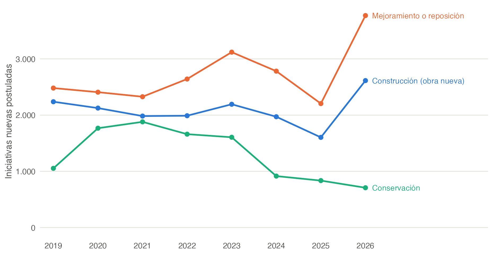

# Felipe: inaugurar o mantener

Primer borrador, 30 de octubre de 2026.

## 1. Idea básica

**Pregunta.** ¿Por qué el gasto municipal se inclina por inaugurar obras nuevas (plazas, sedes, luminarias) y descuida su mantención? ¿Se inclina más cuando el horizonte del alcalde es corto, por ejemplo en año electoral o en su último mandato permitido?

**La intuición.** Una obra nueva se inaugura, se ve y se le atribuye al alcalde antes de la elección. Mantener lo que ya existe rinde después y casi no se ve: una plaza bien cuidada no tiene ceremonia. Si el alcalde no está seguro de seguir en el cargo, le conviene lo que rinde ahora.

**Por qué es buena pregunta para el curso.** Es el problema del capítulo 2 (horizonte de apropiación, Dal Bó y Rossi) aplicado a una decisión concreta. Chile ofrece variación en el horizonte: el ciclo electoral y el límite de reelección de los alcaldes (Ley 21.238).

## 2. Datos

**Fuentes.**

- *Banco Integrado de Proyectos (BIP).* Registra las iniciativas de inversión pública que postulan a financiamiento. El Ministerio de Desarrollo Social publica un CSV por año (2019 a 2027) en <https://bid-ckan.ministeriodesarrollosocial.gob.cl/dataset/registro-de-proyectos-de-inversion>. Cada iniciativa se nombra como "proceso + objeto + lugar" ("CONSTRUCCION PLAZA...", "CONSERVACION AREAS VERDES..."), así que la primera palabra dice si es obra nueva, mejoramiento o conservación.
- *SINIM.* Plazas, parques y áreas verdes con mantención (stock y metros cuadrados), gasto en mantención de jardines e inversión municipal, por comuna y año.

**Archivos.**

| Archivo | Qué es |
|---|---|
| `scripts/01_descargar_bip.R` | Descarga el BIP año por año, clasifica cada iniciativa por tipo de obra y arma el panel. |
| `scripts/02_extraer_sinim.R` | Extrae las variables de SINIM del proyecto desde el panel de la ayudantía. |
| `scripts/03_figura1_bip.R` | Hace la Figura 1. |
| `datos/bip_municipal.csv.gz` | Una fila por iniciativa con responsable municipal (70.273 filas, años presupuestarios 2019 a 2027). |
| `datos/bip_panel_comuna_anio.csv` | Iniciativas municipales por comuna, año y tipo de obra: número, nuevas, de espacio público y costo total. |
| `datos/sinim_felipe.csv` | Variables de SINIM por comuna y año (345 comunas, 2001 a 2025). |

Para volver a descargar todo, desde esta carpeta:

```
Rscript scripts/01_descargar_bip.R cache/ datos/
Rscript scripts/02_extraer_sinim.R ../../playground/datos-apoyo/sinim/sinim_panel_largo.csv datos/
Rscript scripts/03_figura1_bip.R datos/bip_municipal.csv.gz figs/
```

**Tipos de obra en el BIP (iniciativas municipales, 2019 a 2027).**

| Tipo | Primera palabra del nombre | N.º |
|---|---|---:|
| Obra nueva | CONSTRUCCION, INSTALACION | 21.311 |
| Mejoramiento | MEJORAMIENTO, REPOSICION, AMPLIACION, HABILITACION, NORMALIZACION, RESTAURACION, RECUPERACION | 27.319 |
| Conservación | CONSERVACION, MANTENCION, MANTENIMIENTO, REPARACION | 11.386 |
| Otro | estudios, adquisiciones, programas, transferencias | 10.257 |

**Variables de SINIM** (`datos/sinim_felipe.csv`): número y metros cuadrados de plazas y de parques urbanos (desde 2010), metros cuadrados de áreas verdes con mantención (total y por habitante), gasto en mantención de jardines, inversión municipal, población, porcentaje rural, ingresos municipales y Fondo Común Municipal.

**Advertencias.**

- El BIP no registra todas las obras con fondos propios del municipio. En 2024, casi todas las iniciativas municipales (7.599 de 8.270) postulaban al FNDR.
- Una iniciativa aparece en cada año en que pide recursos. Para contar obras distintas, usar las marcadas como `NUEVO` (primera postulación) o el código BIP.
- La clasificación por la primera palabra es automática; conviene revisar una muestra a mano.
- 267 iniciativas no tienen una comuna válida.
- SINIM es autoinformado, y el stock de plazas se corrige con rezagos, lo que genera saltos.
- Los montos son nominales y hay que deflactarlos.

**Otros datos posibles.**

- *Permisos de edificación del INE* (2002 a 2024, uno por fila, con mes y comuna). Incluyen obras cuyo propietario es la municipalidad: 710 en 2024.
- *Registro de transferencias de la Ley 19.862.* Transferencias de los gobiernos regionales (FRIL) y de SUBDERE a los municipios, con el objetivo en texto. Los datos de los gobiernos regionales ya están en `proyects/abraham/datos/`.
- *SINIM, otras mantenciones.* Gasto en mantención de alumbrado público, semáforos y señalización (IADM93, IADM94, IADM95); falta descargarlas.

**Pendiente: datos electorales.** Se necesitan los resultados de alcalde por comuna (2012, 2016, 2021 y 2024) y saber quién repostuló o estaba impedido. Servel los publica en Power BI (los mismos que necesitan Camila y Abraham).

## 3. Figura 1



**Figura 1.** Iniciativas municipales nuevas (primera postulación) en el BIP, por año presupuestario y tipo de obra. La figura describe los datos; no controla por nada.

## 4. Precisiones institucionales (resumen)

1. **Quién paga la obra.** Muchas obras municipales se financian con fondos externos: el FNDR y el FRIL del gobierno regional, y programas de SUBDERE (PMU, PMB) y del MINVU. Para postular a esos fondos, la obra entra al BIP. Lo que el municipio hace solo con fondos propios puede no aparecer.
2. **Dos tipos de mantención.** La mantención de rutina (riego, poda, aseo de plazas) se contrata como servicio y es gasto corriente; en SINIM aparece como gasto en mantención de jardines. La "conservación" del BIP es otra cosa: reparaciones mayores que se financian como inversión.
3. **No toda plaza nueva es una obra municipal.** La Ley General de Urbanismo y Construcciones obliga a los loteos a ceder terrenos para áreas verdes, así que una plaza nueva puede venir de una inmobiliaria.
4. **Elecciones municipales.** Octubre de 2012, octubre de 2016, mayo de 2021 (postergada por la pandemia) y octubre de 2024.
5. **Límite de reelección.** Desde la Ley 21.238 (2020), un alcalde puede reelegirse a lo más dos veces seguidas. Unos 69 alcaldes no pudieron repostular en 2024 (estimación de prensa, no es un conteo oficial).

## 5. El modelo (lo básico)

Usaremos el modelo de **actividades con distintos horizontes de retorno** del capítulo 2, que es la base de **Dal Bó y Rossi (2011)**. Allí, una actividad rinde rápido y otra rinde lento; el alcalde valora el futuro con $\delta$, pero solo se apropia de lo que rinde después con probabilidad $p$.

**Jugadores.**

- Un alcalde, con un presupuesto de inversión $B$ para su período.

**Instrumentos.**

- $k$: obras nuevas (rápidas y visibles: se inauguran antes de la elección), con costo unitario $c_k$.
- $m$: mantención y conservación de lo que ya existe (rinde después y casi no se ve), con costo unitario $c_m$.

La restricción presupuestaria es

$$
c_k\,k + c_m\,m = B .
$$

**Qué obtiene el alcalde.** Siguiendo la notación del capítulo 2,

$$
B_R(k) = b_k\,k, \qquad B_L(m) = \delta\,p\,b_m\,m ,
$$

donde $b_k$ es lo que le rinde inaugurar en este período, $b_m$ es el valor de un espacio público bien mantenido, que se materializa en el período siguiente, $\delta$ es su valoración del futuro y $p$ es la probabilidad de apropiarse de ese valor (seguir en el cargo, o que gobierne su coalición).

## 6. Qué debería predecir el modelo

Falta desarrollar el modelo: resolver el reparto entre $k$ y $m$ y ver cómo cambia con $p$. Lo que sigue es lo que el modelo debería poder decir al final, para tenerlo como meta.

1. **Horizonte corto, más inauguraciones.** Cuando $p$ baja, la proporción de obra nueva frente a mantención sube.
2. **Año electoral.** La proporción de obras nuevas sube en los años previos a la elección.
3. **Último mandato.** Un alcalde que no puede repostular tiene $p$ cercano a cero: debería inclinarse más hacia lo que rinde ahora. (Si lo que lo mueve es la reelección, también podría ocurrir lo contrario: sin elección, ya no le sirve inaugurar. El modelo tiene que decir cuál efecto domina.)
4. **Visibilidad.** El sesgo debería ser mayor donde inaugurar se ve más y mantener se ve menos.
5. **Explicación rival.** Si la obra nueva se paga con fondos externos y la mantención con fondos propios, el municipio prefiere obras nuevas aunque no haya política. El ciclo electoral y el límite de reelección solo importan en la explicación política.

## 7. Diseño del modelo de regresión

Por discutir. Debería tener:

- **Unidad de observación:** comuna y año.
- **Variable dependiente:** proporción de obra nueva frente a conservación y mejoramiento en el BIP; como complemento, el cambio en el stock de plazas y el gasto en mantención por metro cuadrado de SINIM.
- **Variables explicativas principales:** año electoral (o años que faltan para la elección) y si el alcalde puede repostular.
- **Controles:** población, ruralidad, ingresos propios, dependencia del Fondo Común Municipal y financiamiento externo disponible.
- **Efectos fijos:** comuna y año.
- **Muestra:** comunas con datos en todo el período; separar las obras de espacio público.
- **Errores estándar:** agrupados a nivel de comuna.
- **Pruebas de falsificación:** obras que no se inauguran (estudios, diseños) y comunas donde el alcalde se repostula sin competencia real.

## 8. Decisiones abiertas

1. **¿Qué cuenta como "mantener"?** ¿La conservación del BIP, el gasto corriente en mantención de SINIM o ambos?
2. **¿Solo espacio público o todas las obras?** Plazas y parques son el caso más claro; las demás obras dan más datos.
3. **¿Cómo medir el horizonte?** Año electoral, último mandato permitido, margen de la elección anterior.
4. **¿Cómo separar la explicación política de la financiera?** Fondos propios frente a externos.
5. **Lecturas:**
   - Dal Bó y Rossi (2011), "Term Length and the Effort of Politicians", *Review of Economic Studies* 78(4). Capítulo 2 del curso.
   - Ferraz y Finan (2011), "Electoral Accountability and Corruption: Evidence from the Audits of Local Governments", *American Economic Review* 101(4). El límite de mandato como variación en el horizonte (capítulo 4).
   - Drazen y Eslava (2010), "Electoral Manipulation via Voter-Friendly Spending: Theory and Evidence", *Journal of Development Economics* 92(1). Los gobernantes desplazan el gasto hacia lo visible antes de la elección.
   - Rogoff (1990), "Equilibrium Political Budget Cycles", *American Economic Review* 80(1).
   - Corvalán, Cox y Osorio (2018), sobre ciclos electorales en el gasto de los municipios chilenos (citado en el plan 02; falta confirmar la referencia completa).
